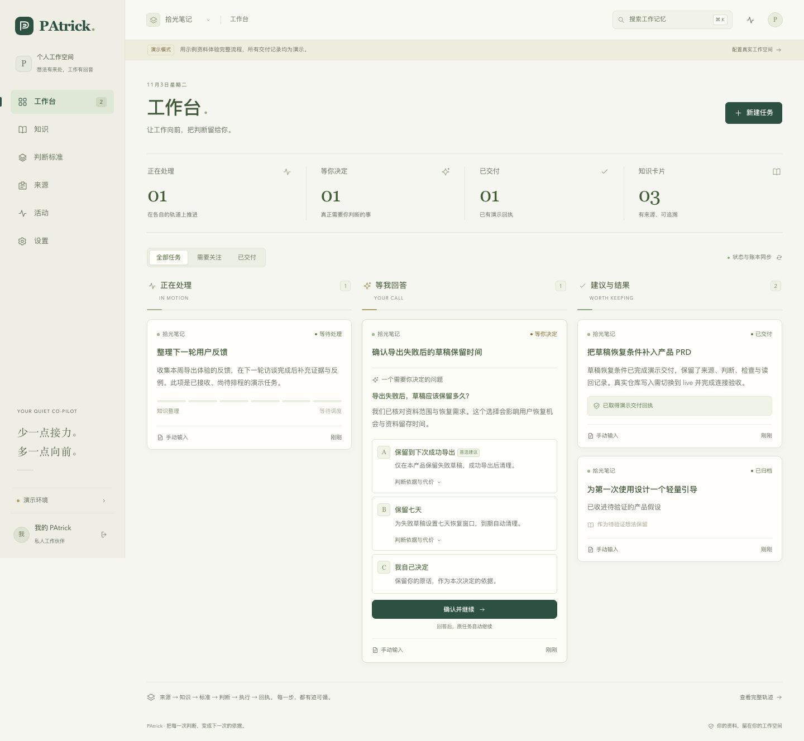

# PAtrick

PAtrick connects project evidence, your explicit decisions, and verifiable delivery. Its first workflow turns changes in one product's `productIdeas` directory into evidence-backed updates to that product's formal PRD. It asks only when a real choice remains, then resumes the same task after your answer.

[简体中文](README.zh-CN.md) · [Operations](docs/operations.md) · [Host setup](docs/deployment.md) · [Design](DESIGN.md) · [Detailed design](docs/designs/PAtrick详细设计.md) · [Acceptance evidence](docs/acceptance.md) · [Test report](docs/test-report.md)

The workbench has three columns: work in progress, questions waiting for you, and suggestions/results. Knowledge, personal standards, sources, activity, and connection settings have separate views. A task drawer keeps its evidence, worker attempts, question versions, and delivery receipt together.



This is one Node.js 24 / TypeScript ESM project: Hono server-rendered HTML, plain progressive JavaScript/CSS, better-sqlite3 with FTS5, Zod, Vitest, and Playwright. The service owns state and writes. Workers propose knowledge, decisions, plans, or isolated artifacts; a model's “done” message is never delivery proof.

## Try the local demo

Use Node **24**, including the Node binary used by background services:

```bash
nvm use 24
npm ci
PATRICK_HOST=127.0.0.1 PATRICK_DATA_DIR=/tmp/patrick-demo PATRICK_VAULT_DIR=/tmp/patrick-demo/vault npm run demo
```

Open the local URL printed at startup; the default port is `4317`. Demo mode uses sample data and replay workers. It does not modify remote repositories, and its sample receipts do not prove a live GitHub/Feishu/model integration. Playwright runs a separate demo on port `4318`.

Live is the default mode when `--demo` / `PATRICK_MODE=demo` is absent. A running local UI and passing tests are separate from live acceptance. [The checklist](docs/acceptance.md) records the difference; no external chain should be called ready until its prerequisites and actual receipts have been verified.

## Configure a live workspace

Copy [.env.example](.env.example) to a private `.env` and use [examples/patrick.config.json](examples/patrick.config.json) as the project configuration. Example runner policies are deliberately **not admitted** and `autoMerge` is **false**. Replace the source directory, owner identity, models, providers, costs, and runtime instance only with values verified for your environment.

The approved pilot target is `AlphaStrategyAI/PAtrick`, with `docs/product/PRD.md` as the only allowed output file and `validate` as the intended required check. The example `trustedAppIds: [15368]` is a GitHub Actions example: confirm the check's actual App ID through the repository API before enabling automatic merge. An allowed repository still needs a passing, current-head check and a policy permitting the intended merge.

Keep the active database, WAL, credentials, and runtime state **outside the synchronized workspace**. The default macOS data location is `~/Library/Application Support/PAtrick`; set an absolute `PATRICK_DATA_DIR` if you need another location. A local `.env` is not automatically loaded by every npm script. With Node 24, load it explicitly:

```bash
node --env-file=.env --import=tsx src/index.ts
```

For a compiled service:

```bash
npm run build
node --env-file=.env dist/index.js
```

For local live mode, startup creates a private `access-token` file inside `PATRICK_DATA_DIR` when no `PATRICK_TOKEN` was supplied. Read that file privately and use it at `/login`. You can instead generate and configure your own token:

```bash
node -e "process.stdout.write(require('node:crypto').randomBytes(32).toString('hex') + '\n')"
```

Store it in the private environment file. `PATRICK_SESSION_SECRET` can be set independently; otherwise the access token is used. Non-loopback access requires an explicit token of at least 24 characters before bootstrap, and should be available only through an authenticated private network. The browser login creates an HttpOnly session; API clients may send `Authorization: Bearer …` in a header. Do not put credentials in URLs, screenshots, task text, or Git.

## What live delivery needs

- A repository and exact allowed paths, trustworthy nonempty required checks/App IDs, and merge permission compatible with repository policy. Do not bypass independent human review.
- Grok Build, dsh ACP, and/or Codex noninteractive access admitted separately for each role, domain, model/provider, permissions, and cost. At least one admitted backup is needed to accept automatic fallback.
- Lima on the execution host, with no default host mounts or SSH agent forwarding, restricted egress, and isolated task copies. **Lima was not installed on the inspected host**; install and validate it before admitting live workers.
- A Feishu app, the owner's Open ID, private-chat delivery, verified callbacks, and permission to read history for offline catch-up.
- An approved bilingual search gateway. PAtrick queries Chinese and English and independently opens public HTTPS original sources; see the [exact gateway contract](docs/operations.md#search-gateway-contract).
- Authorized network paths, backup destination, and a recovery procedure that reconciles remote effects before retrying.

The default role sequence is Grok knowledge extraction / case extraction / decision, Codex planning, Grok execution, then Codex checking and feedback. Each role has admitted fallback candidates. A question has exactly A (recommended), B (alternative), and C (your own answer). Waiting releases the worker indefinitely. Two repair rounds are allowed; version or baseline changes require new planning/checking.

Delivery requires a bound review, successful trusted required checks at the current PR head, a merged commit, and a read-back of the target file at that merge SHA. The writer rechecks permissions and paths. An uncertain network outcome is reconciled with the remote object before another write.

## Development and checks

```bash
npm run dev
npm run typecheck
npm run test:unit
npm run test:integration
npm run build
npm run check
```

`npm run check` runs type checking, Vitest, the production build, and formal PRD structure validation. Browser tests are separate:

```bash
npx playwright install chromium
npm run test:e2e
```

The browser suite starts its demo server through `playwright.config.ts`. Do not use an unrelated existing process on port `4318` as test evidence. Record failures and skipped cases as well as passes. Tests and demo replay use independent data; they do not constitute the real zero-question / one-answer delivery acceptance.

Other local entry points:

```bash
npm run doctor
npm run backup
npm run report -- patrick
npm run mcp
```

For a private `.env`, use the Node invocations documented in [operations](docs/operations.md). `doctor` reports local/configuration readiness and missing prerequisites; it cannot prove a remote merge, a paid background subscription, or corporate network permission. `report` reads a running host's weekly project report; its cost total is conservatively reserved usage, not a provider invoice. [Host setup](docs/deployment.md) documents `restore` and `install-service` (`service` is an alias).

The stdio MCP entry connects to the running HTTP service. Configure `PATRICK_URL`, `PATRICK_TOKEN`, `PATRICK_MCP_PROJECT`, and `PATRICK_MCP_DOMAIN` in the private client environment; it exposes `lookup`, `ask`, `get_task`, `get_answer`, and `record_conversation` for the bound project.

## Project map

- `src/domain.ts`: shared contracts and role output schemas.
- `src/store.ts`, `intake.ts`, `knowledge.ts`, `standards.ts`: durable records, source revisions, scoped retrieval, and explicit decisions.
- `src/scheduler.ts`, `orchestrator.ts`, `integrations/`: admitted workers, durable workflow, research, platform writers, Feishu, MCP, and network boundaries.
- `src/app.ts`, `src/web/`, `public/`: authenticated Hono pages and progressive interactions.
- `scripts/`, `examples/`: local diagnostics, backup/recovery, and [launchd templates](examples/launchd/README.md).
- [Technical scheme](docs/designs/PAtrick技术方案.md), [implementation plan](docs/plans/2026-11-03-patrick-implementation.md), and [formal PRD](docs/product/PRD.md): source requirements, planned work, and the pilot output document.

This repository provides local and launchd operation guidance. No public hosting deployment is requested or implied. Development/operations and learning roles can extend the same contracts, but their sources, actions, and domains need separate real acceptance.

Use local system fonts; no proprietary font files are distributed. Third-party source, if introduced, must retain its license, pinned provenance, and modification notes. See [LICENSE](LICENSE).
