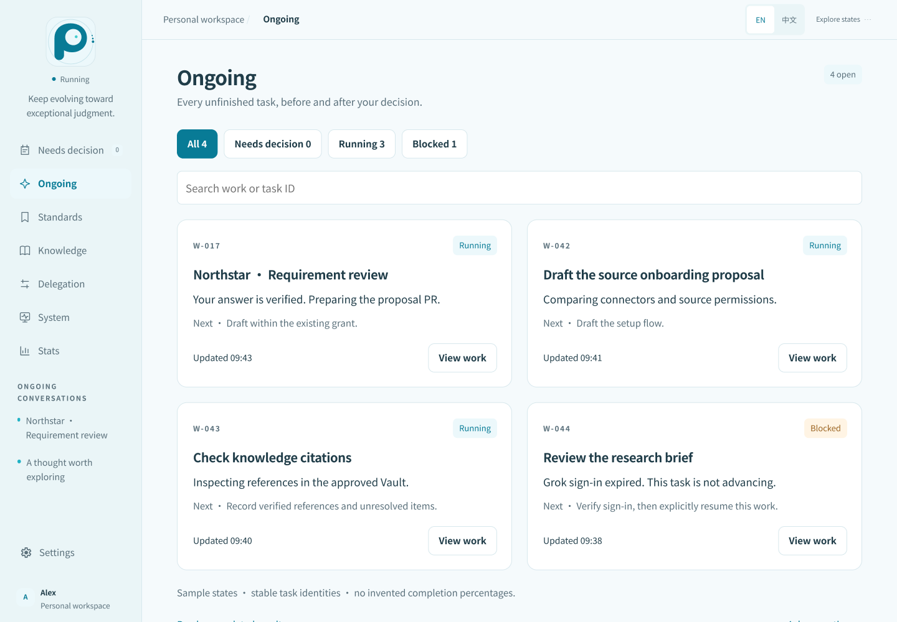
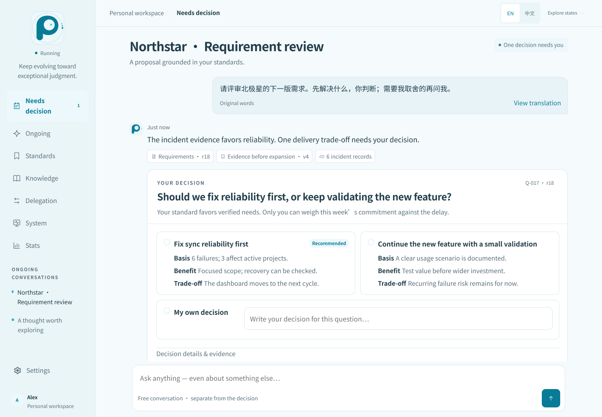
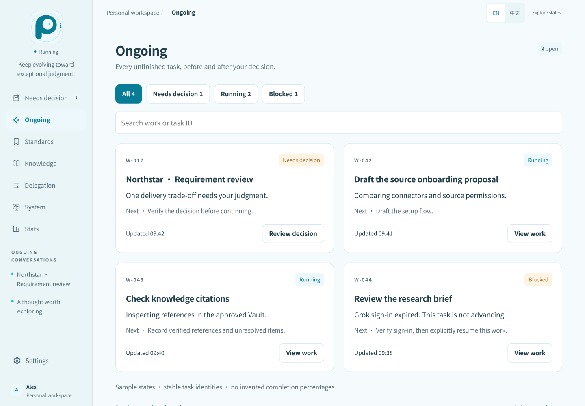
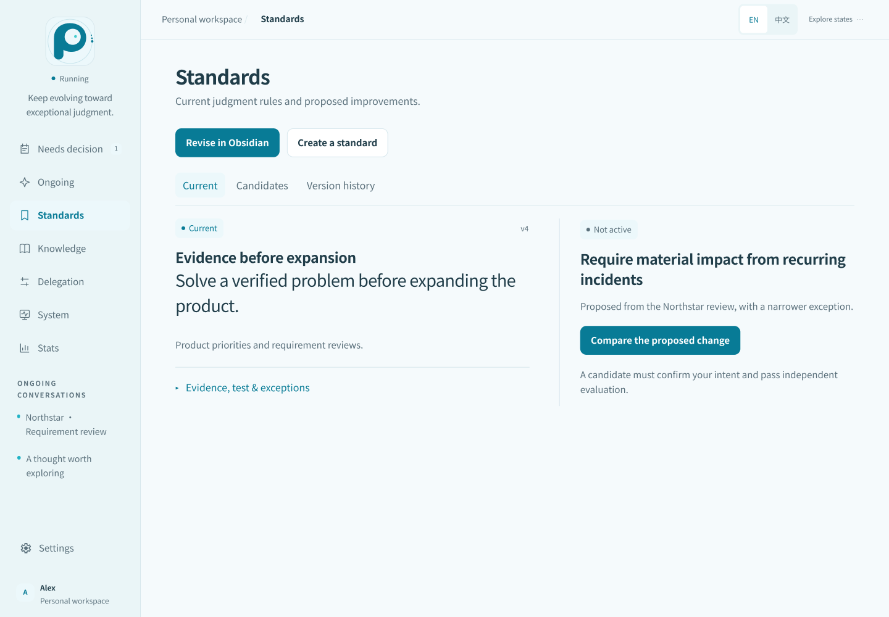
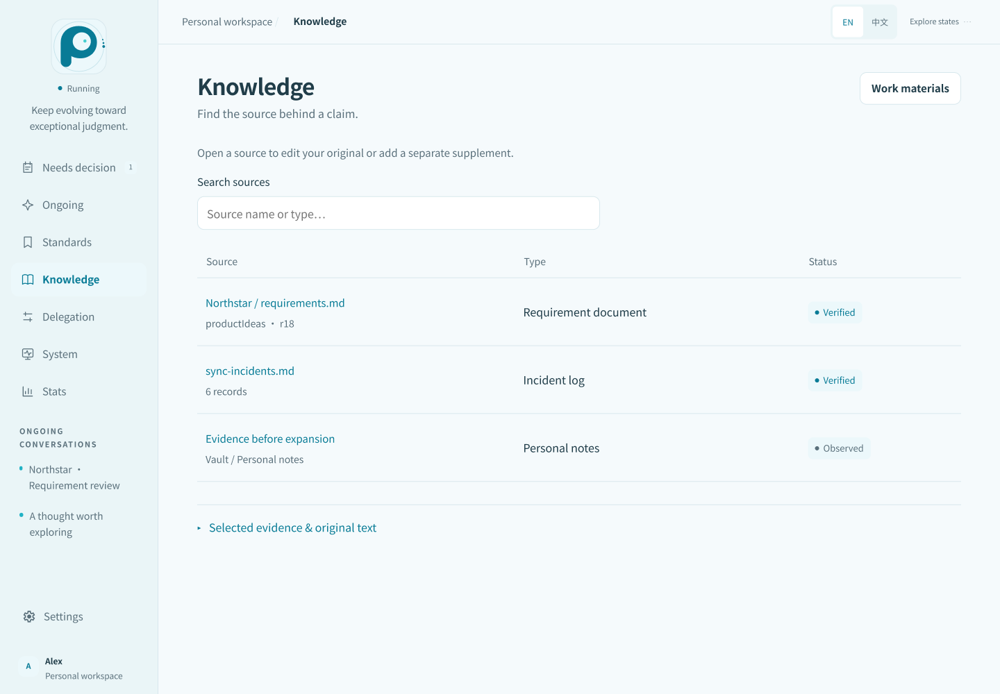
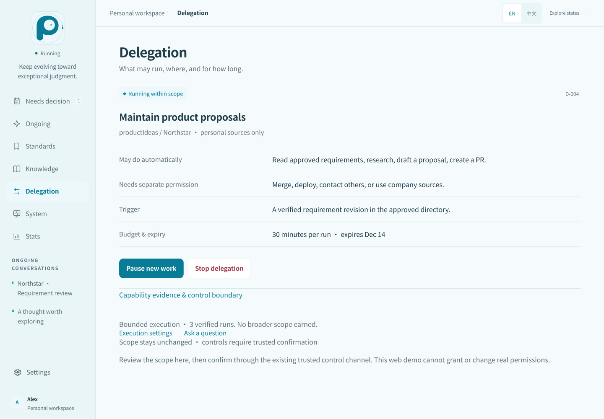
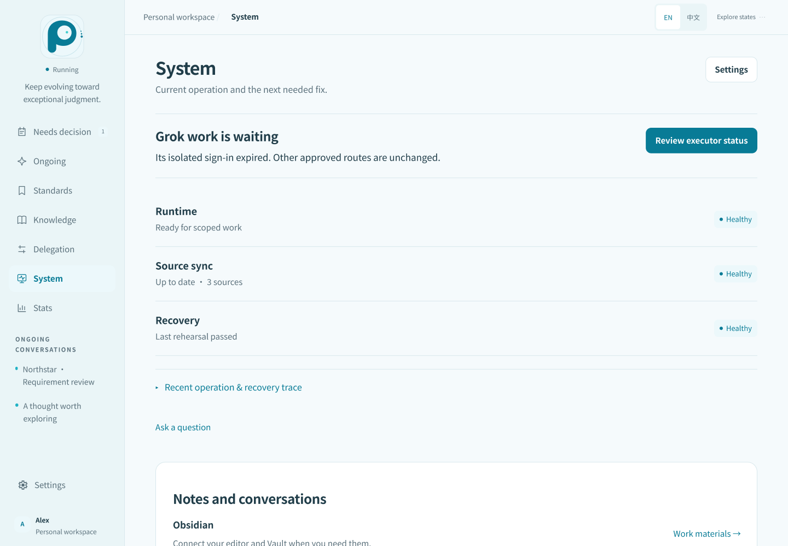
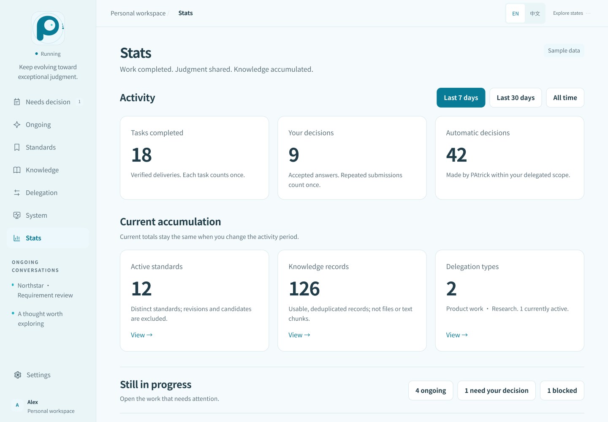
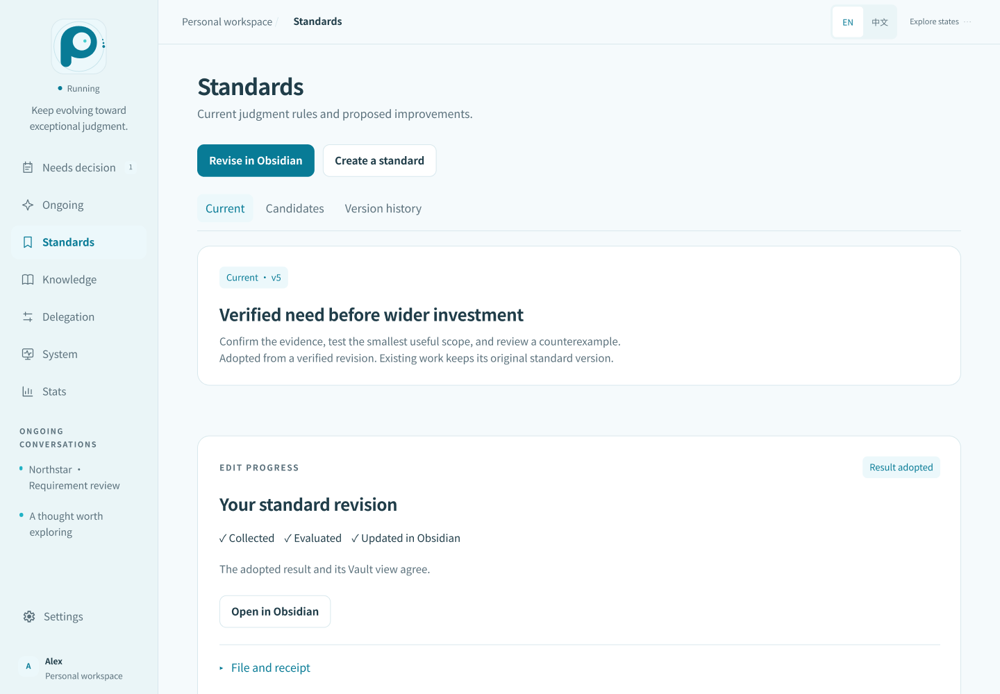
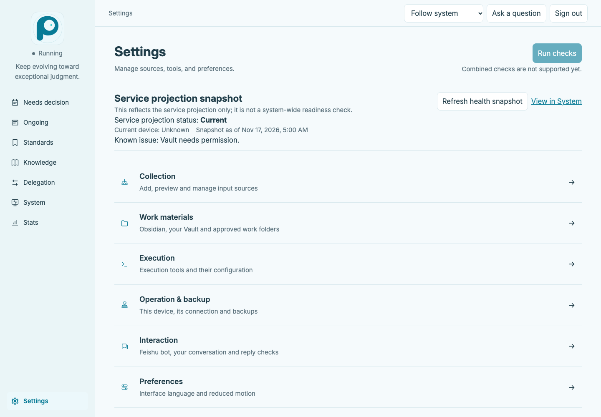

# PAtrick

[简体中文](README.zh-CN.md)


PAtrick is designed to help you make better decisions by carrying work from a source change to a verified proposal pull request and turning observed results into reusable cases.

## What it is for

PAtrick is intended to research your work and ask only when a real trade-off needs your judgment. A decision card presents two concrete options, A and B, with evidence, benefits, and costs, plus **Custom decision** for a custom answer. After your answer is verified, the intended flow resumes the same work with the applicable authorization.

The planned first workflow starts with a change in an approved `productIdeas` directory. Delivery is the creation and verification of the proposal pull request (PR). [Product design v2.6](docs/designs/PAtrick产品设计.md)

## How a piece of work moves

The following describes the intended end-to-end flow. The automatic handoff from an approved source change to a work item is not wired yet.

1. PAtrick captures an approved source change and researches it against the applicable evidence and standards.
2. Work proceeds within its delegated scope. If a consequential choice is still open, PAtrick preserves its progress and asks for a decision.
3. A verified answer resumes that work. With the required authorization, the publisher opens the proposal PR and reads it back to verify what was delivered.
4. Reviews, revisions, and observed outcomes feed the original case. A proposed change to a standard stays a candidate until it passes evaluation and is adopted.



*Figma design reference for Ongoing. The v2.6 design index retains this v2.5.1 export.*

## The workbench

### Needs decision

Compare the options and evidence for an open trade-off, then submit your decision.



*Figma design reference. The v2.6 design index retains this v2.5.1 export.*

### Ongoing

Follow the same work from its current stage through blockers, verified delivery, and history.



*Figma design reference. The v2.6 design index retains this v2.5.1 export.*

### Standards

See the active criteria, proposed revisions, and the evidence used to evaluate a change.



*Figma v2.6 design reference.*

### Knowledge

Find a claim, check its verification status, and trace it back to the source revision.



*Figma v2.6 design reference.*

### Delegation

Review the scope, actions, budget, and expiry you authorized and preview changes before applying them.



*Figma design reference. The v2.6 design index retains this v2.5.1 export.*

### System

Review service health, notifications, change receipts, and a scoped diagnostic preview. Running the checks reports the status of the network, the three executors, the collection sources, the recovery gate and the host with its backup targets.



*Figma v2.6 design reference.*

### Stats

Review recent activity, completed work, and the knowledge and standards you have accumulated.



*Figma design reference. The v2.6 design index retains this v2.5.1 export.*

## Knowledge and standards

Edit your originals, supplements, and standards drafts in Obsidian. In PAtrick, follow the exact revision from collection to knowledge verification or standards evaluation, through adoption and the update to the generated Vault view. The planned workflow starts with file changes in an approved scope. Directory collection is currently unavailable, and authorization and automatic dispatch for directory-triggered work are still pending. Adoption requires verification or evaluation, and PAtrick reports the Vault update separately.



*Figma v2.6 design reference showing the Standards adoption state.* [Obsidian setup and rehearsal evidence](docs/operations/obsidian-install-report.md)

## Settings

- **Collection** lets authorized users add RSS feeds, web pages, GitHub repositories and approved folders, preview their scope, and enable, pause, or disconnect them. A GitHub source reads the live GitHub API with a staged token. A folder source is read through a reader that resolves every path one component at a time, never follows a link out of the approved root, reads through the descriptor it opened and bounds what it reads. Activation and the first successful collection have separate receipts.
- **Work materials** reviews an already registered Obsidian Vault connection and its permission checks before confirmation.
- **Execution** runs a check of the three backends. Each record says what was observed; a backend outside the isolated guest stays blocked with that reason, and the check never starts a backend run because a run spends the budget.
- **Operation & backup** shows the registration and targets for host, network repair, backup, and restore actions. Available network and recovery actions use the trusted confirmation flow. The host check reports the registered targets and the last observation.
- **Interaction** supports initial Feishu setup, pairing, and a sample test preview when the required host capabilities are registered. Sending and verifying the test require a transport. Re-pairing an existing connection goes through a trusted change that drains the active connection first.
- **Preferences** saves language, reduced motion, the notification level, and quiet hours for the account.
- The settings home ends with a readiness summary that says where each entry comes from: detected on this device, suggested and still missing, your own choice, or inherited from the host.



*T24 runtime reference: a fresh service projection and a Vault permission issue in a synthetic fixture.* [Settings capture record](fixtures/screens/visual-environment.json) · [Feishu setup and current evidence](docs/operations/feishu-setup-report.md)

## Install and run

Use Node.js 24.9.0 and npm 11 or later. From a local checkout, run these commands at the repository root to start the sample-data demo.

```sh
npm ci
npm run dev:demo -w @patrick/web
```

Open the local address printed by Vite. Choose **Ongoing** to see sample work and **Settings → Preferences** to switch languages. Demo mode uses sample data and runs without the service or connected providers.

Run the local code checks from the same directory.

```sh
npm run lint
npm run typecheck
npm run test:unit
```

The service runtime is built separately. Running it against real data requires a trusted host controller, registered service identity, approved data scope, and the required provider configuration. The repository has macOS arm64 and x64 build materials. The source candidate remains non-installable, and target-host installation and signed release acceptance are pending. [Runtime build](docs/operations/runtime-build-report.md) · [Release evidence](docs/operations/release-report.md) · [Recovery and upgrades](docs/operations/恢复与升级.md)

## Repository map

| Path | Contents |
| --- | --- |
| [apps/web](apps/web/) | React workbench, bilingual demo, and web client |
| [apps/service](apps/service/) | Service application, routes, and runtime composition interfaces |
| [packages/contracts](packages/contracts/) | Shared request, response, resource, and event schemas |
| [packages/domain](packages/domain/) | Work, decisions, delegation, evidence, and standards logic |
| [packages/storage](packages/storage/) | SQLite migrations, persistence, blob storage, and read models |
| [packages/integrations](packages/integrations/) | Source collection, Vault, and external service adapters |
| [packages/executor](packages/executor/) | Shared executor contract, backend adapters, and run supervision |
| [packages/host](packages/host/) | Host diagnostics, credentials, and operational boundaries |
| [docs/designs](docs/designs/) | Product and technical designs, prototypes, and Figma delivery index |

## This version does not

- Delivery ends at a verified proposal PR. Merging it, deploying the work product, and L3 multi-step delegation are outside this version. [Technical design v2.1](docs/designs/PAtrick技术设计-v2.md)
- The work-directory editor is still pending.
- Re-pairing and rotating the credential of an existing Feishu connection both go through an authorized change: the new secret is staged by the secure credential endpoint, and the change drains the active connection and clears the old binding before it applies.
- The native Feishu round trip still needs transport provisioning and live acceptance. Real GitHub delivery and Codex CLI, Grok Build, and DSH under their intended host identities also need live acceptance. The local browser and service fixtures exercise their documented contracts.
- The Obsidian rehearsal covered a synthetic Vault under the current desktop account. A separate production service identity, native reboot, cross-device sync, and upgrade and uninstall preservation are still pending acceptance.
- Pilot quality and maintenance timing require observed, authorized work. Local tests and design examples cover implementation cases. [Pilot maintenance and release criteria](docs/operations/维护手册.md)

## License

PAtrick is licensed under the [MIT License](LICENSE).
