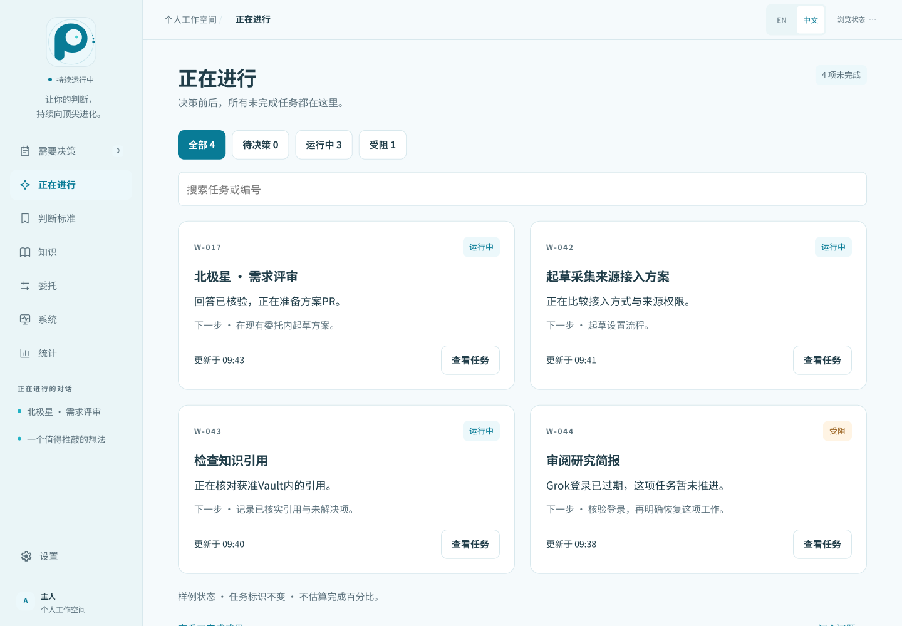
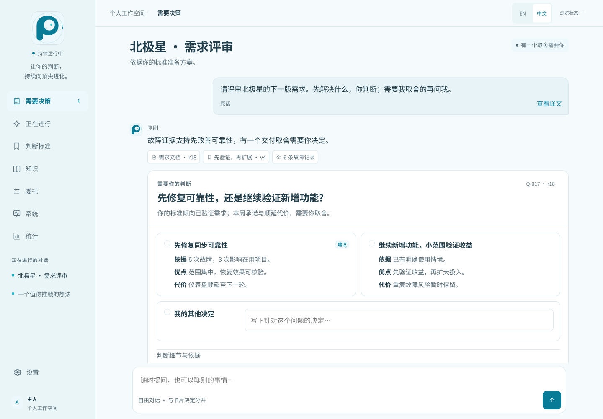
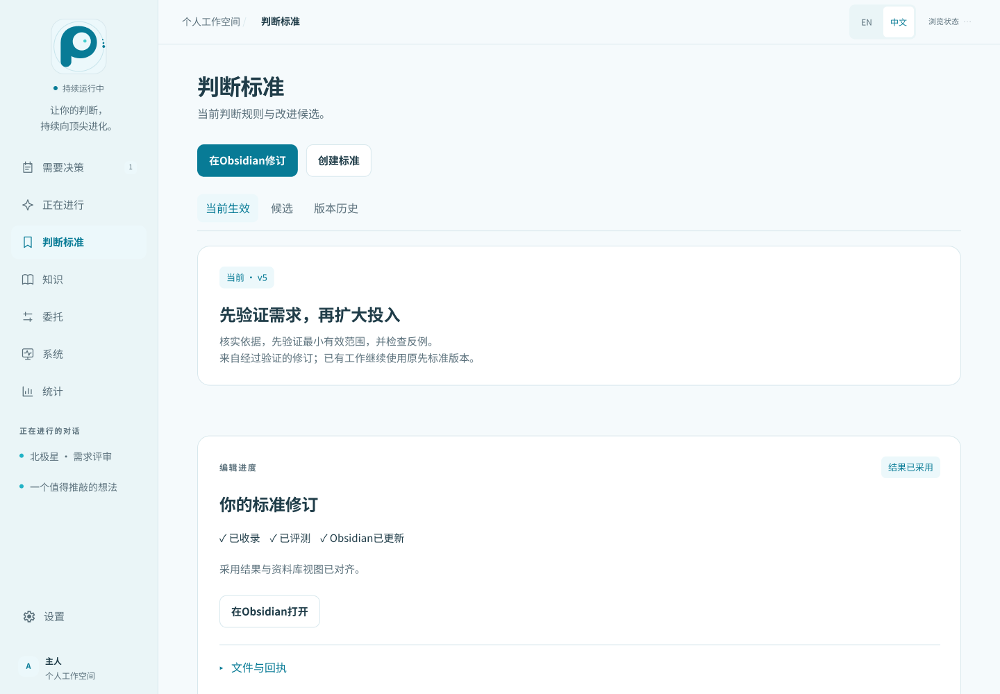
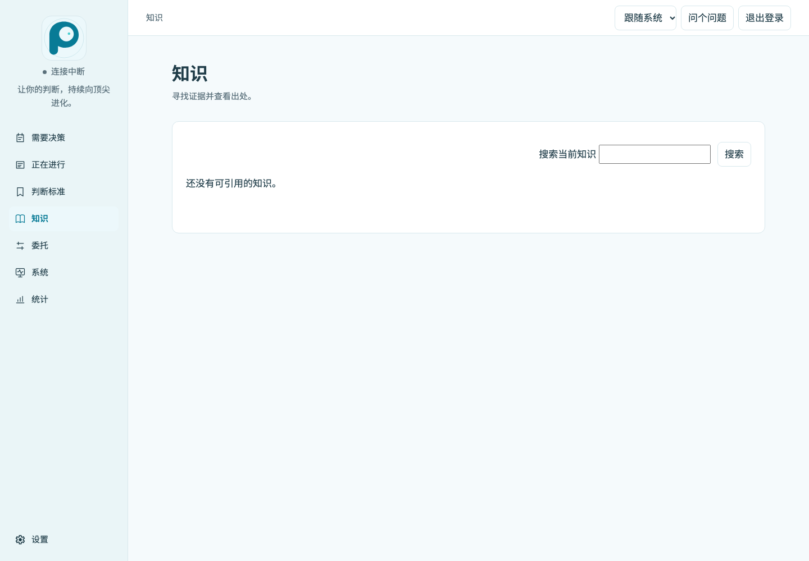
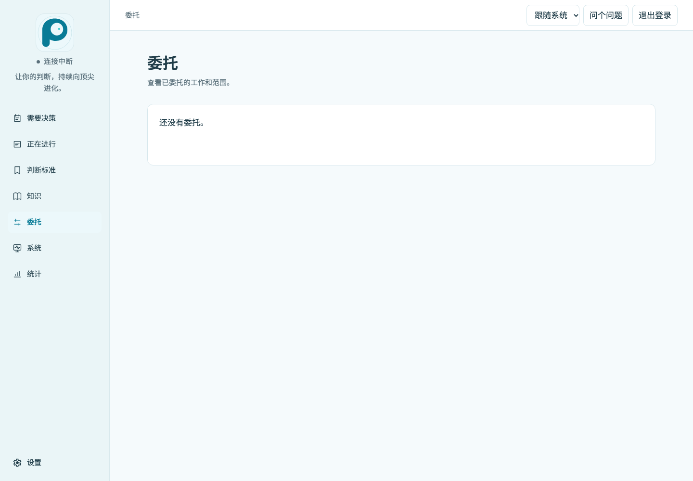
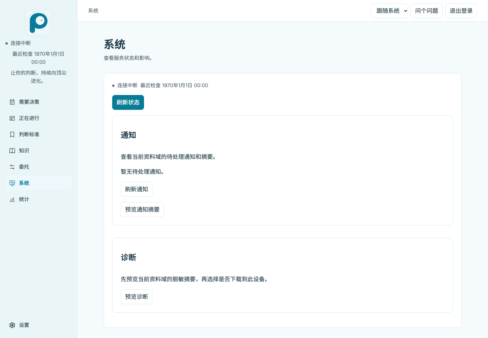
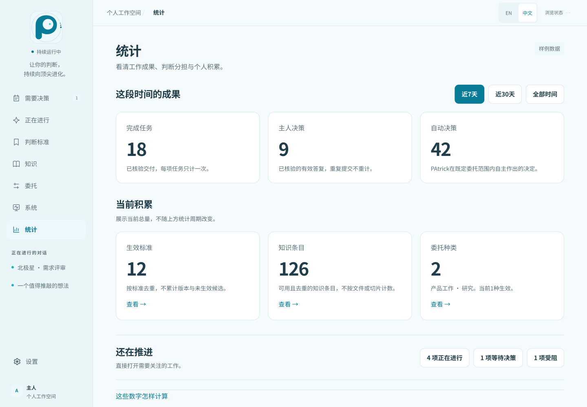
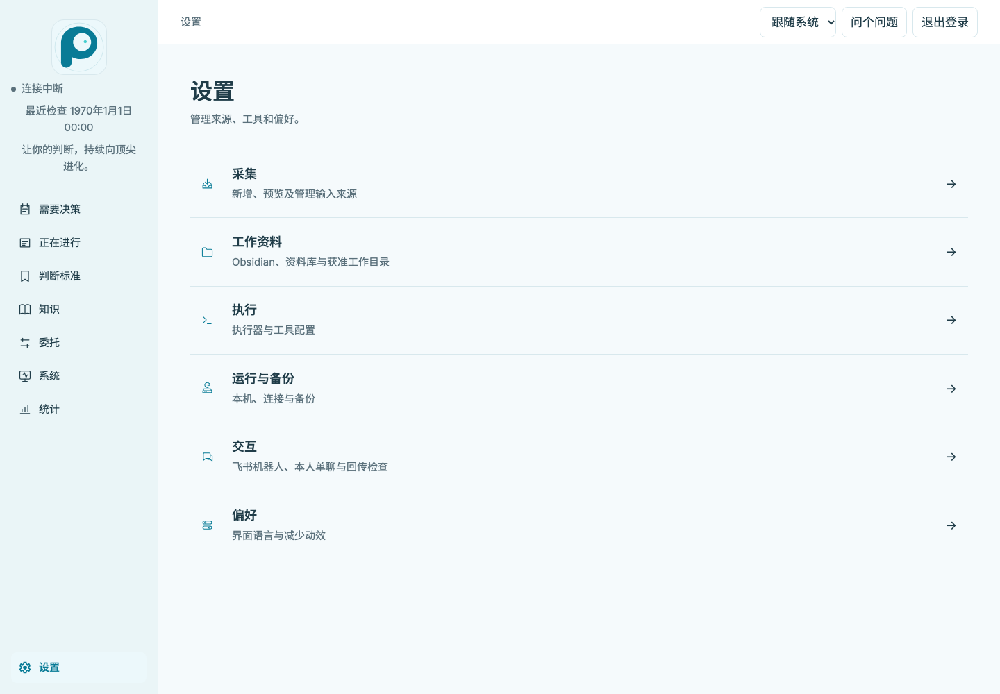

# PAtrick

[English](README.md)


PAtrick 的目标是从来源变化推进到经核验的方案拉取请求，并把观察到的结果沉淀成可复用的案例，让判断随着工作一起改进。

## 适合做什么

PAtrick 旨在围绕手头的工作展开研究，只在确实需要你权衡时提问。决策卡列出 A、B 两个具体方案的依据、优点和代价，也可以填写**自定义决定**。预期流程是在答复核验通过后，在获准范围内继续原来那项工作。

首个计划中的工作场景从获准的 `productIdeas` 目录变化开始。创建并核验方案拉取请求（PR）即为交付。 [产品设计 v2.6](docs/designs/PAtrick产品设计.md)

## 一项工作如何推进

下列流程描述预期的端到端体验。获准来源变化自动转为工作项的接线尚未完成。

1. PAtrick 收录获准的来源变化，按对应证据和生效标准展开研究。
2. 工作按委托范围推进。遇到影响执行的取舍时，保留进度并请你作决定。
3. 答复核验通过后继续原任务。具备所需授权时，发布器创建方案 PR，并读回复核交付内容。
4. 评审、改动和观察到的结果回到原案例。标准改进建议先留作候选，通过评测并被采纳后才生效。



*Figma v2.6 设计参考，展示工作续办。*

## 工作台

### 需要决策

对照待处理取舍的方案和依据，提交你的决定。



*Figma v2.6 设计参考。*

### 正在进行

查看同一项工作的当前阶段、阻塞原因、经核验的交付及历史。


*Figma v2.6 设计参考。*

### 判断标准

查看生效标准、待评测的修订以及评测所用的证据。



*Figma v2.6 设计参考，展示标准已采用状态。*

### 知识

查找知识条目，核对核实状态，并追溯到对应的来源修订。



*T24 运行界面参考：合成账号下的知识空状态。*

### 委托

查看已批准的工作范围、动作、预算与期限，并在应用前预览变更。



*T24 运行界面参考：合成账号下的委托空状态。*

### 系统

查看服务状态、通知、变更回执以及当前范围的诊断预览。



*T24 运行界面参考：合成账号的事件流断开时，仍可查看状态和诊断。* [截图记录](fixtures/screens/screen-manifest.json)

### 统计

回看近期活动、完成的工作，以及积累的知识和标准。



*Figma v2.6 设计参考。*

## 知识与标准

在 Obsidian 编辑你的原稿、补充笔记和标准草稿。在 PAtrick 查看确切修订的收录、知识核实或标准评测、采用以及资料库生成视图的更新。保存文件是这个流程的起点。核实或评测通过后才能采用，导回状态另行记录。


*Figma v2.6 设计参考，展示标准采用后的状态。* [Obsidian 接入与演练记录](docs/operations/obsidian-install-report.md)

## 设置

- **采集**允许获准用户新增 RSS 订阅和网页，预览范围后启用、暂停或断开。已有 GitHub 和目录来源可以查看。启用与首次采集成功分别有回执。
- **工作资料**在确认前查看已登记的 Obsidian 资料库连接及权限检查。
- **执行**显示执行器检查处理器是否已登记。内置服务目前尚未登记该处理器。
- **运行与备份**显示主机检查、网络修复、备份与恢复操作的登记状态和目标。可用的网络和恢复操作通过可信确认流程执行。
- **交互**在所需主机能力已登记时支持飞书首次设置、配对和样例测试预览。发送和核验测试需要传输通道。
- **偏好**保存账户的语言和减少动效设置。



*T24 运行界面参考：合成账号下的六组设置。* [设置截图记录](fixtures/screens/visual-environment.json) · [飞书设置与当前证据](docs/operations/feishu-setup-report.md)

## 安装与运行

使用 Node.js 24.9.0 和 npm 11 或更新版本。在本地检出后的仓库根目录运行以下命令，启动使用示例数据的演示。

```sh
npm ci
npm run dev:demo -w @patrick/web
```

打开 Vite 打印的本地地址。在**正在进行**查看示例任务，在**设置 → 偏好**切换界面语言。演示使用示例资料，可以独立于服务和外部渠道运行。

在同一目录运行本地代码检查。

```sh
npm run lint
npm run typecheck
npm run test:unit
```

服务运行时单独构建。接入真实资料需要可信主机控制器、已登记的服务身份、获准的数据范围和所需渠道配置。仓库有 macOS arm64 与 x64 构建材料。源码候选尚不可安装，目标主机安装与签名发布仍待验收。 [运行时构建](docs/operations/runtime-build-report.md) · [发布包记录](docs/operations/release-report.md) · [恢复与升级](docs/operations/恢复与升级.md)

## 仓库结构

| 路径 | 内容 |
| --- | --- |
| [apps/web](apps/web/) | React 工作台、双语演示和网页客户端 |
| [apps/service](apps/service/) | 服务应用、路由和运行时组合接口 |
| [packages/contracts](packages/contracts/) | 共用的请求、响应、资源与事件合同 |
| [packages/domain](packages/domain/) | 工作、决策、委托、证据和标准逻辑 |
| [packages/storage](packages/storage/) | SQLite 迁移、持久化、文件对象存储和只读模型 |
| [packages/integrations](packages/integrations/) | 来源采集、资料库和外部服务适配 |
| [packages/executor](packages/executor/) | 统一执行合同、后端适配和运行监督 |
| [packages/host](packages/host/) | 主机诊断、凭据和运行权限边界 |
| [docs/designs](docs/designs/) | 产品和技术设计、原型及 Figma 交付索引 |

## 本版不做

- 交付止于经核验的方案 PR。本版不负责合并、部署业务成果或执行 L3 多步骤委托。 [技术设计 v2.1](docs/designs/PAtrick技术设计-v2.md)
- 收录来源修订不会自动创建工作；获准触发规则和来源到工作的调度尚未接通。本地测试覆盖各个组件，尚未验证从来源到 PR 的完整流程。
- 设置首页显示六组入口。设计中的全局检查面板和各组就绪摘要仍待实现。
- 设置中新增 GitHub 和本地目录来源、工作目录编辑器、设置页的内置执行器及主机检查处理器、通知偏好仍待实现。系统页尚未提供独立的网络、执行器和来源状态摘要。
- 当前飞书设置覆盖首次连接和配对。已有连接的凭据轮换和重新配对仍需要设计中的独立授权变更流程。
- 飞书原生往返仍需配置传输通道并完成真实验收。GitHub 交付，以及 Codex CLI、Grok Build 和 DSH 各自在目标宿主身份下运行，也需实测验收。本地浏览器和服务夹具覆盖各自的实现合同。
- Obsidian 演练在当前桌面账户下使用合成资料库。独立生产服务身份、主机原生重启、跨设备同步及升级和卸载后保全仍待验收。
- 试点质量和维护耗时要用获准的实际工作留证。本地测试与设计画面覆盖实现样例。 [试点维护和发布门槛](docs/operations/维护手册.md)

## 许可证

PAtrick 采用 [MIT 许可证](LICENSE)。
