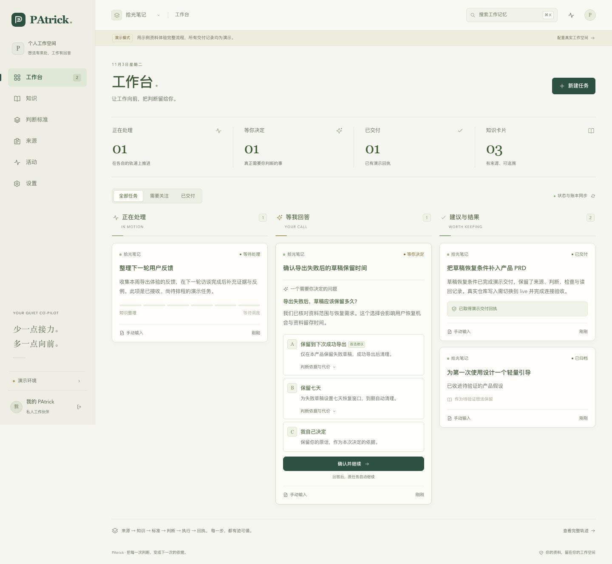

# PAtrick

> **2026-11-06 开发检查点：** 当前冻结源码通过52个测试文件、2450项测试，另有1项既有跳过；类型检查、构建和PRD校验通过。独立复审仍有1项关键问题、6项重要问题，尚未通过发布验收；真实模型调用保持关闭。见[完整审查与未完成项](docs/reviews/2026-11-06-knowledge-experience-checkpoint.md)。文内旧日期的测试和实施描述保留其历史阶段口径，最终文档审计与端到端复验仍待完成。


PAtrick 把项目证据、你的明确决定和可核交付连起来。第一条工作链是：你在一个产品的 `productIdeas` 中正常修改想法，它把有依据的验收条件补入正式 PRD；确实需要你取舍时，只问一个有证据的问题，答复后自动续办原任务。

[English](README.md) · [运行手册](docs/operations.md) · [主机部署](docs/deployment.md) · [界面设计](DESIGN.md) · [详细设计](docs/designs/PAtrick详细设计.md) · [验收证据](docs/acceptance.md) · [验证报告](docs/test-report.md)

工作台分“正在处理／等我回答／建议与结果”三栏，并提供知识、判断标准、来源、活动和设置视图。任务抽屉把原文、来源修订、worker 尝试、问题版本和交付回执放在一起。



项目使用 Node.js 24、TypeScript ESM、Hono 服务端 HTML、普通渐进 JavaScript/CSS、better-sqlite3/FTS5、Zod、Vitest 和 Playwright。宿主管理权限、状态和写入；worker 只提交候选或隔离产物。模型说“完成”不能代替 CI、合并和文件读回证据。

- **判断历史**：宿主冻结每次成功初判的目标、原判、实际采用规则的内容与版本、引文和预测（未知为 `null`）。本人决策案例保留当时快照，再追加绑定交付回执的反馈；历史记录缺少快照时明确未知。预测和交付反馈各有证据要求，业务效果仍需独立观测。

## 复核判断结果

在 **判断标准 → 结果复核** 查看冻结初判、到期安排、可核交付、后续本人选择，以及来源报告的更正、测量、失败和放弃材料；工程检查失败单独展示。在项目配置或新增项目表单把 `reviewIntervalDays` 设为 **1–365** 的整数，默认 **7**，设置页显示已保存值。新快照冻结各自周期；旧快照独立沿用七天，不随今天的项目设置改写。

宿主启动时及每 60 秒在本地扫描。获准集成可导入不启动任务的引用材料，把精确引文关联到初判，并按项目/域查询或触发复核；详见 [运行方法与 HTTP 契约](docs/operations.md#outcome-review-sources-and-http-contracts) 和 [结果复核实施计划](docs/plans/2026-11-03-outcome-reviews.md)。目前**没有配置真实指标来源**，缺结果或归因材料继续**待观察**。“已关联结果依据”仅关联来源报告，不证明因果、预测准确或业务改善，也不提升本人原则。回执待复核不表示没有交付。

下述早期基础提交是 `b50716c`（**2026-11-05**）。完整检查通过 **41 套件、1,687 项测试**，另有 **1 项明确跳过的文件所有权夹具**；类型检查、构建与 PRD 校验通过。最近一次界面提交通过 **16/16 Chromium 测试**，后续变更沿用未改动界面的浏览器证据。描述性经验候选、统一结构化解析和有界仓库回读的源码已复核；运行时入库、测试支持的历史引用与事实使用仍在实施，其余故障／重启控制、实际 guest 验收、最终文档复核、发布及精确 head CI 仍待完成。[验证报告](docs/test-report.md) 区分源码检查和实际 guest／提供方验收。

## 本地体验

```bash
nvm use 24
npm ci
PATRICK_HOST=127.0.0.1 PATRICK_DATA_DIR=/tmp/patrick-demo PATRICK_VAULT_DIR=/tmp/patrick-demo/vault npm run demo
```

打开启动日志中的地址，默认端口是 `4317`。这条命令显式使用独立临时数据目录。演示使用样例材料、回放 worker 和模拟交付，不修改远端仓库。样例回执不等于 GitHub、飞书或模型实链已通过。Playwright 使用另一个 demo 服务和 `4318` 端口。

未传 `--demo` 或 `PATRICK_MODE=demo` 时默认为 live。能打开页面、本地测试通过、外部前提就绪和真实任务验收是不同结论；以 [验收清单](docs/acceptance.md) 记录为准。

## 配置真实工作空间

把 [.env.example](.env.example) 复制为私有 `.env`，以 [示例配置](examples/patrick.config.json) 为起点。示例中的 `autoMerge` 为 `false`，所有 worker 的 `admitted` 为 `false`，不会因复制文件就获得外写权限。来源目录、本人身份、模型/提供方、费用和 Lima 实例必须换成已核验值。

试点目标为已确认的 `AlphaStrategyAI/PAtrick`，只允许写 `docs/product/PRD.md`，预期必需检查名为 `validate`。示例 `trustedAppIds: [15368]` 是 GitHub Actions 的示例 ID，启用自动合并前必须从实际仓库 API 确认检查的 App ID、当前 PR head 和合并政策。仓库要求独立人审时不能绕过。

数据库、WAL、凭据和活动运行状态放在同步目录外。macOS 默认数据目录是 `~/Library/Application Support/PAtrick`；自定义 `PATRICK_DATA_DIR` 时使用绝对路径。HTTP 入口会读取当前目录的 `.env`；其他入口也可统一显式加载：

```bash
node --env-file=.env --import=tsx src/index.ts
```

生产构建：

```bash
npm run build
node --env-file=.env dist/index.js
```

本地 live 未设置 `PATRICK_TOKEN` 时，启动会在数据目录生成权限受限的 `access-token` 文件，私下读取后在 `/login` 登录。也可自行生成并写进私有 `.env`：

```bash
node -e "process.stdout.write(require('node:crypto').randomBytes(32).toString('hex') + '\n')"
```

`PATRICK_SESSION_SECRET` 可单独设置，省略时使用访问令牌。非回环监听必须预先提供至少 24 字符的 token，并通过认证私网访问。网页使用 HttpOnly 会话；API 使用 `Authorization: Bearer …` 头。不要把 token 放进 URL、任务材料、截图或 Git。

## live 的前提

- 已授权仓库、准确允许路径、非空必需检查与可信 App 列表，以及允许相应合并方式的仓库政策。
- 按角色、数据域、模型/提供方、工具权限和费用逐一准入的后台 runner；自动切换至少需要一个已准入备选。
- 执行主机上的已审 Lima 构建，移除默认主机挂载、禁 SSH agent 转发、限制出口及会话上传，仅交付任务材料。模板要求 2.3 引入的 `hostLoopback` 支持，稳定版 2.2.1 不足。私有安装须把对应 `limactl` 放进服务 PATH，并设置与创建实例时相同的可选 `LIMA_HOME`；见 [主机部署](docs/deployment.md#lima-worker-isolation)。
- 飞书应用、已核本人 Open ID、私聊 Chat ID 与历史补读权限。应用认证的 WebSocket 不要求 HTTP 回调 token；HTTP 回调单独要求验证凭据。
- 获准双语检索网关；宿主实际查询中英文，并独立打开公开 HTTPS 原文。完整请求格式见 [运行手册](docs/operations.md#search-gateway-contract)。
- 已授权网络路径、异机备份及恢复接管流程；不确定的远端副作用先对账再重试。

**2026-11-04** 已在当前 MacBook Pro 完成获准局部试运行：固定官方 Lima 开发提交与 Ubuntu ARM64 guest 启动，检查挂载/agent 与主机回环边界，并用**合成 Node runner**走实际编译适配器的 guest 测试和清理。三种预期结果及工作区移除均已观察，**模型调用 0、费用 $0**。这仅证明局部传输；获准出口、非特权执行、提供方准入及生产 Mac mini 仍未验收。见 [试运行证据与限制](docs/test-report.md#bounded-local-lima-trial-and-home-selection)。

在私有环境设置 `FEISHU_APP_ID`、`FEISHU_APP_SECRET`、`FEISHU_OWNER_OPEN_ID`、`FEISHU_CHAT_ID`，通道仍须实际获得已授权历史。`FEISHU_VERIFICATION_TOKEN` 对 WebSocket/发送/历史可省略，但缺失、空串或纯空白时，`/webhooks/feishu` 对回调一律返回 **403**，已就绪 WebSocket 或签名/加密请求也不例外。加密 HTTP 回调另设 `FEISHU_ENCRYPT_KEY`。仍支持手动配置已核本人/私聊的私有环境；正常业务路由保留 `/pair` 为配置输入并忽略历史重放，它不是已交付的公共配对命令或 API。详见 [飞书设置与验证](docs/operations.md#feishu-settings-and-catch-up)。

**2026-11-04** 已用生产入口完成限定本人私聊传输验证：持久发件箱中的配置通知实际发送并远端核验；干净重启后，**2** 条不同的本人 `/status` 均接纳、回复并远端核验，重复标记 **0**。此次没有调用模型，未验收决策卡作答续办、PRD 交付、计费、launchd 或异机恢复。设置和 `doctor` 只报告连接配置，不能代替完整工作链验收。

本人仅允许使用 **Grok/Codex 现有订阅所含额度，不追加计费**。试点已固定 `billingBoundary: "included-only"`、**额外费用上限 0**、**单任务总尝试上限 32**。各角色、重试和换手共用持久计数，重试不能重置。金额为 0 仍须另验订阅、账户和提供方禁止额外收费的能力；真实权益、费用执行约束及生产核验器仍待配置，因此真实模型调用继续关闭。详见 [费用与尝试上限](docs/operations.md#billing-and-attempt-limits)。

默认分工是 Grok 整理知识、提取案例及初判，Codex 规划，Grok 执行，Codex 检查和反馈，各角色按准入名单自动换手。问题恰好 A 首选、B 第二建议、C 自己决定；等待本人时释放 worker，不自动代选。最多两轮返修，需求或基线变化重新规划/检查。

只有绑定同版需求与产物的检查、当前 PR head 的可信必需 CI 全部成功、实际合并及按 merge SHA 读回正式文件，才能支持交付。反馈基于真实回执。写入器在外写前重验权限与路径，网络结果未知时先查远端。

## 开发与验证

```bash
npm run dev
npm run typecheck
npm run test:unit
npm run test:integration
npm run build
npm run check
```

`check` 包含类型检查、Vitest、构建与正式 PRD 结构检查，浏览器测试单独运行：

```bash
npx playwright install chromium
npm run test:e2e
```

Playwright 按配置启动 demo 服务；不要把无关的现有 `4318` 服务当成验证证据。记录失败和跳过数量。本地禁写回放不能替代真实零问交付、只答一次交付和故障恢复验收。

其他入口：

```bash
npm run doctor
npm run backup
npm run report -- patrick
npm run mcp
```

`doctor` 反映配置及本机能力，不能证明远端合并、后台订阅额度或企业网络授权。`report` 读取运行中宿主的项目周报，费用是保守预留值，不能当作提供方账单。[运行手册](docs/operations.md) 包含显式加载私有环境、备份和 MCP；[主机部署](docs/deployment.md) 说明 `restore`、`install-service` 及其 `service` 别名。

stdio MCP 连接已经运行的 HTTP 服务，在私有客户端环境设置 `PATRICK_URL`、`PATRICK_TOKEN`、`PATRICK_MCP_PROJECT`、`PATRICK_MCP_DOMAIN`。工具为 `lookup`、`ask`、`get_task`、`get_answer`、`record_conversation`，按绑定项目工作。

## 代码与文档

`src/domain.ts` 定义共享契约；`store/intake/knowledge/standards/reviews` 管理账本、修订、检索和本人标准；`scheduler/orchestrator/integrations` 负责角色与外部边界；`src/app.ts`、`src/web/`、`public/` 提供认证 SSR 与交互；`scripts/`、`examples/` 提供本地运维与 [launchd 模板](examples/launchd/README.md)。

[技术方案](docs/designs/PAtrick技术方案.md)、[实施计划](docs/plans/2026-11-03-patrick-implementation.md)、[判断历史修复计划](docs/plans/2026-11-03-decision-snapshots.md)、[结果复核实施计划](docs/plans/2026-11-03-outcome-reviews.md)、[正式 PRD](docs/product/PRD.md) 分别保存来源要求、计划、本地修复证据和试点产出；105 条要求及分层证据见验收清单。

当前交接范围是本地运行和 launchd 运维，没有要求公共托管部署。开发运维、学习及更多来源可沿同一契约扩展，但需分别真实验收。无自动入口的来源应显示未覆盖。

使用本机系统字体，不分发专有字体文件。引入第三方源码时保留许可证、固定来源及改动说明。许可证见 [LICENSE](LICENSE)。
