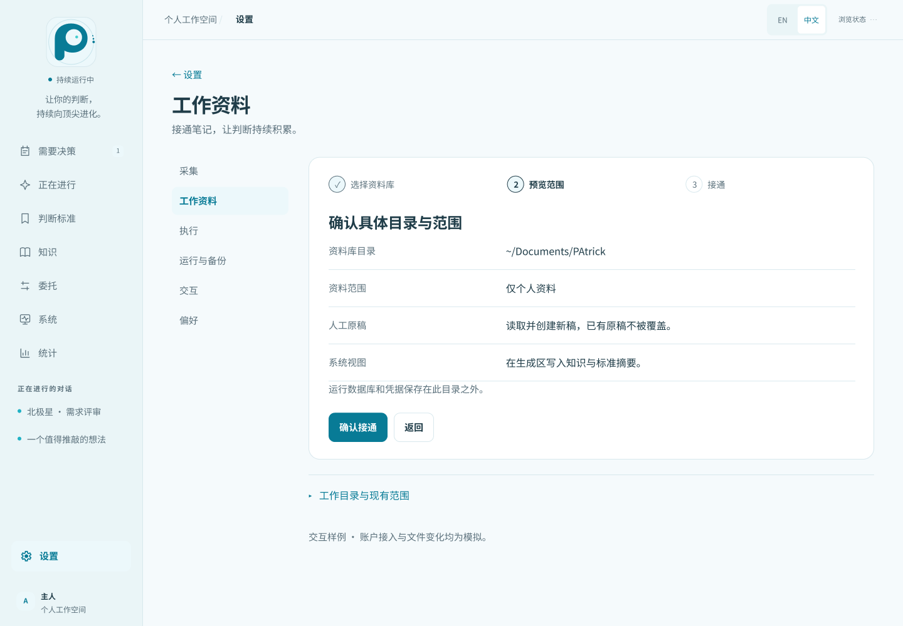
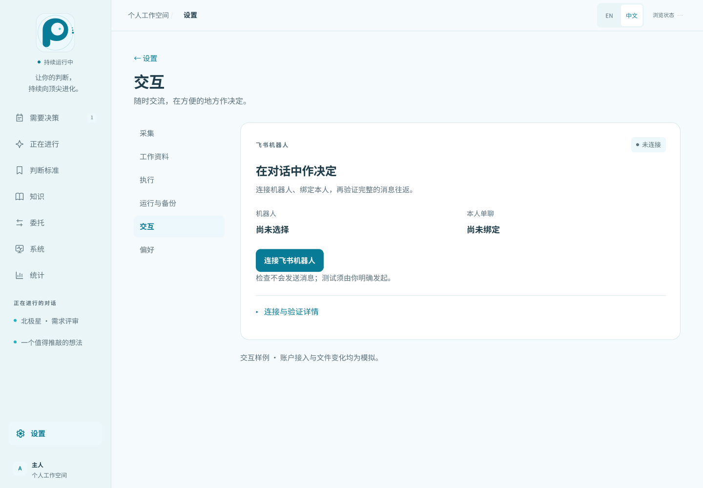
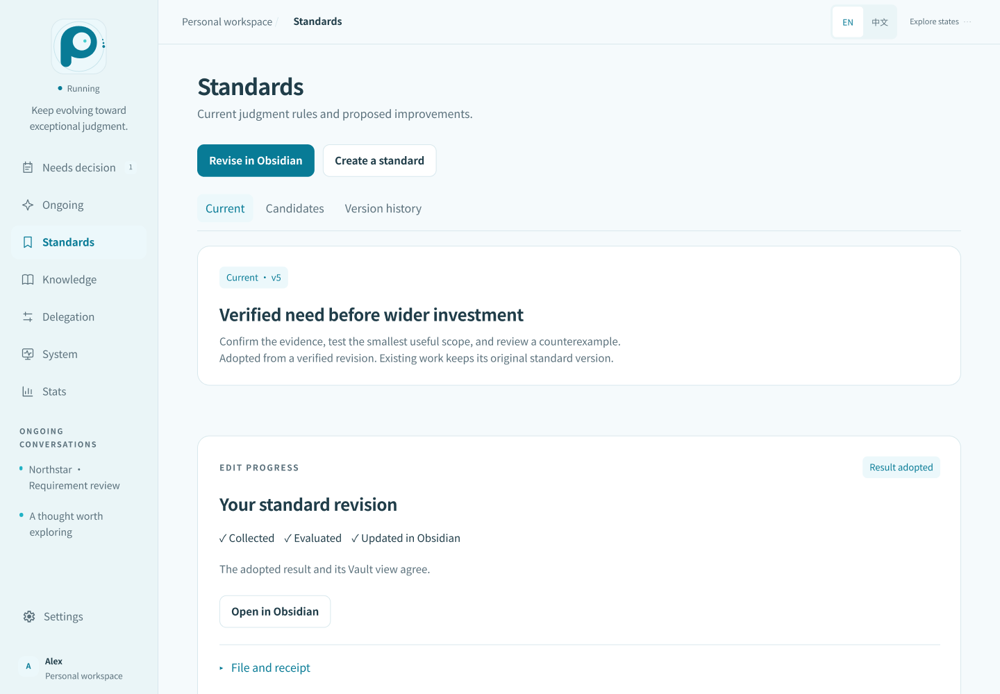

# PAtrick 产品设计 v2.6

**让你的判断，持续向顶尖进化。**

版本：v2.6 设计规格 · 2026-11-15。依据：[技术设计](PAtrick技术设计-v2.md)、[产品研究](../requirements/PAtrick产品设计研究.md)。本版补齐Obsidian知识/标准编辑与飞书机器人接入，新增“交互”设置类别；延续“判断成长工作台 + 随时对话的第二大脑”、流光青视觉、动态logo和系统语言跟随。

网页原生咨询、业务决定、偏好保存和类型化配置提案是**需实现的接口合同**；委托、凭据、预算、本机与恢复操作沿用可信控制链。本文描述目标行为，页面样例不代表已连接真实服务；实现与验收边界集中见§7、§10。

阅读入口：[TJ团队Figma设计](https://www.figma.com/design/kPSkB5zeZSKaK7Yrz3PslQ?node-id=24-67) · [Figma原型（英文系统示例）](https://www.figma.com/proto/kPSkB5zeZSKaK7Yrz3PslQ?node-id=24-67&starting-point-node-id=24%3A67) · [双语交互原型](设计资产/v2/交互原型.html) · [运行logo动图](设计资产/v2/logo-running.gif) · [交付清单](设计资产/v2/设计交付清单.md)。资产沿用`设计资产/v2`目录；本版以交互原型为页面基准，产品文档、原型和Figma按同一流程与状态交付；实际验证范围见§9.3。

## 1. 产品承诺与原则

PAtrick围绕本人正在做的工作持续研究、判断和执行；本人随时提问、纠正或作决定。每次判断能回到当时的证据与标准，每次真实结果成为改进依据。能力成熟后，已交代清楚的重复工作自动衔接，本人把注意力留给新的取舍。

“顶尖”是持续校准的方向：按领域参考有出处的优秀方法，与个人当前标准、外部方法和实际结果比较，识别进步与退步。不用模型自评分、规则数量或自动化率证明判断变好。

| 原则 | 产品必须做到 |
|---|---|
| **判断成长可见** | 展示哪次纠正被采用、解决什么问题、哪些场景仍不适用；可回到案例与版本 |
| **对话随时可用** | 所有页面可提问；工作对话保留上下文，业务取舍可直接在网页回答 |
| **只打断必要取舍** | 证据和委托足够就推进；必须问时给两项具体方案及自定义决定，答后自动续办 |
| **依据就在判断旁** | 默认呈现比较所需的依据、优点、代价与关键未知项；原文按需展开，不展示模型私有思维链 |
| **学习与授权分开** | 回答解决本次问题，归纳先成候选，验证后才生效；方法提高不自动扩权 |
| **状态与结果可信** | 接收、核验、续办、交付和实际效果分别表示；断线显示时间，未知结果先对账 |
| **自动化可局部退回** | 按项目、动作、资料域、预算与期限委托；异常暂停相关范围，无关工作继续 |
| **个人资产可编辑、可携带** | 知识与标准有可读原稿；本人能修订并看到处理进度，系统保留原文与版本，不悄悄替换判断标准 |
| **少输入、少排障、少干扰** | 先检测已有配置，只补问缺项；已授权的固定修复自动完成，需本人时给一个明确下一步 |
| **清晰、可访问、双语完整** | 一眼看到结论和主动作；语言默认跟随系统，可手动覆盖，全界面同步切换且不改变业务状态 |

首个完整场景：**productIdeas指定目录需求变化 → 自动研究与初判 → 必要决定 → 方案PR → 结果观察 → 案例与标准改进**。首版终点是开PR，合并和部署分别受委托约束。知识编辑沿用Obsidian；Codex CLI、Grok Build、DSH均通过统一执行合同，用户无需每次选模型。

## 2. 页面与两种对话

| 主导航：英文 / 中文 | 第一眼呈现 | 主动作与展开内容 |
|---|---|---|
| **Needs decision / 需要决策** | 首页；当前确需本人取舍的问题，保持连续对话 | 查看A/B建议或填写自定义决定；提交后可追踪同一任务，不混入无需回答的运行日志 |
| **Ongoing / 正在进行** | 所有未完成任务，包含待决策与已决定后后台推进的任务 | 看状态、最近进展、下一步和更新时间；进入同一任务的决策卡、详情或受阻原因 |
| **Standards / 判断标准** | 当前标准、候选准备改变什么 | 创建或修订标准；比较版本，查看案例、反例、评测与生效进度 |
| **Knowledge / 知识** | 搜索、来源与核实状态的清晰列表 | 查看详情、编辑原稿或添加补充；查看出处、核实状态、冲突与编辑回执 |
| **Delegation / 委托** | 范围、动作、预算、期限与当前能力 | 查看或调整精确委托；展开限制、差异与可信控制回执 |
| **System / 系统** | 当前影响最大的异常和服务状态 | 处理一个阻塞；展开受影响工作、诊断、修复轨迹与恢复门禁 |
| **Stats / 统计** | 完成的工作、主人与自动决策次数、当前积累 | 切换时间范围；查看标准、知识、委托及需要关注的任务 |

主导航固定七项，“正在进行”紧接“需要决策”，“统计”紧接“系统”。底部独立入口**Settings / 设置**管理持久配置、检测和变更；System管理当前运行、故障与工作影响，二者共享状态并互相链接。Stats集中呈现成果与积累，成长依据仍进入任务对话和Standards。

**Ask a question / 问个问题**在所有页面可达；后台页可进入独立咨询，保留来源页、上下文与返回位置。上下文以可移除标签呈现，不悄悄跨个人/公司资料域检索。全局聊天与工作聊天各保留草稿，只有本人选择“关联到这项工作”后才迁入；提到项目不自动创建执行任务。

“需要决策”页保持连续对话：本人原话、研究摘要、决定卡、回执、成果和反馈串在同一工作下。标题附近显示目标、状态、下一步和成果入口；内部重试与工具日志折叠。无待决定时显示“Nothing needs your decision right now / 目前无需你作决定”；没有足够成长结果时写“正在积累证据”，不用装饰性分数。

**卡片自定义决定输入与全局/工作自由输入同时存在，目的和提交按钮分开。** 等待关键回答时可以讨论和补证，但受阻执行仍等待；这类讨论使用关联原工作的独立受限Consultation和获准咨询预算，不启动新业务轮次、后续事件或外部动作。跨入口共享同一工作与决定状态，不复制任务生命周期。

### 2.1 两个入口，同一项工作

“需要决策”是待回答问题的视图，“正在进行”是任务全景；二者共享任务ID、问题版本、回执和状态。本人回答核验通过后，问题退出待答队列，同一任务在“正在进行”继续显示；新取舍出现时再进入待答队列，不复制任务。

| 正在进行的状态 | 默认展示 | 主动作 |
|---|---|---|
| 等待决策 | 具体取舍、等待原因、最后更新时间 | 去决策，打开原问题卡 |
| 已接收 / 核验 / 排队 / 运行中 | 最近完成了什么、当前阶段、接下来做什么 | 查看任务进展、依据和成果入口 |
| 受阻 / 暂停 / 失败待处理 | 阻塞范围、已有成果、最后可信时间 | 进入对应修复或委托流程；不因刷新页面自动重试 |
| 已交付 / 已取消 | 结果与回执保留 | 移至已完成记录，仍可回查，不挤占当前工作列表 |

列表支持按状态筛选、按任务名或编号搜索；“全部”包含所有未完成状态，待决策优先。每项只露**名称、状态、最近进展、下一步、更新时间**；阶段与完成事实优于无法证实的百分比。详情集中呈现目标、来源版本、委托、进展时间线、决定与回执、当前阻塞和成果。断联显示上次可信状态，不把“尚未更新”写成“运行正常”。

**主要流程：采集或已有委托触发 → 任务进入正在进行 → 必要时进入需要决策 → 本人回答 → 核验 → 原任务续办 → 成果记录。** 两处计数按同一权威状态计算；重复提交、语言切换、筛选或重连不创建新任务。没有待答时，首页明确显示“暂无待决定问题”，提供“查看正在进行”，自由聊天仍可用。

### 2.2 统计：工作成果与个人积累

先看**这段时间完成了什么**，再看**现在积累了什么**。页面分两组各三张数字卡，底部显示正在进行、等待决策和受阻任务；计数口径折叠呈现，不堆图表。

| 指标 | 怎样计算 | 时间范围 |
|---|---|---|
| 完成任务 | 最终交付已核验的任务，按任务ID去重；重试、子步骤与重复回执不重计 | 近7天 / 近30天 / 全部时间，默认近7天 |
| 主人决策 | 主人对精确问题版本作出且核验通过的有效答复；闲聊、待答和未通过的尝试不计 | 同上 |
| 自动决策 | PAtrick在现有标准和委托范围内自主作出的有效决定，按决定事件ID去重；模型调用和建议不算决定 | 同上 |
| 生效标准 | 当前生效的独立标准；版本升级不新增一条，候选和已停用项不计 | 当前总量，不随活动周期切换 |
| 知识条目 | 当前可用、去重的知识记录；来源文件、向量切片和重复导入不当作新增知识 | 当前总量 |
| 委托种类 | 已建立的独立委托类型；同类实例、别名和修订不重复累计，另列当前生效类型数 | 当前总量 |

标准、知识和委托卡可进入对应页面；底部任务计数可直接打开“正在进行”的相应筛选。切换周期或语言保留阅读位置，不触发业务动作。页面显示快照时间；断联保留上次可信数据，尚未取得的数据用“—”，不能冒充零。统计按本人可见资料域聚合，不能通过总数泄露其他域的内容。

计数反映活动与积累，不能证明判断更好；质量仍由证据、独立评估和真实结果说明。页面示例数据清楚标识为样例，已核验的新答复只增加一次主人决策，不同时增加完成任务数。

## 3. 决策消息卡：两项建议，加一个自定义决定

### 3.1 默认就能完成比较

卡片先说明问题、工作范围、为何需要本人取舍及材料时效。A/B各有四项短句：**具体行动、依据、优点、代价**；涉及风险、金额、期限、关键未知或不可逆影响的条件不得藏入详情。推荐必须有依据，不预选或自动提交。第三入口**My own decision / 自定义决定**始终显示文本框，允许第三方案、组合、条件或暂缓；证据原文、采用标准、反对意见和完整影响可展开。

示例：“这轮方案先解决重复故障，还是继续新增功能？”A：先处理故障；依据可核实事故记录；优点降低持续损失；代价延后功能探索。B：继续新增功能、小范围验证收益；依据已有明确使用情境；优点尽早获得功能收益证据；代价故障风险暂留。自定义可写“先用一天修复最高频故障，剩余时间小范围验证新功能收益”。系统保留原话，只补问影响执行的缺失条件。

两项必须真正可区分，不捏造依据。材料不足时可比较两条补证路径或“有条件推进/等待补证”，说明局限。本人可暂不提交；明确暂缓只记录意图并保持等待，沉默不视为同意。选择方案或填写自定义后都须显式提交，按钮说明所提交的决定。

### 3.2 提交与讨论的语义

| 用户行为 | 系统解释与可见结果 |
|---|---|
| 选择A/B并提交 | 精确问题版本的一次决定；先“已收到，正在核对”，有效后在原工作自动续办 |
| 提交自定义决定 | 按原问题允许的自由文本合同处理，原文完整保存；关键歧义或超范围形成差异明确的新问题 |
| 自由聊天写“同意”“先这样” | 普通对话；必要时定位对应卡片，不代发决定 |
| 追问或补充证据 | 新讨论；原方案实质变化则生成新版本，解释变化 |
| 向过期卡片提交 | 保留输入，指出变动与需重新决定的部分，不把旧同意用于新对象 |
| 网页与飞书同时回答 | 同一权威接受首个有效答复；重复请求返回原回执，冲突迟到回答只留审计 |

收件、核验、续办分别呈现；重复点按、刷新、重连或换语言均不重复执行。一次决定不会自动变成永久偏好、标准或委托。没有有效回答时，不启动受阻业务的新执行或发布。

## 4. 从回答到持续提高的判断

| 环节 | 保存与展示 | 进入下一步的条件 |
|---|---|---|
| **提问** | 当前问题、当时证据、方案、标准版本与必须取舍的原因 | 有真实取舍才问，不为采集偏好制造问卷 |
| **一次回答** | 本人原话、选择与作用范围；后来结果另存 | 先解决本次工作，积累案例，不直接改标准 |
| **候选归纳** | 重复分歧、关键新证据、反例或外部方法；拟改规则、范围与副作用 | 进入candidate，旧版继续生效；一次重要纠正也可提候选，但不能跳过验证 |
| **验证生效** | 当前/候选/外部方法同题对照、独立留出案例、真实结果和不确定性 | 已授权方法策略内达标自动晋级；价值、风险边界或权限变化另行决定 |

个人价值偏好、专业方法和行动政策分别管理。本人可在对话纠错或打开Obsidian修订原稿；文件保存、入库、候选验证、生效分别显示，系统视图不覆盖人工原稿。当前、候选和失效版清晰可辨。

- **外部参照有出处**：产品、代码、运维等领域分别引用优秀方法、适用条件与反例；缺个人标准时明确采用外部方法，不只学习“更像过去的我”。
- **同题、同信息、同预算**：冻结当时资料、评价门槛和样本划分；候选不能修改自己的评分门槛，生成样本不能兼作独立留出验证，历史回放不泄露后来结果。
- **实际结果校准**：区分本人采纳、PR创建/合并和业务效果；未观察到保留unknown。重大改写、拒绝、失败与转人工都计入，不只展示成功。
- **持续检测退步**：看引用错误、反例遗漏、返工、本人介入时间与关键失误；证据撤回或退化时局部暂停/降级，回退前重查旧版仍有效。
- **AI升级同样比较**：模型和执行配置先作为候选，对比质量、成本、延时与失败轨迹，影子运行后小范围采用；新版本不继承旧能力评级。

已授权策略内的方法改善不每次打断本人；缺样本、门槛或类别授权时保留候选。首版深入产品/需求域，其他领域逐步积累；对话只呈现最有价值的变化和可选复盘，不要求逐任务评分。

### 4.1 知识和标准：在Obsidian编辑，在PAtrick看进度

Obsidian负责本人可编辑的笔记；PAtrick负责核实知识、评测标准与跟踪工作。知识、当前/候选标准和案例摘要自动以可读文件呈现在资料库中；原稿与系统生成内容分别组织，附件和出处随条目保留。

| 想做什么 | 页面主动作 | 保存后看见什么 |
|---|---|---|
| 修改本人知识笔记 | 知识详情“编辑原稿” | 打开对应Obsidian文件；入库后显示“已收录，待核实”，核实结果再更新知识条目 |
| 补充外部资料/生成知识 | 知识详情“添加补充” | 创建关联原条目的笔记；不改写原始证据，个人理解与核实事实分别标记 |
| 创建第一条标准 | 标准页“创建标准” | 从模板建立草稿，保存后成为候选；未验证前不当作生效标准 |
| 改进已有标准 | 标准详情“修订标准” | 从选定版本建立修订稿；“已入库 → 待评测 → 评测中 → 生效/未采纳”，当前标准继续可用 |
| 修改系统生成内容 | 对应详情“创建修订稿” | 在人工区新建稿件，保留原稿；修改经过相同核实/评测流程，不直接覆盖系统视图 |

**编辑 → 保存文件 → 收录修订 → 核实/评测 → 采用结果 → 更新到Obsidian。** 页面分开显示文件、业务处理和资料库更新进度。打开编辑器不算保存，保存不算标准生效；写回未完成时显示“结果已采用，资料库待更新”。重试或重复点击重新打开同一稿件，不能创建重复副本。

原稿变动、评测不足、基线已变与写回失败均保留内容，并给一个下一步。设备未安装Obsidian时指向安装指引；当前设备未接通资料库时提供“在编辑设备打开/查看文件位置”。未安装或关闭桌面编辑器不冒充后台服务停止。笔记、草稿、引用原文不随界面语言改写。

## 5. 首期设置：六组入口，资料与交互各有归属

### 5.1 设置范围

Settings首页只显示**当前设备与检查时间、一句就绪结论、Run checks / 运行检查**和六个入口。默认只突出最需要处理的问题。日常字段保持简短，Obsidian与机器人按接入步骤补齐；采集按来源新增配置，默认只补网址或目录、资料域，频率与历史范围按需调整；已有值先检测，缺失或错误时才补问，技术证据在相关故障详情中查看。

| 首期设置组 | 本人需要设置什么 | 系统自动发现与检查什么 |
|---|---|---|
| **Collection / 采集** | 添加、修改、暂停、恢复或断开来源；逐源确认范围、频率、首次历史范围 | 识别来源类型与可用接入方式、登录/读取权限、样例、重复项、排除规则和最近采集状态；先预览，再启用 |
| **Work materials / 工作资料** | 获准工作目录；接通Obsidian与资料库，已有正确值直接沿用 | 应用与设备、资料库位置/范围、实际权限、入库与写回、同步状态；分别说明编辑器与资料是否可用 |
| **Execution / 执行** | 默认获准执行器、单次运行时长 | Codex CLI、Grok Build、DSH各自的安装、实际隔离身份、后台配置与可运行状态；当前委托、预算及期限只读展示，调整进入Delegation |
| **Operation & backup / 运行与备份** | 核对本地备份目标，可按需配置离机副本 | 已登记主机的心跳、磁盘、网络及最近备份；故障时给一个处理入口，恢复前先校验并进入可信流程 |
| **Interaction / 交互** | 连接飞书机器人、绑定本人单聊、发送回传测试、更新凭据/重新绑定/停用 | 自动识别机器人与租户；检查权限、连接、收信/卡片回传及本人目的地，默认检查不发消息 |
| **Preferences / 偏好** | 跟随系统/English/简体中文、减少动效、必要通知、免打扰时段 | 系统时区、显示偏好及通知预览；机器人连接在“交互”中管理 |

**标准在Standards管理，权限与预算在Delegation管理。** 首期不再提供标准域/评测周期/留出样本表单、数据库与检索策略编辑器、未实现的来源市场、任意Hub/代理配置、多设备编排、未实现主题或复杂通知规则。这些入口从当前界面移除，能力实施后再添加；不把原八组表单换名塞进“高级设置”。三执行后端属于现有需求，未配置者如实显示状态。

目录变化仍须遵守资料域和许可。任务触发排除产物、review、机器人分支与系统视图；获准反馈另行关联原案例。每个检测值标明“检测到、建议、本人设置或继承”，允许纠正并保留来源；结果绑定设备、身份、目标、配置版本和时间。相关内容改变或超时后标为过期，不继续显示就绪。

### 5.2 采集来源：本版即可扩展

**添加来源 → 输入网址或目录 → 识别类型与权限 → 预览样例和范围 → 确认精确配置 → 读回启用回执 → 观察首次采集。** 当前设计覆盖GitHub、本地目录、RSS订阅与单个网页；界面仅开放实际已支持的接入方式，不把未实现的连接器显示为可用。无法识别或无法读取时保留草稿，说明一个可处理原因；不要求先填一整张表。

每个来源保存地址/范围、资料域、目标知识库、采集频率、首次历史范围和排除项。默认仅接收新增内容；回填历史另列范围、预计数量及可能费用。工作资料中的目录/Vault可作为已登记来源引用，共用配置与采集责任方，不重复采集。网址不夹带凭据；需要身份时使用可信连接流程，资料不能自动跨个人/公司域。

来源列表显示**名称、类型、范围、启停状态、最近成功时间或下一步**。启用回执与首次采集成功分开；等待首次采集不能显示“已同步”。修改地址、资料域、权限或频率会使旧预览失效。新增来源沉淀资料，只有已有获准触发规则才能创建任务；不因来源接入就扩大执行权限。

暂停停止新的采集调度，在途请求先核对；断开还停用该连接的后续访问。两者都保留已采集证据、来源引用和已有任务，不自动取消工作或删除共享凭据。恢复在原获准范围重新核验；重复来源先定位现有条目，不另建一份。首次失败、权限过期、同步延迟与成功分别呈现。

### 5.3 从检测到实际生效

**检查获准范围 → 建议已有值 → 只补缺项 → 预览差异 → 验证当前草稿 → 保存偏好或可信应用 → 读回回执 → 复查。** 首次可沿用一个工作范围与Vault，之后随时添加新来源，不要求填完所有配置。

| 阶段 | 本人应当看见什么 |
|---|---|
| **Draft / 草稿** | 当前→拟变更、影响范围与费用；编辑不改变正在使用的配置 |
| **Validated / 已验证** | 结果绑定精确草稿、设备/身份与基线版本；修改后必须重验 |
| **Submitted / 已提交** | 可重取的变更记录；等待确认、应用中和失败分别表示 |
| **Effective / 已生效** | 处理器实际回执及生效版本，明确哪些项已改变 |
| **Verified / 已复查** | 变更目标及原健康依赖的检查结果、时间和范围 |

检测先做轻量只读检查，只访问获准位置、已登记服务和实际运行身份。付费或写入测试仍需现有许可与预算；安装或桌面登录不等于隔离后台可用，不静默切付费后备。通知预览不发送消息，测试发送须有明确接收对象和意图。语言选择即时保存；其他偏好和运行配置按各自流程处理，不因换语言清空草稿。

失败保留仍有效的旧配置；部分应用列出实际生效项，只回滚本次拥有且版本仍匹配的变更。保存不自动续办暂停工作；取消只停止未完成检查，不能抹掉已经发生的效果。每条结果只露**状态、证据/时间、影响、一个下一步**，区分未检查、缺权限、不支持、断联与失败；脱敏日志和诊断包按需查看，导出先预览，不自动上传。

关键演示路线：设置→运行检查→Grok登录到期→执行页修复入口→明确标识的模拟可信回执→复查；另覆盖修改获准目录后验证失效、偏好保存/重置和系统语言覆盖。演示不实际探测账户、修复网络或发送通知。

### 5.4 工作资料：接通Obsidian与资料库

工作资料页用一张“Obsidian与资料库”卡片呈现：编辑设备、资料库名称、最近收录/写回时间及一个主动作；目录、权限和技术依据折叠。已有可用配置优先沿用，不重复要求输入路径。

**检测Obsidian → 缺少时查看安装指引 → 创建/选择资料库 → 预览读取、新建稿与系统视图写入范围 → 确认接入 → 验证文件往返。** 首次打开目录为Obsidian资料库；模板帮助本人创建知识、案例和标准稿。个人/公司资料分别接入，不由笔记内容改变资料域。

状态分为未接通、检查中、待安装/需权限、待确认、已接通及需要处理。应用未安装但后台资料可用时分别说明；资料库离线或只有占位文件时不写“已同步”。退出Obsidian后PAtrick继续处理已接通资料。更改位置先预览、再验证，失败保留原稿和草稿，不自动搬移或覆盖资料。

### 5.5 交互：在飞书随时答复，同一工作继续推进

“交互”首期提供飞书机器人连接。首页只露机器人、本人单聊、最近检查时间和一个主动作；配置按“连接 → 绑定本人 → 往返验证”展开，技术证据放在详情。

1. **连接**：已有应用填写App ID与应用密钥，未创建者进入创建指引；自动检查机器人、租户和必要权限。密钥遮蔽输入，不回显或写进本地草稿。
2. **绑定本人**：本人向机器人发送短期配对码，在网页确认收到消息的身份、单聊及资料范围；不手填用户/会话ID，陌生人不能抢先成为主人。
3. **往返验证**：先预览目的地与无业务资料的测试卡，再明确点击发送并在飞书回传。分别显示连接、消息和卡片回传结果；能发出消息不等于能接收决定。
4. **使用与维护**：完整验证后确认启用；可更新凭据、重新绑定、检查或停用。修改应用/身份/目的地使旧验证失效。停用先阻止新收发，核对已提交答复后才显示已停用；原工作和网页决定入口仍可使用。恢复旧备份后须重新核验和启用。

状态包括未连接、检查中、待绑定、待往返验证、待启用、已连接、需要处理、停用中、已停用。错误只露原因、影响和一个下一步；凭据无效、缺权限、非本人回传、测试超时和断连可分别处理。检查默认不外发消息，测试不触发任务、决定或统计。普通飞书聊天“同意”不代替决定卡提交；Web与飞书共享同一首答与回执。

## 6. 知识、委托与运行衔接

知识区区分原文、核实事实和候选归纳，保留出处、精确修订、时效、冲突双方与撤回记录。Vault人工稿与系统生成区分开，SQLite/WAL、密钥和执行器HOME在同步根之外；一个文件只有一个采集责任方。复核失败标待核实，重建索引不冒充恢复原文。采集、模型、日志、同步和备份执行同一资料域边界。

委托按领域、动作、资源、风险、资料域、预算与期限管理。能力可在授权上限内成熟，扩范围仍走差异确认。暂停阻止新动作；停止还须确认执行树已停，已发请求先对账，恢复不清零预算。首期以方案PR为终点，合并、部署及多步规划不提供当前设置入口。

网页与开发工具共用认证Consultation：即时可答就回答，需研判则返回可重取请求；只有最终答案持久化才算完成。关闭窗口不取消，重连取回同一结果；取消与终态按版本仲裁，工具资料未经允许不进入共享记忆。

| 当前状态 | 界面重点 | 继续条件 |
|---|---|---|
| 正常 / 无需本人 | 目标、下一步、最近成果 | 后台推进，不逐条通知工具日志 |
| 待决定 / 身份或预算等待 | 具体问题、已有成果、受阻范围 | 有效回答或对应可信回执，其他获准工作可继续 |
| 已提交 / 核验 / 续办 | 同一决定的阶段和时间 | 幂等核验成功才续办，失败保留输入 |
| 材料变化 / 远端结果未知 | 差异、保留的草稿或待核实请求 | 重答或对账，不复用旧同意、不重复发布 |
| 已交付 / 效果待观察 | 核验链接、时间和尚未知的效果 | 反馈关联原案例，不重新触发产品任务 |
| 连接中断 / 目标故障 | 上次状态、影响和下一步 | 已授权固定诊断修复，复验目标与原健康依赖 |
| 备份待校验 / 恢复中 | 本地快照一致性、新稿/撤回与未决动作对账，已启用时核对离机副本 | RecoverySet覆盖两库、Vault/blob、问题/回执/水位及版本；隔离核验、单写者和相关门禁通过后才开放 |

系统页汇总Obsidian收录/写回与飞书收发状态；故障直达对应设置，不再维护另一份连接状态。恢复后飞书重新授权和配对，旧单聊绑定、测试通过和待发通知不直接复用；先核对已有决定与投递，再恢复收发。

必要决定、需本人处理的阻塞及明确要求即时通知的成果才打断本人；正常推进和自愈合并摘要。关闭网页不停止已准入流程。侧栏logo表示服务状态，具体任务是否执行仍看任务卡。

## 7. 精简界面背后的可信合同

网页是认证客户端，领域服务与Autoloop保留各自权威。界面减少字段不减少认证、精确版本、预算和恢复约束；以下是待实现的服务合同，不作为设置表单呈现。

| 合同 | 必须保留的约束 |
|---|---|
| **WorkList / WorkDetail** | 同一任务权威的只读视图；按任务ID去重，问题/回执关联原任务；状态、游标与最后更新时间可重取，列表过滤不改生命周期 |
| **StatsSnapshot** | 只读聚合已授权可见范围；返回口径版本、时间窗、时区、快照时间、数据水位与去重结果；流量和当前存量分开，延迟或未知不写成零 |
| **SourceConfig / CollectionReceipt** | 精确地址、范围、资料域、身份、频率与历史范围绑定版本；启用回执、首次采集与触发任务分别记录；修改失效、重复去重、暂停/断开保留证据 |
| **WebSession** | 本人认证、CSRF/来源校验、逐资源与资料域权限；浏览器不持owner或远端写凭据，草稿不串用户 |
| **Conversation / Consultation** | 持久请求ID、调用者幂等、游标重连、取消/终态CAS；最终答案持久化后才显示完成 |
| **Decision / Answer** | 绑定问题、选项、对象、generation与版本，保留稳定选项ID或原始custom；Web/飞书原子首答，读回AnswerReceipt，不重复续办 |
| **VaultConnection / EditReceipt** | 精确设备、目录、资料域与读写范围；原稿与生成视图区分，编辑ID/源修订/基线绑定核实与评测，采用与写回各有回执，重试不复制稿件 |
| **FeishuConnection / ChannelTest** | 机器人、租户、本人单聊和凭据引用绑定配置版本；配对码一次有效且限时，测试与业务消息分离；轮换/恢复使旧证明失效，停用先核对在途答复 |
| **PreferenceUpdate** | 仅保存白名单偏好；语言保存system/en/zh模式，用户覆盖与有效呈现语言分开。不改权限、费用或待答，原型本地保存不冒充账户同步 |
| **SettingsInspect / Validate** | 按获准scope返回发现值、来源、设备/身份、配置版本、证据/时间；验证绑定精确草稿hash，探测无额外权限 |
| **SettingsChangeProposal** | change ID、类型化操作、目标/资料域、基线版本、草稿hash、精确差异、影响及授权/预算；CAS+幂等，不接受任意配置键 |
| **可信应用与订阅** | 已登记处理器返回实际`applied_revision`及逐项效果；新增身份/范围/费用走可信链，部分回滚受版本约束。状态按快照+游标重取，读历史不抢焦点 |

凭据由安全登录或可信入口保存，不进入网页存储、日志或诊断包。主机操作仅允许已登记固定动作，复用主机锁与network_epoch；不关闭TLS或改变公司策略。VPN 只保留 OpenVPN 与 Shadowrocket：OpenVPN 默认是公司内网客户端，Shadowrocket 默认是访问公网网站的客户端。两条路径能否并用须在实际设备验证。备份一致性、撤回保护、远端不确定动作对账不因隐藏高级配置而省略。网页按钮不能授予权限；聊天中的“记住”先区分记录案例、提议标准或变更委托。

## 8. 跟随系统，也尊重本人选择

语言偏好有三项：**Follow system / 跟随系统、English、简体中文**。首次无偏好时选择跟随系统，按系统/浏览器语言列表顺序匹配中文或英文；`zh-*`显示简体中文，`en-*`显示英文，均不支持时回退英文。Web实现读取`navigator.languages`，不可用时读取`navigator.language`。

| 选择或变化 | 立即发生什么 |
|---|---|
| 首次打开 / 跟随系统 | 显示首个受支持系统语言；跟随模式下，系统语言改变时同步更新 |
| 手动选择English或简体中文 | 全界面立即切换并保存本人覆盖；重开仍沿用，不被后续系统变化覆盖 |
| 改回Follow system | 清除手动覆盖并重新读取当前系统语言；其他设置草稿不变 |

导航、按钮、方案取舍、表单、状态、日期、弹窗、确认、Toast、错误、权限提示、工具提示和无障碍名称均同步切换。错误码映射本地化文案；AI答案和摘要按所选语言提供，未就绪时也用该语言说明。偏好按本人会话隔离，服务端同步须有真实实现与回执。

本人原话、草稿、笔记和来源摘录保留原文，提供有标识的译文；代码、路径、URL、专名与ID保留原值。只改变语言/格式，不改变金额、期限、否定条件、证据版本或资料域。翻译遵守既有预算，不静默切付费provider。

切换保留聊天/决定/设置草稿、选项、展开项、焦点、位置和回执关联；不提交决定、不重发咨询/检测/应用、不改问题或配置版本。生成中切换不混入旧语言流。Figma展示中英预设及系统语言示例，实际系统检测和持久覆盖在HTML原型中验证。

## 9. 视觉、动态logo与设计资产

### 9.1 一眼看清，再按需深入

每页一个**32/40px标题、一行摘要、一个主动作**；正文17/28px，辅助15–16/24px，以32/48px留白组织列表和对照，不靠缩字塞内容。Figma中英使用Noto Sans SC；HTML以Inter/系统字体和Noto Sans CJK SC回退，保持相同字号与行高；实现验收要求控件触达至少44×44px，普通文字对比度≥4.5:1，状态同时有文字。

信息按**概览 → 决定所需细节 → 技术记录**展开。A/B行动、依据、收益、代价、范围和关键风险默认可见；窄屏顺序堆叠，自定义框常显。设置呈现§5的首期设置与逐源采集配置，不留未来功能占位。长文、小屏、缩放、键盘及屏幕阅读器须验证；详情关闭恢复焦点，新消息不抢阅读位置。

流光青基准：背景`#F5FAFC`、表面`#FFFFFF`、侧栏`#EAF5F7`、正文`#203D49`、次文字`#5A707B`、主色`#087B96`、分隔`#D8E8ED`、选中底`#ECF8FB`。状态色配文字，延续已验证的文字对比度。

**图标按功能区分，设置分类不复用主导航图形。** 中英文使用同一套图标，选中时只改变强调色；入口始终保留文字标签。

| 入口 | 图形 | 表达的含义 |
|---|---|---|
| 系统 | 屏幕内的运行波形 | 查看服务状态与运行问题 |
| 设置 | 齿轮 | 管理持久配置 |
| 采集 | 向下箭头与收件托盘 | 接入与接收新来源 |
| 工作资料 | 文件夹 | 管理获准目录与资料位置 |
| 执行 | 终端提示符 | 连接并检查执行工具 |
| 运行与备份 | 存储盘与回转箭头 | 本机维护、备份与恢复 |
| 交互 | 两个对话气泡 | 连接机器人与答复渠道 |
| 偏好 | 两个切换开关 | 调整语言、动效与通知偏好 |

沿用主导航20px、设置分类17px的图标位置；尺寸与选中反馈保持一致。SVG与Figma共享语义，避免同一图形代表不同入口。

### 9.2 好奇的P：安静地持续运行

侧栏顶部使用**80×80px方形动态标识，横向居中**；浅青底、68px的好奇P主体，比原标识更大。下方保留当前语言完整口号：中文“让你的判断，持续向顶尖进化。”，英文“Keep evolving toward exceptional judgment.”。全部当前侧栏使用同一标识；移动端收进导航抽屉。消息头像用30px同源静态小标识，不叠加多个循环。

[运行logo动图](设计资产/v2/logo-running.gif)采用**4.8秒平缓循环**：细小青蓝光点沿外围运行，眼神轻微回应，主体不弹跳、不闪烁。它表达“服务在线、持续关注工作”，不表示每个任务正在执行或已经成功；单项待答、某个执行器受阻不停止健康服务的运行标识。

| 服务或显示状态 | 标识与文字 |
|---|---|
| **Running / 运行中** | 循环动图；包含正在等待本人决定的正常服务状态 |
| **Paused / 已暂停** | 仅在服务明确暂停时静止；单项委托暂停不冒充全局暂停 |
| **Connection lost / 连接中断** | 静态标识与上次更新时间；不能据此断言远程服务已停止 |
| 状态未知 / 减少动效 | 未知显示静态状态；减少动效保持静态logo和真实Running等文字 |

持续循环仅用于运行标识。对话进入160–220ms、决定/回执交接约180/220ms、依据光带320ms、候选轻入280ms仍为单次反馈；动效不暗示批准或改变焦点。系统或手动减少动效时静态呈现，页面隐藏时暂停装饰播放；图标可访问名称为PAtrick，状态变化可朗读，循环每帧不播报。

### 9.3 交付与验证版本

当前共有**292个Figma画面**：本轮更新92个相关旧画面，新增96个画面（38类流程状态的中英版、6个展开画面、14个移动端画面），并统一中文口号换行。所有当前画面均有可编辑文字/组件，整页图片填充为0；3838处本轮跳转已写入，64处关键目标读回一致。HTML通过105项行为检查与220组界面组合检查，覆盖中英、桌面/移动端、异常和键盘焦点；结果见交付清单。

Figma用于查看和点击预设画面；自由输入、状态保持、配置回执和动态提示以HTML模拟为准。两者均不代表真实平台已接通。

| 重点画面 | 说明 | 配图 |
|---|---|---|
| 工作资料 · Obsidian | 检测、确认目录范围与接通状态 | [英文](设计资产/v2/Figma-en-obs-ready.png) / [中文](设计资产/v2/Figma-zh-obs-ready.png) / [范围预览](设计资产/v2/Figma-zh-obs-review.png) |
| 交互 · 飞书 | 连接、本人配对、往返测试与启停 | [英文](设计资产/v2/Figma-en-feishu-home.png) / [中文](设计资产/v2/Figma-zh-feishu-home.png) / [移动端配对](设计资产/v2/Figma-zh-mobile-feishu-pair.png) |
| 标准修订 | 收录、评测、采用与资料库更新分别呈现 | [英文](设计资产/v2/Figma-en-edit-standard-adopted.png) / [中文](设计资产/v2/Figma-zh-edit-standard-adopted.png) |
| 统计 | 六项核心指标、周期切换、当前积累和进行中任务 | [英文](设计资产/v2/Figma-en-stats.png) / [中文](设计资产/v2/Figma-zh-stats.png) / [移动端](设计资产/v2/Figma-en-mobilestats.png) |
| 需要决策 | 方形运行标识、两种建议、自定义决定与独立对话 | [英文](设计资产/v2/Figma-en-conversation.png) / [中文](设计资产/v2/Figma-zh-conversation.png) |
| 正在进行 | 待决策、后台推进和受阻任务集中展示，决定前后沿用同一任务 | [英文](设计资产/v2/Figma-en-ongoing.png) / [中文](设计资产/v2/Figma-zh-ongoing.png) |
| 设置首页 | 六类独立图标、一次检查和优先问题 | [总览](设计资产/v2/Figma-en-settings.png) |
| 采集 | 已有来源、添加入口、范围预览、启停和最近状态 | [来源列表](设计资产/v2/Figma-zh-settings-collection.png) / [范围预览](设计资产/v2/Figma-zh-settings-source-preview.png) |

当前证据：[界面与跳转核对](设计资产/v2/Figma-界面核对.json)、[图标核对](设计资产/v2/Figma-图标核对.json)、[原型验证](设计资产/v2/原型验证.json)、[Figma交付记录](设计资产/v2/Figma交付记录.json)。[v2.5.1基线](设计资产/v2/历史-v2.5.1/Figma交付记录.json)与[v2.5回归记录](设计资产/v2/历史-v2.5/原型验证.json)保留。[历史v2.4](设计资产/v2/历史-v2.4/Figma交付记录.json)、[v2.3](设计资产/v2/历史-v2.3/Figma交付记录.json)与[v2.2](设计资产/v2/历史-v2.2/Figma交付记录.json)分别保留，旧测试不计作本版重测。运行动图在v2.3验证过实际播放；Figma原生循环已读回校验，尚无实际原型播放录屏，静态图不作为播放证据。

## 10. 验收与实施范围

| 本版验收重点 | 必须观察到的行为 |
|---|---|
| 统计口径与导航 | 入口紧接系统；六项指标、三个周期、活动量与当前总量分开；答复只计一次，不冒充任务完成，断联显示快照时间 |
| 六组首期设置 | 未来入口从当前界面移除；标准/委托回到业务页；缺项才问，不重复配置已检测值 |
| 采集可扩展 | 可添加本版已支持的来源；预览精确范围后启用，首次采集状态独立；暂停或断开保留已有证据与任务 |
| Obsidian接入与编辑 | 安装/资料库状态分别显示；已有原稿可打开，外部资料可补充，标准可新建/修订；保存、核实/评测、生效与写回分开，原稿不被覆盖 |
| 飞书交互 | 六类设置中有独立交互入口；连接/配对/测试/启用可走通，错误可处理，停用先收口；测试不增加任务/决定统计 |
| 决策与进行中任务 | 菜单相邻、任务ID一致；待决策与后台运行都可追踪，答复核验后更新原任务与计数，受阻事项给出下一步 |
| 系统语言与本人覆盖 | 中英系统默认、未支持语言回退、手选重载保留、改回跟随立即生效；弹窗/错误/动态状态完整切换，不丢草稿或重发业务 |
| 动态logo | 当前页面方形标识居中，运行循环；断联/明确暂停/减少动效准确静止，等待某个决定不冒充服务停止 |
| 检测与可信应用 | 修改使原验证失效；提交、生效、复查分开，保留真实范围/费用/回执；无静默扩权、付费回退或保存后自动续办 |
| 决定与判断成长 | A/B四要素及自定义常显；回答→案例→候选→独立评估，退化可退回，方法提高不自动扩权 |
| 知识、执行与恢复 | 人工稿/冲突/撤回受保护，三后端走实际隔离后台路径；预算预留、远端对账、一致备份和单写者恢复门禁不省略 |
| 清晰与可访问 | 系统/设置可辨，设置分类与主导航不复用图形；双语长文、小屏、键盘、焦点和减少动效可用，主要流程没有技术说明堆叠或未来占位 |

本版仍贯通采集、事实记忆、个人标准、初判审批、执行反馈、展示、交互七层，以一个工作范围、一个标准域及必要连接器起步。采集来源可在本版扩展；更多工作类型和设备能力实施后再增设置；每周维护以一小时为约束，观察成果有效率、返工、关键失误、本人时间与范围内自动完成率。

本版交付与验证结果见交付清单。检测、决定和回执均为样例，不执行真实账户配置、网络变更或业务动作；Web认证、后端联调、跨入口仲裁、真实恢复和用户可用性仍需实施验收，不能靠界面精简省略合同。
