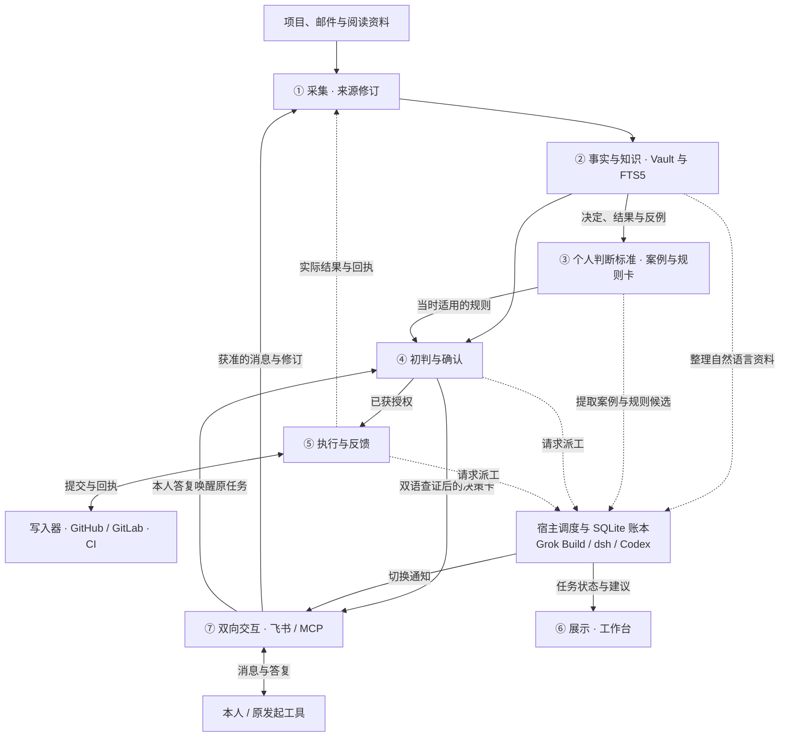

# PAtrick 技术方案

PAtrick 把散落在项目、对话和阅读中的资料与判断经验连起来，按你的标准自动完成产品设计、开发和知识整理，只在确实需要你作取舍时提问。

## 1. 主栈选 TypeScript

**决策顺序**是先保证一件真实工作能无人接力地交付，再比较 100 人时内要写多少适配代码、每周 1 小时内要维护几套服务，最后考虑未来的算法需求。

| 比较项 | Python | TypeScript |
|---|---|---|
| worker 接入 | 可用 dsh Python SDK，也能经子进程适配 Grok Build、Codex。复用 Super Agent 的 TS 小模块需翻译或跨进程。 | 统一适配 dsh ACP、Grok Build CLI、Codex 非交互模式，共用角色类型和结果校验，也能复用原型的小模块及用例。 |
| 当前工作量 | FastAPI、飞书及 MCP 的 Python SDK 足以搭建首版。文件监听、Git、SQLite 两种语言都能做。 | 文件监听、飞书、Octokit、MCP 和网页用同一套类型、依赖锁和测试。外部输入仍须在运行时校验。 |
| 长期代价 | 文档解析、检索实验及数据分析选择多。若这些成为主业，Python 更有优势。 | 首版的工作量集中在事件、权限和回执。代价是跟踪 Node 与 Harness 的版本兼容。重型解析以后可作为独立 Python 工具接入。 |

**决定采用 Node.js 24＋TypeScript**，自有代码放在一个项目。Hono 提供 HTTP 和服务端页面，SQLite 保存任务，Vitest 测试。今后若引入 Python 解析器，它与主服务只交换带版本的数据。[Harness Python SDK][py] · [Harness CLI][cli] · [ACP TypeScript SDK][acp] · [FastAPI 模板][fastapi]

## 2. DeepSeek Super Agent 复用到哪里

DeepSeek Harness（dsh）负责运行智能体。**Super Agent 是构建在 dsh 之上的单仓主动编码研究原型**，监听 GitHub 和可选的飞书，判断是否受理，为工单分配独立会话，订阅原讨论并回传结果。以下按公开提交 `6337fc8` 选型，仅把该版本已有的行为计入可复用范围。[原型与定位][super] · [作者设计说明][article]

- **直接取用小块源码。** 稳定键函数可用于消息去重，输入补齐授权域、仓库、来源对象和修订。保留 MIT 声明，把上游“执行器重启后恢复待处理消息”的用例改接 PAtrick 存储，作为回归样本。原包标为 `private`，没有独立的 `./core` 导出。[键生成][ids] · [恢复用例][resume] · [包定义][pkg]
- **移植三种做法。** 同一讨论的新消息直达已订阅的任务，避免重复调用模型分派。长期任务与一次模型运行分开，等你回答时可释放 worker。发消息前持久化意图，重发前按目标线程、发送方和稳定标记查回执。这些都由 PAtrick 的同一份任务账本承载。[来源接口][sourcekind] · [事务收发箱][outbox] · [GitHub 去重][marker]
- **自行掌握交付与授权。** 原型可在无关联 PR 时把 `ready` 记为完成，零项检查也可能显示 CI 通过。部署预设给予执行器完整主机权限。PAtrick 自建入库前的权限过滤、本人问答续办和受控写入器。模型只提交建议或补丁，正式交付要有远端证据。[结束条件][ready] · [CI 汇总][cisummary] · [部署预设][preset]

## 3. 七层架构与逐层选型

下文的“宿主”是 PAtrick 常驻的 TypeScript 业务服务。每台执行机另有网络守护器。主流程是 **捕获来源修订 → 整理并检索知识与个人标准 → 初判 → 制定执行方案 → 执行 → 检查 → 取得交付回执 → 反馈**。工作台展示进度，交互层负责随时收答。七层按版本化接口替换，共用 Markdown 和任务账本。

| 层与必要性 | 比较、选择与自研边界 |
|---|---|
| **① 采集** · 知道哪份材料变了 | **选 Chokidar＋补扫，并接收⑦的消息事件**。文件和获准消息都输出同一种来源修订。单一同步目录只需库，不必另管 Node-RED 流程服务。监听提示后等文件稳定，读取内容并计算修订，定时扫描补漏、处理撤回，入账成功才推进游标。以后需要可视化编排多个来源时，Node-RED 也只须输出同一种 `SourceRevision`。[Chokidar][watch] · [Node-RED][nr] |
| **② 事实与知识** · 知道结论从何而来、何时有效 | **选 Obsidian Vault 存卡、SQLite FTS5 供程序搜索、PAtrick 知识整理模块负责建卡。** 整理文章、PRD 和对话时，模块调用只读 worker 提取候选，从当前原文核对出处后写入。Obsidian Search 供本人查阅，Bases 查看兴趣主题和待复核资料。多跳关系或历史题反复答错时，再考虑 Graphiti 作为派生索引。[Obsidian Search][obssearch] · [Bases][bases] · [FTS5][fts] · [Graphiti][graphiti] |
| **③ 个人判断标准** · 区分你的原则、通用建议和模型猜测 | **选同一 Vault 的决策案例和版本化规则卡，由 PAtrick 案例提取模块维护。** 模块复用②的 worker 池提炼非结构化材料，自己核实本人身份、适用范围与证据，决定能否引用为本人原则。Letta 可维护 agent 记忆，Vault 卡可以逐版审阅和回放。执行权限仍由宿主另行校验。[需求文档](PAtrick需求文档.md) · [Letta][letta] · [原型受理策略][admission] |
| **④ 初判与确认** · 决定能否做、是否必须问你 | **首版用 Grok Build 只读决策 worker＋宿主动作策略**。dsh、Grok Build、Codex 均经适配器实现同一 `Decision` 接口。输出依据、适用规则、建议与缺口。遇到必须由你取舍的问题，先检索中英文原始资料并综合判断，再通过⑦发送两条建议和自定义选项。LangGraph 可用于复杂编排，首版固定流程由账本续办。宿主独立校验当前授权和剩余额度。[Harness CLI][cli] · [Codex 非交互模式][codex] · [LangGraph][langgraph] |
| **⑤ 执行与反馈** · 把建议变成可查的业务结果 | **首版按 Codex 规划 → Grok Build 或 dsh 执行 → Codex 检查与反馈运行**。与④共用三个 worker 的调度器，当前 worker 不可用时自动换用已准入的备选，并经⑦通知本人。隔离 worker 生成补丁及测试记录，Codex 检查后交宿主写入器创建 PR、查 CI、合并并读回。Codex 再依据真实交付回执形成反馈，关联事实与规则。写入器独占短期仓库凭据。[Codex 非交互模式][codex] · [Octokit][octokit] · [GitLab MR 流水线][gitlab] |
| **⑥ 展示** · 一眼知道在做什么、什么在等你 | **选 Hono 服务端 HTML**。上游面板依赖 DSH Web 且将部分投递失败列入人工处理。Obsidian Bases 适合读知识。自研一页三栏“正在处理／等我回答／建议与结果”，显示最后进展、理由和证据链接，技术故障列在任务旁。界面只读 `TaskView`，回答经第七层入账，关掉页面仍照常运行。[Hono JSX][hono] · [原型阶段映射][stage] |
| **⑦ 双向交互** · 人和工具都能提问并收到答案 | **选飞书官方 Node SDK＋MCP TypeScript SDK**。上游飞书适配器回复已有消息，源自本地文件的任务还需主动私聊本人。本人可在飞书查询和作答。MCP 供 Cursor/Codex 查资料、提问，仓库适配器关联原讨论。⑦把获准归档的消息交给①，另将答复送回已登记任务。切换通知主动发到本人飞书，不需确认。决策卡则绑定问题编号、发起方、本人和修订，支持选择建议或输入自己的决定。等人时释放调用，离线后按水位补读。答复自动唤醒已登记任务并回送。外部工具重连也能按编号取答。[飞书 SDK][feishu] · [历史消息][history] · [MCP SDK][mcp] · [原型回复接口][reply] |

### ⑦的消息怎样进入①

**会。⑦负责收发和身份校验，①把获准留存的业务内容登记为来源。** 宿主按消息用途分别投递，同一条本人答复可以同时服务当前任务和长期记忆。

| ⑦收到或发出的内容 | 给当前任务的结果 | ①如何采集 |
|---|---|---|
| 本人选 A/B、输入 C 或纠正旧决定 | 按身份、问题与任务版本接纳一次答复，自动续办 | 保存本人原话或所选建议的冻结文本、适用范围和出处。该记录可进入③的案例库 |
| 飞书需求、邮件摘录、GitHub 讨论或工具给出的项目事实 | 投递到相应项目或讨论 | 保存获准原文的位置及修订。工具的推测标明作者，待核实后才成为事实 |
| 临时查询、worker 切换通知、投递回执和机器人自身消息回流 | 查询返回答案；通知只供知晓 | 普通查询可记在任务历史，纯运行消息只留审计编号。它们不会自动变成本人的原则，也不会触发新的采集循环 |

⑦先持久接收，再分别投递“处理原任务”和“采集来源”。①按授权域、平台、原消息 ID 与修订去重；实时收件、离线补读和文件镜像能证明同源时仅生成一份来源修订。采集暂时失败会自动补投，不让你重复回答。迟到或未通过身份核验的答复不能写成已采纳的本人原则。消息编辑或撤回会使相应事实、规则和待办重新核实；按当下权限清理原文、案例摘录与索引，只保留允许的版本及撤回标记。仅获准临时处理的消息只留必要的运行标识，原文及其派生内容均不进入长期 Vault。

### ② 谁整理事实与知识，谁负责搜索

**整理归 PAtrick 的知识整理模块（`src/knowledge.ts`）。** ①交给它带授权范围、原文定位和修订号的材料。PR 编号、提交 SHA、CI 回执等有固定字段的数据由程序直接解析。遇到文章、PRD 或飞书讨论，模块才调用只读角色 `knowledge_extract`，从获准片段提取陈述、逐字引文、解释和概念关联。首版首选 **Grok Build**，复用④已经接入的运行器。dsh、Codex 通过同一角色的准入测试后可自动接手，每次只派一个 worker。

**核实和写入归宿主。** 知识整理模块重读对应修订，核对引文、权限和有效期。原文可以证明作者提出过某个主张。要把主张用于业务判断，还须有相应的权威记录或独立证据。事实卡保存单条陈述、原句与核实状态。知识卡围绕一个主题整理多张事实卡，用双链列依据、冲突和反例。缺证标待核，解释和推论标明依据。只有宿主能发布这些 Markdown 卡并更新搜索索引。来源更正或撤回时先使旧引用失效，再重算关联知识。worker 故障期间保留已接收的修订，恢复后按同一修订补办。

**搜索分两个入口。** 你可以在 Obsidian 用内置 Search 查正文、路径，用 Bases 按属性浏览。飞书、工作台、Cursor/Codex 及④统一调用 PAtrick 的 `lookup`。宿主在 SQLite FTS5 用 `MATCH` 搜标题、别名、正文和中文词项，限定调用者的授权域、项目和当前有效版本，按 `bm25()` 排序，再凭卡片 ID 回读 Vault 原句和出处。关掉 Obsidian 或停用模型，已发布资料仍可查。索引丢失可由 Vault 和当前撤回记录重建。[Obsidian Search][obssearch] · [FTS5 查询与排序][fts-query]

**中文短词单独处理。** 首版用 `unicode61`，建索引与查询时都把连续中文拆出相邻双字词，例如“草稿恢复”包含“草稿”和“恢复”。英文保留词项，项目别名一同索引。SQLite 自带的 trigram 全文查询对少于三个字符的词没有匹配。若真实问答里出现换个说法就搜不到的情况，再用这些漏搜样本评估是否叠加语义检索。[FTS5 分词器][fts]

### ③ 如何积累并改进个人判断标准

**长期主本是 Vault 里的决策案例和带版本的规则卡。** 案例记某一次如何选择，规则记在什么条件下应怎样判断。首版先回读一个产品已有的 PRD、评审与本人决定，建立第一批有出处的案例和明确原则，其他领域随真实工作自然扩展。两者用稳定 ID 和双链连接原始资料、采用过它的任务和后来的结果。换模型或 worker 时仍能读回这段判断历史。

**自研的是案例提取模块（`src/standards.ts`），理解自然语言时会用 worker。** ⑦已核验的 A/B/C 答复由程序直接登记本人原话或当时所选建议，⑤可验证的业务回执按同一案例追加。对于散落在 PRD、评审和多次讨论中的决定，模块调用只读角色 `case_extract`，首选 **Grok Build**，不可用时依次尝试获准的 **dsh、Codex**。worker 返回候选案例、可能的规则、支持及反对的原文位置。宿主按原始决定 ID 和修订去重，核验本人、范围、例外和有效依据后写卡。模型概括只进入“观察”。只有能追溯到已核身份的本人明确决定，才可在该决定覆盖的范围内用于④初判。

1. **每逢真实选择，自动留一案。** 本人的飞书答复、PRD 决定、评审意见或对助手的纠正触发建卡。冻结当时的目标、可见证据、候选项、助手的初判、本人决定与原话、适用产品/领域。没有明说的理由标为未知，后来发生的结果另行追加。
2. **从案例抽取有边界的规则。** 规则卡记录条件、优先考虑什么、例外、支持案例、反例、版本与出处。一次明确选择首先只适用于该事项；有可核的本人原话明确覆盖更广范围时，才按该范围使用。模型发现的重复模式、专家方法和行业经验分别标为“观察”或“外部参考”。它们可用于比较建议，仅凭多次猜中不能转为本人原则。
3. **在后续任务里留下预测，再用结果校准。** ④先记录它引用的规则版本、推荐选项、依据和预期结果。到了案例约定的复核时间，⑤把实际交付、后续更正及产品指标关联到原案，包括失败和放弃的方案。若你的选择不同，分别核对是漏了事实、误解了你的偏好，还是规则有例外；选得像你和实际业务效果分别计量。短期结果缺失或无法归因时继续观察。
4. **每周复盘反例，每月用新案例比较版本。** 在一个领域内，用当时可得的资料、隐藏本人选择和事后结果，让旧版与候选版回答同一组未参与提炼的案例，并与有出处的行业方法比较。分开报告关键约束漏判、本人纠正次数、漏问/误问、可观察的业务结果及样本数。只有改善原错题且关键题不退化，才试用候选版本。证据仅支持原项目，就只在原项目试用。若候选改变你本人的价值取舍，先保留为建议，等待你的真实决定提供依据。证据被撤回、规则过期或出现适用冲突时暂停引用，保留旧版与修订原因，本域未决任务重新判断。
5. **把学到的东西还给你。** 工作台每周展示一个最值得复盘的真实案例：当时依据了哪条规则，结果怎样，哪种条件过去被忽略，以及下次可以怎样判断。如果你在新任务里自然表达了自己的初判，系统对照最初判断、建议、最终选择与结果，跟踪哪种改进在新场景仍有效。日常不要求手工标注；只有真实任务的取舍仍不清楚时，才按下文三选一流程询问。

例如飞书讨论提到“导出失败后有人丢了草稿”。②可请 worker 找出原句，先记为用户报告，有复现或获准日志再补核实结果。你选 C“仅本产品保留草稿到下次成功导出”后，③直接把这条答复和产品范围写入案例。如果后来多次评审都提到敏感草稿，③才请 worker 对照这些案例，提出带例外的候选规则。下次你问“草稿怎么处理”，FTS5 找到本产品仍有效的事实和规则，④给出建议并附原话。后续可核对草稿找回与超期未清理情况，在留出案例上检验新版本。

### memhub 在②③的复用范围

**首版保留 Vault 主本、FTS5 搜索和现有提取 worker。** memhub v0.2.3 最能省工的是 Cursor/Codex 的会话解析、增量游标和现成测试。在工具适配器中只移植试点用到的解析逻辑和样例，保留 Apache-2.0 许可证、来源和改动说明。memhub 自带的完整写入链还涉及 Python、Chroma、Kuzu，以及生成、嵌入和 JEV 写入裁决三个提供方。已有 CLI 订阅能否覆盖这些服务要另行核实。它的 Git／网盘同步会复制记忆正文、元数据和向量，PAtrick 继续按第 5 节从授权 Vault 和单写入者同步。[固定版本][mh-release] · [许可证][mh-license] · [会话解析][mh-source] · [依赖][mh-deps] · [提供方配置][mh-config] · [同步内容][mh-sync]

1. **让工具在需要时自动带上记忆。** 首版先接一个产品的受管 Codex 任务。启动前由⑦用已认证的项目身份调用②的 `lookup`，核验该工具与模型可读的范围，只带入少量有效卡片、版本和出处。回合结束后，⑦把获准的新对话交①增量采集。实时和历史补读按原始会话、轮次和修订去重，剥离此前注入的记忆，避免把同一句话学两次。未知项目返回空结果。上游默认召回会带入全局画像，也可能带入匹配度更高的其他项目事实，不能直接承担公司 GitLab 和个人 GitHub 的权限隔离。[增量采集][mh-source] · [上游召回实现][mh-scope]
2. **给②增加可验证的排障经验卡。** 沿用 memhub 的问题、解法、涉及文件和适用环境，再绑定产品、代码版本、测试／CI 回执及失效条件。同类错误可按症状和不同问法找回。会话里助手说“修好了”只生成待核经验，⑤回收成功证据后才能供下次任务引用。工程经验保留在②，是否体现本人的判断取舍另由③核验。[工程经验字段][mh-procedure]
3. **给③区分当场记下的决定和事后归纳的规律。** 有身份和范围的本人明确选择立即按其原义记录。当同域案例新增或因纠正、结果而修订，主机在队列空闲时调用 `case_extract` 提炼观察，并记录支持和反对的原始案例 ID。同一决定在飞书、PRD 和工具对话中的镜像只算一次。规则版本区别处理“本人明确改了主意”“只在本产品或某段时间例外”“证据互相冲突”。前者从生效时间接替旧版，例外保留基线，冲突同时保留两侧并暂停自动引用。来源撤回立即停用相关规则。模型归纳进入每月留出案例对照，只有本人明示的范围才能作为其原则。[分层与版本语义][mh-layers] · [归纳时的证据校验][mh-digest]

**Cursor 的逐轮注入单独验收。** 上游列出八种工具，但接入深度不同，例如 Hermes 目前只接 MCP 和 skill。上游给 `beforeSubmitPrompt` 返回 `additional_context`，Cursor 对该事件公布的输出只有 `continue` 和 `user_message`。本地 Cursor 可先用有明确契约的 `sessionStart` 注入项目摘要，后续任务由受管工具经 MCP 自动查询当前版本。用一条只存在于试点卡中的标识验证工具确实取得并引用它，撤回后用新会话重测，并在执行动作前复核出处。验收依据是工具实际收到且使用了当前版本。[各宿主接入方式][mh-hosts] · [上游钩子输出][mh-hook] · [Cursor 逐轮钩子][cursor-prompt] · [Cursor 会话启动钩子][cursor-session]

**何时值得加 memhub 检索。** 作者在同模型条件下与 hy-memory、mem0 比较了三个题集，其中 LongMemEval 是 24 题，PersonaMem-v2 对 mem0 的差异未达显著，LoCoMo 多跳题也落后于 mem0。它们衡量记忆问答，不能验证个人原则或业务结果。只有真实同义问法、多跳或历史题反复漏召回，才在 T11 原有预算内，用一个获准产品的冻结副本，对照 FTS5 与 memhub 的关键词、语义和图关系混合检索。试验单独存储，全程只读 PAtrick 主本。用相同候选条数、资料截止时间及预算，检查正确出处命中、跨域返回、撤回后复现、错误原则、费用和维护分钟。至少修好一道原错题、关键题不退化、越域和撤回泄漏为零，才考虑让它返回候选卡片 ID，最终仍由宿主回读核验。[混合检索源码][mh-hybrid] · [作者评测协议与分项结果][mh-bench]

### 首版 worker 分工

| 阶段 | 首版 worker | 必须交出的结果 |
|---|---|---|
| ② 整理自然语言资料 | Grok Build | `knowledge_extract` 提交陈述、引文和知识关联候选，宿主核实后写卡 |
| ③ 提取案例与规则线索 | Grok Build | `case_extract` 提交候选案例、规则和反例，宿主核验并区分观察与本人明示 |
| ④ 初判与确认 | Grok Build | `Decision`，包含证据、个人标准及是否需要本人回答 |
| ⑤ 制定执行方案 | Codex | `ExecutionPlan`，列明目标、基线、步骤、允许路径、测试和停止条件 |
| ⑤ 执行 | Grok Build 为默认，可配置 dsh | 按已校验的方案修改隔离副本，提交补丁摘要、测试结果和问题 |
| ⑤ 检查结果 | Codex | 对照原需求与方案，核对实际补丁、独立测试及问题，给出通过、返修或提问 |
| ⑤ 反馈 | Codex | 依据合并版本、CI 和读回结果形成反馈，提出事实卡、规则卡的更新候选 |

**worker 可替换，角色和流程由宿主管理。** dsh 用 ACP，Grok Build 用非交互 CLI，Codex 用 `codex exec`，各适配器统一接收任务与版本、角色、已授权上下文和输出 Schema。每次运行记录实际运行器、模型、提供方、权限与费用。上表是各角色的首选。每个运行器先用相同接口回放，并验证该数据域允许的提供方、工具权限和费用，才加入该角色的候选清单。

**方案与结果逐版绑定。** Codex 规划与检查使用独立的只读角色，会执行测试的代码仍在隔离区运行。宿主校验方案后才派执行 worker；Codex 检查绑定同一需求版本、方案摘要及实际产物摘要。返修自动回到执行阶段，方案或基线变化则重新规划与检查，最多两轮且受任务预算约束。只有需要你的真实取舍才发问。发布前的检查、可信 CI 和合并读回共同支持“已交付”；交付回执再交 Codex 形成反馈，失败则保留未完成状态自动重试。候选规则按第三层校验后再生效。[Harness CLI][cli] · [Codex 非交互模式][codex]

**数据归属与恢复。** Vault 保存可读的事实和标准。SQLite（`better-sqlite3`）在同一事务记录任务状态和待执行动作。一次动作使用一个稳定编号，断电后先查远端再补做。技术故障退避重试，入库和调用模型前分别校验资料权限。首版单机无需消息服务器。出现跨机离线积压时再比较 NATS JetStream，以重复投递后仍只产生一次业务效果为切换条件。[SQLite 适配器][sqlite] · [JetStream][nats]

### worker 不可用时自动切换并通知

宿主统一调度②③的两个提取角色和④⑤的全部角色。知识整理、案例提取、初判和默认执行按 **Grok Build → dsh → Codex** 尝试。显式选 dsh 执行时按 **dsh → Grok Build → Codex**。规划、检查和反馈按 **Codex → Grok Build → dsh** 尝试。先过滤未获当前数据域、角色权限和额度准入的候选。检查优先交给与实际执行不同的运行器；只有预先验证了独立只读配置时，才允许同一运行器换独立会话检查。

启动失败、超时、持续限流或该运行器凭据失效时自动切换。测试失败或检查要求返修，仍走业务返修流程。换手沿用原任务、角色和冻结输入，生成新的尝试编号，拒收旧尝试的迟到输出。若旧动作可能已经写入远端，先核对回执，结果不明时暂停外写。每轮每个候选最多试一次；全部不可用则保留任务，退避探测后自动续办。

**每次实际切换都主动告知本人。** 宿主在同一事务中登记新尝试和⑦的通知，飞书私聊说明“哪个任务、哪个角色、从谁换到谁、原因、是否已续办”。通知失败由收发箱补送，按切换编号去重；全员不可用也告知阻塞原因和下次探测时间。通知不进“等我回答”，不拦住健康 worker。

### 必须本人决定时，先查证，再给三个选项

④发现可能需要本人选择时，先由宿主的只读检索接口分别用**中文、英文**从问题本身、备选做法、反例或失败案例等角度查询。打开原文，记录出处、日期、适用条件和矛盾点；尽量取得两种语言的一手资料，并找独立来源交叉核对。同一原文的翻译或转载只算一个来源。检索词遵守资料出域权限。

worker 把查得的事实、仍不确定的判断、本人已有标准分开，对候选按适用性、收益、代价、风险和可逆性比较。已有证据能决定的直接处理。仍需本人权衡的，经⑦发一张决策卡，说明待选问题和关键分歧，**恰好提供三个入口**：

- **A · 首选建议**，说明具体怎么做、为何更符合你的标准、主要代价与依据。
- **B · 第二建议**，提供另一种可行做法，说明什么条件下它更合适、会放弃什么，并附依据。
- **C · 我自己决定**，接受本人自由输入，由宿主原样绑定本题和适用范围。

两种语言都要实际查。若某一语言缺可靠资料，继续换词查证并标记证据缺口；若仍能支持两个可行建议，卡中明示不确定性，否则保持待补证并重试。你选 A/B 或输入 C 后，宿主按本人身份、问题编号、卡片和任务版本验收，去重并自动续办。旧版答复触发重新判断，不执行过期选项。

## 4. 最小可用系统与验收

**只接一种工作。** 你在同步空间的 `productIdeas` 正常修改一个产品的想法，PAtrick 自动把已有证据支持的验收条件补入该产品 GitHub 仓的正式 PRD。首次只配置一个目录、一个目标仓和允许路径、可信 CI、一个本人飞书账户、模型出口和费用上限。初始事实与规则取自已有 PRD 和你表达过的决定。单纯的新点子自动归档为待验证假设。

1. 保存文件后，①捕获修订，②找原句和竞品或用户证据，③取当时有效的规则，④由 Grok Build 决定可以修订、应归档或需要一个答案。决策端经⑦按任务编号查询证据和标准，⑥自动显示进度与建议。
2. 例如资料同时要求“导出失败即删草稿”和“保留七天”，系统先查适用范围。系统用中英文查询相关用户体验、数据保留实践及反例。如果仍需你选，可给 A“仅本产品保留七天以便恢复”、B“失败即删以降低留存成本”，按实际证据标首选、列代价与出处，另给 C“我自己决定”。你可以选 A/B，也可在 C 输入“仅保留到用户下次成功导出”。宿主核验本人和当前版本，只唤醒原任务一次。资料已更新则重新判断。
3. ⑤先让 Codex 产出执行方案，宿主校验后交 Grok Build（或已配置的 dsh）生成补丁并测试，再由 Codex 检查实际结果。未通过自动返修。写入器复核最新授权、来源和允许路径，要求 PR 当前 head 的可信必需检查逐项成功。缺项、跳过或基线改变就阻塞或重验。合并后读回 `目标仓/PRD路径@合并SHA`，Codex 根据该回执给出反馈，宿主登记交付并经⑦回送原任务。[分支保护][protect] · [检查结果 API][checks]

**记忆验收。** 给②一段真实讨论，能以“草稿”或“恢复”查到本项目有效卡和精确原句。模拟提取 worker 故障并换手，预期只建一张卡，飞书收到切换通知。用同一条本人决定从实时消息与历史补读进入⑦，预期一次任务续办、一条来源修订和一个决策案例。仅给③模型概括时只能得到观察；加入绑定本人及项目的明确答复后，下一项同域任务可追溯使用的规则版本。撤回原话后，即使重建索引，旧事实和规则也不再支持新的初判。

**MVP 通过条件。** 在一个真实允许自动合并的仓，各跑一例“无需提问直接交付”和“只答一次后自动交付”。关闭 IDE、Obsidian 和工作台，仍须留下七层轨迹、Grok 初判、Codex 方案、Grok/dsh 执行、Codex 检查与反馈，以及合并回执。再模拟首选 worker 在各角色不可用、通知通道离线、全部候选不可用，以及漏文件通知、重复回答、写 PR 后断网。核对每次切换均经⑦补送通知，决策卡有中英文检索记录，A/B/C 分别能恢复原任务，重放只产生一份预期修改。若仓库要求独立人审、飞书不能补读，或订阅缺少获准的后台额度，先替换为具备相应能力的授权仓、通道或模型。条件欠缺就如实标记该链未就绪。

## 5. 运行、多端同步与网络

- **主机与隔离。** Mac mini（24 GB／200 GB 空余）由 launchd 拉起主服务，一次跑一个 worker。worker 统一在 Lima 隔离环境运行，三个运行器分别经 ACP 或 CLI 派工，按角色挂载只读材料或可写任务副本。移除默认挂载、关闭 SSH agent 转发，只交付任务材料，限制网络出口和会话日志上传。只有虚拟机外的写入器持有仓库写凭据。Mac Pro（16 GB／100 GB 空余）用于开发和恢复。手机经飞书收答，网页经认证私网访问。公司材料和凭据留在获准设备与网络域，只回传允许的字段。[Lima 挂载控制][lima] · [SSH 配置][limassh]
- **同步和备份。** 百度同步空间继续保存允许同步的业务文件。Git 提交确定发布版本，各机用独立工作副本。规范知识卡由 mini 原子写，其他端的修改作为来源修订，冲突保留双方版本。各端经 API 读取任务。活动数据库、WAL 和凭据放在同步目录外。同步会传播误删，另用 SQLite 在线备份＋restic 每日把一致快照、Vault 版本及撤回记录加密备份到获准异机。恢复先重放撤回、核对远端，吊销旧写入资格后再接管。[SQLite 在线备份][backup] · [restic 异机仓][restic]
- **每台执行主机自查、自修。** Uptime Kuma 可在异机见证失联。本机选 **launchd＋VPN 适配器**，失联时也能诊断并尝试重连。各端每分钟互发心跳，每台主机只探测获准的业务路径。心跳丢失先查本机网卡、DNS、路由、代理及 TLS，再判断对端。心跳正常但 GitLab 或 GitHub 不通也启动诊断。探内网前先验企业 DNS 与路由。内网用 Tunnelblick 的 AppleScript，或已安装 OpenVPN 发行版获准的管理接口。GitHub 用 Shadowrocket 经本机验证的“状态／连接／断开”快捷指令。加锁只重连故障路径，限次、退避、失败回退。复验故障路径、原健康路径和心跳，再核对远端续办。鉴权失败和限流单独处理，强制 MFA 提示本人。[Uptime Kuma][kuma] · [Tunnelblick][tunnel] · [OpenVPN][ovpn] · [快捷指令 CLI][shortcuts]
- **双 VPN 有条件并用。** 公司允许分流，且实测两种启动顺序、并发访问和单路重连时，内网域名与流量均走企业 DNS／路由、GitHub 走指定出口，才启用同机并用。优先使用获准的进程级公网代理。全隧道冲突或无法验证时，工作设备处理 GitLab，个人主机处理 GitHub。只有一台且政策允许轮换时，排空在途写入后分时切换。没有合格路径就挂起对应任务。[多 VPN 共存限制][twovpn]

## 6. 从一条链扩到三类工作

下表是你的累计投入预算。首个目标是 **36 小时跑通七层**。若中途未通过，优先用下一段工时修好同一条链。

| 累计人时 | 交付物与过关条件 |
|---|---|
| **0–6** | 验证 Grok Build 对知识整理、案例提取、初判、执行各角色的后台权限，以及 Codex 规划、检查、反馈的费用和隔离。逐角色核验首选与备选的实际提供方、权限和费用（dsh 需验证 ACP），至少有一个已准入备选才能验收自动切换。再核 GitHub App、必需检查、飞书私聊/补读和 Shadowrocket，并用一次预期失败的 CI 验证门禁。 |
| **6–36** | 先用一个产品打通原文→②事实卡与 FTS5→③案例和规则→Grok 初判，再接 Codex 规划、Grok/dsh 执行、Codex 检查与反馈。接上写入器、工作台、飞书和一个 MCP 工具，跑完零问、三选一回答、切换通知、检查返修与断线恢复，按合并文件验收。 |
| **36–52** | 在 16 小时内最多用 4 小时移植上游小模块与回放样例，其余验证撤回、重复、副作用、备份恢复和双 VPN 准入。上游依赖若拖慢交付，只保留协议和故障用例。 |
| **52–82** | 先接收益最高的一条。**开发与运维**从已合并 PRD 按同一 Codex 规划→Grok/dsh 执行→Codex 检查与反馈链派发，按同一提交跑测试，追至 GitHub PR／内网 GitLab MR、发布后错误率与必要回滚。**知识学习**从已有 X 书签或获准的公众号阅读信号起步，产出解释、关联、反例和到期复核。按一条真实工作验完再接下一条。[X 书签][x] |
| **82–100** | 自动评测、生成维护报表。最后 10 小时修未过的门槛。列出 100 小时内实际验收的来源、动作和领域。 |

**100 小时以后。** 先补齐开发、知识两条线中尚未通过的一条，再逐个来源、产品和判断领域扩展。产品设计增加 GitHub 远端分支增量与补扫，覆盖网页端的想法修改，再接获准的 Grok Bot 对话和飞书需求，搜集竞品一手资料。邮箱按服务商增量接口接入。本地笔记沿用文件适配器。公众号、个人微信或第三方 Grok 若没有获准的自动入口，工作台列为“未覆盖”。日常流程不增加转发、贴标签或导出。

**保持水平靠同题对照。** 每周统计漏采、错误引用、漏问／误问、真实交付、费用和维护分钟。每月自动从上游版本、业内方法或新模型中挑一个能解错题的候选；个人规则的升级另按③分领域比较新旧版本。首版用 Vitest 禁写回放。需要批量对比多个模型时再用 Promptfoo。记忆题测时间、撤回和弃答，判断题隐藏你的原答案与事后结果。同预算下至少修好一道原错题、关键题无退化，且越权、重复外部动作和假交付均为零，才在一个产品试用。异常自动切回旧版并对账。每周维护上限 60 分钟，连续两周超限就暂停扩源，先修耗时最多的环节。[Vitest][vitest] · [Promptfoo][promptfoo] · [LongMemEval][longmem] · [Agent 评测方法][eval]

[py]: https://deepseek-harness.github.io/deepseek-harness/guide/python-sdk
[cli]: https://github.com/deepseek-ai/deepseek-harness/blob/master/apps/cli/README.zh.md
[acp]: https://github.com/agentclientprotocol/typescript-sdk
[fastapi]: https://fastapi.tiangolo.com/advanced/templates/
[super]: https://github.com/deepseek-ai/dsh-superagent-prototype/tree/6337fc823ce20251c8de8085948165c81aaa701e
[article]: https://mp.weixin.qq.com/s/zoS7GlReWPhfCjENGxXCdg
[ids]: https://github.com/deepseek-ai/dsh-superagent-prototype/blob/6337fc823ce20251c8de8085948165c81aaa701e/src/core/ids.ts
[resume]: https://github.com/deepseek-ai/dsh-superagent-prototype/blob/6337fc823ce20251c8de8085948165c81aaa701e/tests/runtime-concurrency.spec.ts#L693-L709
[pkg]: https://github.com/deepseek-ai/dsh-superagent-prototype/blob/6337fc823ce20251c8de8085948165c81aaa701e/package.json#L4-L21
[sourcekind]: https://github.com/deepseek-ai/dsh-superagent-prototype/blob/6337fc823ce20251c8de8085948165c81aaa701e/src/sources/kind.ts#L84-L108
[outbox]: https://github.com/deepseek-ai/dsh-superagent-prototype/blob/6337fc823ce20251c8de8085948165c81aaa701e/src/app/outbox.ts#L26-L50
[marker]: https://github.com/deepseek-ai/dsh-superagent-prototype/blob/6337fc823ce20251c8de8085948165c81aaa701e/src/sources/github-channel.ts#L25-L40
[ready]: https://github.com/deepseek-ai/dsh-superagent-prototype/blob/6337fc823ce20251c8de8085948165c81aaa701e/src/core/assignments.ts#L121-L132
[cisummary]: https://github.com/deepseek-ai/dsh-superagent-prototype/blob/6337fc823ce20251c8de8085948165c81aaa701e/src/sources/github-read.ts#L13-L36
[preset]: https://github.com/deepseek-ai/dsh-superagent-prototype/blob/6337fc823ce20251c8de8085948165c81aaa701e/docs/006-deployment.md#L13-L34
[watch]: https://github.com/paulmillr/chokidar
[nr]: https://nodered.org/about/
[bases]: https://github.com/obsidianmd/obsidian-help/blob/master/en/Bases/Introduction%20to%20Bases.md
[obssearch]: https://help.obsidian.md/plugins/search
[fts]: https://www.sqlite.org/fts5.html#the_trigram_tokenizer
[fts-query]: https://www.sqlite.org/fts5.html#the_bm25_function
[mh-release]: https://github.com/shibing624/memhub/tree/1c039327396f6d543a7ef6b4b78b147f80ad8990
[mh-license]: https://github.com/shibing624/memhub/blob/1c039327396f6d543a7ef6b4b78b147f80ad8990/LICENSE
[mh-hosts]: https://github.com/shibing624/memhub/blob/1c039327396f6d543a7ef6b4b78b147f80ad8990/docs/memhub.md#L128-L136
[mh-hybrid]: https://github.com/shibing624/memhub/blob/1c039327396f6d543a7ef6b4b78b147f80ad8990/memhub/retrieval/hybrid_engine.py#L1-L10
[mh-source]: https://github.com/shibing624/memhub/blob/1c039327396f6d543a7ef6b4b78b147f80ad8990/memhub/hub/sources.py#L637-L699
[mh-deps]: https://github.com/shibing624/memhub/blob/1c039327396f6d543a7ef6b4b78b147f80ad8990/pyproject.toml#L6-L28
[mh-config]: https://github.com/shibing624/memhub/blob/1c039327396f6d543a7ef6b4b78b147f80ad8990/memhub/config.default.yaml#L2-L39
[mh-sync]: https://github.com/shibing624/memhub/blob/1c039327396f6d543a7ef6b4b78b147f80ad8990/docs/memhub-server.md#L73-L77
[mh-scope]: https://github.com/shibing624/memhub/blob/1c039327396f6d543a7ef6b4b78b147f80ad8990/memhub/hub/server.py#L412-L461
[mh-procedure]: https://github.com/shibing624/memhub/blob/1c039327396f6d543a7ef6b4b78b147f80ad8990/memhub/coding/types.py#L37-L89
[mh-layers]: https://github.com/shibing624/memhub/blob/1c039327396f6d543a7ef6b4b78b147f80ad8990/docs/memory_layers.md
[mh-digest]: https://github.com/shibing624/memhub/blob/1c039327396f6d543a7ef6b4b78b147f80ad8990/memhub/system2/system2_agent.py#L316-L366
[mh-hook]: https://github.com/shibing624/memhub/blob/1c039327396f6d543a7ef6b4b78b147f80ad8990/memhub/cli/hub.py#L512-L531
[cursor-prompt]: https://cursor.com/docs/hooks#beforesubmitprompt
[cursor-session]: https://cursor.com/docs/hooks#sessionstart
[mh-bench]: https://github.com/shibing624/memhub/blob/1c039327396f6d543a7ef6b4b78b147f80ad8990/docs/benchmarks.md#L26-L61
[graphiti]: https://github.com/getzep/graphiti
[letta]: https://github.com/letta-ai/letta
[admission]: https://github.com/deepseek-ai/dsh-superagent-prototype/blob/6337fc823ce20251c8de8085948165c81aaa701e/docs/002-authorization.md#L91-L110
[langgraph]: https://docs.langchain.com/oss/javascript/langgraph/overview
[octokit]: https://github.com/octokit/octokit.js
[pulls]: https://docs.github.com/en/rest/pulls/pulls
[gitlab]: https://docs.gitlab.com/ci/pipelines/merge_request_pipelines/
[hono]: https://hono.dev/docs/guides/jsx
[stage]: https://github.com/deepseek-ai/dsh-superagent-prototype/blob/6337fc823ce20251c8de8085948165c81aaa701e/src/core/stage.ts#L5-L25
[feishu]: https://github.com/larksuite/node-sdk
[history]: https://open.feishu.cn/document/server-docs/im-v1/message/list.md
[mcp]: https://github.com/modelcontextprotocol/typescript-sdk
[reply]: https://github.com/deepseek-ai/dsh-superagent-prototype/blob/6337fc823ce20251c8de8085948165c81aaa701e/src/sources/feishu-channel.ts#L18-L30
[sqlite]: https://github.com/WiseLibs/better-sqlite3
[nats]: https://docs.nats.io/learn/jetstream/pull-consumers
[protect]: https://docs.github.com/en/repositories/configuring-branches-and-merges-in-your-repository/managing-protected-branches/about-protected-branches
[checks]: https://docs.github.com/en/rest/checks/runs
[backup]: https://sqlite.org/backup.html
[lima]: https://lima-vm.io/docs/reference/limactl_start/
[limassh]: https://raw.githubusercontent.com/lima-vm/lima/master/templates/default.yaml
[restic]: https://restic.readthedocs.io/en/stable/030_preparing_a_new_repo.html
[kuma]: https://github.com/louislam/uptime-kuma
[tunnel]: https://tunnelblick.net/cAppleScriptSupport.html
[ovpn]: https://openvpn.net/community-docs/management-interface/
[shortcuts]: https://support.apple.com/guide/shortcuts-mac/run-shortcuts-from-the-command-line-apd455c82f02/mac
[twovpn]: https://tailscale.com/docs/reference/faq/other-vpns
[x]: https://docs.x.com/x-api/users/get-bookmarks
[vitest]: https://vitest.dev/guide/
[promptfoo]: https://www.promptfoo.dev/docs/intro/
[longmem]: https://github.com/xiaowu0162/LongMemEval
[eval]: https://www.anthropic.com/research/demystifying-evals-for-ai-agents

[codex]: https://developers.openai.com/codex/noninteractive/
