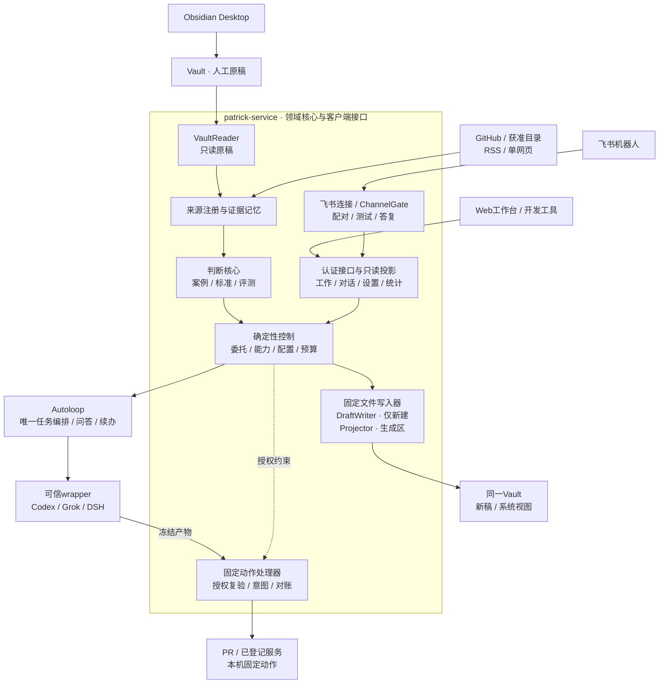
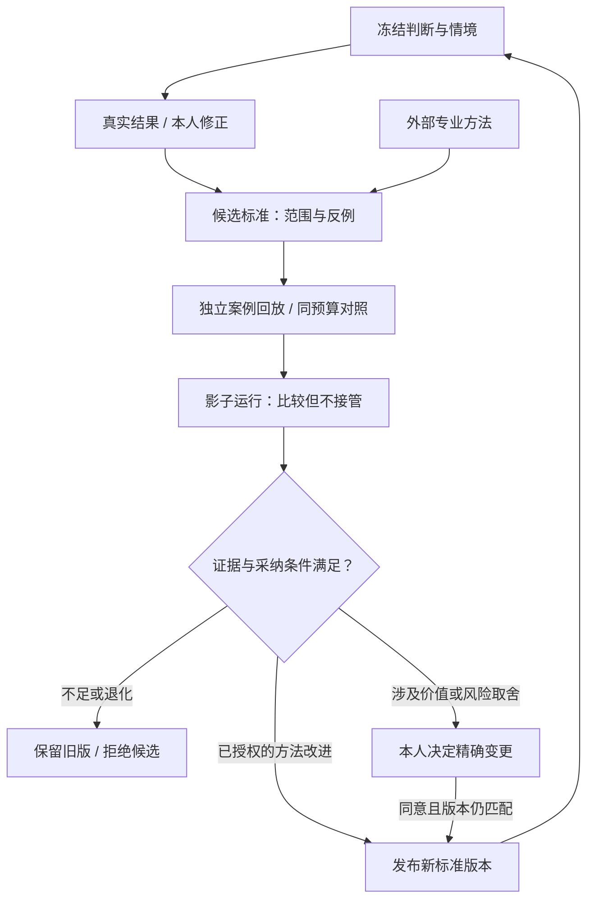
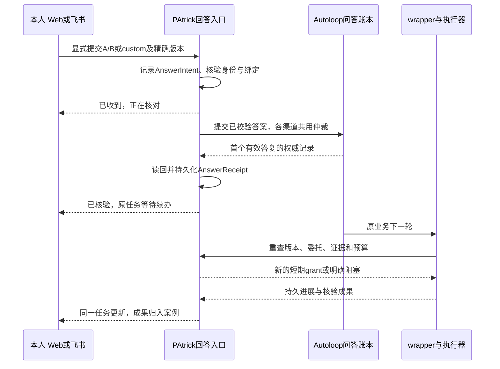
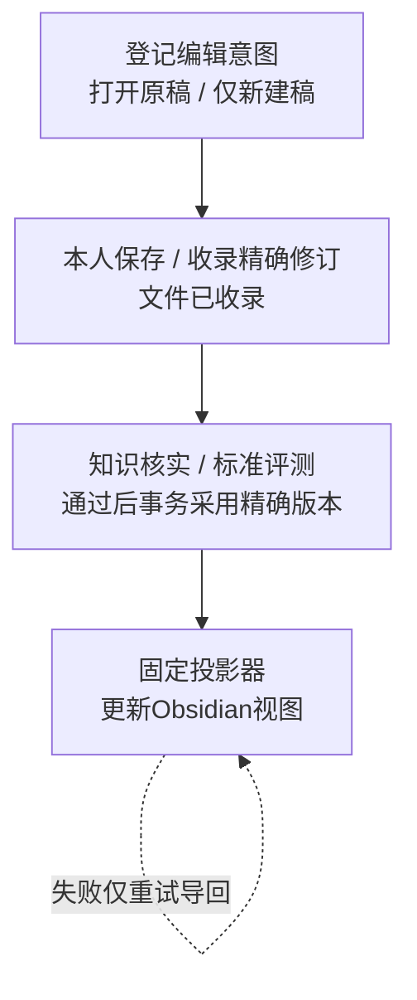
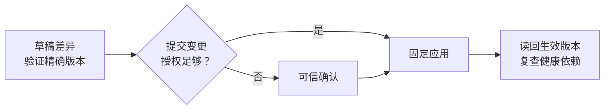

# PAtrick 技术设计 v2：让判断持续进化，让工作可靠推进

修订：v2.1 · 2026-11-15。对齐[产品设计 v2.6](PAtrick产品设计.md)，保留七层闭环、三种执行器与长期运行要求。**按全新系统设计：从空代码仓库、空数据库和首次部署开始，不以现有PAtrick代码或历史实现为约束。** 开发拆解见[技术实现计划](../plans/PAtrick技术实现计划.md)。本轮把产品§4.1、§5.4–5.5的编辑与连接流程落实为数据、状态和接口，并更新§7.2验收映射。本文是实现合同；原型、Figma预设和上游能力均不代表真实服务已经联通。

## 1. 设计哲学：少占用注意力，持续提高判断与交付质量

**让你的判断，持续向顶尖进化。** PAtrick是随时可对话的第二大脑：有依据、有委托就推进，缺少关键取舍就提出具体问题；把每次回答、纠正和真实结果沉淀为可验证的个人标准，持续吸收更好的方法与AI能力。

长期资产是个人的知识、判断标准、案例和委托关系。模型、执行器、编辑器与编排产品都应能替换，而这些资产继续有效。成功的表现是成果更好、返工更少、本人需要投入的注意力更少；任务数、笔记数和模型调用量都只是过程数据。

### 1.1 从三个项目继承什么，再向前走一步

| 参考项目与已核实原则 | PAtrick 的架构选择 | 进一步建立的能力 |
|---|---|---|
| **DeepSeek Harness**：能力通过服务接口提供，一切可插件化；模型可见内容应能从日志还原 [H1] | 模型执行与领域端口分离；薄插件接入；冻结实际输入、证据和标准版本 | 换模型后仍能重放“当时为何这样判断”，比较判断质量是否提升 |
| **Agent Autoloop**：纯确定性内核、事件溯源、挂起等待不消耗模型、指令与资料分离、反馈有界 [A0] | 只保留一个任务编排器；持久问答、重试和续办；外部资料不取得控制权 | 将真实交付结果接回案例和评测，限制学习与执行的循环成本 |
| **Super-agent**：尽量少占人类注意力；在请求或书面规则内行动；先观察再放宽；少概念、少设置；按实际影响停止 [S0] [S1] | 明确委托、问题与动作；只把必要取舍交给本人；用业务对象组织工作 | 按具体工作范围积累能力证据，逐步减少重复确认，同时保留撤销和降级能力 |

以上是设计基准，不是三个项目的功能排名。PAtrick 的增量应由两个闭环证明：**判断标准因结果而改进，自动化因能力证据和既有授权而扩大。** 判断质量提高与执行权限扩大分别受控。

### 1.2 九条原则及其工程约束

| 原则 | 必须落实的设计 | 判定方式 |
|---|---|---|
| **P1 成果与注意力优先** | 随时可咨询；只有必要取舍才打断；问题附两项可比较建议和自定义决定 | 成果有效率、本人介入分钟数、无效提问率 |
| **P2 先有证据，再作判断** | 每个关键判断绑定来源、时间、标准和反例；未知保持未知 | 引用可回查；更正/撤回能阻断依赖它的新动作 |
| **P3 知识与判断是个人资产** | 人工原稿可编辑、可携带；知识、案例、标准与评测独立于聊天和编辑器保存 | 原稿不被覆盖；能比较/重放版本、拒绝退化候选，更换编辑器不迁移业务权威 |
| **P4 能力增长不等于授权增长** | 价值偏好、专业方法、动作权限分开；委托有范围和期限 | 一次认可不变成永久规则；模型不能自行扩大权限 |
| **P5 自动化渐进且可退回** | 按领域/动作/资源记录能力准入；观察、对照、有限放行、持续监测 | 达标才提高自动化；异常能局部暂停、降级和重新评测 |
| **P6 推理开放，状态转换确定** | 模型提建议；固定代码验证版本、权限、预算和结果；每类状态只有一个权威写者 | 重试、迟到回答、旧worker和崩溃不产生越权或重复结果 |
| **P7 小核心、可替换边界** | 复用编排、Agent运行时和编辑器；领域通过版本化端口连接 | 替换一个执行器不迁移个人标准，不启动第二套调度器 |
| **P8 可恢复才可长期委托** | 先记录意图再调用外部系统；读回确认；版本锁、恢复集合和资源上限 | 断网、升级和恢复演练可收口；每周维护投入可控 |
| **P9 界面简明，语义完整** | 一项工作一个身份；文件收录/业务采用/资料库更新、检查/测试/启用分别显示；只补缺项、全界面双语 | 切页、换语言、断线和重试不改业务状态；编辑器关闭、可选渠道未配不冒充服务故障 |

首版围绕一个完整场景落实全部原则：**productIdeas 需求变化 → 研究与初判 → 必要时问本人 → 生成方案 → 自动开 PR → 记录反馈并改进标准。** 开 PR 是该场景的完成点；合并和部署需要各自的委托。

## 2. 架构：一个工作台，一个领域核心，一个编排器

### 2.1 三个闭环，两个速度

- **工作闭环**按任务运行：来源 → 证据 → 判断 → 授权执行 → 核验结果。它产出方案、PR、咨询答案等实际成果。
- **判断改进闭环**按结果和维护周期运行：案例 → 标准候选 → 对照评测 → 生效或拒绝。它改进“怎样判断”。
- **委托成长闭环**按范围积累证据：能力观察 → 有限自动化 → 持续评估 → 提升或降级。它决定“当前可以自动做到哪一步”。

后两个闭环复用 Autoloop 的维护规则，不建立新调度器。任务固定使用某版标准；后台学习不能在任务中途悄悄改规则。撤回证据、撤销权限等即时约束仍在每次行动前生效。

### 2.2 技术架构总览

网页是主要交互入口，Obsidian负责人工原稿编辑。`patrick-service`合并部署领域模块、认证接口和只读投影；Autoloop独占业务编排。总览画命令与数据主路径；回执经同一账本/outbox回到投影。图中人工原稿与新稿/系统视图是同一Vault的不同受限区域，每个框是职责，不代表独立微服务。

来源先落盘，再经outbox触发获准任务；wrapper验收的判断/评测回到判断模块，冻结产物交动作处理器。判断模块经Memory端口取证据，不建第二份记忆；控制模块核准后续任务或逐项动作。投影读取领域事实与Autoloop序列，可重建、不调度；主机监督向同一健康视图供证。Obsidian人工编辑经VaultAdapter采集；原稿读取、新稿创建、生成区投影分别受限，共用同一个source_id和采集责任方。飞书与Vault连接只走固定配置处理器，不启动另一套Agent循环；连接和编辑回执汇入同一健康投影。关闭编辑器或网页均不停止后台工作。

### 2.3 七层需求如何落到模块与选型

| 需求层 / 模块 | 选型及复用方式 | PAtrick负责的边界 | 对应原则 |
|---|---|---|---|
| **采集：Source / Collection** | 复用GitHub/GitLab验签；定制目录/Vault、RSS和单网页适配器 | 版本化来源注册、范围预览、采集回执、修订/补扫/撤回；接入来源不自动授予任务触发权 | P2、P8、P9 |
| **事实与记忆：Evidence / Memory** | SQLite关系表 + 全文检索；首版不另建图数据库 | 实体、主张、时态关系、证据、冲突、撤回依赖；检索返回证据包 | P2、P7 |
| **个人标准：Standards / Evaluation** | 自研领域模型；Harness/CLI辅助提取和评测；Obsidian编辑修订稿 | 案例、标准版本、外部方法、留出回放、反例、效果比较；候选与生效版本分开 | P3、P5 |
| **初判与审批：Judgment / Delegation** | 自研准入；借鉴 Super-agent Mandate；复用 Autoloop ask/answer | 建议与执行权分离；委托范围、能力状态、版本化问题、grant与降级 | P1、P4、P6 |
| **执行与反馈：Executor / Effects** | 复用 Autoloop worker、CLI和Harness；自研统一wrapper与固定发布器 | 三后端同合同；冻结产物、逐动作检查、幂等对账、结果归因；不复制Agent loop | P5、P6、P8 |
| **展示：Web / View / Stats** | React + Vite；Radix交互基础件；TanStack Query；Obsidian保留编辑职责 | 七个主页面、六组设置；共享连接向导、三段编辑进度、健康/统计投影与双语动效 | P1、P3、P9 |
| **交互：Conversation / Consultation / AnswerGate** | HTTP命令 + SSE订阅；复用飞书传输与Autoloop问答；窄MCP | 工作/独立咨询分开；A/B与custom精确绑定；各入口共用首答仲裁，草稿独立 | P1、P4、P6 |
| **设置：Settings / Preferences** | 类型化配置、固定检测器及处理器；安全凭据提供器 | 六组设置；发现→验证→应用→读回→复查；偏好白名单与权限变更分离 | P4、P8、P9 |
| **共用运行能力** | Autoloop唯一任务编排；自研主机监督、版本锁与恢复协调 | 定时、重试交上游；网络修复、跨账本恢复和兼容验收由PAtrick补齐 | P6、P8 |

选型结论是 **Web工作台 + PAtrick领域核心 + Autoloop编排 + 可替换执行器 + Obsidian编辑器**。Harness是完整执行后端及插件宿主，与Codex CLI、Grok Build平级；Super-agent提供哲学和建模参考。前端技术是拟采用方案，锁定依赖后须通过中文、无障碍和恢复合同验收，HTML原型不直接充当生产客户端。

不选“全部放入Harness插件”，因为进程内工具、webhook和会话不足以承担持久业务编排；不选“同时运行Super-agent和Autoloop”，因为会引入两套任务生命周期；也不自建通用工作流平台。需要领域差异就写小模块，需要通用运行能力就复用已有产品。

### 2.4 权威数据与替换边界

| 数据 | 唯一权威 | 其他组件如何使用 |
|---|---|---|
| 人工笔记、案例补充、标准修订稿正文 | Vault人工区 | 采集为不可变来源；服务和Agent不覆盖原稿 |
| 核实图谱、生效标准、评测、判断、委托与能力状态 | PAtrick SQLite | 通过领域端口读写；生效指针由事务校验后更新 |
| 任务、轮次、问题卡、回答、重试、延时 | Autoloop | PAtrick保存业务关联，展示只读聚合，不复制调度状态机 |
| WorkRef、决定/配置意图、交付与咨询结果、会话消息、来源配置、偏好 | PAtrick SQLite | WorkRef只关联业务、lane和事件谱系；AnswerReceipt是hub答案的核验记录，不是第二份回答权威 |
| Vault连接配置、EditIntent及文件/采用/投影回执 | PAtrick SQLite；正文仍归人工区 | 连接复用来源配置与设备映射；回执可重取，不从Obsidian窗口或URI推断成功 |
| 飞书配置、配对、ChannelTest与启用记录 | PAtrick SQLite + 系统凭据提供器 | 传输和界面共用版本；测试证明不等于业务启用或执行授权 |
| WorkList、StatsSnapshot、健康与通知投影 | PAtrick SQLite的可重建读模型 | 保留来源水位、口径版本、范围和时间；不直接驱动授权或续办 |
| 模型上下文与session | 各执行器 | 可用于续跑；丢失后从业务快照恢复 |
| 实际PR、部署与线上版本 | 远端目标 | 发布后读回；本地记录是核验凭据 |
| Markdown系统视图、全文/向量索引 | 上述权威数据的投影 | 可重建；不是授权入口，也不足以恢复整个业务系统 |

首版采用TypeScript、Hono同源API、版本化JSON Schema、SQLite/WAL与文件blob；Node精确版本满足上游要求（研究基线≥26.13.0）。React构建产物由服务提供，无额外SSR进程；业务命令用HTTP，增量通知用SSE，断线可轮询同一快照。领域代码不依赖UI类型、上游内核或执行器session。

源码按`apps/web`、`apps/service`与`packages/`下的合同/领域/存储/集成/执行/主机模块组织；模板在`assets/vault-kit`，夹具与评测数据在`fixtures`，与实现计划§2.2一致。常驻Autoloop hub/worker与一个patrick-service，执行器按任务启动；数据库、密钥及执行器HOME在同步根外。首版不引入消息集群、独立图数据库或另一套业务调度器。

### 2.5 客户端共用合同

写命令携带 `client_request_id + expected_revision + payload_hash`：同键同内容返回原回执，异内容返回409；CAS表示“只有版本仍一致才提交”。读取返回 `schema_version / scope / as_of / watermark / freshness`，跨hub与领域库使用水位向量，不伪装跨库原子事务。快照后从游标接SSE；缺段重取快照，不重放业务命令。

| 产品入口 | 领域对象与最小接口 | 必须成立的语义 |
|---|---|---|
| 需要决策、正在进行 | `WorkList / WorkDetail / DecisionCard`；`GET /work`、`GET /work/:id`、`POST /questions/:id/answers` | 同一work_id；答复接受、核验与续办分别可见 |
| 随时对话 | `Conversation / Consultation`；创建、取结果、取消及事件订阅 | 自由聊天不代发决定，不因提到项目新建任务 |
| 标准、知识、委托 | `StandardVersion / Evidence / WorkMandate`的查询与类型化提案 | 编辑原稿、采纳标准、扩大委托三条路径分开 |
| Obsidian接通与编辑 | `VaultConnection / EditIntent / EditReceipt`；`GET /vaults`、`POST /edits`、`GET /edits/:id` | 原稿/补充/首次标准/修订分型；收录、采用和导回分别有版本回执 |
| 飞书交互 | `FeishuConnection / ChannelTest`；配对确认、测试预览/发送/取回；应用仍走`SettingsChangeProposal` | 测试通过后为待启用；当前绑定的可信启用完成才接业务 |
| 系统、六组设置 | `HealthSnapshot / SettingsInspect / Validate / SettingsChangeProposal / PreferenceUpdate` | 检测不扩权；保存不等于生效；设置不复制委托表单 |
| 统计 | `StatsSnapshot`；`GET /stats?period=7d`，另支持30d/all | 去重后聚合；活动量与当前存量分开 |

WebSession采用成熟WebAuthn库（拟用SimpleWebAuthn）校验本人passkey，本机可信命令完成首次登记/恢复，不开放自助注册。服务端会话配合HTTPS、HttpOnly/Secure/SameSite Cookie、CSRF与Origin检查；MCP和飞书各自验证调用者并关联本人账户，仍保留独立caller_id和权限范围，咨询工具不能答题或管理委托。每次读取、订阅和写入检查资源/资料域，撤权关闭相关流和缓存；浏览器、模型和普通咨询工具均不持hub owner或远端写凭据。

## 3. 判断如何沉淀并提高

### 3.1 保存可复用的判断结构

个人标准不是一段越来越长的系统提示词。它必须说明：**遇到什么情境，依据什么证据，怎样比较选项，何时例外，怎样检验结果。**

| 对象 | 最少保存内容 | 作用 |
|---|---|---|
| `Case` 判断案例 | 当时情境、可见证据、备选方案、预测、选择及理由、标准版本；后来结果与观察时间另存 | 保留当时可知信息，避免事后改写预测 |
| `StandardVersion` 标准 | 领域、适用范围、原则、决策检验、例外/反例、来源、版本、有效期和状态 | 能调用、对照、修订和回滚 |
| `Decision` 单次判断 | 输入修订、标准、证据、A/B行动与利弊、关键未知、需问原因；建议与最终决定分开 | 支撑卡片与可追溯案例；未通过准入的建议不计为自动决定 |
| `EvaluationPolicy` 评测规则 | 控制面维护的版本、任务范围、样本口径、质量门槛、结果观察窗口与退化条件 | 候选生成器不能修改自己的放行规则 |
| `EvaluationReport` 评测 | 候选差异、冻结案例/结果版本、基线、规则版本、预算、结果、失败与不确定性 | 为标准采纳和能力准入提供可撤回证据 |

三类规则独立保存：**个人价值偏好**表达本人愿意如何取舍；**专业方法**来自可验证知识与案例；**动作策略**规定允许做什么。专业方法可以经过评测改进；价值取舍需要可信本人意见；动作策略只能由授权控制链改变。学习模块不能改权限、风险分类、评测门槛或自己的放行规则。

### 3.2 标准改进闭环

候选必须指出改善哪个失败、依赖哪些证据，以及可能伤害哪些场景。用户采纳、PR合并和现实效果分别记录：采纳不代表判断正确，结果未观察到就保留 `unknown`。拒绝或重大改写也是案例，不能只学习成功样本。

评测遵守五条纪律：

1. **先定评价标准。** 候选生成前冻结质量门槛、关键失败定义、比较预算和留出划分；候选不能修改自己的考卷。
2. **隔离未来信息。** 回放只提供当时可见证据；候选生成器只访问训练/回归集，留出标签由评测端口独立保管。用于调参的留出样本转入回归集，按项目或时间补入新留出样本；新增真实结果进入后续评测。
3. **对照个人基线与外部方法。** 同任务、同信息、同成本比较当前标准、候选和有出处的专业方法；看事实正确性、反例处理、结果效用和本人取舍，而非只追求模仿历史选择。
4. **评判来源独立。** 引用、版本、权限等由确定性校验；结果优先读真实回执；主观质量可辅助使用独立模型并抽样由本人校准。模型自评分或换一个模型打分，都不能单独放行。
5. **留出不确定空间。** 样本不足、代表性不够、关键失败或证据变动时，保持候选/影子运行；只在已有授权类别内自动采纳方法改进。回滚也须验证旧版仍符合当前证据与权限。

首版深入需求判断/产品设计：收集至少10个种子案例，另留至少5个未用于候选生成的案例；这是最小流程样本，不足以证明普遍可靠或自动取得更高委托等级。其他领域先登记范围，缺有效个人标准时明确使用有出处的通用方法。领域覆盖需求、产品、界面、代码、项目管理、投资、运维、增长、商业模型、招聘、薪酬激励、关系维护，逐域积累案例并准入。

### 3.3 一个贯通例子

当前标准是“功能开发前先验证需求强度”。某次方案遗漏了反复发生的运维故障；PR反馈与事故日志表明，故障修复已有充分证据。PAtrick保存原判断和实际结果，提出候选：“故障类问题可用可核实的频次和损失替代新增访谈”，同时给出“普通功能冒充故障”的反例。

用户可在Obsidian补充修订理由。保存后先显示“已入库、旧标准仍生效”；系统核实日志、回放案例、影子比较。若属于已授权的证据方法改进并通过门槛，则发布新版本；涉及风险容忍变化时，只问这个取舍。下一次同类需求引用新标准，仍只能在原有PR委托内执行。是否允许合并或部署另行判断，标准更新不会代替授权。

Standards页由这些对象直接投影：当前、候选、失效版分别列出，版本比较给出拟改规则、适用范围、案例/反例、外部方法、评测及退化记录。对话纠错先绑定原案例；一次重要纠正也可提出候选，但不能跳过独立验证。没有足够证据时呈现“正在积累证据”，不生成装饰性成长分数。

每周通过Autoloop维护规则检查获准专业资料、上游release与模型能力变化，形成待评测的方法/升级候选；再汇总一个最值得复盘的分歧和候选差异。用户可自然语言纠正，无须给每次任务打分。无反馈不视为认可，待复盘案例不阻塞无关工作。

## 4. 自动化如何逐步提高

### 4.1 以工作范围为单位，而不是给整个助理打等级

一个委托范围由 **领域 × 动作类型 × 资源范围 × 风险类别 × 数据域** 确定，例如“产品设计 / 创建方案PR / productIdeas指定目录 / 可审阅可撤回 / 个人资料”。记录最大授权范围、当前能力准入、预算、期限、停止条件和证据版本。

| 能力阶段 | 可以自动做什么 | 转入下一阶段需要什么 |
|---|---|---|
| **L0 观察** | 在已获准数据上回放或影子判断，比较与本人判断的差异 | 有代表性的案例、正确归因和明确完成条件 |
| **L1 辅助** | 自动研究、提出方案；对尚无执行委托的动作获取一次性决定 | 真实执行样本、可验证结果、候选范围及已有或新增的范围授权 |
| **L2 范围内自动执行** | 在既有委托内自动完成固定流程，仅对例外提问 | 持续达到质量与异常处理门槛，跨步骤效果可验证 |
| **L3 范围内多步骤委托** | 在明确目标和总预算内分解、执行、复核、必要时回退 | 持续监测；扩大资源、动作、风险或数据范围仍须授权 |

等级是**能力准入上限**，不授予权限。模型发起的业务动作取以下交集，再检查证据与预算：

> 身份权限 ∩ 当前 WorkMandate ∩ 动作策略 ∩ 当前能力准入 ∩ 本次 ExecutionGrant。

本人直接编辑、接通或测试属于认证owner命令：固定处理器核验对象/资料域和现有操作许可，新增范围等仍需ControlReceipt；不为此制造业务任务或授予模型权限。EffectIntent的origin和authorization_ref由服务按命令类型生成，不能由客户端、模型或MCP自报；业务、本人操作、渠道测试和Vault投影各核验对应授权，统一记账/对账。

资料正文、文件标签、模型置信度和学习出的标准都不能改变这个交集。风险分类和资源匹配由受保护策略与可核验事实决定；缺少关键事实则补证或提问，不能让模型把动作重新标为“低风险”来绕过门槛。

`WorkMandate`保存可信来源身份、资源/动作/资料域、预算、版本和期限；`ExecutionGrant`是本次短期执行许可，绑定business_id、generation、attempt、输入/策略版本及依赖水位。同一generation仅一个active grant，换attempt原子撤销旧grant；存在未决远端动作先对账。业务答复只解决当前问题，权限、凭据、预算及委托变更另走可信提案，不能把卡片同意当扩权。

### 4.2 提升、暂停与降级规则

`DelegationProfile` 保存范围、委托版本、能力等级、观察窗口、评测规则版本、`evaluation_report_id/version`、能力证据epoch、标准/执行配置版本、预算、期限和状态。报告绑定实际案例与结果版本；换模型或大改标准时，先做兼容回放，不能直接继承旧成功率。

- **提升**：预先配置最小有效样本、任务覆盖、结果观察窗口、允许误判/返工、必测失败轨迹和回退条件。实际结果尚未成熟的样本不计为已验证成功。关键越权、应问未问为零容忍；其他阈值按范围设定，缺阈值不自动提升。报告样本量、分布和不确定性，小样本的零失败不等于零风险。
- **授权内提升**：用户已明确授权某范围，并预先允许按这些门槛调整能力准入时，可以自动提升；否则只提出具体授权差异。一次动作批准不扩展为长期委托。
- **即时降级**：证据撤回、重大失败、权限撤销、配置不兼容或质量漂移时，只暂停受影响范围，撤销相关未执行grant，并对在途动作先对账。恢复需重新满足门槛，不因计时到期自动恢复。
- **多步骤约束**：L3冻结目标、资源、允许动作组合、最多步骤与总预算，再校验累计成本、组合影响、资源冲突、阶段结果和停止条件；每一步仍单独准入。改变目标或动作集合形成新提案，缺少组合风险校验时最高保持L2。

能力状态、升级理由和降级事件在SQLite记录；等待、定时评估和后续执行仍交Autoloop。这是准入策略，不是新任务状态机。

### 4.3 首版与长期目标

首版不必让所有场景从零开始观察。用户已经选定的“指定目录方案PR”可在授权、隔离和验收通过后以L2运行；陌生领域从L0/L1积累。投资交易、招聘录用、薪酬调整等高影响行动首版只给建议。

首版实现按范围登记、影子比较、门槛评估、暂停/降级，并演示一次“准入通过”或“因证据不足拒绝提升”；不以100小时内达到L3为验收目标。自动化提升首先来自可靠范围内少问重复问题、自动续办和恢复，其次才是承担更长的行动链。

质量证据进入案例、Standards评测与复盘：成果有效率、返工率、本人介入时间、关键失误、范围内自动完成率。自动完成率的分母固定为范围内所有有效任务，包含转人工、失败和取消，重复投递去重；不能只选容易任务。Stats的六项活动/积累数字不替代这些质量指标，标准采纳率、权限大小和自动化率都不能单独代表进步。

## 5. 产品能力如何实现

### 5.1 两个任务入口，一份可信进展

来源触发时创建稳定 `work_id`，`WorkRef`关联业务根事件、generation、Autoloop lane和交付目标。一次工作可有多轮执行、问题和重试，不能按run或页面新建任务。对话、决定卡、回执与成果都引用此ID。

`WorkList / WorkDetail`是只读投影：汇合Autoloop轮次/待答、领域准入、wrapper进展及交付回执。`done`仅表示一轮结束；只有完成条件及远端成果核验通过才记录 `work.delivered`。投影不领取任务、不触发重试。

| 展示状态 | 权威依据 | 页面行为 |
|---|---|---|
| 等待决策 | 当前generation存在未答关键问题 | 两页均能定位同一任务；需要决策只列可回答卡 |
| 已接收 / 核验 / 排队 / 运行中 | AnswerIntent、核验回执、hub队列、有效执行租约与进展 | 回答核验后退出待答队列；原任务留在正在进行 |
| 受阻 / 暂停 / 失败待处理 | 身份、预算、证据、故障或显式控制状态 | 展示影响范围、已有成果、一个下一步；刷新不重试 |
| 已交付 / 已取消 | 最终交付核验；或执行树停止且未决动作对账后的取消回执 | 从未完成列表移出，保留可查询的历史详情 |

详情保存目标、来源版本、委托、时间线、决定/回执、阻塞和成果。列表仅露名称、状态、最近进展、下一步、更新时间，支持状态筛选、任务名/编号搜索及稳定分页；待决策优先。“全部”包括所有未完成任务，失败待处理不能因某轮结束而消失。

需要决策为首页：无待答时显示清楚空态、查看正在进行入口及自由聊天；内部重试和工具日志折叠，不混入待答问题。任务计数按work_id去重，多张问题卡各按question_id定位，不把多个问题当多项工作。

显示状态由固定优先级推导：终态先核验；待答、暂停/阻塞保留各自原因，执行阶段另列，避免一个枚举吞掉另一种限制。没有新心跳就标陈旧，不推断任务正常。导航计数、列表和Stats底部任务数共用相同范围与水位；跨库尚未追平时标同步中，不拼出“已续办却仍可答”的假状态。

暂停、停止与续办提交类型化WorkControlIntent，绑定work_id/generation、当前控制版本与权限；处理器回执前只显示处理中。暂停挡新动作，停止还确认整棵进程树及未决效果，续办重查当前委托、证据、预算和grant；修好配置不会自动撤销本人暂停。

### 5.2 连续对话、精确决定与原任务续办

`Conversation`分工作对话与独立咨询；消息持久保存 `message_id / conversation_id / work_id? / role / kind / source_revision / result_version`。kind区分本人原话、研究摘要、决定卡、回执、成果和反馈；流式片段只是展示，最终消息落盘后才表示完成。全局提问带可移除的上下文标签、资料域和返回位置；聊天、卡片custom、设置草稿按本人、会话与对象隔离保存，关闭弹层或换页不混写。

**自由聊天、提交决定、关联工作是三种独立命令。** “同意”“记住”不能自动点击卡片、发布标准或扩大委托。提到项目不创建任务；明确关联已有工作后才挂接咨询引用，并重新检查资料域，原对话留可追溯关联。关键回答未到时仍可聊天、补证：受限Consultation有独立request_id/lane，parent_work_id只关联上下文；使用获准咨询预算，只允许研究与解释，不启动受阻工作的轮次、阶段事件或外部动作，不清零原任务的成本和循环深度。

`DecisionCard`冻结 `question_id/version、work_id/generation、decision/proposal/policy版本、证据水位、options_hash`。A/B使用稳定option_id，各存行动、依据、优点、代价及关键风险/金额/期限/未知项；自定义文本框始终可用，保留原文。两项不能凭空编造；证据不足时给不同补证路径或有条件推进/等待补证。无预选、无自动提交；明确暂缓保持等待，沉默不算同意。A/B和custom统一经过DecisionSubmission，将proceed、deferred和clarification_required分开；选项的处置语义与版本、options_hash冻结：暂缓/关键歧义只存原话与等待回执，不提交hub答案、不发answer.verified、不计有效决定；随后有效答复仍走原问题的首答仲裁。若选项明确授权一个有界补证步骤，可接受为proceed，但原工作进入waiting_evidence，仅在既有许可内补证，材料满足前不发布/推进原交付；“以后再定”不等同补证授权。

`AnswerGate`统一接Web与飞书业务答复，复用飞书传输但适配其入站处理；不得保留绕过校验的第二条答题路径。每问题串行处理回答与换代请求，先持久化AnswerIntent并检查绑定，再交Autoloop的原子首答仲裁；本地收件不是已接受。custom只按原问题允许的自由文本合同提交；影响执行的歧义先澄清，超范围或实质改案形成有差异的新问题，不能用自然语言另授权限。

两库没有分布式事务：发送前后崩溃均按intent、card和hub序列对账；无法确认时保持核验中，不选第二个答案或推进执行。重复请求返回原回执，冲突迟到答复只记审计。过期卡保留输入并展示变化；新generation不可复用旧同意。恢复中的worker必须同时确认hub答案、有效QuestionBinding与领域核验记录，才可签新grant；接收过答案后发生的撤权仍立即生效。

原生card.answered可能先于本地核验到达；wrapper先走固定对账，不因此提前启模型。核验回执与answer.verified唤醒outbox同事务，恢复键固定为work_id/generation/question_id/answer_event_id；两种触发共用一次逻辑续办，重复触发返回原进展或no-op。技术重试仍归原恢复键并受attempt/grant约束，避免“先等回执、后永远无人唤醒”或双重续办。

`need_answer`与可执行提案排他。派工、阶段emit、effect三处检查**同一业务**的未答关键卡；等待时worker退出，无关任务及上述受限咨询可继续。控制器清卡记origin=controller，不计作本人决定。选项翻译仅改变呈现，不改option_id、问题版本或授权。

网页和工具共用 `Consultation`：HTTP创建/取结果/取消，MCP暴露 `patrick_consult / patrick_consult_result / patrick_memory_query`；身份与资料域来自认证。状态为 `pending / waiting_user / answered / cancelled / failed`，按调用者+client_request_id幂等。已知即答，否则交Autoloop研判；只有验收并持久化ConsultationAnswer才answered。关窗不取消，重连取同一结果；取消与终态用result_version竞争，迟到结果只审计。工具输入默认不进共享记忆。

### 5.3 可新增来源，知识与原稿各有权威

`SourceConfig`保存稳定source_id、连接器类型/版本、规范化地址、范围/排除项、资料域、目标知识库、身份引用、频率、首次历史范围与config_revision。`ConnectorCapability`如实报告已实现的检测、读取、增量、暂停和撤回能力；首个闭环用GitHub/目录，完整产品版补齐RSS和单网页，未准入类型不显示为可用。

| 来源 | 读取与识别 | 去重和更新 |
|---|---|---|
| GitHub | 仓库/分支/路径许可，webhook验签后拉取完整内容；轮询补漏 | 对象ID与提交修订；机器人分支、产物、review不作需求触发 |
| 本地目录 / Vault | 只读获准根，稳定读取；watcher提示加定期补扫 | 单一采集责任方、稳定文件ID、附件独立修订；离线/占位不当删除 |
| RSS | 固定HTTP读取器和禁用外部实体的解析器；条目提取 | source内GUID/规范链接标识对象，内容变化另建修订 |
| 单网页 | 固定HTTP读取和正文提取，保留原始响应与定位 | ETag/Last-Modified辅助检测，正文hash确定修订；不执行网页脚本 |

添加流程是**输入地址/目录 → 识别与权限检查 → 范围/样例预览 → 确认精确配置 → 启用回执 → 首次采集回执**。预览绑定草稿hash、规范化目标、身份/资料域、配置基线和有效期；任一变更即失效。默认仅新增，启用时建立可重放的基线游标；历史回填另列范围、数量/费用与许可。已有工作目录/Vault引用同一source_id，不重复注册；同一物理文件不得被两个connector抢占。

URL禁止夹带凭据；仅访问获准HTTP(S)目标，每次解析及重定向重查网络/资料域范围，拒绝任意本机、元数据地址及越权内网探测。认证用安全连接流程返回credential_ref；读取到登录页不算采集成功。超时、大小和重定向次数有上限；失败保留草稿，返回可本地化的原因和一个下一步。

来源启用只建立采集许可；只有已有获准触发规则才能创建工作。频率由Autoloop维护规则触发确定性读取，文件watcher只作唤醒信号。`CollectionReceipt`绑定config_revision，分别记录启用、首次/最近成功、游标、数量与错误，“等待首次采集”不写成已同步。暂停停止新调度，在途先对账；断开另停用后续访问，两者保留证据、引用、任务和共享凭据。恢复核验原范围，修改走新版本；旧回执不得更新当前游标或重新启用来源。

原文完整落blob后，以同一SQLite事务写 `SourceRevision + cursor + outbox`；固定事件ID重送，成功/duplicate才记送达。A→B→A保留三次修订。事实图用实体、主张、时态关系与精确证据片段组织；事实、推断、偏好分开，状态为 `candidate / supported / disputed / stale / retracted`。KnowledgeRecord表示可独立引用的结论及必要限定，关联多个实体/主张/来源；知识详情和统计共用稳定knowledge_id及同域canonical根。合并保留旧ID重定向，拆分保留历史并指向新条目；有有效支持才available，单来源撤回不抹掉其他有效支持。知识页提供搜索、来源/核实筛选、引用与冲突详情、Obsidian入口；结构化ID/关系查询优先，FTS5用中文预分词字段和别名索引补召回，中文短词/混合英文纳入固定检索集；未来向量召回仍受资料域、时效及撤回过滤。

每条证据有verified_at/next_verify_at；Autoloop维护规则定期复核，网络失败只标待核实/过期。更正/撤回同时提高evidence_epoch并阻断依赖：`来源→证据→标准/判断→提案→动作`与`案例/结果→评测→能力准入→grant`。门禁同步检查水位，不等待后台遍历；无关工作继续，已发动作按真实结果对账。

Obsidian Desktop是正式编辑端，复用Properties、Templates、Bases、Backlinks/Graph和Canvas。[O1] [O2] [O3] Vault分人工的 `知识笔记/判断案例/标准修订` 与生成的 `系统视图`：人工保存只产生来源修订，标准先成为候选；文件保存、入库、验证、生效各有回执。无ID由服务分配，重复ID/并发base保留双方；删除需成功补扫确认，删投影不撤回事实。导出只写新批次，最新指针按projection_revision前进；脏投影保留，失效批次移至Vault外隔离区，失败标cleanup_pending。

每个Vault一个采集主机、一个主同步机制；多设备先验证冲突、改名和占位行为，未准入时单设备编辑。SQLite/WAL、凭据及执行器HOME不进同步盘。离线副本/Obsidian缓存不能保证即时清除，未入库就被同步器覆盖的原稿无法凭空恢复；受控检索和外发仍须立即执行撤回。

#### 5.3.1 知识与标准在Obsidian中的编辑、存储

Vault保存Markdown人工稿与附件；SQLite/blob保存精确来源、核实知识、标准版本与评测；Projector从已提交快照导回系统视图。编辑器缓存不承担业务权威。[O7] 目录、模板和文件合同见[实现计划§3.4](../plans/PAtrick技术实现计划.md#34-obsidian知识和标准怎样编辑保存回写)。

| 入口 / EditIntent.operation | 固定处理器做什么 | 业务采用条件 |
|---|---|---|
| 本人原稿 / `edit_original` | 定位本人可编辑来源，登记编辑意图后打开原文件；服务不写原稿正文 | 新修订归档后核实；理解与事实分开，核实前不替换当前可用知识 |
| 外部资料或生成知识 / `supplement_knowledge` | 在人工区仅新建关联knowledge_id的补充稿，保留外部证据 | 核实后关联原知识；补充文件不自动多算一条知识 |
| 首次标准 / `create_standard` | 按模板新建稿，保留draft_key；分配standard_id，active_version与base均为null | 与冻结外部方法/案例及EvaluationPolicy比较；达标且获准才CAS null→v1 |
| 已有标准 / `revise_standard` | 从选定版本新建稿，冻结standard_id、document_id与base_version | 原稿修订、基线、证据、评测及策略仍匹配才CAS采纳；过期保留原稿并比较差异 |

`GET edit-target`只解析入口，`POST /edits`登记/返回同一编辑意图，URI仅在本人点击后打开已登记的`obsidian://open`位置。[O8] 原稿/修订以可信映射定位，不接收任意绝对路径或覆盖命令。相同请求、重复点击和重连复用活动edit_id；新建独立标准才换draft_key，采用后下一次编辑绑定新基线。已有文件先核验身份与内容，不用重试重建覆盖。

`EditReceipt`分三轴：**文件** preparing/awaiting_save/collected/invalid/conflict；**业务** not_started/pending/verifying/evaluating/adopted/not_adopted/stale；**导回** not_due/pending/current/failed/cleanup_pending/superseded。返回edit_id、receipt_revision、source_revision、候选/结果及projection_revision；来源修订变动使旧评测失效。格式无效仍保留原始字节归档；换语言不产生新意图。

活动编辑键在数据库唯一；新建标准把null基线规范化进非空键并以draft_key区分，不依赖SQLite对null的唯一性。采用校验最新已收录的document head与冻结修订；未观察到的后续保存另成修订，不宣称文件系统和数据库原子提交。更新版本已投影时，旧导回回执为superseded，指向当前结果，不再发布旧批次。

保存不等于采用，采用不等于导回成功。导回失败显示“结果已采用，Obsidian待更新”；重试复用原采用事实与投影意图，不重建候选、不重评、不重复计数。首次标准只在null→v1后增加存量，修订不增加standard_id；在途工作继续冻结旧标准，新工作才选新版，撤回约束仍即时生效。

VaultReader只读人工区；DraftWriter仅新建；Projector只写生成区，持同Vault资源锁发布完整批次并检查单调版本。人工改过的生成文件保全全部字节；旧批次移Vault外隔离。模板、生成区和编辑回执不作为新需求根；学习评测仍按既有策略与预算交Autoloop。文件合同归T06，标准评测/采纳归T07。

当前设备缺应用或Vault映射时显示编辑设备与可复制的相对位置，不伪装已打开；未安装/退出Obsidian只影响该设备编辑，不改变已接通Vault的后台采集/导出。独立留出集不导入学习Vault。

### 5.4 六组设置：先检测，再应用并复查

Settings管理持久配置，System展示当前运行影响；二者共享HealthSnapshot、检测回执和change_id，修复入口互相定位。标准在Standards管理，权限/预算在Delegation管理。首页仅呈设备、检查时间、就绪摘要、运行检查和六类入口。

| 设置组 | 本期字段与动作 | 检测器和生效处理器 |
|---|---|---|
| 采集 | 按来源新增/修改/暂停/恢复/断开，范围、频率、首次历史范围 | SourceRegistry与连接器；复用§5.3合同 |
| 工作资料 | 获准目录、Vault位置；自动识别仓库/Obsidian | Directory/Vault Inspector：应用/安装器版本、设备映射、实际服务权限、样例/排除、入库/导出与同步状态；只补缺项 |
| 执行 | 默认获准执行器、单次时长；委托/预算只读链接 | ExecutorProbe验证三后端实际隔离身份、安装、后台profile与可运行性 |
| 运行与备份 | 备份目标；运行检查及受控恢复入口 | HostProbe、Network Supervisor、Backup/Recovery处理器；已登记主机与目标 |
| 交互 | 飞书机器人连接/检查、本人绑定、测试、轮换/启停 | FeishuConnection独立处理凭据/长连接/身份与回传，复用SettingsChangeProposal |
| 偏好 | system/en/zh、减少动效、必要通知、免打扰 | PreferenceUpdate白名单；不夹带机器人连接变更 |

日常字段保持精简，Obsidian与飞书按步骤只补缺项；Vault位置在工作资料中只配置一次，采集复用已有source_id；不加数据库策略、评测表单、任意Hub/代理、多机编排或未来连接器市场。检测值记录 detected/suggested/user/inherited 来源及设备、身份、目标、config_revision、证据、时间与有效期。只检测已授权位置和已登记服务；安装或桌面登录不等于后台就绪。付费/写入探针须有对应许可与预算，不能以“运行检查”扩大访问范围。

`SettingsInspect / Validate`返回检测记录；验证绑定draft_hash、base_revision、设备/身份和范围。`SettingsChangeProposal`只接受注册操作及精确差异，含change_id、预期版本、影响、授权/预算；不接受任意键值配置或shell。普通偏好独立保存，语言立即生效；运行配置经CAS与幂等处理，新增身份、范围、费用、本机操作和恢复仍走可信控制链。浏览器按钮本身不授予能力，可信回执必须来自处理器。

处理器先记录意图再应用，读回applied_revision和逐项效果，最后复查目标及原健康依赖。Submitted、Effective、Verified分开；Effective后复查失败仍显示实际已改变内容。失败保留有效旧配置；部分应用只补偿本次拥有且版本仍匹配的项。取消停止未完成检查，不抹掉已发生效果；保存不自动恢复暂停工作。

飞书连接属于运行配置，不能塞进普通偏好PATCH；更换应用/密钥/目的地须重新核验，配对测试不是可信控制授权。错误用稳定code区分未检查、缺权限、不支持、断联、过期与失败；界面只露状态、证据/时间、影响和一个下一步。诊断日志先脱敏，导出包先预览、不自动上传。通知默认预览，实际测试发送须有明确对象与意图；MFA或登录不能由模型代填凭据。

#### 5.4.1 工作资料：Obsidian与Vault接通

`VaultConnection`汇合vaults、设备映射、SourceConfig及检测/收录/投影回执，不复制一份配置。首页显示编辑设备、资料库、最近收录/导回与一个主动作；目录、范围和证据折叠。

| 步骤 | 确定性合同 |
|---|---|
| 检测 | 仅检查已登记设备、应用/安装器、获准根与实际服务权限；浏览器和手机不能推断本机已安装，未知如实返回 |
| 选择与预览 | 沿用检测值；列出人工区读取、新稿创建、生成区写入及资料域；草稿不改变有效配置 |
| 确认接通 | `connect_vault / change_vault`走SettingsChangeProposal；绑定draft_hash、根目录身份、采集主机/编辑映射、身份、基线与TTL，应用前重验 |
| 往返核验 | 许可内以隔离样例/受管探针验证读取、新建和生成区写入；不改本人原稿、不入业务统计，清理只动本次拥有的文件 |
| 接通后 | 同一source_id负责采集；新位置不自动搬移/覆盖旧资料。权限/路径变化使相关证明失效，失败保留仍有效配置和原稿 |

连接呈现not_connected/checking/needs_install/needs_permission/awaiting_confirmation/connected/degraded；同时返回独立的editor_status、collection_status、projection_status及时间/原因。needs_install用于首次编辑准备；已接通后编辑器缺失只改变editor_status，不撤销后台收录许可。资料库不可达与导回待处理也分别报告。检查默认只读，不自动安装或拉起应用；写入样例与安装须有明确范围和许可。

Settings和System读取同一HealthSnapshot与对象回执，异常直达对应设置和受影响工作。核心ready、可选连接和单任务状态分别计算：未配置飞书、关闭编辑器、个别导回失败不停止健康服务的运行logo；依赖这些能力的任务仍准确显示受阻。

#### 5.4.2 交互：先绑定本人，再验证并启用飞书

在**设置 → 交互 → 飞书机器人**配置，不新增顶级菜单。采用企业自建应用机器人；仅能向群发消息的Webhook机器人不足以接收本人决定。[F1] 默认官方SDK出站长连接，单独验证消息事件与新版卡片回调；私有Web服务无需公网入站。[F2]

| 环节 | 本人操作 | 自动检测与合同 |
|---|---|---|
| 配置 | App ID、App Secret；缺失时给创建应用/开权限指引 | 尽量识别名称、租户及能力；Secret直入系统凭据提供器，仅留credential_ref/version，不回显、不入草稿/日志 |
| 绑定 | 向机器人发送一次性配对码，再在已登录Web确认本人、单聊与资料域 | 获取open_id/chat_id；短期、单用、绑定app/tenant/配置版本，非本人不能抢先成为主人；不手填用户ID |
| 检查 | 运行检查，按唯一下一步修复 | 凭据、机器人发布/可见、最小权限、连接、收信、卡片回调分别报告；不能查到的状态待实测，不把能发消息等同能答题 |
| 往返测试 | 预览明确目的地和无业务资料样例，点击发送后在飞书回传 | ChannelTest独立记录预览/发送意图、message_id和真实回传；超时unknown先核对，测试不进AnswerGate/模型/统计 |
| 启用 | 往返通过后确认当前机器人、本人单聊与资料域 | 通过测试仅为needs_enable；可信启用绑定当前完整证明，完成后才ready/active |
| 维护 | 更新凭据、重新绑定、启停 | 精确差异走可信配置流程；修改身份/目的地使旧验证失效。停用先置draining/提高epoch并关新入出站，按ChannelGate核对在途hub答复；未决意图仍核对中不能标已停用，确认终态后取消待发/关连接；新到迟到事件只审计，原问题可在Web处理 |

外部status为not_configured/checking/needs_binding/needs_test/needs_enable/ready/degraded/draining/disabled/requires_reauthorization；权限、凭据、断连等以独立reason_code表示。ChannelTest状态为previewed/sending/sent/verified/unknown/expired，只有当前绑定的真实回传才能verified；sent不能推出verified，verified不能推出启用。全部中英显示并保留时间/证据。首页只露状态、本人目的地和一个主动作，技术细节折叠。未配置飞书不阻断Web；不默认申请通讯录或群历史权限，也不把机器人接入当成飞书知识采集授权。

飞书变更仅注册set_feishu_connection、rotate_feishu_credential、rebind_feishu、enable_feishu、disable_feishu，统一经SettingsChangeProposal。配对/测试只认connection的current_pairing_id/current_test_id；新建时同事务失效旧项并推进指针，回调与启用再次核对。测试未知结果先对账；平台无法读回时保持unknown，明确开始新测试才分配新test_id并使旧测试失效。证明TTL约束本次启用；启用后按实时连接/权限监测，不定时要求主人重发测试。

`ChannelConnection/Binding/Receipt`保存应用/租户、凭据引用、配置版本、本人/目的地、资料域、channel_incarnation/connection_epoch及探针证据。SDK连接认证后仍校验消息身份、原消息和问题版本；消息按应用+message_id去重，卡片按平台回调ID与精确绑定去重。入站先持久化再快速确认，后台交同一AnswerGate；单聊“同意”仍是聊天。飞书AnswerIntent同时绑定connection/incarnation/epoch、配置/身份版本和入站事件/提交许可。ChannelGate串行处理答复送hub与停用：未发送的旧意图失效，已发送者列cutoff逐个对账；此前已获提交许可、已被hub接受且仍满足现行门禁的答复可完成核验，撤权后的失效答复不续办。未知结果保留“停用中”，不能用断开连接替代对账。

配对挑战以哈希保存随机码，默认5分钟、单用，绑定当前账户、应用/租户、配置/凭据/绑定版本与incarnation/epoch；先保存SDK确认的发送者，再由已登录Web本人确认，不采用“先回传者就是主人”。重新绑定先排空旧渠道并使旧绑定/测试失效，不能用旧证明启用新目的地。

配对/检测阶段为probe模式，仅接配对和测试；可信启用后才接业务。同app/tenant不并开测试与生产消费者；所有探针和启用提案绑定配置/凭据/身份/资料域/incarnation/epoch及有效期；预览、发送、返回、启用各步重验，旧异步结果不能把新配置置ready。只改草稿不影响有效旧连接；候选只读检查失败保留旧版，运行切换已发生则显示实际逐项结果，不能把保存旧配置冒充恢复就绪。恢复强制停用，生成新随机channel_incarnation，旧绑定/配对/测试/ready和待发队列失效；重新核验、配对、往返测试及Web可信启用后才生成新卡片映射。长连接断开可重连但不重做业务；配置、诊断和安装doctor均覆盖此模块。

### 5.5 统计来自事实，数量不代替质量

Stats是只读投影，按已授权资料域**先过滤、再聚合**。`StatsSnapshot`返回 `metric_definition_version、window_start/end、timezone、as_of、watermark、freshness、coverage`；底部进行中/待答/受阻数复用WorkList投影，点击只改变筛选。标准、知识、委托卡导航到对应列表。

| 指标 | 事实来源与去重键 | 口径 |
|---|---|---|
| 完成任务 | 核验后的work.delivered，work_id | 首次有效交付时间计一次；重试、重开后的再次交付、子步骤不重复计 |
| 主人决策 | 已核验AnswerReceipt，question_id+version对应的权威答案ID | 闲聊、控制器清卡、重复/失败/迟到答复不计 |
| 自动决策 | 领域提交的有效decision.committed，decision_event_id | 记录标准/委托/输入版本；建议、模型调用、未准入尝试不计 |
| 生效标准 | 当前有效Standard的稳定standard_id | 不按版本计数，候选/停用项不计 |
| 知识条目 | 可用KnowledgeRecord的canonical_id | 去重合并后计条目；非切片/文件数，撤回及不可用项不计 |
| 委托种类 | 曾建立实例的规范delegation_type_id | 同类实例、别名、修订只计一类；另计当前至少有一个有效委托的类型数 |

前三项为活动量：近7天/近30天/全部，默认近7天；按请求的IANA时区计算含今天的自然日窗口，返回精确边界，语言切换不换窗口或时区。后三项为同一快照的当前存量，不随周期变化。质量另看§3、§4的独立评测与真实结果，不能用这六个数字证明“顶尖”。

文件保存、创建草稿、ChannelTest与安装样例不写业务统计事实；首次标准采用才计一条，修订/导回重试不增数，知识补充先核实并关联canonical_id。

事实导入使用唯一事件键，增量投影与游标同事务；统计可从事实重建，更正/撤销以补偿事件修正相关桶，重复消费不增数。备份恢复先追平权威水位。未取得/不可确认的数据用null和状态表示，前端显示“—”；断联显示上次快照与时间，不能填0。样例数据有显式demo标记，与真实账本分开。

### 5.6 双语与动效属于呈现，不改变业务

主导航固定为需要决策→正在进行→判断标准→知识→委托→系统→统计，Settings独立置底。前端共用会话入口、决定卡、回执、状态、详情抽屉和表单组件。TanStack Query缓存服务端读模型，本地按本人隔离保存草稿、选择、展开、焦点和滚动；安全动作不乐观标成功，不自动重发失效写命令。连接向导和EditProgress保留draft_key/edit_id、非敏感草稿、展开、焦点与位置；密钥只在当前表单内存暂存，成功提交、取消、登出或卸载表单即清除，不进入持久草稿、URL或遥测。SSE按事件ID去重，页面退出不取消已准入工作。

本人内容和模型Markdown统一经过白名单渲染与CSP限制，禁执行HTML/脚本和未授权远程嵌入；链接与证据按资料域检查。登出清除该身份的本地草稿/缓存，持久消息与已提交工作仍由服务保留，换账号不可读取前一人的数据。

语言用FormatJS消息目录与Intl格式化。`PreferenceUpdate.language_mode = system | en | zh`与effective_locale分开：无偏好默认system，顺序匹配navigator.languages（缺失时navigator.language），zh-*映射简体中文、en-*映射英文，其余回退英文；跟随模式监听languagechange，手选覆盖持久保存，改回system重新检测。偏好按本人隔离并有真实保存回执，原型localStorage不冒充账户同步。

语言先即时切换；账户保存失败则保留本设备选择并明确“尚未同步”，重连按偏好版本处理冲突，不宣称服务端已保存，不顺带提交其他草稿。服务端持mode，各设备解析system的有效语言，不能让一台设备的系统语言覆盖另一台的手动选择。

导航、方案说明、表单、弹窗、状态、日期、Toast、错误、工具提示与无障碍名称均走消息键；服务端返回error code和类型化参数，不把原始英文异常直接显示。中英键覆盖与动态错误路径列入构建/端到端检查。

AI答案、摘要和卡片呈现按locale提供：原始业务内容、本人原话、引用与草稿不改写；译文显式标识，代码/路径/URL/ID原样保留。译文缓存键含内容hash、版本、资料域与locale，校验金额、期限、否定条件和引用不变；语义无法保证时提示并保留原文入口。翻译使用已授权预算，未就绪用当前语言说明，不静默切付费provider。

换语言只推进presentation_epoch，旧语言流片段停止展示但原业务继续持久化；保留草稿、option_id、展开、焦点、滚动与回执关联，不重发咨询、检测或决定。语言相关缓存失效不改变问题/配置版本。已展示历史也切换系统文案，用户内容保留原文及可选译文。

视觉令牌以[设计CSS](设计资产/v2/设计令牌.css)为基准，流光青、32/40标题、17/28正文及留白由共享token控制。沿用[语义SVG图标](设计资产/v2/icons/manifest.json)：系统波形屏幕、设置齿轮、交互双气泡，8个导航入口与6类设置共14种不同图形。当前[292帧索引](设计资产/v2/Figma交付记录.json)与[原型验证](设计资产/v2/原型验证.json)是设计基线；同组件以fixture覆盖，不能直接视为真实服务验收。响应式布局保证A/B依据、利弊和自定义框默认可见；控件触达≥44px、正文对比度≥4.5:1；像素验收使用最终发行字体/hash生成并审阅的浏览器基线；Figma字体与浏览器不同的字形/换行另记允许差异，不能冒充抗锯齿误差。长文、缩放、键盘、读屏、抽屉关闭后的焦点恢复均需验收，新消息不抢阅读位置。

全局侧栏共用80×80居中的好奇P与完整双语slogan；消息头像30px静态。SVG+CSS实现4.8秒循环，仅在新鲜HealthSnapshot明确服务running时播放；单任务等待不停止健康服务标识。明确paused、断联/未知时静止，断联附上次时间，不推断服务已停。prefers-reduced-motion或本人减少动效启用时静止并保留状态文字，Page Visibility暂停隐藏页装饰。对话160–220ms、回执180/220ms、依据320ms、候选280ms均为单次反馈，不暗示批准；仅状态变化aria-live播报，不逐帧播报。

通知按本人、对象、事件版本和渠道幂等：只打断必要决定、需本人处理的阻塞及显式订阅成果，正常推进/自愈合并摘要。免打扰到期前重查问题是否仍有效；撤回/已回答的不再发。通知失败可重试投递，但不能重做业务动作；各渠道遵守同一资料域与目的地许可。

### 5.7 三个执行器，共用一个运行合同

统一路径为 `Autoloop worker → patrick-executor → 可信wrapper → backend`。wrapper接收精简快照，监督权限、预算、进程树和产物；backend能力清单声明认证、取消、resume、用量、工具与资料域能力，缺失项不能伪造。

| 后端 | 复用内容 | PAtrick补齐 |
|---|---|---|
| Codex CLI | CLI与Autoloop codex JSON/resume语义 | grant、隔离、真实终态、用量和产物归属 |
| Grok Build | 非交互JSON CLI；历史成功调用仅作参考 | 自研adapter；exit0与end_turn校验，resume独立准入 |
| DSH / Harness | headless、Cordis、模型/工具/会话与公开插件口 | 专用Home/profile、PAtrick bundle、装载探针、请求前预算、严格final |

三者是一等支持目标，每个都通过共同合同后才标可用，不要求每任务轮流调用三个。订阅CLI优先，至少一个真实知识/判断步骤经过Harness bundle；没有可用订阅route时，仅使用已许可且有限额的API。

Harness bundle的patrick-memory、patrick-judgment、patrick-bridge通过受限RPC提供证据、标准与预算/运行关联，不拿数据库连接。ModelRoute选择单次调用的provider/model/auth；ExecutorBackend选择整个任务的CLI，不能混为一个设置。

wrapper只产 `agent_completed / policy_wait / technical_failure`：真实完成并通过产物校验、控制器明确等待、或技术失败。先原子落盘，待进程退出和输出排空，再检查exit、唯一终态及schema；模型不能自报policy_wait掩盖错误，预算等待不反复当失败重派。[A4] [A7] [H6]

resume须确认旧执行树已停、后端支持、身份/Home/cwd/profile及存储兼容，并重新施加权限；否则先对账，再从业务检查点重建。跨后端不搬session ID，默认不嵌套CLI子代理。

### 5.8 发布、实际效果与反馈

冻结来源修订、目标base SHA、补丁hash、验证后tree SHA与规则版本。模型只写隔离目录；发布器核对路径、symlink、大小、diff、引用和报告，base/来源变动须重新核实。领域事务写决定及EffectIntent，提交后固定处理器按资源串行，重查grant、委托、能力、证据和版本。

首版用GitHub Git Data/PR API从已验证bytes建立blob/tree/commit/ref/PR，再读回仓库、分支、head/tree；不在模型目录运行Git hooks或仓库脚本。稳定业务键和固定分支用于对账，响应丢失或崩溃遗留executing转uncertain，先查远端，不重复开PR。撤权不能取消已发网络请求：如实记录迟到结果，再按权限更正。

开PR即首个场景的交付点；不启用旁路自动merge/deploy。未来每个mutation都过同一动作门禁，部署另需artifact digest、线上版本、观察窗与获准回滚。暂停挡新动作；停止还须确认执行树终止并对账在途请求；恢复不清零预算。

发布后登记 `outcome_watch(case_id, decision_id, remote_ref, observed_revision)`，webhook加Autoloop定期补查，将评审、重大修改、拒绝、合并/关闭和本人反馈关联原案例。机器人产物/review可经独立反馈路由采集，但不触发新需求根事件。“PR已开”“本人采纳”“业务效果”分别保存；无法观察的效果保持unknown。

## 6. 运行、恢复与独立升级

### 6.1 部署与真实权限边界

Mac mini（24GB/200GB）为主节点，Mac Pro（16GB/100GB）为开发与恢复节点；获得公司访问资格后才承担内网worker。launchd管理后台服务，GUI型VPN操作由实测可用的LaunchAgent承担；不依赖编辑器、浏览器或IDE在线，不做双主自动提升。

监督身份持有hub管理凭据、冻结上下文和控制配置；模型后端用另一个OS身份或真实隔离VM，只读获准快照、写任务输出。固定发布器独占远端写凭据，网络监督只持本机固定操作权限。运行代码/profile只读，session与OAuth刷新目录按可信组件需要单独授权。换目录、同UID文件权限或工具提示词都不构成完整隔离。[A3] [H13]

个人/公司数据域在采集、索引、模型请求、日志、备份和Vault同步中一致执行，数据域由服务配置赋予。API知识profile关闭任意shell、JS/PTC、原始凭据读取和插件管理；需要任意代码时另设不挂凭据的隔离执行环境。订阅CLI须在实际隔离身份下验证登录与后台续跑；失败不降级为共享个人HOME或full-access。

#### 6.1.1 Obsidian桌面端与Vault部署

默认Mac mini安装官方macOS Universal桌面包，Vault与后台服务同机；Mac Pro起步用于开发/恢复，跨机编辑另经同步准入。[O9] T00锁应用/安装器版本、OS/架构与包hash；T27交付桌面/Vault安装检查模块，T23整合进总安装器。顺序为：**检测/安装应用 → 选择获准目录与资料域 → 装载vault-kit → 首次打开目录为Vault/登记本机URI → 验证实际服务权限 → 样例编辑、入库与导回**。完整步骤见[实现计划§6.2.1](../plans/PAtrick技术实现计划.md#621-obsidian桌面端与vault首次部署)。

vault-kit包含知识/案例/标准模板、索引、Bases/Canvas及manifest，只新建缺项，不覆盖本人配置。一个资料域独立Vault；Reader、仅新建原稿的DraftWriter、生成区Projector分别检查权限；接入预览分别确认读/新建/生成区写入，不由只读来源接入推导写权限。Obsidian按需打开，后台采集/导出随service运行；关闭应用不停止工作。桌面未就绪与Vault/业务未就绪分别报告；安装器与设置页共用VaultConnection Inspector及作用域证明，不各自维护一份“接通”。

每Vault只选一个受测同步机制；Baidu网盘或Obsidian Sync等验证常驻文件、离线/改名/冲突和资料域许可后才开放跨机编辑，未准入时单设备。[O6] SQLite/WAL、blob、凭据与执行器目录在同步根外；同步不代替RecoverySet。应用/安装器升级先备份、回放文件/URI/核心功能；应用与安装器分别校验版本。[O10] 卸载保留Vault，恢复先保护较新原稿、基线/冲突与撤回，再重建生成区，换设备/路径须重新确认根目录、采集主机与URI映射。恢复后的旧Vault检查证明先失效，核对当前设备/根/权限及较新原稿后才恢复对应收录/导回；EditIntent、采用事实和projection_revision继续沿原身份对账，不重复建稿或采纳。

### 6.2 运行保障的固定合同

| 能力 | 首版实现与边界 |
|---|---|
| **预算与停止** | 按business累计时限、attempt和子任务额度，重试/session更换不清零。API每次逻辑调用前原子预留，覆盖root/child/title/compaction/retry；未知价格、归属、用量或服务失联时不放行新收费调用，缺usage保留未决预留。订阅缺计量则明确unknown，只硬限时间/次数 |
| **网络与VPN** | 区分worker→hub、主机间心跳、GitHub/GitLab业务探针。故障先查本机接口/路由/DNS/代理，再查目标TCP/TLS/HTTP/鉴权；只执行已测固定恢复，最后同时复验故障目标、原正常目标与peer。401/403归身份，429退避，不关闭TLS验证 |
| **主机互斥** | 路由、DNS、系统代理与VPN变更共用主机锁和network_epoch；回退只撤销本轮拥有且仍匹配epoch的变更。重连有次数/冷却上限，MFA形成一次问题；恢复不产生新业务根、不清零hops、不绕过待答门禁 |
| **双VPN** | 只保留 OpenVPN 与 Shadowrocket，按实际版本、账号与后台会话探测。OpenVPN 默认连接公司内网，Shadowrocket 默认访问公网网站。测试两种启动顺序、并发访问、企业 DNS 和重连影响；不能并用则明确 dual_path=false，按许可分机或受控轮换，不改公司网络策略 |
| **备份与恢复** | RecoverySet包含两库、来源/blob、Vault、案例/标准/评测、未结问题与AnswerIntent、咨询/会话、配置变更/回执、偏好、委托类型、动作及撤回水位；投影保留重建版本/水位。冻结写者后备份；恢复追平撤回和新稿，对账卡片/配置/uncertain动作，确认单写者后开放 |
| **容量与维护** | 初始模型worker并发1；队列上限1000，附件20MB；背压保留游标。磁盘<30GB告警、<15GB停大附件/新副本；普通会话14天、完成副本7天，活跃引用与凭据另行保留。数值为待实测初值 |

按量API只准入已证明每个收费attempt受预算约束的route；SDK内部重试或隐式再发不天然经过公共hook。实际provider账单与估计仍需核验，不把估计当精确费用沙箱。未配置金额上限时禁止API费用；不能静默切换付费provider。具体装载、预算和恢复合同见附录A。

### 6.3 每层可替换，不同时重写一切

所有端口版本化；未知schema major或缺required capability拒绝接单。默认固定上游版本并用外部插件/适配器，不fork内核。确需补丁时记录上游SHA、原因、回归用例和删除条件，业务代码与补丁分开。Obsidian使用核心产品和文件格式；替换编辑器无需迁移领域账本。

升级流程为：**候选版本 → 变更与权限差异 → 上游关键测试 → PAtrick合同回放 → 影子比较 → 小范围采用**。同题比较质量、成本、延时与失败轨迹；模型、编排器、领域schema分批升级，新模型/执行配置不继承旧能力评级。任一门槛失败就保留当前版本；生产不追随branch/next。

`upstream.lock.json`记录repo/commit、包版本、构建摘要、schema、配置hash和测试报告；Obsidian单独记产品实测版本、核心功能、vault-kit与同步能力。升级先排空任务；不可逆迁移先做恢复演练，已有新写入后不能用旧库覆盖来“回滚”。更换编排器须停入口、封存旧worker、导入未结关联并确认单写者，不能并行双写。

恢复目标RPO≤24小时、RTO≤2小时，均待实测。撤回日志持续独立复制；独立RecoveryWitness以原子CAS记录writer_epoch及open/sealed，生产写者启用前置open，停止全部写者并核对全部撤回后才可封存交接证书。恢复须在线核对权威证书及完整日志，不能以连续但落后的日志、租约到期或本地备份证明最新；主盘丢失且见证仍open时保持关闭，RTO目标不得压过此门禁。水位无法确认时关闭相关域检索/外发，不能用RPO容忍复活已撤回材料。每周隔离恢复演练禁用真实写凭据；主节点切换先停止旧写者/撤销其写凭据并核实远端状态。

## 7. 实施、验收与演进

### 7.1 先贯通100小时闭环，再逐项完成产品验收

100小时是首次投入预算，不是完整产品方案的固定完工承诺。新增Web认证、跨入口仲裁、设置处理器与完整双语都是真实开发工作，不能只换页面名称。先做一个工作范围、一个标准域的七层纵向闭环；设备、同步或上游合同不通过就停在相应门槛并重估，不能降低约束。以下为首个100小时的切片，最后20小时留给联调与故障验证。

| 小时 | 实施切片 | 退出条件 |
|---|---|---|
| 0–12 | 版本/身份/资料域、三CLI和VPN能力探测、Web认证、范围与评测定义 | 实际后台身份可用；产品缺口清单与完成条件明确 |
| 12–28 | Autoloop、SQLite/blob、GitHub/目录、Vault采集、证据/标准最小模型 | 来源可靠落盘、中文可查证；人工稿/冲突/撤回受保护 |
| 28–48 | 统一wrapper、Harness bundle、预算/grant、问答、PR与效果对账 | 直接交付或持久等待后续办；未准入后端如实标不可用 |
| 48–66 | Web需要决策/正在进行、双语组件、咨询HTTP/MCP、飞书AnswerGate | 同一任务、原子首答、重连取答；换语言不重复提交 |
| 66–80 | 反馈→案例→候选→独立评测，委托准入，必要设置及健康回执 | 能追溯一次纠正，演示采纳/拒绝或降级；设置实际生效可查 |
| 80–100 | 端到端、网络固定修复、RecoverySet与恢复演练 | 七层真实闭环；关键故障能收口，缺口不冒充已验收 |

**完整产品版仍必须补齐**：七个主页面与六组设置的真实服务、GitHub/目录/RSS/单网页的接入合同、三后端逐个准入、统计投影、配置部分失败/恢复、全界面双语/可访问性与下表全部验收。顺序可分切片，缺项不能据Figma有页面而标完成。L3规划、所有外部平台/领域、专用Obsidian插件、公开SaaS和双主高可用属于后续扩展。

### 7.2 产品到实现的验收映射

| 产品设计依据 | 技术落点 | 必须观察到的行为 |
|---|---|---|
| §1、§4 判断成长 | §3、§4 案例/标准/评测/能力 | 本人纠正形成候选；独立对照与真实结果支持采纳或拒绝；升级不扩权 |
| §2、§2.1 两页同一任务 | §5.1 WorkRef与只读投影 | 待答、核验、后台推进、受阻和历史均可查；跨页不复制任务，计数同源 |
| §2、§3、§7 对话与决定 | §5.2 Conversation、AnswerGate、Consultation | A/B四要素和custom常显；聊天不答题；跨入口首答、过期保护、重启续办 |
| §2.2 统计 | §5.5 StatsSnapshot | 六指标/三周期；活动与存量分开，重复答复不增数，断线非零、跨域不泄数 |
| §4.1、§7 个人资产编辑 | §5.3.1 EditIntent/EditReceipt、T06/T07/T16 | 原稿/补充/首次标准/修订四种入口；保存不生效，旧评测不批新稿，导回重试不重复采用或计数 |
| §5.4 Obsidian接通 | §5.4.1、§6.1.1 VaultConnection、T17/T27 | 检测→范围预览→确认→往返；编辑器、收录、导回分别报告，关应用后台仍工作 |
| §5.5 飞书交互 | §5.4.2 FeishuConnection/ChannelTest、T10/T17/T22 | 独立交互类别；配对→测试→待启用→可信启用，超时不假成功，排空/恢复后旧证明不能复用 |
| §5 采集与设置 | §5.3、§5.4 来源注册与固定处理器 | 精确预览后启用，首次采集单列；改草稿即失效，应用/复查分开，失败保留真实结果 |
| §6 知识/委托/系统 | §3、§4、§5.3、§6 | 人工稿/冲突/撤回可追溯；暂停/停止语义准确；故障定位到任务与修复入口 |
| §7 可信合同 | §2.4–2.5、§5、附录A | 服务端鉴权、版本、幂等与可信回执生效；不能靠网页状态通过验收 |
| §8 全界面语言 | §5.6 偏好、目录、AI呈现 | 中英/不支持语言默认、手选重载、改回跟随、全部错误/弹窗切换；业务状态不变 |
| §9 视觉与交互 | §5.6 共享组件和HealthSnapshot | 页面/图标与原型一致；logo按真实服务状态，减少动效、长文、小屏、键盘/读屏可用 |

产品映射以外，还必须穿过真实adapter、wrapper、hub与领域服务验证以下故障路径：

| 验收组 | 必须出现的样本/反例 | 通过依据 |
|---|---|---|
| **首个工作闭环** | 至少3次有效需求更新：直接PR、问答后PR、过期/冲突拦截 | 输入、证据、标准、grant、PR head/tree与回执串联 |
| **标准真实提升** | 发布后的PR反馈自动归入原案例并形成候选，完成独立回放和shadow；另有退化或样本不足候选 | 精确版本采纳/拒绝记录；价值偏好与权限未被静默修改 |
| **委托成长** | 授权内门槛通过/不足、超范围升级请求、重大失败或能力评测证据撤回、换模型或标准重评 | 升级不能自行扩权；降级拦住未发动作；无关范围继续 |
| **学习抗偏差** | 训练/留出泄漏、未来结果混入、只计成功、模型自评分放行 | 候选不放行，评测报告说明分母、样本和局限 |
| **Vault与证据** | 原稿/新修订入口、无ID/复制ID、r8评测与r9新稿、附件/撤回、写入崩溃/旧导出、真实Mac部署/关闭Obsidian | 原稿/冲突保全；保存不直接生效，URI不冒充保存；同请求不重复新建；关闭应用仍采集/导出，恢复不覆盖较新原稿 |
| **执行与问答** | 完成后exit1、final后挂起、缺插件、ask+proposal、迟到/伪造回答、旧attempt | 受阻业务不派工/发布；受限咨询可独立解释；隔离身份不能读控制凭据 |
| **咨询与发布** | 掉线重连、跨调用者、cancel/answer竞态、远端成功本地丢回执、base变化 | 单一咨询终态；已验证产物与远端一致；uncertain先对账 |
| **Web与配置** | 跨身份/域访问、重复点击、答案落hub后崩溃、验证后改草稿、部分应用、流游标断档 | 无泄露/重复效果；收件不冒充接受；读回对账后恢复，旧配置与实际变更可区分 |
| **统计与语言** | 事实重复/撤销、时区跨日、权限变化、恢复重放、生成中切语言、错误弹窗/读屏 | 重建前后口径一致；旧语言片段不混入；金额/否定条件、草稿、焦点、业务版本不变 |
| **预算与循环** | 最后额度竞争、缺usage、后台/子任务/重试、API服务失联、反馈再触发 | 未预留的新收费调用为0；不重花未决预算；hops不重置 |
| **飞书设置** | 未配置、错App/Secret、权限/发布未就绪、配对过期/抢配、消息与卡片分别失败、断连/轮换/停用/重复回传 | 不手填身份；测试独立不记业务；未获提交许可的迟到回调不能续办；未配飞书不阻断Web，真实双向往返后才就绪 |
| **网络与恢复** | hub正常但GitLab失败、双VPN相互影响、修复竞态、错位两库、较新Vault+旧备份 | 本机先诊断、单mutation、双目标复验；先撤回/补采/对账再开放 |
| **升级与替换** | schema不兼容、后台profile变化、换执行器、恢复旧标准 | 拒绝不兼容组合；领域资产保留；旧版仍有效才可回退 |

用Vitest/合同夹具验证确定性规则，Playwright走认证后的真实HTTP/SSE链路及双入口竞态，隔离演练验证外部对账与恢复。原型测试、上游测试或独立parser单测不能代替服务联调。质量宣称另报样本规模、领域、基线和失败：引用准确率初始目标≥95%，关键越权、应问未问和受控召回撤回材料零容忍；五个留出样本不足以证明总体达标。

### 7.3 后续演进与维护约束

1. **先稳定产品闭环**：标准可追溯，PR可对账，Obsidian关闭仍运行；范围内L2稳定，不急于L3。
2. **再扩来源与知识域**：完整产品版先完成GitHub/目录/RSS/单网页；内网GitLab与飞书资料接入按域准入，邮件、微信、公众号、X逐个核实API/许可和登录能力，无稳定入口保留手动导入。每个connector通过修订、去重、撤回和断网补采测试。
3. **再扩代码与运维委托**：内网GitLab放到合规工作设备，接咨询、MR、检查、部署和回滚；每个动作单独定义权限与结果。组合风险可验证后才提高到L3。
4. **按收益替换技术**：仅在检索、吞吐或交互出现实测瓶颈时引入embedding、替代图存储、薄Obsidian插件或其他编排器；保留相同领域合同。

每周自动报告：升级候选、最有价值的标准差异、委托范围变化、来源/网络/备份异常。本人一小时预算建议分为升级15分钟、判断与委托15分钟、异常15分钟、余量15分钟；连续两周超时就暂停扩展并处理最高频故障。自动化是否提高，要同时看长期成果质量和人工投入，不能靠减少监测或隐藏问题达标。

## 8. 证据基线与审查范围

| 项目 | 研究基线 | 证据用途 |
|---|---|---|
| deepseek-harness | `e8f7b93a344964de3dca1ace9e72b6e4d6de87cb`，`0.2.2-rc.2` | 插件/能力边界、headless、会话、预算hook；developer preview不视为稳定ABI |
| agent-autoloop | `45aecbf578289cda72d1fc773dcad069bfe7778b` | 确定性内核、事实日志、问答、插件与CLI协议 |
| dsh-superagent-prototype | `8c32a9dc5d72c033816c6a8110b37f40cf94fba4`，`0.1.0` | 注意力哲学、Mandate、事务后Effects；是设计参考而非额外生产服务 |
| Obsidian | 官方帮助；实施时锁实际应用版本 | Properties/Templates/Bases/Graph/Canvas及文件同步边界；直接复用产品，不称开源代码复用 |

前三项目声明MIT，提取代码保留版权与许可证，Harness第三方内容另遵守notices。源码事实证明扩展面，不证明PAtrick已实现；历史上游测试、Grok评审调用也不证明本版完整系统可运行。

历史三轮与Grok审查、架构/执行器与Obsidian增补是历史证据，不自动覆盖本次产品对齐。

当前修订v2.1以产品v2.6为输入，补齐VaultConnection、四类EditIntent/三轴EditReceipt、ChannelTest/待启用及健康/统计隔离，并落实到T00–T27。当前292帧及105项/220组原型证据见产品§9.3；它们验证设计样例，不证明真实渠道或设备已接通。

本轮核对文档结构、链接/引用、状态/API一致性、任务依赖/估时及Mermaid渲染；未沿用旧审核结论替新增合同背书。真实服务、设备、恢复与部署仍按§7实施验收。

## 附录A. 实现时不得省略的合同

本附录保留容易在精简中丢失的集成细节；原则与架构以正文为准。旧稿中的完整装载示例和历史故障分析，其章节号仅适用于旧稿。

### A1. 来源、Vault与投影

- `SourceRevision` 至少含schema、source/object/revision ID、观察序号/时间、hash、locator、trust class、data domain和墓碑。来源身份与域从connector配置取得；blob落盘失败不推进游标。一个真实文件只由一个connector负责。
- 产品任务触发白名单排除方案产物、review附件、机器人分支、系统视图、模板及`.obsidian/.base/.canvas`；避免自触发。已交付产物与review可经独立反馈路由采集，仅关联原案例，不再触发需求任务。人工来源引用的获准附件单独建ID和修订；路径规范化并拒绝越界symlink、宏和嵌入执行。
- 无ID文件的映射由服务维护，不为嵌入ID改原稿。移动需可信关联，hash相同不足以认定同一对象；显式重复ID保留双方。普通文件删除至少两次成功补扫确认；离线/占位只标健康不确定，相关动作暂缓。
- 标准修订绑定 `document_id / source_revision / content_hash / base_version`；采纳事务CAS核对当前草稿、base、候选、证据和评测版本。r8评测晚于r9完成时，r8只留历史，不能把r9标为通过。
- 导出intent绑定单调 `projection_revision`；同一 `vault/data_domain/view_kind` 的最新指针只前进。物理 `export_seq` 不代表语义新旧，同intent重试核验manifest/hash；较旧迟到批次不夺取当前指针。
- 受管撤回批次优先原子移动到同文件系统、Vault外受限隔离区；脏投影保留全部字节。移动失败先验证副本并标cleanup_pending，不宣称原Vault已清理。恢复和离线回流继续遵守撤回水位；原生Obsidian缓存/手工副本的残留单独提示。

### A2. 问题、grant、咨询与事件谱系

- `QuestionBinding`冻结business/request、generation、decision/proposal/policy版本、question key与options hash。仅经DecisionSubmission判为proceed后，稳定option_id才映射冻结的0起索引；上游提交custom时省略choice、传text，不能传choice=null。原文另存，避免上游trim丢失本人输入；长文本按合同提示，不静默截断。读回用真实answers.card，answers.choice为整数或null，chosen为文字，历史decided.choice不可当新授权。[A5] [A8]
- 上游answer只原子判断卡片是否open，不替PAtrick校验业务generation/options_hash；精确版本由统一AnswerGate与续办门禁补齐。飞书校验by/channel/原消息ref；Web由认证服务端适配。关闭原生持链接即可回答的link通道，不向模型提供上游owner MCP；重建状态要遍历分页并衔接seq，不把首屏缺卡当已答。[A8] [A9]
- 卡已创建但本地映射未提交时，用持久key和hub可信状态对账，不能让模型猜关联。长时间等待后签新短期grant，若答案仍有效不重复问；源变化推进generation并清理旧卡。
- wrapper在派工、emit和effect三处检查本业务未答关键卡。`context.open`可能含同source/group其他lane，不能全局阻塞。已有匹配卡产生controller `policy_wait → done/no-op`，不新建卡或调用模型。
- 取消/换代的固定ControlIntent由监督身份调用公开resolve端点；changed:false也要核对代次。端点上游by可能固定“本人”，本地另记origin=controller，禁止当作本人选择。owner凭据不暴露给模型或MCP咨询。[A6]
- 咨询以调用者+client_request_id幂等，内容不同409；跨身份不可读。按 `subject=request_id`、静态group和显式parallel配置隔离lane；只有最终ConsultationAnswer可写answered。取消与答复用result_version CAS，迟到结果仅审计；不可恢复故障/上游重试终止映射为failed。[A2]
- observer用状态快照+seq接stream补齐关联。首版链 `source.changed → research/judge → draft.requested → draft.ready → 固定验证/PR/反馈` 最多两次阶段emit；保留root/cause/generation/hops。回答/later/网络恢复不重置深度，反馈不伪装新来源；上游超过8跳停止派工。
- answer.verified是控制面恢复通知，只唤醒同一恢复键，沿用原root/cause/generation/hops；不是新业务根或额外模型阶段。核验事件与原生答复重复到达时，必须测到只续办一次；未决结果先对账。

### A3. Harness装载、终态与预算

- PAtrick只通过公开 `agent.ts command/read/check` 接Autoloop；内置DSH adapter不传自定义profile/model/effort，不能把GUI装过插件当作后台已生效。专用DSH_HOME的headless profile安装精确bundle，锁全部patch及有效配置hash；不每轮重置默认profile。[A4] [H5]
- readiness实际启动生产headless路径、调用PAtrick工具并核验bundle/schema/服务能力；删除必需插件时必须失败。禁用默认会话上报、inventory、插件管理和HMR，核对telemetry实际配置；模型请求仍按获准provider传送上下文。[H4]
- DSH用stdin传任务；缓存final，等真实close和输出排空，再检查exit0、唯一final、`reason.kind=completed`、session及产物。wrapper NDJSON是自己的协议，不伪造DSH completed；agent_completed/policy_wait/technical_failure先落盘，wrapper非零退出一律不收成功。Autoloop timeout单位是分钟，需留停树和落盘余量。[H6]
- `patrick-bridge`在公共 `llm/stream` waterfall调用next前原子reserve；business/grant/session/attempt来自可信绑定。全局listener只覆盖本进程，所有相关进程都须装载；无法归属的后台模型功能关闭。取消/缺usage保留uncertain预留，已发送的attempt不得重启后重新取得可花额度。[H9]
- waterfall覆盖逻辑LLM调用，不保证覆盖adapter内部所有HTTP。锁定版pi-ai设SDK maxRetries=0；DeepSeek stale-file-id恢复可能同次调用再发messages。未证明逐attempt门禁的收费route不准入硬预算，或通过逐HTTP代理/已验证最大次数预留另行验收。[H10] [H11]
- `openai-codex` OAuth不等于普通openai API-key route，也不自动读取Codex登录。headless按专用profile显式启用必要认证。API启动要求可信非空key、明确provider/endpoint，固定模型不可写的invocation cwd；不得由任务`.env`或Home静默补位。OAuth刷新由可信credential provider维护。[H7] [H12] [H13]
- API持key进程不得同时给模型任意shell/宿主读取；否则请求前hook并非费用边界。三CLI后端均声明resume/取消/用量/工具/认证/数据域能力；能力缺失就降级或拒绝，不伪造可恢复性。

### A4. 外部动作与恢复集合

- `EffectIntent`固定effect/resource、动作、payload hash、预期版本、origin、authorization_ref与receipt；business来源另必填business/generation/grant，本人操作/测试/投影分别绑定操作授权或采用事实及当前写入许可。来源类型由服务生成并交叉校验，不构成绕过业务门禁的入口。状态为prepared/executing/verified，失败分retryable/uncertain/rejected/superseded；该账本只执行固定动作，不派Agent。
- 资源串行、generation和active grant检查共同挡住旧worker；未决远端写入先对账再允许冲突动作。PR marker只是查找线索，最终核验repo/branch/head/tree；多份匹配结果转冲突，不继续创建。
- `RecoverySet`保存两库backup/hash/schema、hub seq、inbox/outbox/observer水位、QuestionBinding/card、blob与版本锁、委托/能力/评测版本、撤回epoch；Vault额外保存ID映射、人工/附件修订、base、冲突双方、编辑回执及投影/隔离清单。
- 渠道配置/绑定/配对挑战、测试发送意图/回执及渠道inbox/outbox同样入RecoverySet；旧渠道恢复先隔离未决项，不自动重发，历史已核验业务答案仍照常去重对账。新增Web/设置对象同样入集合：会话/咨询最终结果、AnswerIntent及回执、来源配置与采集游标、配置意图/实际效果、偏好、统计事实/口径版本和委托类型。凭据仅按安全提供器的加密备份合同保存；恢复使旧Web会话失效，重建缓存/投影，未决答复与配置先对账，不能据旧“已验证”状态自动应用。
- 备份窗口暂停入口、claim、回执及effect派发，排空或停止执行树；不确定调用标uncertain。冻结写者后做SQLite一致备份，不能只复制活跃db而忽略WAL。无法冻结的来源需持久交接日志，否则不称完整恢复集合。
- 已入库快照与尚未入库人工稿分开；后者稳定读取后标pending_ingest，读不完整列缺口。活跃等待、冲突和证据引用pin住，不随会话/投影归档清理。
- 撤回日志独立有序复制并保留epoch/hash链；仅复制成功才标异地保护。恢复先取可确认最新水位并对账权威来源；有缺口则相关域保持关闭，旧备份不证明当前有效。
- 恢复到隔离目录，比较当前Vault的新稿、ID及冲突，补采pending_ingest，不能覆盖同步中的人工区。hub缺固定事件ID则重送，有则绑定原seq；孤卡无可信binding保持隔离。重建observer、对账uncertain、检查单写者后开放动作；演练不连生产同步器或真实外写凭据。

## 参考资料

正文引用均固定到研究提交；产品帮助仅说明功能，设备/同步/身份能力仍需实测。

[A0]: https://github.com/KKKKhazix/agent-autoloop/blob/45aecbf578289cda72d1fc773dcad069bfe7778b/README.md
[S0]: https://github.com/deepseek-ai/dsh-superagent-prototype/blob/8c32a9dc5d72c033816c6a8110b37f40cf94fba4/docs/000-philosophy.md
[H1]: https://github.com/deepseek-ai/deepseek-harness/blob/e8f7b93a344964de3dca1ace9e72b6e4d6de87cb/docs/architecture.md
[H2]: https://github.com/deepseek-ai/deepseek-harness/blob/e8f7b93a344964de3dca1ace9e72b6e4d6de87cb/README.md
[H3]: https://github.com/deepseek-ai/deepseek-harness/blob/e8f7b93a344964de3dca1ace9e72b6e4d6de87cb/packages/experimental/webhook/README.md
[H4]: https://github.com/deepseek-ai/deepseek-harness/blob/e8f7b93a344964de3dca1ace9e72b6e4d6de87cb/apps/cli/reference/README.md
[H5]: https://github.com/deepseek-ai/deepseek-harness/blob/e8f7b93a344964de3dca1ace9e72b6e4d6de87cb/apps/cli/reference/README.md#L13-L85
[H6]: https://github.com/deepseek-ai/deepseek-harness/blob/e8f7b93a344964de3dca1ace9e72b6e4d6de87cb/packages/bundle/headless/README.md
[H7]: https://github.com/deepseek-ai/deepseek-harness/blob/e8f7b93a344964de3dca1ace9e72b6e4d6de87cb/packages/llm/llm-pi-ai/tests/login.spec.ts#L89-L111
[H8]: https://github.com/deepseek-ai/deepseek-harness/blob/e8f7b93a344964de3dca1ace9e72b6e4d6de87cb/packages/subagent/subagent-codex/README.md#L95-L110
[H9]: https://github.com/deepseek-ai/deepseek-harness/blob/e8f7b93a344964de3dca1ace9e72b6e4d6de87cb/packages/llm/llm/src/index.ts#L63-L76
[H10]: https://github.com/deepseek-ai/deepseek-harness/blob/e8f7b93a344964de3dca1ace9e72b6e4d6de87cb/packages/llm/llm-pi-ai/src/adapter.ts#L149-L164
[H11]: https://github.com/deepseek-ai/deepseek-harness/blob/e8f7b93a344964de3dca1ace9e72b6e4d6de87cb/packages/llm/llm-deepseek/src/adapter.ts#L105-L162
[H12]: https://github.com/deepseek-ai/deepseek-harness/blob/e8f7b93a344964de3dca1ace9e72b6e4d6de87cb/packages/boot/app-boot/src/index.ts#L256-L275
[H13]: https://github.com/deepseek-ai/deepseek-harness/blob/e8f7b93a344964de3dca1ace9e72b6e4d6de87cb/packages/credentials/credentials-local/src/index.ts#L638-L723
[S1]: https://github.com/deepseek-ai/dsh-superagent-prototype/blob/8c32a9dc5d72c033816c6a8110b37f40cf94fba4/docs/001-domain.md
[S2]: https://github.com/deepseek-ai/dsh-superagent-prototype/blob/8c32a9dc5d72c033816c6a8110b37f40cf94fba4/src/index.ts
[S3]: https://github.com/deepseek-ai/dsh-superagent-prototype/blob/8c32a9dc5d72c033816c6a8110b37f40cf94fba4/docs/003-execution.md
[S4]: https://github.com/deepseek-ai/dsh-superagent-prototype/blob/8c32a9dc5d72c033816c6a8110b37f40cf94fba4/src/app/effects.ts
[A1]: https://github.com/KKKKhazix/agent-autoloop/blob/45aecbf578289cda72d1fc773dcad069bfe7778b/docs/plugins.md
[A2]: https://github.com/KKKKhazix/agent-autoloop/blob/45aecbf578289cda72d1fc773dcad069bfe7778b/kernel/query.ts
[A3]: https://github.com/KKKKhazix/agent-autoloop/blob/45aecbf578289cda72d1fc773dcad069bfe7778b/SECURITY.md
[A4]: https://github.com/KKKKhazix/agent-autoloop/blob/45aecbf578289cda72d1fc773dcad069bfe7778b/plugins/dsh/agent.ts
[A5]: https://github.com/KKKKhazix/agent-autoloop/blob/45aecbf578289cda72d1fc773dcad069bfe7778b/protocol/job.ts#L34-L48
[A6]: https://github.com/KKKKhazix/agent-autoloop/blob/45aecbf578289cda72d1fc773dcad069bfe7778b/kernel/http.ts#L192-L201
[A7]: https://github.com/KKKKhazix/agent-autoloop/blob/45aecbf578289cda72d1fc773dcad069bfe7778b/plugins/codex/agent.ts#L25-L85
[A8]: https://github.com/KKKKhazix/agent-autoloop/blob/45aecbf578289cda72d1fc773dcad069bfe7778b/kernel/decide.ts#L486-L520
[A9]: https://github.com/KKKKhazix/agent-autoloop/blob/45aecbf578289cda72d1fc773dcad069bfe7778b/docs/protocol.md#L280-L317
[O1]: https://obsidian.md/help/bases
[O2]: https://obsidian.md/help/properties
[O3]: https://obsidian.md/help/plugins/graph
[O4]: https://obsidian.md/help/plugins/canvas
[O5]: https://obsidian.md/help/cli
[O6]: https://obsidian.md/help/sync-notes
[O7]: https://obsidian.md/help/data-storage
[O8]: https://obsidian.md/help/uri
[O9]: https://obsidian.md/help/install
[O10]: https://obsidian.md/help/updates

[F1]: https://open.feishu.cn/document/uAjLw4CM/ukTMukTMukTM/reference/im-v1/guide/faq "应用机器人与自定义机器人；2026-11-14核对"
[F2]: https://open.feishu.cn/document/uAjLw4CM/ukTMukTMukTM/event-subscription-guide/long-connection-mode "飞书长连接事件接收"

飞书回调补充：[接收回调](https://open.feishu.cn/document/event-subscription-guide/callback-subscription/receive-and-handle-callbacks)。官方Node SDK说明与平台文档存在版本差异，T00锁定版本后分别实测消息事件/新版卡片回调，不据文档宣称已联通。
