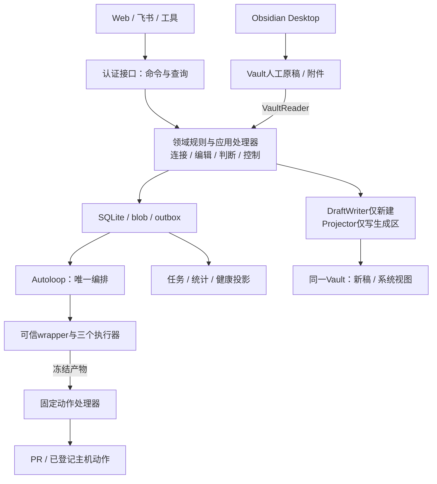
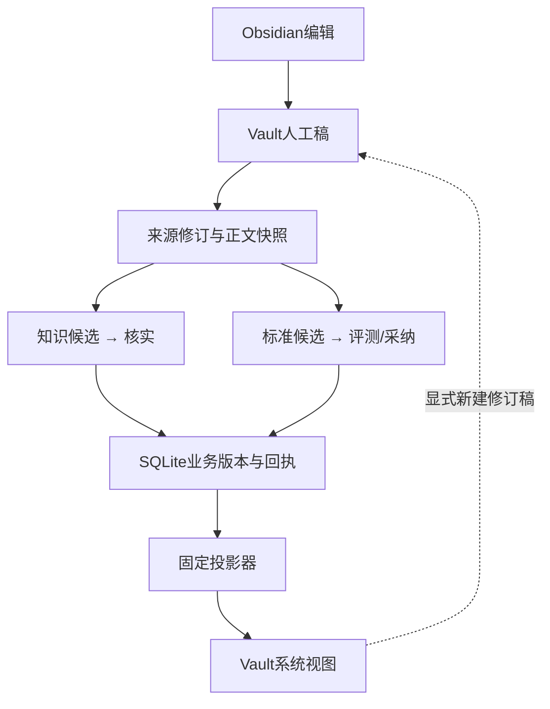

# PAtrick 技术实现计划

版本：1.3 · 2026-11-15 · 完整对齐产品v2.6的连接、编辑、状态与验收，实施未开始。依据：[产品设计 v2.6](../designs/PAtrick产品设计.md)、[技术设计 v2](../designs/PAtrick技术设计-v2.md)、[交互原型](../designs/设计资产/v2/交互原型.html)与[TJ团队Figma](https://www.figma.com/design/kPSkB5zeZSKaK7Yrz3PslQ?node-id=20-549)。

**按全新系统实施：从空代码仓库、空数据库和首次部署开始。** 本文定义完整产品所需的开发任务、接口、数据及验收；任务均未实施，原型中的成功提示不作为真实服务证据。当前范围包括飞书机器人设置及Obsidian知识/标准编辑；以当前292帧/65张导出索引为设计基线，逐状态映射；原型105项/220组检查不作为真实后端、渠道或设备验收。本文路径均相对本仓库根目录：产品/技术设计与设计资产位于 docs/designs，实现计划位于 docs/plans。

## 1. 目标、范围与完成标准

让本人随时咨询；有证据、有委托时自动推进，缺关键取舍时给出A/B与自定义决定；回答后续办同一工作，将真实结果沉淀为案例、标准和经过验证的自动化能力。

| 完整产品版必须交付 | 明确的终点 |
|---|---|
| 七个主页面与设置 | 需要决策、正在进行、判断标准、知识、委托、系统、统计；六组设置接真实处理器，包含飞书机器人连接与检查 |
| 一个真实工作闭环 | productIdeas指定范围变化→研究→必要回答→方案PR→反馈→案例/标准改进；开PR即交付 |
| 四类采集与三个执行器 | GitHub、获准目录/Vault、RSS、单网页；Codex CLI、Grok Build、DSH分别通过实际后台准入 |
| 完整可信交互 | Web/飞书首答仲裁、工具咨询、精确版本、幂等、断线重取、状态与实际效果分离 |
| Obsidian编辑与知识资产 | 桌面端与Vault部署；知识笔记/标准修订可编辑，入库、核实/评测、生效与导回分别有回执 |
| 判断成长和渐进委托 | 候选/生效标准分离，独立评测；授权范围内提升，退化局部降级，换模型重新评估 |
| 长期运行 | 真实身份隔离、预算门禁、VPN诊断/固定修复、跨账本备份、隔离恢复、可撤回升级 |
| 完整呈现 | 中英及系统语言、状态动效、移动端、键盘/读屏；292个Figma画面映射到组件和可复现状态 |

合并/部署业务成果、L3多步自主规划、其他平台连接器、公开多租户SaaS与双主高可用不属于本期。部署PAtrick自身是本期交付内容，与它替主人部署其他产品分别授权。

每个任务的完成需同时满足：代码与Schema、合同/故障测试、界面对应状态、操作说明、可重放证据。先完成七层最小闭环，再完成全部产品验收；100小时是首次投入窗口，不承诺覆盖完整产品工作量。

## 2. 技术栈与模块边界

### 2.1 选型清单

版本列是拟采用兼容系列，T00必须生成精确lockfile、构建摘要和许可证清单；不使用latest部署。上游SHA沿用技术设计§8，升级须重新通过合同测试。

| 位置 | 选型 | 选择理由与准入条件 |
|---|---|---|
| 语言/构建 | TypeScript、Node 24 LTS（≥24.9）、npm workspaces、ESM | 一套语言贯通UI、合同与服务；Mac arm64/x64及Linux CI验证原生依赖 |
| Web | React 19、Vite 7、React Router 7、TanStack Query 5 | 客户端路由与读模型缓存；静态产物由同源服务提供，无SSR进程 |
| 组件/样式 | Radix Primitives、CSS变量/CSS Modules、现有SVG资产 | 自建少量语义组件；不引入另一套视觉主题，同组件用fixture表达292个画面 |
| 语言/内容 | FormatJS/react-intl、Intl、统一Markdown白名单渲染 | 中英消息键、日期时区及复数；禁任意HTML/脚本/远程嵌入 |
| HTTP/合同 | Hono 4、Zod 4→JSON Schema、OpenAPI 3.1 | 入口运行时校验；从同一Schema生成客户端类型和接口文档 |
| 飞书传输 | 官方Node SDK的出站长连接、企业自建应用机器人 | 单聊事件及新版卡片回调分别准入；无需公开Web服务，不能用仅发送的群Webhook机器人代替 |
| 登录 | SimpleWebAuthn、服务端Cookie会话 | 本机可信引导绑定本人passkey；浏览器不持执行凭据 |
| 知识/标准编辑 | Obsidian Desktop；Properties、Templates、Bases、Backlinks/Graph、Canvas核心功能 | 正式编辑端；T00锁应用/安装器版本。通过文件适配器与官方URI接入，后台不依赖Obsidian常开 |
| Vault文件 | UTF-8 Markdown、yaml 2 + Zod校验平铺Properties、获准附件；`.base`/`.canvas`视图 | 人工正文可携带、可编辑；系统生成区按版本投影，不用Obsidian缓存承担业务持久化 |
| 存储 | SQLite/WAL、better-sqlite3、FTS5、内容寻址blob目录 | 单主事务、低维护；中文预分词/别名索引，后续向量召回不改权威数据 |
| 编排 | agent-autoloop固定SHA | 唯一任务/问题/回答/重试权威；仅接公开HTTP和command/read/check插件合同 |
| 执行 | 统一patrick-executor + Codex CLI/Grok Build/DSH适配器 | CLI真实退出与产物验收；Harness bundle通过受限RPC接领域端口 |
| 采集 | chokidar、固定HTTP读取器、RSS解析器、正文提取器 | watcher+补扫；RSS禁外部实体，网页不执行JS；重定向逐跳检查许可 |
| 测试 | Vitest、fast-check、Playwright、axe-core | 规则/竞态/故障注入、真实HTTP/SSE端到端、可访问与视觉检查 |
| 运行 | launchd、Lima隔离执行环境、系统凭据提供器、版本化发布目录 | 主机服务与模型工具隔离；CLI登录、VPN及备份目标按设备实测 |

前端、服务、worker共享合同包，不共享数据库连接。首版不引入Kafka、独立图数据库、通用工作流引擎或第二套Agent循环。

### 2.2 代码组织和依赖

```text
apps/web/                      路由、页面、组件、语言、草稿与订阅
apps/service/                  同源HTTP、认证、SSE、命令/查询入口
packages/contracts/            Zod、事件/DTO、OpenAPI、生成客户端
packages/domain/               纯规则：判断、标准、委托、预算与状态准入
packages/storage/              migrations、repositories、事务、blob、投影
packages/integrations/         autoloop、sources、feishu、MCP、vault、publisher
  vault/                       reader、create-only草稿写入器、投影器、URI解析
packages/executor/             wrapper、三个backend、Harness bundle与探针
packages/host/                 凭据、网络、进程控制、备份恢复、固定操作
assets/                        令牌、图标、字体、logo；带来源与hash
  vault-kit/                   版本化笔记/标准模板、Bases/Canvas、说明与manifest
fixtures/                      产品状态、合同、失败轨迹、独立评测数据
tests/                         unit、contract、integration、e2e、visual、recovery
deploy/                        配置Schema、launchd、Lima、Obsidian安装/检测、升级/卸载模板
```



domain只依赖contracts和端口；集成与storage实现端口；service组装。网络监督、HTTP服务、hub可独立存活，模型按需启动。outbox只投递已经决定的事件/固定动作，不分解任务、不按prompt派工；后续业务轮次统一交Autoloop。

| 模块 | 输入→输出 | 唯一写入责任 |
|---|---|---|
| Collection/Evidence | SourceConfig→原文修订/事实/引用 | 来源修订、游标、证据状态及撤回水位 |
| VaultConnection / VaultAdapter | 设备/根/许可/SourceConfig→连接与检测回执 | 配置复用vaults/source_configs；独立报告编辑器、收录与导回，不重复注册来源 |
| Edit / DraftWriter / Projector | 四类编辑意图/来源修订/已采用快照→三轴EditReceipt及文件 | Edit处理器记账；Reader只读人工区、DraftWriter仅新建、Projector只写生成区；不直接采纳标准 |
| Judgment/Learning | 证据+标准→建议/案例/候选/评测 | 判断与评测事实，事务校验后的生效标准指针 |
| Delegation/Budget | 可信委托+能力→短期grant/预留 | 权限、准入、预算；模型只能提交候选 |
| FeishuConnection / ChannelTest | 应用/凭据引用→配对、往返证明、probe/active/停用回执 | ChannelGate串行启用/切换/排空；测试namespace与业务AnswerGate分离 |
| Conversation/AnswerGate | 消息/精确答复→咨询结果/核验回执 | 会话与咨询结果；hub仍是问题/首答权威 |
| Work/View/Stats | hub事实+领域回执→只读快照 | 可重建投影；不调度、不凭UI状态续办 |
| Settings/Operations | 精确变更提案→实际效果/复查 | 注册处理器按目标版本应用；不接受任意shell/配置键 |
| Executor/Delivery | 冻结输入→验收产物/远端核验 | wrapper终态与动作账本，远端仍持实际成果权威 |

## 3. 数据模型与一致性

### 3.1 共同规则

采用SQLite STRICT表、foreign_keys=ON、WAL、受测busy_timeout和短写事务。网络、模型与文件大读取不在数据库事务内。所有业务记录有schema_version、稳定ID、account_id/data_domain、revision、created_at/updated_at；UTC存时间，呈现时区另存。跨域外键包含domain，查ID也校验调用者范围。

不可变事实追加保存；可变指针用CAS（expected_revision一致才更新）。ID不由显示语言、标题、文件mtime或模型输出决定。每条变更同时写领域事件与outbox，唯一键提供幂等；跨hub、文件和远端均靠意图+核验恢复，不宣称分布式原子提交。

### 3.2 表组与关键字段

| 表组 | 最少字段与关系 | 约束/索引 |
|---|---|---|
| accounts / credentials / sessions | passkey公钥、credential_id、会话token_hash、auth_epoch、expiry、最近认证时间 | credential_id唯一；仅存hash，不把远端密钥存进会话 |
| caller_scopes / preferences | caller_id、owner、domain/action范围；mode=system/en/zh、motion、notifications、quiet_hours、revision | MCP调用者与本人账户关联但权限不等同；偏好不含授权字段 |
| source_configs / source_versions | source_id、type、normalized_target、scope/excludes、domain、credential_ref、frequency、history、enabled、config_revision | 规范来源键去重；版本不可变；同物理文件只有一个采集责任方 |
| collection_receipts / source_cursors | source_id、config_revision、启用/首次采集/成功/失败、cursor、count、evidence_ref、observed_at | 回执唯一event_id；旧版本回执不更新当前游标 |
| source_objects / source_revisions / blobs | object_id、source_id、locator、revision_id、observed_seq、hash、trust_class、tombstone、blob_ref | unique(source_id,object_id,observed_seq)；A→B→A保留；blob成功才提交游标 |
| vaults / vault_clients / vault_ids | vault_id/source_id、domain、采集主机、根目录身份、config_revision/connection_epoch/scope_hash；设备本地映射版本与应用状态；document_id/相对路径/record关联 | VaultConnection从这些配置和检查回执推导；同物理文件一个责任方，映射不是授权；路径/身份变化使旧证明失效 |
| edit_intents / draft_intents / edit_receipts | edit_id、operation、draft_key、非空active_key、closed_at、account/domain、record/document/source/base绑定、请求hash；三轴状态/receipt_revision、candidate/result、effect_ref | 原稿打开只登记意图；新稿create-only；同请求/同活动编辑归同edit_id，独立新标准以draft_key分开；旧回执不覆盖新修订 |
| projection_batches | vault/domain/view_kind、projection_revision、采用事实ID/版本、intent/manifest/hash、cleanup_state | 采用与导回独立；同意图重试，最新指针单调；不重建候选/重复计数 |
| knowledge_records / knowledge_members / knowledge_aliases | knowledge_id、canonical_id、当前版本/状态；成员claim/entity及证据引用；合并/拆分事件 | canonical只能指向同域根；旧ID可解析，不按文件、实体或切片直接计数 |
| channel_tests / channel_pairings | test_id、preview_hash、发送意图/message_id/回传事件、状态/有效期；配对码hash、候选发送者、Web确认 | 绑定应用/租户/config/credential/binding版本、domain/incarnation/epoch；一次性配对；测试verified后仍须可信启用 |
| channel_connections / channel_bindings / channel_receipts | connection_id、app_id/tenant_key、credential_ref/version、config_revision、channel_incarnation/connection_epoch、current_pairing_id/current_test_id；owner_open_id/chat_id/domain、绑定/探针/停用回执 | 一条主动飞书连接；新挑战/测试与旧项失效同事务、CAS推进当前指针；回调/启用只认当前指针，消息按应用+message_id去重 |
| control_proposals / control_receipts | proposal_id/hash、目标/动作/范围、base_revision、challenge、本人认证及实际结果 | 一次性挑战；精确差异绑定；不以普通聊天或飞书测试回执代替控制授权 |
| entities / claims / relations / evidence_refs | canonical_id、predicate/object、valid_time、状态、精确revision/span、verified_at/next_verify_at | supported/disputed/stale/retracted可区分；全文与图邻接按域过滤 |
| evidence_dependencies / withdrawal_events | from_kind/id/version→to_kind/id/version、epoch、reason、event_id | 覆盖标准/判断/提案及评测/能力两条链；门禁同步检查相关epoch |
| cases / case_outcomes | 情境、当时可见证据、标准、选项、预测/选择；后来结果、可信来源及观察时间 | 原判断与后验结果分存；拒绝、返工、失败、unknown均保留 |
| standards / standard_versions / candidates | stable standard_id、active_version、domain、范围、规则/例外/反例、来源、草稿base、状态/有效期 | 采纳CAS核对草稿/基线/评测/证据；版本不增加标准数量 |
| evaluation_policies / datasets / reports | 冻结门槛/预算/划分、case/result版本、基线/候选/外部方法、失败/不确定性 | 留出访问独立；生成样本不作留出；候选不能改评分门槛 |
| mandate_types / mandates / capability_profiles | type_id、领域/动作/资源/风险/域、预算/期限、L0–L3、报告/配置版本 | 类型不按实例计数；能力提升不扩权；撤回依赖可立即降级 |
| work_refs / work_generations | work_id、root/cause、source_revision、generation、hub_lane、完成条件、delivery_ref | root业务键唯一；一个工作多个run/问题；run.done不是交付 |
| decisions / question_bindings | decision_id/event_id、版本/证据、A/B行动利弊、option_disposition/允许后续动作（计入options_hash）、custom合同；hub_card_id、question_version、options_hash、索引映射 | 问题生成后冻结；语义变化新版本；翻译不改option_id |
| decision_submissions | submission_id、raw_custom、disposition、question_version、reason、answer_intent_id? | proceed/deferred/clarification_required分开；暂缓和待澄清不产生有效hub答案 |
| command_inbox / answer_intents / answer_receipts | caller/request/payload_hash、精确绑定、raw_custom、发送状态；飞书另绑connection_id/incarnation/epoch、config/binding_revision、inbound_event_id、channel_permit/cutoff；hub_answer_event_id、validity、result_revision | 同键异内容409；首答由hub仲裁；有效回执按hub答案ID唯一 |
| resume_intents / execution_grants | 恢复键、generation、question/answer事件、upstream_event_id、attempt；输入/策略/证据版本、expiry、revoked_at | 恢复键唯一；每业务代次至多一个active grant；同键重试不重置预算 |
| conversations / messages / consultations | kind、origin、work/context refs、raw_text、final_result、caller_request_id、result_version、cancelled_at | 工作与自由咨询分开；最终答案落盘才answered；取消/终态CAS |
| budget_reservations / usage_receipts | business/grant/session/attempt、route、预留金额/时长、held/spent/uncertain、actual_usage | 额度竞争原子预留；未知用量保留预留，不能重花 |
| effect_intents / effect_receipts | effect_key/resource/action/hash、expected_remote_version、服务生成的origin、authorization_ref；业务另绑work/grant/generation，其他绑owner命令/test_id/采用事实 | origin=business/owner_operation/channel_test/vault_projection；不同来源必填对应授权，CHECK约束排他；uncertain先对账，资源串行 |
| settings_inspections / settings_drafts / validations / changes / item_effects | draft_hash、base_revision、device/identity、操作列表、检查证据/期限、applied_revision、逐项效果 | 验证精确绑定；部分回滚只撤本次拥有且版本匹配的项 |
| host_observations / recovery_sets / notifications | 主机/目标/epoch/检查时间；备份manifest/hash/撤回水位；对象版本/渠道/投递状态 | 修复共用主机锁；旧通知重新判断有效性；恢复集禁止半成品标成功 |
| domain_events / outbox / projection_cursors | seq、event_id、aggregate/version、causation、scope、payload；destination/ack；hub/domain水位 | event_id唯一；投影变更与游标同事务；outbox成功或duplicate才ack |
| work_views / stats_views / health_views | 只读状态、范围、as_of、freshness、definition_version、水位向量 | 可全量重建；不作为执行授权或业务事实来源 |

SQLite部分唯一索引落实关键排他：active grant按(work_id,generation)，答案按hub_answer_event_id，恢复按(work_id,generation,question_id,answer_event_id)，外部动作按effect_key；未关闭编辑按(account_id,domain,active_key)。active_key由操作/目标/精确基线规范化计算，null用固定值编码；新建标准再包含draft_key，避免null放过重复或合并两个独立新稿。索引条件与关闭规则写入migration测试，不能仅靠应用内“先查再插”。

### 3.3 必须写成确定性事务的流程

1. **采集提交**：稳定读取→blob临时文件/fsync/原子重命名→事务提交修订、cursor、domain_event/outbox。崩溃遗留blob可GC，已提交修订不可缺blob。
2. **答复接受**：认证→保存AnswerIntent→每问题串行验证→hub首答→读回→事务写AnswerReceipt与answer.verified outbox。原生card.answered可能先到，wrapper未核验不能启模型；两个事件用同一恢复键归并，技术重试沿用该键。
3. **准入与派工**：检查身份∩委托∩策略∩能力∩grant及证据/预算；CAS替换旧attempt，未决effect先对账。resume只关联原工作，不能创建新业务根。
4. **外部效果**：事务落EffectIntent→提交后调用→读回→事务落proof/业务事实。超时不等于失败；executing崩溃后转uncertain，先查远端再重试。
5. **配置应用**：草稿验证→可信差异授权（需要时）→固定处理器→逐项applied_revision→复查。保存、应用、复查三个状态独立；取消不撤销已发生效果。
6. **标准采纳**：冻结评测和依赖→事务核对candidate/base/source/report/policy/epoch→CAS更新active_version并追加事件；首次null→v1，修订n→n+1，任一不匹配只留历史。
7. **编辑与导回**：事务登记/重取EditIntent→固定文件操作→读回修订→核实/评测及采用→同事务安排投影；导回重试只消费原采用事实。
8. **连接切换**：校验精确证明→ChannelGate或Vault资源锁→固定处理器及逐项回执；测试返回与启用分别落账，修改/恢复后旧证明不复活。

**知识条目身份**：KnowledgeRecord是一项可独立引用的结论及其必要限定，可关联多实体、多主张和多来源。提取只生成候选；固定准入或人工采纳后成为可用条目。稳定knowledge_id不因新增来源改变；合并用同域canonical根重定向旧ID，拆分生成新ID并保留原条目的历史/子项指引，不悄悄把旧引用改成另一结论。当前结论须仍有有效支持才available；单来源撤回但其他支持有效不删条目，全部支持失效不计存量。知识详情、列表和Stats共用此合同。

主SQLite只由service的repository接口写入；host/wrapper通过受限RPC交回执。hub库只由Autoloop写，禁止跨库直接SQL。恢复/导入工具使用相同验证规则，不能绕过唯一键和资料域。

### 3.4 Obsidian：知识和标准怎样编辑、保存、回写

**Obsidian是正式编辑端，Vault是普通文件夹。** 笔记以Markdown正文和Properties保存，外部文件变化可被Obsidian读取；PAtrick通过文件适配器接入，不依赖专用插件或常驻编辑器。见官方[存储说明](https://obsidian.md/help/data-storage)与[文件格式](https://obsidian.md/help/file-formats)。

| 内容 | 存储与写入者 | 作用 |
|---|---|---|
| 人工知识笔记、案例补充、标准修订稿 | Vault人工区；本人编辑，固定DraftWriter仅可创建新稿 | 正文的原始权威；每次观察到的有效修订归档到blob/SourceRevision |
| 核实知识、标准候选/版本、生效指针、评测及回执 | SQLite业务表 + blob证据/正文快照；领域服务写入 | 执行、检索和统计的权威；不会因改一份Markdown直接生效 |
| 知识卡、当前/候选标准、案例摘要及关系视图 | Vault的`系统视图`；Projector从已提交快照导出 | 在Obsidian可读、可搜索、可浏览；不承担授权或标准采纳 |

```text
PAtrick-个人/                         # 每个资料域独立Vault
  知识笔记/  判断案例/  标准修订/       # 可编辑Markdown原稿
  附件/                              # 获准图片/PDF等，保留独立ID/hash
  模板/                              # 知识笔记、案例、标准修订模板
  系统视图/索引.md                     # 指向当前完整批次
  系统视图/批次/<projection_revision>/
    知识/  生效标准/  候选标准/  案例/  # Markdown快照
    知识.base  标准.base  知识关系.canvas
  .obsidian/                         # 编辑器配置，不含PAtrick密钥/数据库
```

知识模板分“事实、出处、个人理解、待核实”；标准模板分“适用范围、判断规则、例外、正反案例、依据”。Properties采用平铺字段：`patrick_id、kind、knowledge_id?、standard_id?、base_version?`。ID与标准基线同时保存在服务端映射；改YAML只产生待校验输入，不能改资料域、active_version、评测门槛或委托权限。无ID笔记按§3.2分配映射，不为补ID覆盖原文。YAML只接受受限数据类型，拒绝可执行tag/递归展开，格式错误定位到原稿行并保留原文；正文原始字节先归档，不靠解析结果还原原稿。



- **编辑知识**：Web先定位可编辑的人工来源；仅有外部资料或系统视图时，新建关联该knowledge_id的补充稿。本人保存后，Reader稳定读取→原文落blob→事务写来源修订/编辑回执→知识候选核实→更新KnowledgeRecord及导出。个人理解与核实事实分别标记，不修改外部原始证据。
- **编辑标准**：首次通过`POST /edits`的create_standard操作按模板建稿，沿用draft_key；服务分配standard_id，base_version/active_version=null，不计生效标准；修订已有标准则从选定版本创建新稿，固定`document_id/base_version`及快照；已有同一编辑请求则重新打开原稿；edit_original只登记并定位，不写文件。保存只进入候选；T07冻结评测、检查最新原稿/基线/证据/策略，满足既有授权才CAS采纳；首次与冻结外部方法及独立案例比较，缺EvaluationPolicy/样本/许可时保留候选。风险偏好变化按可信取舍确认；采纳前旧版继续生效，旧评测不能批准新稿。
- **AI沉淀与导回**：对话/工作产出的知识和标准先进入业务表，再按其真实状态自动导出为知识卡或候选/生效标准。想修改生成内容时创建人工修订稿；系统不把生成区再采成新需求或新证据。独立留出集留在评测域，不导入学习Vault。
- **文件写入与恢复**：先持久化Draft/ExportIntent，再完整写临时文件并原子提交；新稿禁止覆盖已存在路径，同请求沿用edit_id。崩溃先核验目标/manifest/hash再续办，不生成第二份。投影发布持同Vault资源锁，在锁内检查单调revision并原子更新完整批次/索引；旧worker不能覆盖新索引。旧批次移到Vault外隔离区，人工改过的生成文件先保全全部字节。失败显示“业务已入库/生效，Obsidian待更新”，不回滚业务或覆盖原稿。

`.obsidian`、模板、系统视图、`.base/.canvas`和同步临时文件不进业务采集/任务触发；获准附件仍单独采集。`.base`只筛当前批次的Properties，Canvas只指向同域已导出条目；它们及Graph均是浏览视图，不是业务知识图谱的权威。编辑回执以§3.5三轴表示，不以打开URI或Obsidian缓存证明保存成功。已有活动编辑按账户/域/操作/目标/基线复用；新建标准以持久draft_key区分，不能把所有target=null请求合成同一稿。文件已存在先核验，不能为重试覆盖本人新内容；源修订/基线变化保留冲突，旧评测不能批准新稿。

### 3.5 连接与编辑状态合同

DTO由固定处理器及事实投影生成，前端不能PATCH状态。所有检查/回执带对象版本、设备/身份、时间/有效期和receipt_revision，迟到结果只补历史，不更新当前就绪结论。

| DTO | 状态与必要字段 | 不变量 |
|---|---|---|
| VaultConnection | not_connected/checking/needs_install/needs_permission/awaiting_confirmation/connected/degraded；vault/source、config_revision、scope_hash、root_identity、capture_host、client_mapping_revision | editor_status、collection_status、projection_status分别报告；应用未安装/关闭不等于后台停止 |
| EditReceipt | file：preparing/awaiting_save/collected/invalid/conflict；business：not_started/pending/verifying/evaluating/adopted/not_adopted/stale；projection：not_due/pending/current/failed/cleanup_pending/superseded | edit/source/base/candidate/result/projection版本精确关联；无效格式保留字节归档；更新版本已导回则旧项superseded，不再重发 |
| FeishuConnection | not_configured/checking/needs_binding/needs_test/needs_enable/ready/degraded/draining/disabled/requires_reauthorization；reason_code独立 | 传输mode为probe/active/draining/disabled；完整往返只到needs_enable，可信启用后才ready/active |
| ChannelTest | previewed/sending/sent/verified/unknown/expired；test_id、preview_hash、目的地、message_id/回传证据 | 绑定app/tenant/config/credential/binding/domain/incarnation/epoch；旧回传无效；不进AnswerGate、模型或统计 |

核心服务ready、可选集成和任务前置条件分别推导。Settings与System共用HealthSnapshot：展示影响、时间和一个下一步；未配飞书不阻Web，某项导回失败不把整个PAtrick标成停止。语言切换只改变展示，全部状态/错误以code映射中英。

needs_install只提示首次编辑准备；已接通后桌面缺失仅改变editor_status。采用在事务中比对最新已收录document head与冻结候选，不能把未观察到的文件保存算作已验证；后续修订重新核实/评测。测试证明TTL只限制启用提交，active健康靠当前连接/权限检查，配置/绑定/恢复变化才重验。

## 4. 接口与事件合同

### 4.1 共同协议

同源前缀 `/api/v1`。写命令含client_request_id、expected_revision（创建为null）、payload_hash；服务端重新计算hash。默认202返回可重取command_id，只有完成同步的偏好写入返回200；重复请求返回原状态。401未登录、403越范围、409版本/幂等冲突、422语义错误、429限流、503暂不可用；错误体为 `{code, params, retryable, correlation_id, current_revision?}`，无原始密钥/堆栈。

业务动作核验WorkMandate与ExecutionGrant；本人接通/编辑/测试由认证owner命令和已获准对象范围驱动，新增范围仍走可信控制，不创建WorkRef或扩大模型权限。origin/authorization_ref由服务按注册处理器生成，公共payload不能选择；本人操作、渠道测试和投影也使用同一EffectIntent对账，业务统计只消费相应业务事实。

读取返回 `{schema_version, scope, as_of, watermark, freshness, data}`；分页cursor绑定过滤条件、排序、可见域和权限版本。默认50、最多200条；SSE先快照后接游标，游标断档返回reset_required并重取快照。权限缩小立即关闭相关订阅并清缓存，不先发全量再由前端隐藏。

SSE事件最少含event_id、type、resource_id、resource_revision、scope、as_of、watermark；客户端按ID去重，仅更新同版本或更新版本。心跳只维持连接，不能替代业务服务健康证据。大正文取受控详情接口，不塞进每次事件。

### 4.2 Web/工具接口清单

| 资源 | HTTP合同 | 写入结果/重要边界 |
|---|---|---|
| 会话 | `POST /auth/challenge`、`/auth/verify`；`GET/DELETE /session` | passkey challenge一次性/短期/绑定origin；登记由本机bootstrap票据发起 |
| 工作 | `GET /work`、`/work/:id`、`/work/:id/timeline`；`POST /work/:id/controls` | pause/resume/stop类型化命令；绑定generation与控制版本，回执前不假装已停 |
| 决定 | `GET /questions/:id`；`POST /questions/:id/answers`；`GET /answers/:receiptId` | A/B传option_id或custom原文；精确问题/提案/证据绑定；首答仲裁 |
| 对话 | `GET/POST /conversations`；`GET/POST /conversations/:id/messages`；`POST /conversations/:id/work-links` | 自由消息不答题；关联须显式选择原工作并重新校验域 |
| 咨询 | `POST /consultations`；`GET /consultations/:id`；`POST /consultations/:id/cancel` | caller/request幂等；answered/cancelled/failed终态不互相覆盖 |
| 知识 | `GET /knowledge`、`/knowledge/:id`、`/knowledge/:id/evidence`、`/sources/:id/revisions/:rev` | 搜索/筛选与出处；原稿编辑打开获准Obsidian位置，网页不替代编辑器 |
| Vault连接 | `GET /vaults`、`/vaults/:id/connection`；`POST /vaults/inspections`、`/vaults/validations` | 复用Settings Inspect/Validate处理器；确认接通/换位置只走settings/changes的connect_vault/change_vault，不建第二条配置写入口 |
| 编辑意图 | `GET /knowledge/:id/edit-target`、`/standards/:id/edit-target`；`POST /edits`；`GET /edits/:id` | 四类operation：edit_original/supplement_knowledge/create_standard/revise_standard；GET只解析/读回，POST按可信映射登记或仅新建稿，不接受任意路径/覆盖正文 |
| 编辑后续 | `POST /edits/:id/checks`、`/edits/:id/projection-retries` | checks只唤醒同来源固定补采并返回进度；导回重试绑定已采用结果/投影版本，不新建标准、不重评或续办业务任务 |
| 标准 | `GET /standards`、`/standards/:id/versions`、`/evaluations/:id`；`POST /standard-candidates`、`/standard-candidates/:id/evaluations`、`/standard-candidates/:id/adoptions` | 提议、评测、采纳分开；采纳由策略/可信本人决定驱动，不能直接PATCH active_version |
| 委托 | `GET /delegations`、`/delegations/:id`；`POST /delegation-proposals`、`/delegations/:id/controls` | 范围差异、预算与期限可审阅；精确可信回执才改变授权 |
| 来源 | `GET /sources`、`/sources/:id`、`/sources/:id/receipts`；`POST /sources/detect` | detect只在已获准范围探测；新增/修改/启停最终走统一SettingsChangeProposal |
| 设置 | `GET /settings`；`POST /settings/inspections`、`/settings/validations`、`/settings/changes`；`GET /settings/changes/:id` | 六组操作注册表；验证结果有期限/设备/身份；生效与复查分别记录 |
| 飞书配置 | `GET /channels/feishu`；`POST /channels/feishu/inspections`、`/validations`、`/credentials` | credentials专用TLS入口仅存安全提供器并返属主/草稿绑定的短期引用，不入通用inbox/outbox；配置/轮换/启停走settings/changes |
| 本人配对 | `POST /channels/feishu/bindings`、`/bindings/:id/confirm`；`GET /channels/feishu/bindings/:id` | 创建随机码、读候选发送者；必须已登录Web本人显式确认，app/tenant/配置/身份版本与TTL重验，不信任首个发送者 |
| 往返测试 | `POST /channels/feishu/tests`、`/tests/:id/send`；`GET /channels/feishu/tests/:id` | 创建不可变预览不发送；send显式绑定test_id/preview_hash与目的地；独立读回发送/回传证明，verified后仍待启用 |
| 偏好 | `GET/PATCH /preferences` | 白名单字段CAS；语言即时切换但失败显示未同步，不夹带委托/预算 |
| 系统 | `GET /system/health`、`/system/incidents/:id`；`POST /system/operations` | 仅已登记固定修复/备份/恢复操作，须验证相应ControlReceipt |
| 可信控制 | `POST /control-proposals/:id/confirm`；`GET /control-receipts/:id` | 最近本人认证+精确proposal_hash+一次性挑战+当前策略；普通业务答案不能替代 |
| 统计 | `GET /stats?period=7d&timezone=Asia/Shanghai` | period还支持30d/all；服务端验证时区，按域先过滤再聚合，未知null |
| 通知/诊断 | `POST /notifications/preview`、`/notifications/test`、`/diagnostics/preview`、`/diagnostics/export` | 预览无外发；测试发送明确对象/意图；诊断脱敏后供下载，不自动上传 |
| 订阅/命令 | `GET /events?after=cursor`、`GET /commands/:id` | 可重取回执；断线不取消业务，不自动重新提交写命令 |

MCP只暴露patrick_consult、patrick_consult_result、patrick_memory_query；Token由可信控制入口签发并限定caller/domain/动作，不提供问答授权、主机或凭据工具。飞书使用SDK认证的长连接，不把HTTP签名校验套到长连接消息；验证绑定的app/tenant、本人open_id、chat、原消息与问题版本，所有业务答复进入同一AnswerGate。Web普通聊天和飞书单聊“同意”都不代发决定；只有卡片显式提交或原问题允许的精确答复合同才进入答题路径。关闭原生“持链接即可答题”旁路。

### 4.3 代表性写入与返回

```json
{
  "client_request_id": "req-unique",
  "expected_revision": 3,
  "payload_hash": "sha256-of-canonical-payload",
  "payload": {
    "work_id": "W-017", "generation": 2,
    "question_id": "Q-017", "question_version": 3,
    "proposal_revision": 8, "options_hash": "frozen-options-hash",
    "answer": {"kind": "custom", "raw_text": "先处理最高频故障，再验证新需求"}
  }
}
```

响应先为 `{command_id, state:"received", receipt_url}`。A/B和custom都先产生DecisionSubmission；A/B的处置语义随option_id冻结，不能把“等待补证”仅作为标题。明确暂缓为deferred，关键条件不明为clarification_required；原文可重取，保持问题open，不写hub答案/answer.verified，不签业务grant、不计主人决策。模型只辅助解释，固定合同校验缺项/范围；无法确定是否可执行时澄清，不猜测放行。明确选择“执行获准的补证步骤”可为proceed，但冻结next_action=collect_evidence；原业务进入waiting_evidence，仅可触发已有许可的补证，证据满足前不得发布或启动原交付阶段。仅选择“以后再定/等待”仍为deferred，不等同补证授权。只对proceed建立AnswerIntent，读回后给 `verified / stale / rejected / conflict`；续办另给work进展。暂缓/澄清回执只能更新仍open且版本匹配的问题，不能覆盖已经接受的答案。服务端把option_id映射冻结的上游0起索引；custom提交上游时省略choice、传text，原文独立保留；不能把choice=null发送给上游。

`POST /edits`使用共同命令信封。创建意图时expected_revision=null，服务按vault_id推导资料域并核验配置版本；新稿路径和document_id由服务分配，不接受任意文件位置。

| operation | 必需的目标/基线字段 | 返回与文件动作 |
|---|---|---|
| edit_original | knowledge_id、已关联的document_id、expected_source_revision | 登记同一edit_id，返回原稿入口；不写正文 |
| supplement_knowledge | knowledge_id、expected_knowledge_revision、draft_key；关联精确来源引用 | 仅新建补充稿，关联原知识/证据，不覆盖外部原文 |
| create_standard | draft_key、expected_active_version=null | 分配standard_id和新稿；active_version仍为null，不要求已有标准 |
| revise_standard | standard_id、base_version、draft_key | 从指定版本仅新建修订稿；采纳时仍须当前active等于base，否则保留为stale |

返回command_id、edit_id、receipt_revision，以及`file{state,proof_ref}`、`business{state,candidate_id,result_ref}`、`projection{state,intent_id,projection_revision,superseded_by}`；未产生的值为null，不能以缺省值伪装成功。原稿/基线无法匹配返回409和原稿/差异入口；不为重试换路径覆盖。采用完成后关闭活动键，历史及失败导回意图保留；冲突/未通过仍保留原编辑入口，下一次采用须重新核验。

配对confirm、test send及enable都重验同一完整绑定与有效期。同请求重试返回原挑战/测试/变更，不因换语言、刷新或超时自动发送第二张卡；无结果保持unknown，先按message_id对账。Secret只经专用端点，公共command/query/SSE回执只含引用与脱敏参数。

操作注册表将connect_vault/change_vault交T06；set_feishu_connection/rotate_feishu_credential/rebind_feishu/enable_feishu/disable_feishu交T10。配对确认只建立候选身份证明；现有active连接重新绑定先经变更流程排空，完整证明及可信启用之后才重新接业务。平台无法读回未知测试时不盲重发；本人明确新测试才换test_id，并将旧测试置status=expired、reason_code=TEST_REPLACED。

### 4.4 事件目录与派工限制

| 事件 | 产生者 | 消费者与不变量 |
|---|---|---|
| source.revision.committed | 采集事务 | 事实核实；仅获准trigger产生工作，不由任意资料正文派工 |
| work.requested / draft.requested / draft.ready | 可信入口/验收后的阶段结果 | Autoloop；带root/cause/generation/hops，未答关键卡不得emit下一阶段 |
| question.bound / answer.verified | QuestionBinding/AnswerGate | 投影与幂等恢复；不发新业务根，不能重复启模型 |
| decision.committed / work.delivered | 判断准入/交付核验事务 | 案例与统计；建议/模型调用/子步骤不计成有效决定或完成任务 |
| evidence.invalidated / capability.changed | 撤回/评测控制 | 同步门禁先阻断，后台重建依赖；无关域继续 |
| standard.candidate / standard.activated | 领域采纳事务 | Standards视图、后续维护评测；运行中任务固定旧标准，撤回约束仍即时生效 |
| vault.connection.changed / edit.receipt.changed / channel.test.updated / channel.mode.changed | 固定连接/文件处理器 | 健康、设置、编辑进度与SSE；只作状态通知，不派新业务根，不计任务/决定 |
| settings.applied / settings.verified | 固定处理器 | 健康/设置投影；保存不自动恢复暂停工作 |
| effect.uncertain / outcome.observed | 效果/反馈观察 | 对账、原案例结果更新；反馈不触发新需求根 |

所有事件有版本和消费者能力检查；未知major拒绝处理，保留原消息以便升级后重放。定时采集、复核、评测、结果观察与通知重试均由Autoloop维护规则触发固定处理器；主机心跳可以独立定时，但不得绕开业务门禁。

## 5. 界面与各功能的实现、测试

### 5.1 页面、组件与真实服务

路由顺序固定，页面通过同一SDK和只读投影取数。组件不持远端密钥，不将点击、loading结束或模型文字当成功回执。

| 路由/功能 | 组件和状态 | 服务接入与核心验收 |
|---|---|---|
| `/decisions` 需要决策 | WorkConversation、DecisionCard、OptionCompare、CustomDecision、Receipt、独立Composer；空态/过期/核验/离线 | 同一work/question版本；A/B行动/依据/利弊及关键风险常显，自定义与自由聊天有不同提交按钮；聊天“同意”不答题 |
| `/work`、`/work/:id` 正在进行 | WorkList、状态筛选/搜索、进展时间线、阻塞、成果、决定定位 | 全部未完成任务按work_id去重；已答仍在原任务运行，已交付进入历史；无证据不显示百分比 |
| 全局咨询 | ConsultationPanel、ContextTags、工作关联、返回锚点 | 每页可达，工作/全局草稿隔离；等答时受限咨询可继续，原业务不派工；取消/终态竞态与重连同结果 |
| `/standards` | 当前/候选/失效、创建标准/修订入口、三轴EditProgress、版本/案例/评测 | 首次null基线到v1；修订冻结基线；保存不生效、旧版继续可用；过期不采纳，导回重试不重复计数 |
| `/knowledge` | 搜索/核实筛选、出处、编辑原稿/添加补充、冲突与EditProgress | 本人原稿可定位；外部/生成内容仅补充；收录与核实分开，canonical引用稳定，不按新文件加知识计数 |
| `/delegations` | 范围/动作/风险/资料域/预算/期限、能力阶段、精确变更差异、可信回执 | 提升不扩权，暂停阻新动作，停止核对执行树，在途先对账；回退旧版先验有效性 |
| `/system` | HealthSummary、最大影响异常、受影响工作、诊断与固定修复、恢复门禁 | heartbeat不等于服务可用；本机先诊断，修复后验证目标与原健康依赖；关联Settings同一change_id |
| `/stats` | 两组三卡、7d/30d/all、口径折叠、任务快捷筛选、快照时间 | 活动与存量分开；过滤/换语言不写业务；答复只增加一次主人决策，非同时增加完成任务 |
| `/settings` | 就绪摘要、设备/检查时间、Run checks、六组入口 | detected/suggested/user/inherited可见；只补缺项，未来入口不展示 |
| `/settings/collection` | 已有来源、添加/预览、修改/暂停/恢复/断开、首次采集状态 | 默认仅新增；历史范围/费用另确认；重复源定位已有条目，暂停不取消任务/删除证据 |
| `/settings/materials` | VaultConnectionCard、三步接通向导：检测/选择→预览范围→确认与往返；目录细节折叠 | 沿用已有应用/编辑机/Vault映射；编辑器/收录/导回分别报告，位置只配置一次；失效证明不接通，关应用后台继续 |
| `/settings/execution` | 三后端状态、默认执行器/时长、委托预算只读链接、登录修复 | 实际隔离后台探针；桌面登录不能假就绪，不能静默付费回退 |
| `/settings/operation` | 已登记主机、网络/磁盘、备份目标与时间、可信恢复入口 | 保存/生效/复查分开；恢复到隔离目录，未核对撤回/未决效果不开放 |
| `/settings/interaction` | FeishuConnectionCard、三步向导：应用→本人绑定→往返验证；待启用/维护/排空 | 当前绑定的测试返回后显式可信启用；缺权限/过期/非本人/unknown可处理；停用先核对，测试不记业务 |
| `/settings/preferences` | 系统/中英、减少动效、必要通知、免打扰 | 普通偏好白名单；不夹带机器人配置，语言切换保留业务状态 |

首期仅保留当前需要的日常字段、逐源配置与两个按步骤展开的接入区；标准与委托不在设置里重复实现。来源写入口和工作资料变更共用SourceConfig处理器；Settings与System也共用操作账本，不能分别维护“已修复”。

#### Obsidian编辑入口

工作资料用VaultConnectionCard显示资料库、编辑设备、最近收录/导回及一个主动作，ConnectionWizard逐步检测/选择、预览范围、确认接通并核验往返。系统自动沿用已有映射，只补缺项；未获授权前不安装、不写样例、不自动拉起应用。读/新建/生成区写分别列出，变更走同一SettingsChangeProposal。

知识详情按来源给“编辑原稿”或“添加补充”；标准页同时提供“创建标准”和“修订标准”。统一POST /edits，重开沿用edit_id/draft_key；EditProgress从三轴回执呈现“已收录→核实/评测→采用→更新到Obsidian”，失败只给对应下一步。首次标准、补充稿、过期修订不能走同一个默认采纳分支。

客户端只对本机已登记Vault生成官方`obsidian://open?vault=…&file=…`，编码中文、空格、`#`等字符；不透传任意URI动作/绝对路径。[官方URI合同](https://obsidian.md/help/uri)。原稿打开不算保存；checks复用原来源补采，projection-retries只重试原采用结果的导回。

服务端路径、编辑设备映射与浏览器设备分别登记；手机/未登记设备提供“在编辑设备打开/复制相对路径”，保留同一edit_id。`EDITOR_NOT_READY / VAULT_NOT_MAPPED / SOURCE_NOT_EDITABLE / EDIT_CONFLICT / EXPORT_PENDING`及安装指引、范围弹窗、动态回执全部本地化，不显示原始异常或假称已打开。

#### 飞书机器人设置与检查

入口为Settings → Interaction → Feishu bot，采用独立的“交互”设置类别。首屏只显示连接状态、机器人/本人目的地、最近检查时间和一个主动作；展开配置才显示App ID与密钥输入。连接流程：**选择/创建企业自建应用 → 填App ID及App Secret → 自动检测 → 本人单聊配对 → Web确认身份/资料域 → 预览测试 → 显式发送并回传 → 启用**。不支持接收答复的群Webhook机器人不作为完整接入方式。

- **减少输入**：服务检测机器人名称、租户、所需权限及连接；本人向机器人发送默认5分钟有效的随机配对码，仅存hash；捕获经SDK核验的发送者，重验完整绑定并在已登录Web中显式确认，不手填这些ID。只申请单聊收信、机器人发信及当前卡片能力所需最小权限；不默认读取群历史、通讯录或导入飞书知识。平台不能枚举的权限/发布状态标“待实测”，以真实回传证据核验，不编造就绪。
- **凭据**：App Secret仅通过认证TLS写入专用凭据端点，禁日志/分析埋点/本地草稿；立即存系统凭据提供器，业务表/回执只有credential_ref/version，前端不读回明文。修改App ID、凭据、租户或身份/目的地使旧验证与配对失效；更改域/启用/轮换/停用走精确SettingsChangeProposal，普通PATCH preferences无权执行。
- **检测分层**：凭据有效→机器人可用/发布可见→出站长连接→接收消息im.message.receive_v1→卡片card.action.trigger→本人目的地/资料域→发送及回传。只连上WebSocket或成功发消息均不等于“可以接收决定”。Run checks默认无消息外发；入站能力待真实测试，不用权限列表替代往返。
- **测试隔离**：点击“发送测试消息”前显示机器人、目的地和不含业务资料的样例；test_id带独立namespace，测试卡只验证回传，绝不调用业务AnswerGate/模型或产生决定/任务统计。持久化发送意图、平台message_id与回传证据，超时标unknown，核对后再重试，不自动连续发消息。
- **状态与启用**：外部状态严格采用§3.5；完整回传后显示needs_enable，带有效绑定/test_id的可信启用完成才ready/active。权限、凭据、断连是独立reason_code；过期码重建、非本人拒绝、unknown先对账，不复用旧证明。
- **停用**：停用走ChannelGate（同应用内先锁渠道、再锁问题）：先原子置draining、提高connection_epoch并关新入出站；尚未开始发送hub的旧epoch意图作废，已送hub/结果未知者列入cutoff清单，逐个读回收口。cutoff前已获提交许可的答复仍须通过现行身份/策略/问题门禁；确已被hub接受且仍有效的记录原决定，已经核验的工作继续。撤权后失效的答复不签grant，保留审计并刷新Web问题。未知意图未收口时显示“停用中，答复核对中”，不宣称disabled；确认终态后才取消待发、关闭长连接并完成停用。cutoff后新到及无提交许可的旧事件只审计。保留业务问题供Web处理，不取消工作或删除共享凭据；重新启用重验身份与权限。未配置飞书不阻断Web工作。

配置/配对/测试使用probe模式：只接配对码、探针和隔离test_id，不接业务对话/决定；只有当前配置的身份绑定、双向检查和可信启用均完成才转active。同app/tenant只有一个受监督长连接，检测不得另起消费者抢走业务事件；密钥轮换先验证候选凭据，再按ChannelGate排空切换，失败恢复仍有效旧版并如实显示连接间隙。所有探针/测试回执绑定配置版本、credential_version、binding_revision和connection_epoch，旧回执不能将新配置置ready。

草稿和生效配置分开：只读候选检查失败不影响仍有效旧连接；实际切换先排空，失败展示已改变项与连接间隙，重新核验后才恢复active。成功、取消、登出或卸载表单清除内存Secret；非敏感向导草稿/阶段、test_id与焦点可随中英切换保留。

T03提供可信配置引擎，T10交付配对/测试/启用与ChannelGate后台；T17接交互设置，T20复用投递/诊断端口。当前38类新增流程状态已有中英Figma画面，T00读取实际frame_id，T24映射到组件/fixture；只对确无设计的后续状态另列缺口，不再以原196帧为覆盖基线。

### 5.2 UI状态、语言和动效

共用ConnectionWizard、ScopePreview、EditProgress、StatusEvidence与可信确认弹窗；业务状态只读服务，焦点/草稿属于呈现。Secret排除在DraftStore、URL、日志和遥测之外，仅留当前表单内存。

AppShell固定侧栏与移动抽屉；页面仅一个标题/摘要/主动作，概览→比较所需细节→技术记录逐层展开。服务器状态交TanStack Query，草稿以account/conversation/question/version分区；登出清理本地私有缓存，服务端对话留存。

语言mode持久保存为system/en/zh。系统语言按navigator.languages顺序匹配，zh-*映射简体中文，en-*英文，否则英文；跟随模式监听languagechange，手动覆盖不被设备系统变化写回。切换presentation_epoch，不变business revision；丢弃旧语言的显示片段但继续持久化原结果。AI译文按content_hash/revision/domain/locale缓存，预算不足显示当前语言等待说明，保留原文入口。

所有系统文案使用消息键，包括动态错误、弹窗、Toast、状态、aria-label与日期。原话/草稿/代码/URL/ID不翻改，译文有标记；金额、期限、否定条件、引用与范围做一致性校验。保存失败保留本机选择，标未同步；不自动提交决定或重发咨询/检测。

共享设计令牌固定流光青浅色：背景#F5FAFC、侧栏#EAF5F7、主色#087B96、文字#203D49；当前不开放主题设置，CSS资产中的深色候选不自动启用。标题32/40、正文17/28、留白32/48；Inter/系统字体与Noto Sans CJK SC回退按产品规格，发行包自带获准字体并记录许可证。

Logo是侧栏居中的80×80方形SVG+CSS，主体68px、消息头像30px静态；4.8秒运行循环。真实服务running且状态新鲜才播放，单任务等待不停止；paused/unknown/断联/减少动效静止并保留状态文字。Page Visibility暂停隐藏页装饰，状态变化aria-live一次播报。对话160–220ms、决定/回执180/220ms、依据320ms、候选280ms；交互反馈不暗示授权。

图标复用[语义清单](../designs/设计资产/v2/icons/manifest.json)：系统波形屏幕、设置齿轮，六类设置与导航不同，交互用双气泡；8个导航入口与6类设置共14种图形。导航20px、分类17px；完整slogan置logo下方，中文在逗号后提供换行机会。触达至少44×44，正文对比度≥4.5:1；小屏A/B堆叠、custom常显，关抽屉恢复焦点，新消息不抢阅读位置。

### 5.3 界面还原验收

T00在`design-inputs.lock.json`锁产品/技术文档、原型、Figma交付记录与图标hash；T14再生成发行字体的浏览器基线。建立 `fixtures/screens/screen-manifest.json`，逐条覆盖[Figma交付记录](../designs/设计资产/v2/Figma交付记录.json)的当前292个frame：`frame_id、route、scenario、locale、viewport、fixture_hash、expected_actions、test_id、baseline_asset/hash、font_hash、browser/DPR`。同组件的预设状态通过fixture驱动，不把292帧当292个路由；不得静默漏掉弹窗、详情、移动或错误态。

产品文字合同决定业务语义，原型决定交互，Figma及65张带版本/hash的导出索引校对几何/内容。像素比较只使用T14以最终发行字体生成、人工核对通过的唯一浏览器基线；Inter与Figma的Noto Sans SC字形/换行差异逐条记录，不能作为抗锯齿差异笼统豁免。固定时钟、数据、字体hash、浏览器、DPR及logo相位后做浏览器截图；动态遮罩只允许时间和确有必要的非业务装饰，不遮按钮、状态、回执或全文。

视觉初始阈值：布局关键边界偏差≤2px、像素差异比例≤0.5%，字体抗锯齿差异单独人工判读；关键内容缺失/遮挡、错误状态、focus丢失直接失败，不靠像素阈值放行。桌面1440×1000、移动390×844为主，另验768宽、200%缩放、长中文/英文、键盘、读屏与prefers-reduced-motion。292个画面均有映射和合同检查，38类新增状态的中英版、6个展开画面、14个新增移动画面单列，截图覆盖每个独立布局/状态；等价合并须记录理由和对应frame，不能仅测首页。

### 5.4 统计计算合同

完成任务按首次有效work.delivered的work_id；主人决策按有效hub答案ID；自动决策按已准入decision_event_id。模型调用、建议、子步骤、控制器清卡、重复和未通过答复均不计。活动窗口按请求IANA时区的自然日计算，含今天，返回精确UTC边界；全部时间明确起点与数据覆盖范围。

当前存量按stable standard_id、可用canonical knowledge_id、曾建立实例的delegation_type_id去重，另给当前有效委托类型数；不随活动周期变化。撤销事实以补偿事件修正原桶，投影与游标同事务；重建前后结果一致。首次标准仅在null→v1增加一次，版本修订不增；补充稿/SourceRevision不直接增加知识；ChannelTest、配对、样例Vault、编辑检查与导回重试不写任务/决定统计。权限过滤先于聚合，unknown=null，断联保留快照时间，不填0。Stats底部任务数来自相同WorkList快照，演示数据使用独立demo库/标识。

### 5.5 判断与自动化的功能测试

冻结10个种子案例和至少5个独立留出案例，仅用于验证流程；不能据此宣称普遍顶尖。候选与当前标准及有出处的外部方法同题/同信息/同预算比较，保留拒绝、返工和未知效果。训练/留出访问分离，候选不能更改EvaluationPolicy；已用于调参的样本退出留出集。

每个能力范围验证：证据不足不晋级、授权内达标可晋级、扩范围需可信差异确认、撤回评测证据即降级、模型/配置变化重新评测、回滚前检查旧版本仍有效。业务完成、本人采纳和实际业务效果分别记事实。持续监测引用错误、漏反例、返工、本人时间和关键失误，未授权任务不因能力评分高而执行。

## 6. 部署、运行与恢复

### 6.1 首次部署拓扑

飞书传输选定官方SDK出站长连接，固定版本和实际企业自建应用分别验证消息与新版卡片回调；不需要公网入站端口。若所选SDK/平台能力不通过，飞书显示受阻并阻止其准入，不能静默改成公开Webhook或假称可答题；Web仍可用。

主机为Mac mini（24GB/200GB），Mac Pro（16GB/100GB）承担开发/隔离恢复；只有获得公司访问资格的设备才接内网GitLab。起步模型并发1，后台服务不依赖浏览器/编辑器常开，不做双主。

| 单元 | 运行身份与边界 | 启动/健康 |
|---|---|---|
| Caddy同源TLS入口 | 固定Web origin/RP ID，服务仅监听loopback；跨设备使用已登记私有网络/DNS/证书 | TLS与origin检查；证书未信任时不能假装passkey可用 |
| Obsidian Desktop / Vault | 默认在Mac mini的本人桌面安装；Reader只读人工稿；真实Vault仅交固定处理器访问，新建稿与生成区写入分别受限；安装器/doctor/设置页共用VaultConnection Inspector与作用域证明 | 按需打开编辑；Reader/Projector由后台服务运行，退出Obsidian或重启主机不停止采集/业务；分别检查桌面端和Vault状态 |
| patrick-service | 控制身份，唯一领域库写者；Web输出脱敏/按域裁剪 | launchd；livez看存活，readyz看DB/必要依赖和当前门禁；可选渠道、编辑器与任务前置条件分开，不按“所有连接都绿”判断服务健康 |
| Feishu transport | 官方SDK企业自建应用出站长连接；事件与卡片回调分开订阅/准入，不公开Web/hub入口 | service集成受监督模块，仅一个主动消费者；durable inbox后快速确认，异步处理/重连去重；doctor分别显示收/发/回传 |
| Autoloop hub/worker | hub管理凭据仅可信适配器持有；不对浏览器/模型暴露 | 独立launchd；公开API状态与seq、worker心跳分别检查 |
| executor环境 | Lima隔离VM内的获准快照、任务输出与专用backend HOME；无hub/发布/主机凭据 | 冷启动实际CLI+工具探针；子进程树、凭据读取、出站路径实测 |
| 固定发布/凭据处理器 | 远端写凭据、安全登录/刷新仅供固定处理器；不运行模型提供的命令 | EffectIntent读回；按资源锁、generation与远端版本核验 |
| Host Supervisor | 最小本机权限、登记好的动作；GUI VPN在实际可用LaunchAgent会话下运行 | 心跳、接口/路由/DNS/代理、TCP/TLS/HTTP/身份逐级检查 |

生产代码与profile只读；任务cwd不能覆盖配置、`.env`或插件。DSH知识profile禁任意shell/JS/插件管理，API凭据与任意代码执行环境分离；订阅CLI必须证明其工具子进程不能取得控制/远端写凭据和越域网络。不能通过共享本人HOME/full-access解决准入失败。

版本化布局：`releases/<digest>/`放只读程序与Web产物，`current`指向当前发布；`data/`放两库/blob/投影，`runtime/`放进程记录/临时结果，`logs/`脱敏，`secrets/`仅存提供器引用。数据根、Lima磁盘、SQLite/WAL、密钥和CLI HOME必须在Vault/网盘同步根之外。配置按Schema验证，不从任务目录自动加载环境变量。

### 6.2 安装与诊断体验

实现 `patrick init / doctor / install / start / stop / backup / restore / upgrade / uninstall` 固定命令。安装包带精确版本、hash、签名/可信发布清单与SBOM；T00确定实际签名渠道并测试验证失败必须拒绝。init只询问无法检测的工作范围、Vault、资料域及必要身份；安全登录在对应可信通道完成，得到credential_ref。

顺序为：核验包→目录/权限/磁盘→初始化schema→选择固定origin与TLS信任→绑定本人passkey→检测三个CLI及获准资料→预览权限/费用→登记委托→安装launchd→运行doctor→用真实只读样例核验。任何一步失败保留可诊断结果；安装成功不等于执行器/公司网络已就绪。

默认不启用未经准入的付费API；API补充必须有明确provider、金额上限及逐收费attempt门禁，缺一保持不可用。订阅用量不明显示unknown，硬限时间/次数；试点总预算和停止条件在首次真实调用前固定，重试/换后端不清零。

doctor返回状态、证据/时间、影响和一个下一步，覆盖实际服务身份、Headless profile、插件能力、数据域、scope、证书、原生依赖、磁盘、网络与备份。脱敏诊断包先本地预览；卸载只停止服务和移除本次安装，不默认删除数据、Vault或共享凭据。

#### 6.2.1 Obsidian桌面端与Vault首次部署

默认Mac mini同时放置服务和一个本地Vault；Obsidian Desktop是桌面应用，后台接入采用文件协议。Mac Pro起步用于开发/隔离恢复，需要跨机编辑时再配置同域副本与本机映射。官方macOS安装使用Universal安装包；T00记录应用版本、安装器版本、OS/架构及包hash，T27验证实际安装。依据：[安装](https://obsidian.md/help/install)、[更新](https://obsidian.md/help/updates)、[同步](https://obsidian.md/help/sync-notes)。

| 步骤 | 安装器/检测器做什么 | 本人只补什么 |
|---|---|---|
| 1. 安装应用 | 检测已安装版本；缺失时使用官方包、核验签名，安装到Applications | 必要系统确认；不把“安装成功”当Vault接通 |
| 2. 建立Vault | 建议获准目录、检测域/容量/服务权限；创建§3.4结构并登记vault_id/source_id | 目录、资料域和编辑机缺失时选择；不放入Obsidian应用数据目录，不嵌套Vault |
| 3. 装载vault-kit | 安装版本化模板、索引与Bases/Canvas样例，记录manifest；只新建缺项 | 首次在Obsidian“打开文件夹为仓库”，按引导启用所需核心功能；不覆盖本人配置/模板 |
| 4. 绑定与检查 | 本机首次运行应用注册URI；登记本地别名/ID；以真实服务身份验证Reader、DraftWriter与Projector各自权限 | 有系统权限阻塞时完成对应授权，不手填服务端文件路径 |
| 5. 文件往返 | 创建样例知识/标准修订稿→本人保存→读回来源和候选→导出；关闭Obsidian后再改受测文件验证后台补采 | 确认样例显示正确；真实标准评测/采纳由T25另验 |
| 6. 可选同步 | 一个Vault只启一种机制；Baidu网盘或Obsidian Sync等各自验证占位文件、离线、改名/冲突和资料域许可 | 明确选目标与费用；未通过保持单设备，不自动启用新订阅 |

样例验证使用隔离测试Vault/账本，不计真实任务与统计；实际Vault就绪以其配置版本和真实服务身份的回执为准。`doctor`分别报告应用可用、Vault可读、新稿可创建、系统区可写、最近入库/导出、同步/磁盘状态。未安装桌面端只阻断该设备编辑；已配置Vault的后台处理继续。接入预览分别列出人工区读取、新稿创建和生成区写入范围，确认后登记；添加只读来源不自动取得文件写权限。运行库、SQLite/WAL、blob、密钥、执行器目录均在Vault及网盘同步根之外；`.obsidian`只保存编辑器配置。同步副本不能代替RecoverySet。

升级先备份人工稿/附件及vault-kit manifest，对新应用/安装器运行打开、保存、URI、Properties/Bases/Canvas回放；不强制追随自动更新。卸载默认保留Vault与业务数据。恢复先保护较新人工稿并核验ID/原稿基线和撤回，再重建生成区；不通过整体覆盖Vault来回滚。换设备/路径后重新确认Vault规范根、采集主机和本机URI映射，旧路径不能自动用于读写或同步。恢复使旧检查证明失效，先核对实际根/权限、较新原稿与source/base，再恢复采集/导回；保留edit_id与采用事实，不按备份状态重建草稿或重复采纳。

### 6.3 网络与资源验收

心跳异常先查本机；hub正常但GitHub/GitLab不可达也触发目标诊断。401/403归身份，429退避，TLS失败不得靠关闭校验修复。Tunnelblick/OpenVPN/Shadowrocket按实际设备测试两种启动顺序、并发、DNS及重连；不能并用则dual_path=false，并按许可分机/受控轮换。

所有路由/DNS/代理/VPN动作持同一主机锁与network_epoch；回退只撤本轮拥有且仍匹配版本的变更。重试有次数、冷却与总时长，MFA只产生一个待处理问题；修复后同时复验故障目标、原健康目标和peer。网络恢复不创建新业务根，不越过待答/暂停门禁。

初始队列上限1000、附件20MB，背压不推进游标；磁盘<30GB告警、<15GB暂停大附件/新副本。完成副本7天、普通session14天可清理，但活跃引用/问题/恢复集合pin住；真实数据量测试后调整。读取分页、SSE慢消费者与LLM输出均设上限，不能因长文本拖垮服务。

### 6.4 备份、恢复与升级

每日RecoverySet：冻结入口/claim/回执/effect写者，排空或停止执行树，标记未决调用；用SQLite backup API保存两库，写blob/Vault映射、人工稿/附件、修订基线/新稿意图/编辑回执、vault-kit/本机映射与冲突、未结问题/答案/咨询、配置效果、委托/评测、版本锁与撤回水位。manifest列hash、schema、完整性及缺口，校验后才标可恢复。无法冻结的输入必须有持久交接日志。

RecoverySet再交受测加密备份工具（拟用restic）复制到已授权目标；活跃数据库不交网盘同步。密钥恢复材料独立保管，备份目标与域保持一致；仅本机文件或未经确认的云同步不能标异地保护。撤回日志独立有序复制，保留epoch/hash链，保护确认不是“复制命令已启动”。

RecoverySet也保存渠道配置/绑定/配对挑战、test发送意图与回执、渠道inbox/outbox及业务关联。恢复先隔离旧渠道未决项，不能自动重发；历史已核验答案仍按业务恢复协议去重对账。

**撤回水位证明**：备份目标另存RecoveryWitness（独立持久、强一致读/原子CAS）。字段为domain、writer_epoch、open/sealed、最高撤回seq/hash及handoff_certificate。生产写者每次启用前先CAS为open；open不会因超时自动变成sealed。撤回立即阻断本机相关域，独立日志确认前标protection_pending。只有停止全部写者/排空入站、复制全部撤回并核对两库后，才能CAS写sealed及交接证书；再次写入须开启新epoch。恢复必须直连权威目标做带随机挑战的CAS读回，验证当前sealed证书/epoch与已fence旧写者一致，再应用完整日志。连续但落后的日志不是最新证明；主盘丢失且仍open、目标不可达/返回旧版本均保持相关域关闭，不能用租约到期或RPO开放。此时须找回原日志或逐项重新核定资料，不能承诺2小时自动恢复。见证目标不满足条件写/一致性就不标恢复就绪；它只存小量控制记录，不参与业务调度。

恢复后的飞书强制进入disabled/requires_reauthorization：生成新的随机channel_incarnation（不能仅把备份中的计数加一），使旧配对挑战、binding可信状态、ready/测试回执及待发队列失效；历史记录留审计。重新校验当前凭据/租户、完成新的本人配对、往返测试及Web可信启用后，才建立带新incarnation的卡片映射；旧回调和旧测试不得恢复业务或就绪状态。此流程是一次新的明确授权，不从旧备份推断最新渠道仍可用；也不替代全局撤回/委托水位校验。T22恢复演练覆盖这一门禁。

恢复命令默认演练模式、隔离目录、无生产写凭据/同步器。依次校验manifest/两库版本→追平最新撤回→保护较新Vault原稿与冲突→补采pending_ingest→对账hub事件/卡片/未决答案、配置与effect→重建投影→使旧Web会话失效→确认单写者。无法确认旧主机已停并撤销旧写凭据时，禁止恢复机对外写。通过后才逐域开放。

升级先停新派工并备份，再安装候选版本、schema迁移与合同回放、研究任务灰度、切换current。新写入前可退回旧程序/库；出现新写入后须执行经验证的逆向/前向修复，不能拿旧备份覆盖。目标RPO≤24小时、RTO≤2小时，以实际恢复演练计时证明；撤回保护不能用RPO容忍过期数据复活。

## 7. 可执行任务清单

所有任务初始状态为未开始。每个任务以独立可审阅PR交付；依赖未通过不接入真实写入。下表小时是单人配合AI的初估，含该任务测试，不含外部登录/设备等待；当前总计236–382小时（含连接向导、编辑回执及292帧映射；按本轮细化重估）；T00后按真实准入重新估时，不把估计作为放宽验收的理由。

### 7.1 基础与工作闭环

| ID / 预计小时 | 依赖 | 开发交付 | 必测与完成证据 |
|---|---|---|---|
| T00 基线与准入 · 4–6 | 无 | 空仓库、精确版本/SBOM、合同探针、产品v2.6/292帧及65张导出索引锁定、完整需求映射、设备/三CLI及Obsidian应用/安装器/核心功能能力表 | Mac/Linux原生依赖构建；验证不兼容组合被拒；design-inputs.lock.json |
| T01 合同与骨架 · 5–8 | T00 | workspaces、contracts、OpenAPI/SDK、统一错误/命令/快照、CI | Schema/客户端一致；不合法major/超范围payload拒绝；contract-report |
| T02 存储与事务 · 7–12 | T01 | 全部表组migration、repositories、blob、inbox/outbox、投影水位 | 唯一键/CAS并发、崩溃落盘、A→B→A、空库初始化与前向迁移；storage-report |
| T03 身份与可信控制 · 8–12 | T01,T02 | WebAuthn、session、caller scopes、控制提案/一次挑战/回执、共用SettingsChange引擎/固定操作注册表、Keychain边界 | CSRF/跨域/重放/过期/恢复会话失效；模型与MCP不能答题/扩权；auth-report |
| T04 Autoloop适配 · 8–14 | T01,T02 | 固定SHA、source/rules、observer快照+分页+seq、公开插件、稳定lane与事件谱系 | 重复/乱序/断档/重启；done+ask不当完成；hops边界；hub-contract-report |
| T05 GitHub与目录采集 · 8–12 | T02,T03,T04 | 注册表、读取/预览、webhook+补扫、游标、触发白名单、首次回执 | 断网/半写/权限过期、重复来源、自触发排除、暂停在途；collection-report |
| T06 知识与Vault · 16–26 | T02,T05 | 事实图/检索；VaultConnection Inspector/处理器、四类EditIntent公共框架、Reader/DraftWriter/Projector、三轴回执、模板/附件 | 接通证明失效/只读不越权；原稿/补充、重复点击不覆盖、中文URI、半写/离线；采用后导回重试不重评/重计；vault-report |
| T07 标准与评测 · 12–18 | T04,T06 | create_standard/revise_standard分型、null/v1与修订CAS、冻结原稿基线、入候选、独立留出/shadow、采纳CAS/复评、导出当前/候选；先fixture后真实评测 | 首次标准base=null/ID稳定、保存不生效、改YAML不扩权、r8评测不批r9、base变化/失败保留旧版、留出不进Vault；evaluation-report |
| T08 委托、能力与预算 · 8–14 | T02,T03,T07 | 范围准入、类型目录、grant、reserve/usage、暂停/降级/恢复 | 末余额竞争、unknown预留、旧attempt/旧报告、scope提升越界、总预算不重置 |
| T09 三执行器 · 12–20 | T04,T08 | wrapper、Codex/Grok/DSH各adapter、Harness bundle、生产readiness | 各自真实后台终态/取消树/用量/隔离；final后挂起、exit1、缺插件、无resume；三份backend报告 |
| T10 精确问答与续办 · 16–26 | T03,T04,T08,T09 | DecisionCard/Binding、AnswerGate、恢复键/outbox；飞书配置/凭据、配对确认、测试预览/发送/读回、needs_enable到active、切换/排空 | Web/飞书首答、原生事件早于回执、跨库崩溃、超时未知、A/B及custom暂缓/澄清不续办、补证只执行补证；飞书probe/active、停用cutoff/未知意图、真实双入口；一次续办证明 |
| T11 对话与咨询 · 8–12 | T03,T04,T06,T09,T10 | Conversation、受限Consultation、HTTP/MCP、context link、终态CAS | 等答仍可咨询且不派业务轮；取消/完成竞态、断线、跨caller、草稿隔离 |
| T12 PR交付与反馈 · 8–12 | T05,T08,T09,T10 | 冻结产物、固定GitHub发布器、effect journal、outcome watcher | base改变、成功丢回执、多个匹配PR、撤权后迟到成功；反馈只回原案例 |

### 7.2 完整产品界面与功能

| ID / 预计小时 | 依赖 | 开发交付 | 必测与完成证据 |
|---|---|---|---|
| T13 投影与实时同步 · 7–12 | T02,T04,T10,T12 | WorkList/Detail、Health、连接/编辑回执投影、SSE/分页、scope/watermark、陈旧状态 | 重建一致、断档重取不重发命令、权限收缩、同一任务/计数；projection-report |
| T14 UI基础与双语 · 8–12 | T00,T01,T03 | AppShell、共享组件、路由、token/图标、i18n、草稿、查询缓存/订阅SDK | 系统/中英/回退、所有错误和aria、换语言保留状态、Markdown注入；ui-foundation-report |
| T15 决策与工作页 · 10–14 | T10,T11,T13,T14 | 连续对话、A/B/custom、自由咨询、任务列表/详情/历史、控制回执 | 真实HTTP往返、重复点击、未核验不续办、过期保留输入、移动双输入；work-ui-report |
| T16 知识/标准/委托页 · 8–14 | T06,T07,T08,T14 | 搜索引用、原稿/补充/首次标准/修订四入口、三轴EditProgress、候选/版本比较、范围提案和可信回执 | UI不直接改active标准/权限；冲突/失效/评测不足/降级可见；learning-ui-report |
| T17 设置处理链与系统页 · 10–18 | T03,T06,T09,T10,T13,T14 | 六组设置；Vault接通/飞书三步向导与待启用/排空，复用T03/T06/T10；System同源状态、检查/修复与偏好 | 精确草稿失效、TTL/设备变化、部分应用/回滚；飞书缺权限/错租户/轮换失效/未配不阻Web；保存不续办 |
| T18 RSS/网页与采集页 · 8–12 | T05,T06,T17 | 两连接器、样例/范围/历史预览、来源增改停断、CollectionReceipt | SSRF/重定向/凭据URL、RSS实体、登录页、重复、暂停在途旧回执、首次采集独立 |
| T19 六指标统计 · 6–8 | T07,T08,T12,T13,T14 | StatsSnapshot/投影、三周期、stock/activity、任务筛选跳转、口径说明 | 去重/补偿/重建/时区跨日、跨域泄数、未知非零、语言不重复计数 |
| T20 通知与诊断 · 4–6 | T03,T10,T13,T17 | 偏好/DND、幂等通知/摘要、复用T10飞书测试/投递端口、预览/明确发送、脱敏诊断下载 | 已答/过期不发送，失败只重试投递，不重做业务；诊断不含凭据/越域原文 |

### 7.3 部署与交付

| ID / 预计小时 | 依赖 | 开发交付 | 必测与完成证据 |
|---|---|---|---|
| T21 主机网络与固定修复 · 8–14 | T03,T08,T13,T17 | Host Supervisor、锁/epoch、VPN探针、冷却/MFA、双目标复验 | hub正常目标失败、双VPN启动顺序、DNS/代理竞态、不可并用；真实设备报告 |
| T22 备份恢复 · 8–14 | T02,T04,T06,T10,T12,T17 | RecoverySet（含原稿/附件/修订基线/新稿意图/回执/kit）、冻结/交接、加密离机、撤回、隔离恢复/重建 | 错位两库、未决效果、较新原稿/旧Vault映射；撤回尾部丢失、witness陈旧/不可达；飞书旧绑定/回调/ready/停用回退；旧主机未停 |
| T27 Obsidian与Vault部署 · 7–12 | T00,T03,T06,T07 | 官方桌面安装配方、共享VaultConnection Inspector、vault-kit、设备映射/范围预览/往返检查、单设备与升级卸载 | 真实Mac打开/编辑/入库/导回；关应用仍处理；缺应用/权限、URI不可用、模板不覆盖；obsidian-install-report |
| T23 安装与升级 · 8–12 | T00,T03,T09,T21,T22,T27 | 签名发布包、Caddy/TLS、launchd/Lima、整合T27桌面/Vault安装检查、init/doctor/upgrade/uninstall | 空Mac安装/重启、飞书长连接收发与doctor、缺证书/权限、磁盘不足、升级失败、拒绝旧库覆盖 |
| T24 视觉/动效/无障碍 · 8–14 | T15,T16,T17,T18,T19,T20 | 292帧及38类新增流程状态映射，三轴编辑进度/连接向导/64条关键设计跳转对照、受控浏览器基线、全页动效/响应式/键盘与读屏 | §5.3视觉门槛、logo真实状态/4.8秒、减少动效、200%缩放、无横向溢出 |
| T25 端到端与故障演练 · 12–20 | T12,T18,T19,T20,T21,T22,T23,T24,T27 | 三条真实工作路线、四类编辑/三轴回执、飞书配对/往返/显式启用/排空、升级恢复与预算故障注入 | 开PR直接/答后/过期；Obsidian知识核实/标准真实评测采纳与双向回执；真实后端/渠道/设备 |
| T26 试点与维护交付 · 4–8 | T25 | 单范围试点、质量/人工投入基线、维护手册、恢复/升级演练、发布清单 | 无P0/P1未决、P2有明确处置；试点达成已冻结指标，周维护目标≤1小时 |

T01先冻结VaultConnection/EditIntent/EditReceipt/ChannelTest及操作Schema，T02落实版本与唯一键；T06先完成接通处理器、文件协议、知识编辑与通用草稿/投影器；T07接标准编辑、候选/评测/采纳。T27交付独立桌面/Vault安装检查模块，不依赖总安装器；T23整合它。T27先验文件到候选往返，T25再验真实模型评测采纳，避免安装与业务联调互相等待。

T10不依赖成品设置UI：用T03认证/可信控制和T10自身配置/测试后台，经认证客户端从空配置走probe→配对→往返→可信启用→active，再做真实双入口验收。禁止直接改ready或伪造ControlReceipt；T17/T20只复用这些既有端口。

T07先完成规则/数据合同，T08先完成固定门槛下的委托与预算，T09通过后在T25补真实标准评测与能力晋级；fixture完成不等于模型路径准入，避免隐性依赖环。T17接T06/T10的真实端口；T27本机检查模块独立交付，完成前相关本机能力如实标待验证，T25汇总真实设备联调。T17先注册网络/备份处理器合同，实际T21/T22未通过时UI显示不可用，完整设置联调归T25。

T14可与服务任务并行，但只能消费稳定合同与fixture；联调完成前标demo。首次100小时选择上述任务的最小纵向切片，不能把未完成任务标完成；完整产品须T00–T27全部交付及§8门槛通过。执行器每个独立验收，单个后端成功不代表T09完成。

## 8. 测试、发布门槛与证据

### 8.1 测试分层

| 层 | 运行方式（T01建立脚本） | 覆盖重点 |
|---|---|---|
| 静态/单元 | `npm run lint`、`typecheck`、`test:unit` | Schema/类型、纯规则、中文检索、时间窗、预算、状态推导；关键分支无未验证路径 |
| 合同 | `npm run test:contract` | 三CLI原始事件/退出、hub问答/分页/seq、connector、版本和能力缺失；固定上游SHA |
| 集成/属性 | `npm run test:integration` | 真SQLite事务+本地HTTP/hub；并发首答、CAS、唯一键、乱序/重复/崩溃点；fast-check生成轨迹 |
| UI端到端 | `npm run test:e2e` | Playwright Chromium/WebKit/Firefox，真实服务/认证测试器；状态、草稿、焦点、双语、SSE重连 |
| 视觉/可访问 | `npm run test:visual`、`test:a11y` | frame映射、受控截图、键盘/axe与人工读屏；减少动效及实际循环录屏 |
| 隔离/设备 | `npm run test:admission` | Mac真实后台身份、三个执行器、凭据/出站边界、VPN、备份目标；不在共享CI带真实密钥 |
| 恢复/升级 | `npm run test:recovery` | 可注入崩溃窗口、恢复集缺口、撤回/新稿、远端不确定效果、schema升级与单写者 |

PR CI运行静态、单元、合同、本地集成与关键UI路线；夜间跑完整UI/视觉/恢复沙箱。真实模型、平台、VPN、离机恢复在获准设备上按发布候选执行并留脱敏证据。覆盖率仅作缺口线索，不能替代反例和实际身份路径；不为简单文字或token映射重复写低价值测试。

### 8.2 必须阻止发布的反例

以下任一发生即失败：重复发布/续办；未答关键问题却派业务轮；旧卡/旧grant生效；跨域读取或统计泄数；缺预留的新增收费调用；候选自改门槛；撤回材料复活；将未知/样例写成成功或0；恢复覆盖较新人工稿；模型读取控制/远端写凭据；可见错误/弹窗未本地化；关键控件无法触达或被遮挡。

另需验证：知识多实体/多来源、重复导入、合并/拆分、单来源与全部支持撤回的ID与计数一致；飞书配对码过期/错误租户/非本人/旧connection_epoch/重复消息与卡片、probe收到业务输入拒绝、停用与hub超时并发、恢复后旧测试回调与停用配置回退、测试不记业务统计、单发成功不标双向就绪；3px关键边界位移和错误换行会使视觉检查失败。连接草稿修改不影响有效旧配置，但旧绑定/探针不能启用新配置；测试verified但未可信启用不得接业务；source启用与首次采集分离；暂停来源不取消工作；配置应用后复查失败仍展示真实已改项；stop确认执行树；通知失败不重执任务；生成中换语言不丢结果或重复请求；Stats重建/补偿前后口径一致；无SSE时轮询同快照可恢复。

**Obsidian专项（T06/T07/T16/T22/T27，T25汇总）**：

| 反例/流程 | 必须观察到的结果 |
|---|---|
| 接通预览后变更根/身份/TTL、未安装编辑器/手机访问、仅只读许可 | 旧证明不能接通；写样例须有许可；编辑器与后台资料状态分开，失败不覆盖原稿或有效配置 |
| 新建/改名/复制ID、中文/空格/`#`文件名、客户端映射缺失 | 原文/身份不混淆；URI正确编码或给可用替代入口；点击不假装已保存 |
| 写稿成功但回执丢失、投影迟到/中断、修改生成文件 | 同请求重新打开已编辑稿不覆盖/重建；发布资源锁挡住旧worker；完整批次才可见；人工字节保全，不被覆盖或回采成新任务 |
| 原稿/补充/首次标准/修订、附件撤回、r8→r9、基线已变 | 四入口各走正确文件操作；知识/标准核实前不采用，旧评测不批新稿；首次v1只计一次、修订与补充不按文件增数 |
| 采用成功但导回失败、重复点重试、运行中任务遇新标准 | 页面分别显示采用/导回；同edit_id/投影意图重试不重建候选或重评，存量不变；原任务仍用冻结旧版 |
| 真实Mac首次部署、重启/退出Obsidian、服务账号权限不足 | 文件编辑→入库/候选→导回可追踪；关应用后台仍处理；权限/桌面状态分别显示 |
| 较新原稿+旧备份、占位/同步冲突、vault-kit升级/卸载 | 原稿/冲突与基线保留，先补采/撤回再生成；不同步运行库，不删Vault或本人模板 |

### 8.3 最终交付证据

`release-evidence/<release_id>/manifest.json`关联product_coverage（产品条款→合同→任务→frame/fixture→测试），记录代码/上游/配置/Schema/fixture版本、测试命令与退出码、实际平台/身份/backend、报告hash、失败与豁免。真实凭据不入证据；截图/录屏仅含获准样例或脱敏数据。每个T任务对应证据路径和完成日期，缺真实能力时标blocked而非passed。

放行顺序：合同可行→空机可部署→真实七层闭环→完整产品/跨入口→故障恢复→小范围试点。试点范围、质量门槛、预算、停止条件先冻结，观察拒绝/返工/失败与本人投入；没有足够结果不能宣称判断提高。引用准确率目标≥95%、越权/应问未问/受控召回撤回材料零容忍，须同时报告样本量和不确定性。

## 9. 本计划的审核与交付记录

v1.3以产品v2.6为当前输入：292个Figma画面、65张导出索引，原型105项行为检查/220组界面组合。当前设计证据见[交付记录](../designs/设计资产/v2/Figma交付记录.json)、[原型验证](../designs/设计资产/v2/原型验证.json)和[界面核对](../designs/设计资产/v2/Figma-界面核对.json)；它们不证明真实后端、飞书或Obsidian设备已联通。T00锁输入hash，T24建立发行浏览器基线，T25另做真实全链路验收。

本轮补齐四类编辑的统一入口、三轴回执、Vault接通证明、配对/测试/待启用/排空，以及同源健康和统计隔离；同步Schema、接口、状态、任务依赖、工时和发布反例。文档执行结构/引用/任务图/估时及Mermaid检查；不将旧审核结论自动计为新增合同已通过独立审核。

v1.0三轮subagent与独立Codex会话的原始意见、v1.1 Obsidian增补及后续入口调整留在历史评审与输入基线中，不改写历史快照。本次仅更新技术设计与实现计划，任务T00–T27均未实施；实际代码、部署和质量宣称仍按§8验收。
