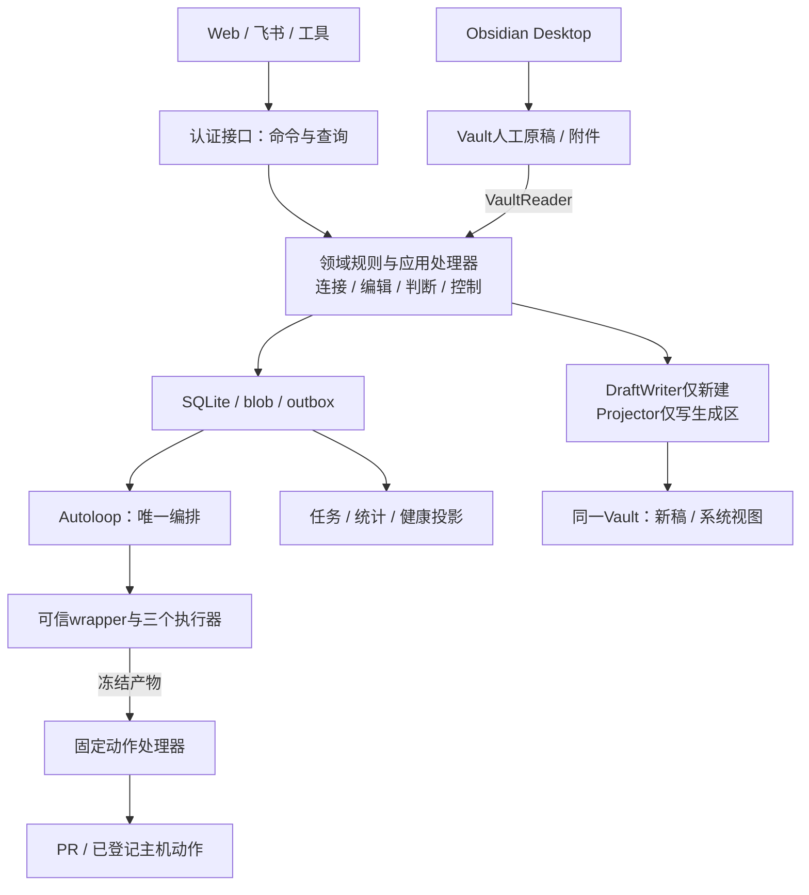
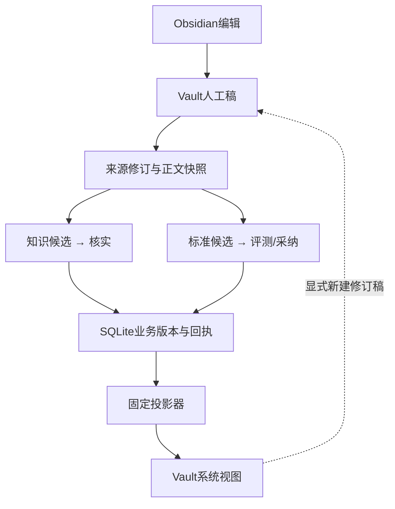

# PAtrick 技术实现计划

> **实施技能** 按任务使用 `superpowers:subagent-driven-development` 或 `superpowers:executing-plans`，以 §10 的复选框追踪红测、实现、验证和提交。

**目标** 从指定目录的一次真实需求变更出发，交付可核验的方案 PR，把本人决定与实际反馈接回同一工作及其判断标准。

**架构** `patrick-service` 提供同源 Web、领域命令及只读投影，SQLite/blob 持有领域事实，Autoloop 独占任务、等待和重试。固定处理器把执行、对账和文件操作连接到三个后端、GitHub、飞书与 Obsidian，各自保留精确版本及回执。

**技术栈** TypeScript、Node ≥24.9.0、npm workspaces、Hono、SQLite/WAL、React/Vite、Autoloop、Codex CLI/Grok Build/DSH、Obsidian Desktop、飞书官方 Node SDK。

## 全局约束

- 首版从空代码、空数据库和首次部署开始。七个主页面、六组设置、四种采集来源、三个执行器均纳入完整产品验收。
- 工作场景以创建并核验方案 PR 为交付点。合并、部署及 L3 属于各自的后续委托范围。
- 以一个工作范围、一个标准域起步。`productIdeas` 首轮至少验证直接交付、回答后交付、过期或冲突拦截三条路线。
- 每次业务执行核验身份、当前委托、策略、能力及短期 grant 的交集。等待关键回答时，研究咨询可按单独许可继续，受阻业务的派工、阶段事件和 effect 均保持等待。
- 每项写入保留精确版本与幂等回执。跨库、文件系统及外部平台通过持久意图和读回对账收口；未知结果保持未知。
- 个人与公司资料域贯通采集、检索、模型、日志及备份。原稿、生成视图、SQLite/WAL、凭据及执行器 HOME 按 §3 和 §6 分配读写边界。
- 发布门槛包括至少 10 个种子案例和 5 个独立留出案例；引用准确率初始目标 ≥95%，关键越权、应问未问及受控召回撤回材料零容忍。
- 主机初始模型并发 1、队列上限 1000、附件 20MB。恢复目标 RPO ≤24 小时、RTO ≤2 小时，每周维护以 1 小时为约束。
- 语言模式 `system/en/zh`。触达至少 44×44px，普通文字对比度 ≥4.5:1，运行标识为 80×80px、4.8 秒循环并尊重减少动效。

---

版本 1.6 · 2026-11-16 · [产品设计 v2.6](../designs/PAtrick产品设计.md) · [技术设计 v2.1](../designs/PAtrick技术设计-v2.md) · [交互原型](../designs/设计资产/v2/交互原型.html) · [TJ 团队 Figma](https://www.figma.com/design/kPSkB5zeZSKaK7Yrz3PslQ?node-id=24-67)

开发依赖见 [§7](#7-可执行任务清单)，设计验收追踪见 [§8.4](#84-从设计条款到验收用例)，逐任务步骤见 [§10](#10-逐任务实施步骤)。

**按全新系统实施：从空代码仓库、空数据库和首次部署开始。** 本文定义完整产品所需的开发任务、接口、数据及验收；任务均未实施，原型中的成功提示不作为真实服务证据。当前范围包括飞书机器人设置及Obsidian知识/标准编辑；以当前292帧/65张导出索引为设计基线，逐状态映射；原型105项/220组检查不作为真实后端、渠道或设备验收。本文路径均相对本仓库根目录：产品/技术设计与设计资产位于 docs/designs，实现计划位于 docs/plans。

## 1. 目标、范围与完成标准

让本人随时咨询；有证据、有委托时自动推进，缺关键取舍时给出A/B与自定义决定；回答后续办同一工作，将真实结果沉淀为案例、标准和经过验证的自动化能力。

| 完整产品版必须交付 | 明确的终点 |
|---|---|
| 七个主页面与设置 | 需要决策、正在进行、判断标准、知识、委托、系统、统计；六组设置接真实处理器，包含飞书机器人连接与检查 |
| 一个真实工作闭环 | productIdeas指定范围变化→研究→必要回答→方案PR→反馈→案例/标准改进；开PR即交付 |
| 四类采集与三个执行器 | GitHub、获准目录/Vault、RSS、单网页；Codex CLI、Grok Build、DSH分别通过实际后台准入 |
| 完整可信交互 | Web/飞书首答仲裁、工具咨询、精确版本、幂等、断线重取、状态与实际效果分离 |
| Obsidian编辑与知识资产 | 桌面端与Vault部署；知识笔记/标准修订可编辑，入库、核实/评测、生效与导回分别有回执 |
| 判断成长和渐进委托 | 候选/生效标准分离，独立评测；授权范围内提升，退化局部降级，换模型重新评估 |
| 长期运行 | 真实身份隔离、预算门禁、VPN诊断/固定修复、跨账本备份、隔离恢复、可撤回升级 |
| 完整呈现 | 中英及系统语言、状态动效、移动端、键盘/读屏；292个Figma画面映射到组件和可复现状态 |

每个任务的完成需同时满足代码与 Schema、合同与故障测试、界面对应状态、操作说明和可重放证据。先完成七层最小闭环，再完成全部产品验收。100 小时是首次投入窗口。

### 1.1 首版之外的工作

- 业务成果的合并和部署按后续独立委托设计。当前成果在方案 PR 核验后交付。
- L3 多步自主规划待范围内 L2 有可追溯的结果后再评估。新增平台和资料域逐个验证授权与撤回能力。
- 多租户 SaaS、双主和独立消息队列随实际吞吐或可用性需求再评估。首版沿用单领域写者及 Autoloop 调度。

部署 PAtrick 自身属于本期交付，由 T23 打包并由 T25/T26 验收和发布。

## 2. 技术栈与模块边界

### 2.1 选型清单

版本列是拟采用兼容系列。T00锁定 Node/npm、上游 SHA、设计输入与构建平台，按可用能力做独立探针。T01创建 workspace 后提交与 manifest 对应的 `package-lock.json`，在 CI 用 `npm ci` 验证；各任务接入依赖时共同更新。T23从锁定提交生成签名包和 SBOM。上游升级须重跑合同测试。[npm ci 文档](https://docs.npmjs.com/cli/npm-ci/)

| 位置 | 选型 | 选择理由与准入条件 |
|---|---|---|
| 语言/构建 | TypeScript、Node 24 LTS（≥24.9）、npm workspaces、ESM | 一套语言贯通UI、合同与服务；Mac arm64/x64及Linux CI验证原生依赖 |
| Web | React 19、Vite 7、React Router 7、TanStack Query 5 | 客户端路由与读模型缓存；静态产物由同源服务提供，无SSR进程 |
| 组件/样式 | Radix Primitives、CSS变量/CSS Modules、现有SVG资产 | 自建少量语义组件；不引入另一套视觉主题，同组件用fixture表达292个画面 |
| 语言/内容 | FormatJS/react-intl、Intl、统一Markdown白名单渲染 | 中英消息键、日期时区及复数；禁任意HTML/脚本/远程嵌入 |
| HTTP/合同 | Hono 4、Zod 4→JSON Schema、OpenAPI 3.1 | 入口运行时校验；从同一Schema生成客户端类型和接口文档 |
| 飞书传输 | 官方Node SDK的出站长连接、企业自建应用机器人 | 单聊事件及新版卡片回调分别准入；无需公开Web服务，不能用仅发送的群Webhook机器人代替 |
| 登录 | SimpleWebAuthn、服务端Cookie会话 | 本机可信引导绑定本人passkey；浏览器不持执行凭据 |
| 知识/标准编辑 | Obsidian Desktop；Properties、Templates、Bases、Backlinks/Graph、Canvas核心功能 | 正式编辑端；T00锁应用/安装器版本。通过文件适配器与官方URI接入，后台不依赖Obsidian常开 |
| Vault文件 | UTF-8 Markdown、yaml 2 + Zod校验平铺Properties、获准附件；`.base`/`.canvas`视图 | 人工正文可携带、可编辑；系统生成区按版本投影，不用Obsidian缓存承担业务持久化 |
| 存储 | SQLite/WAL、better-sqlite3、FTS5、内容寻址blob目录 | 单主事务、低维护；中文预分词/别名索引，后续向量召回不改权威数据 |
| 编排 | agent-autoloop固定SHA | 唯一任务/问题/回答/重试权威；仅接公开HTTP和command/read/check插件合同 |
| 执行 | 统一patrick-executor + Codex CLI/Grok Build/DSH适配器 | CLI真实退出与产物验收；Harness bundle通过受限RPC接领域端口 |
| 采集 | chokidar、固定HTTP读取器、RSS解析器、正文提取器 | watcher+补扫；RSS禁外部实体，网页不执行JS；重定向逐跳检查许可 |
| 测试 | Vitest、fast-check、Playwright、axe-core | 规则/竞态/故障注入、真实HTTP/SSE端到端、可访问与视觉检查 |
| 运行 | launchd、Lima隔离执行环境、系统凭据提供器、版本化发布目录 | 主机服务与模型工具隔离；CLI登录、VPN及备份目标按设备实测 |

前端、服务、worker共享合同包，不共享数据库连接。首版不引入Kafka、独立图数据库、通用工作流引擎或第二套Agent循环。

### 2.2 代码组织和依赖

```text
apps/web/                      路由、页面、组件、语言、草稿与订阅
apps/service/                  同源HTTP、认证、SSE、命令/查询入口
packages/contracts/            Zod、事件/DTO、OpenAPI、生成客户端
packages/domain/               纯规则：判断、标准、委托、预算与状态准入
packages/storage/              migrations、repositories、事务、blob、投影
packages/integrations/         autoloop、sources、feishu、MCP、vault、publisher
  vault/                       reader、create-only草稿写入器、投影器、URI解析
packages/executor/             wrapper、三个backend、Harness bundle与探针
packages/host/                 凭据、网络、进程控制、备份恢复、固定操作
assets/                        令牌、图标、字体、logo；带来源与hash
  vault-kit/                   版本化笔记/标准模板、Bases/Canvas、说明与manifest
fixtures/                      产品状态、合同、失败轨迹、独立评测数据
tests/                         unit、contract、integration、e2e、visual、recovery
deploy/                        配置Schema、launchd、Lima、Obsidian安装/检测、升级/卸载模板
```



domain只依赖contracts和端口；集成与storage实现端口；service组装。网络监督、HTTP服务、hub可独立存活，模型按需启动。outbox只投递已经决定的事件/固定动作，不分解任务、不按prompt派工；后续业务轮次统一交Autoloop。

| 模块 | 输入→输出 | 唯一写入责任 |
|---|---|---|
| Collection/Evidence | SourceConfig→原文修订/事实/引用 | 来源修订、游标、证据状态及撤回水位 |
| VaultConnection / VaultAdapter | 设备/根/许可/SourceConfig→连接与检测回执 | 配置复用vaults/source_configs；独立报告编辑器、收录与导回，不重复注册来源 |
| Edit / DraftWriter / Projector | 四类编辑意图/来源修订/已采用快照→三轴EditReceipt及文件 | Edit处理器记账；Reader只读人工区、DraftWriter仅新建、Projector只写生成区；不直接采纳标准 |
| Judgment/Learning | 证据+标准→建议/案例/候选/评测 | 判断与评测事实，事务校验后的生效标准指针 |
| Delegation/Budget | 可信委托+能力→短期grant/预留 | 权限、准入、预算；模型只能提交候选 |
| FeishuConnection / ChannelTest | 应用/凭据引用→配对、往返证明、probe/active/停用回执 | ChannelGate串行启用/切换/排空；测试namespace与业务AnswerGate分离 |
| Conversation/AnswerGate | 消息/精确答复→咨询结果/核验回执 | 会话与咨询结果；hub仍是问题/首答权威 |
| Work/View/Stats | hub事实+领域回执→只读快照 | 可重建投影；不调度、不凭UI状态续办 |
| Settings/Operations | 精确变更提案→实际效果/复查 | 注册处理器按目标版本应用；不接受任意shell/配置键 |
| Executor/Delivery | 冻结输入→验收产物/远端核验 | wrapper终态与动作账本，远端仍持实际成果权威 |

### 2.3 复用依据

当前 `main` 提供产品与技术设计、双语交互原型及导出索引，应用和测试框架从 T01 建立。T00与 T24 直接核对这些资产。历史飞书实现可用于了解故障轨迹，当前接口以固定上游 SHA 和真实探针为准。

任务、等待、重试继续交 Autoloop。领域服务使用 SQLite/WAL、事务内 outbox 和 SQLite Backup API。浏览器按标准 SSE 断点续接；GitHub、飞书和 Obsidian 通过现有 API、官方 SDK 或文件协议接入。PAtrick 补充可验证的本地授权、对账和展示。 [事务 outbox](https://docs.aws.amazon.com/prescriptive-guidance/latest/cloud-design-patterns/transactional-outbox.html) · [SQLite Backup API](https://www.sqlite.org/backup.html) · [SSE 规范](https://html.spec.whatwg.org/dev/server-sent-events.html)

## 3. 数据模型与一致性

### 3.1 共同规则

采用SQLite STRICT表、foreign_keys=ON、WAL、受测busy_timeout和短写事务。网络、模型与文件大读取不在数据库事务内。所有业务记录有schema_version、稳定ID、account_id/data_domain、revision、created_at/updated_at；UTC存时间，呈现时区另存。跨域外键包含domain，查ID也校验调用者范围。

不可变事实追加保存；可变指针用CAS（expected_revision一致才更新）。ID不由显示语言、标题、文件mtime或模型输出决定。每条变更同时写领域事件与outbox，唯一键提供幂等；跨hub、文件和远端均靠意图+核验恢复，不宣称分布式原子提交。

### 3.2 表组与关键字段

| 表组 | 最少字段与关系 | 约束/索引 |
|---|---|---|
| accounts / credentials / sessions | passkey公钥、credential_id、会话token_hash、auth_epoch、expiry、最近认证时间 | credential_id唯一；仅存hash，不把远端密钥存进会话 |
| caller_scopes / preferences | caller_id、owner、domain/action范围；mode=system/en/zh、motion、notifications、quiet_hours、revision | MCP调用者与本人账户关联但权限不等同；偏好不含授权字段 |
| source_configs / source_versions | source_id、type、normalized_target、scope/excludes、domain、credential_ref、frequency、history、enabled、config_revision | 规范来源键去重；版本不可变；同物理文件只有一个采集责任方 |
| collection_receipts / source_cursors | source_id、config_revision、启用/首次采集/成功/失败、cursor、count、evidence_ref、observed_at | 回执唯一event_id；旧版本回执不更新当前游标 |
| source_objects / source_revisions / blobs | object_id、source_id、locator、revision_id、observed_seq、hash、trust_class、tombstone、blob_ref | unique(source_id,object_id,observed_seq)；A→B→A保留；blob成功才提交游标 |
| vaults / vault_clients / vault_ids | vault_id/source_id、domain、采集主机、根目录身份、config_revision/connection_epoch/scope_hash；设备本地映射版本与应用状态；document_id/相对路径/record关联 | VaultConnection从这些配置和检查回执推导；同物理文件一个责任方，映射不是授权；路径/身份变化使旧证明失效 |
| edit_intents / draft_intents / edit_receipts | edit_id、operation、draft_key、非空active_key、closed_at、account/domain、record/document/source/base绑定、请求hash；三轴状态/receipt_revision、candidate/result、effect_ref | 原稿打开只登记意图；新稿create-only；同请求/同活动编辑归同edit_id，独立新标准以draft_key分开；旧回执不覆盖新修订 |
| projection_batches | vault/domain/view_kind、projection_revision、采用事实ID/版本、intent/manifest/hash、cleanup_state | 采用与导回独立；同意图重试，最新指针单调；不重建候选/重复计数 |
| knowledge_records / knowledge_members / knowledge_aliases | knowledge_id、canonical_id、当前版本/状态；成员claim/entity及证据引用；合并/拆分事件 | canonical只能指向同域根；旧ID可解析，不按文件、实体或切片直接计数 |
| channel_tests / channel_pairings | test_id、preview_hash、发送意图/message_id/回传事件、状态/有效期；配对码hash、候选发送者、Web确认 | 绑定应用/租户/config/credential/binding版本、domain/incarnation/epoch；一次性配对；测试verified后仍须可信启用 |
| channel_connections / channel_bindings / channel_receipts | connection_id、app_id/tenant_key、credential_ref/version、config_revision、channel_incarnation/connection_epoch、current_pairing_id/current_test_id；owner_open_id/chat_id/domain、绑定/探针/停用回执 | 一条主动飞书连接；新挑战/测试与旧项失效同事务、CAS推进当前指针；回调/启用只认当前指针，消息按应用+message_id去重 |
| control_proposals / control_receipts | proposal_id/hash、目标/动作/范围、base_revision、challenge、本人认证及实际结果 | 一次性挑战；精确差异绑定；不以普通聊天或飞书测试回执代替控制授权 |
| entities / claims / relations / evidence_refs | canonical_id、predicate/object、valid_time、状态、精确revision/span、verified_at/next_verify_at | supported/disputed/stale/retracted可区分；全文与图邻接按域过滤 |
| evidence_dependencies / withdrawal_events | from_kind/id/version→to_kind/id/version、epoch、reason、event_id | 覆盖标准/判断/提案及评测/能力两条链；门禁同步检查相关epoch |
| cases / case_outcomes | 情境、当时可见证据、标准、选项、预测/选择；后来结果、可信来源及观察时间 | 原判断与后验结果分存；拒绝、返工、失败、unknown均保留 |
| standards / standard_versions / candidates | stable standard_id、active_version、domain、范围、规则/例外/反例、来源、草稿base、状态/有效期 | 采纳CAS核对草稿/基线/评测/证据；版本不增加标准数量 |
| evaluation_policies / datasets / reports | 冻结门槛/预算/划分、case/result版本、基线/候选/外部方法、失败/不确定性 | 留出访问独立；生成样本不作留出；候选不能改评分门槛 |
| mandate_types / mandates / capability_profiles | type_id、领域/动作/资源/风险/域、预算/期限、L0–L3、报告/配置版本 | 类型不按实例计数；能力提升不扩权；撤回依赖可立即降级 |
| work_refs / work_generations | work_id、root/cause、source_revision、generation、hub_lane、完成条件、delivery_ref、冻结的 judgment_basis | 同一工作首次判断前固定标准或外部方法修订；后续 attempt、问题和续办沿用；run.done不是交付 |
| decisions / question_bindings | decision_id/event_id、版本/证据、judgment_basis_hash、A/B行动利弊、option_disposition/允许后续动作（计入options_hash）、custom合同；hub_card_id、question_version、options_hash、索引映射 | 问题生成后冻结；语义变动用后继问题；翻译不改option_id |
| decision_submissions | submission_id、raw_custom、disposition、question_version、reason_code、answer_intent_id?、replacement_ref? | proceed/deferred/clarification_required分开；需要重新决定时保存新旧绑定和差异；暂缓与澄清不产生有效hub答案 |
| command_inbox / answer_intents / answer_receipts | account/caller/request、command_fingerprint、精确绑定、raw_custom、发送状态；飞书另绑connection_id/incarnation/epoch、config/binding_revision、inbound_event_id、channel_permit/cutoff；hub_answer_event_id、validity、result_revision | 命令指纹含操作、对象、资料域、预期版本和正文hash；同键异指纹409；首答由hub仲裁；有效回执按hub答案ID唯一 |
| resume_intents / execution_grants | work/generation/question/answer、phase、state、next_action、evidence_ref、attempt_id；grant 的 work 或 consultation 主体、冻结依据、允许动作、版本、expiry、revoked_at | 每个恢复阶段唯一；工作与咨询按各自主体限制 active grant；补证时限定动作，咨询不授予业务 effect |
| question_replacements | work_id、generation、原 question_id/version、后继 question_id、原因、差异与关旧卡回执 | 对原版本唯一；换卡期间拒新旧卡并发接受；后继就绪后读回固定关联 |
| conversations / messages / consultations | kind、origin、work/context refs、raw_text、final_result、caller_request_id、result_version、cancelled_at | 工作与自由咨询分开；最终答案落盘才answered；取消/终态CAS |
| budget_reservations / usage_receipts | business/grant/session/attempt、route、逻辑调用ID、预留金额/时长、held/spent/uncertain、dispatched_at、actual_usage | 唯一调用键；预留与发送许可分别原子更新，同一预留仅一次发送许可；未知用量保留预留 |
| effect_intents / effect_receipts | effect_key/resource/action/hash、expected_remote_version、服务生成的origin、authorization_ref、dispatch_seq及远端阶段；业务另绑work/grant/generation，其他绑owner命令/test_id/采用事实 | origin=business/owner_operation/channel_test/vault_projection；不同来源授权由CHECK约束排他；同资源串行，未决写入先对账 |
| settings_inspections / settings_drafts / validations / changes / item_effects | draft_hash、base_revision、device/identity、操作列表、检查证据/期限、applied_revision、逐项效果 | 验证精确绑定；部分回滚只撤本次拥有且版本匹配的项 |
| host_observations / recovery_sets / notifications | 主机/目标/epoch/检查时间；备份manifest/hash/撤回水位；对象版本/渠道/投递状态 | 修复共用主机锁；旧通知重新判断有效性；恢复集禁止半成品标成功 |
| domain_events / outbox / projection_cursors | seq、event_id、aggregate/version、causation、scope、payload；destination/ack；hub/domain水位和投影通知的本地seq | event_id唯一；通知、投影、游标同事务；outbox成功或duplicate才ack |
| work_views / stats_views / health_views | 只读状态、范围、as_of、freshness、definition_version、水位向量 | 可全量重建；不作为执行授权或业务事实来源 |

SQLite部分唯一索引落实关键排他。工作 active grant 按 `(work_id,generation)`，咨询按 `request_id`；答案按 `hub_answer_event_id`，恢复按 `(work_id,generation,question_id,answer_event_id,phase)`，外部动作按 `effect_key`，未关闭编辑按 `(account_id,domain,active_key)`。工作和咨询 grant 的主体字段以 CHECK 排他。`active_key` 规范化操作、目标和精确基线，null 用固定值表示；新建标准还绑定 `draft_key`。迁移测试覆盖索引、主体互斥和关闭后重开。

### 3.3 必须写成确定性事务的流程

1. **采集提交**：稳定读取→blob临时文件/fsync/原子重命名→事务提交修订、cursor、domain_event/outbox。崩溃遗留blob可GC，已提交修订不可缺blob。
2. **答复接受**。认证并保存 AnswerIntent，按问题串行送 hub 首答仲裁，读回后在同一事务写 AnswerReceipt、`phase=answer` 恢复意图和 `answer.verified`。原生 `card.answered` 与该通知共用同一个领取入口；恢复记录尚未可用时，worker 返回控制器的 `policy_wait → done/no-op`，退出且不启动模型或技术重试。
3. **准入与派工**。检查身份、委托、策略、能力、grant、证据及预算。首次判断前写入 `judgment_basis`，续办和换 attempt 从同一工作读冻结版本，每次派发仍检查撤回水位。恢复阶段在 grant 事务中领取，技术重试在旧尝试终结且未决效果对账后沿用同键。咨询使用 `request_id` 的独立 grant 和额度，`parent_work_id` 只承载获准上下文。
4. **外部效果**。事务落 EffectIntent。调度者在短事务中按当前授权、撤回水位、资源和版本领取该阶段的唯一发送许可，随后在事务外调用并读回。许可与撤销按提交顺序裁决。撤销先提交时分派失败，已知尚未发送的许可关闭，已发送或发送状态未知的动作进入对账。只有证明未执行或下游明确保证同键重试幂等时才重发。读回证明与业务事实同事务记录。
5. **配置应用**：草稿验证→可信差异授权（需要时）→固定处理器→逐项applied_revision→复查。保存、应用、复查三个状态独立；取消不撤销已发生效果。
6. **标准采纳**：冻结评测和依赖→事务核对candidate/base/source/report/policy/epoch→CAS更新active_version并追加事件；首次null→v1，修订n→n+1，任一不匹配只留历史。
7. **编辑与导回**：事务登记/重取EditIntent→固定文件操作→读回修订→核实/评测及采用→同事务安排投影；导回重试只消费原采用事实。
8. **连接切换**：校验精确证明→ChannelGate或Vault资源锁→固定处理器及逐项回执；测试返回与启用分别落账，修改/恢复后旧证明不复活。

**知识条目身份**：KnowledgeRecord是一项可独立引用的结论及其必要限定，可关联多实体、多主张和多来源。提取只生成候选；固定准入或人工采纳后成为可用条目。稳定knowledge_id不因新增来源改变；合并用同域canonical根重定向旧ID，拆分生成新ID并保留原条目的历史/子项指引，不悄悄把旧引用改成另一结论。当前结论须仍有有效支持才available；单来源撤回但其他支持有效不删条目，全部支持失效不计存量。知识详情、列表和Stats共用此合同。

主SQLite只由service的repository接口写入；host/wrapper通过受限RPC交回执。hub库只由Autoloop写，禁止跨库直接SQL。恢复/导入工具使用相同验证规则，不能绕过唯一键和资料域。

### 3.4 Obsidian：知识和标准怎样编辑、保存、回写

**Obsidian是正式编辑端，Vault是普通文件夹。** 笔记以Markdown正文和Properties保存，外部文件变化可被Obsidian读取；PAtrick通过文件适配器接入，不依赖专用插件或常驻编辑器。见官方[存储说明](https://obsidian.md/help/data-storage)与[文件格式](https://obsidian.md/help/file-formats)。

| 内容 | 存储与写入者 | 作用 |
|---|---|---|
| 人工知识笔记、案例补充、标准修订稿 | Vault人工区；本人编辑，固定DraftWriter仅可创建新稿 | 正文的原始权威；每次观察到的有效修订归档到blob/SourceRevision |
| 核实知识、标准候选/版本、生效指针、评测及回执 | SQLite业务表 + blob证据/正文快照；领域服务写入 | 执行、检索和统计的权威；不会因改一份Markdown直接生效 |
| 知识卡、当前/候选标准、案例摘要及关系视图 | Vault的`系统视图`；Projector从已提交快照导出 | 在Obsidian可读、可搜索、可浏览；不承担授权或标准采纳 |

```text
PAtrick-个人/                         # 每个资料域独立Vault
  知识笔记/  判断案例/  标准修订/       # 可编辑Markdown原稿
  附件/                              # 获准图片/PDF等，保留独立ID/hash
  模板/                              # 知识笔记、案例、标准修订模板
  系统视图/索引.md                     # 指向当前完整批次
  系统视图/批次/<projection_revision>/
    知识/  生效标准/  候选标准/  案例/  # Markdown快照
    知识.base  标准.base  知识关系.canvas
  .obsidian/                         # 编辑器配置，不含PAtrick密钥/数据库
```

知识模板分“事实、出处、个人理解、待核实”；标准模板分“适用范围、判断规则、例外、正反案例、依据”。Properties采用平铺字段：`patrick_id、kind、knowledge_id?、standard_id?、base_version?`。ID与标准基线同时保存在服务端映射；改YAML只产生待校验输入，不能改资料域、active_version、评测门槛或委托权限。无ID笔记按§3.2分配映射，不为补ID覆盖原文。YAML只接受受限数据类型，拒绝可执行tag/递归展开，格式错误定位到原稿行并保留原文；正文原始字节先归档，不靠解析结果还原原稿。



- **编辑知识**：Web先定位可编辑的人工来源；仅有外部资料或系统视图时，新建关联该knowledge_id的补充稿。本人保存后，Reader稳定读取→原文落blob→事务写来源修订/编辑回执→知识候选核实→更新KnowledgeRecord及导出。个人理解与核实事实分别标记，不修改外部原始证据。
- **编辑标准**：首次通过`POST /edits`的create_standard操作按模板建稿，沿用draft_key；服务分配standard_id，base_version/active_version=null，不计生效标准；修订已有标准则从选定版本创建新稿，固定`document_id/base_version`及快照；已有同一编辑请求则重新打开原稿；edit_original只登记并定位，不写文件。保存只进入候选；T07冻结评测、检查最新原稿/基线/证据/策略，满足既有授权才CAS采纳；首次与冻结外部方法及独立案例比较，缺EvaluationPolicy/样本/许可时保留候选。风险偏好变化按可信取舍确认；采纳前旧版继续生效，旧评测不能批准新稿。
- **AI沉淀与导回**：对话/工作产出的知识和标准先进入业务表，再按其真实状态自动导出为知识卡或候选/生效标准。想修改生成内容时创建人工修订稿；系统不把生成区再采成新需求或新证据。独立留出集留在评测域，不导入学习Vault。
- **文件写入与恢复**：先持久化Draft/ExportIntent，再完整写临时文件并原子提交；新稿禁止覆盖已存在路径，同请求沿用edit_id。崩溃先核验目标/manifest/hash再续办，不生成第二份。投影发布持同Vault资源锁，在锁内检查单调revision并原子更新完整批次/索引；旧worker不能覆盖新索引。旧批次移到Vault外隔离区，人工改过的生成文件先保全全部字节。失败显示“业务已入库/生效，Obsidian待更新”，不回滚业务或覆盖原稿。

`.obsidian`、模板、系统视图、`.base/.canvas`和同步临时文件不进业务采集/任务触发；获准附件仍单独采集。`.base`只筛当前批次的Properties，Canvas只指向同域已导出条目；它们及Graph均是浏览视图，不是业务知识图谱的权威。编辑回执以§3.5三轴表示，不以打开URI或Obsidian缓存证明保存成功。已有活动编辑按账户/域/操作/目标/基线复用；新建标准以持久draft_key区分，不能把所有target=null请求合成同一稿。文件已存在先核验，不能为重试覆盖本人新内容；源修订/基线变化保留冲突，旧评测不能批准新稿。

### 3.5 连接与编辑状态合同

DTO由固定处理器及事实投影生成，前端不能PATCH状态。所有检查/回执带对象版本、设备/身份、时间/有效期和receipt_revision，迟到结果只补历史，不更新当前就绪结论。

| DTO | 状态与必要字段 | 不变量 |
|---|---|---|
| VaultConnection | not_connected/checking/needs_install/needs_permission/awaiting_confirmation/connected/degraded；vault/source、config_revision、scope_hash、root_identity、capture_host、client_mapping_revision | editor_status、collection_status、projection_status分别报告；应用未安装/关闭不等于后台停止 |
| EditReceipt | file：preparing/awaiting_save/collected/invalid/conflict；business：not_started/pending/verifying/evaluating/adopted/not_adopted/stale；projection：not_due/pending/current/failed/cleanup_pending/superseded | edit/source/base/candidate/result/projection版本精确关联；无效格式保留字节归档；更新版本已导回则旧项superseded，不再重发 |
| FeishuConnection | not_configured/checking/needs_binding/needs_test/needs_enable/ready/degraded/draining/disabled/requires_reauthorization；reason_code独立 | 传输mode为probe/active/draining/disabled；完整往返只到needs_enable，可信启用后才ready/active |
| ChannelTest | previewed/sending/sent/verified/unknown/expired；test_id、preview_hash、目的地、message_id/回传证据 | 绑定app/tenant/config/credential/binding/domain/incarnation/epoch；旧回传无效；不进AnswerGate、模型或统计 |

核心服务ready、可选集成和任务前置条件分别推导。Settings与System共用HealthSnapshot：展示影响、时间和一个下一步；未配飞书不阻Web，某项导回失败不把整个PAtrick标成停止。语言切换只改变展示，全部状态/错误以code映射中英。

needs_install只提示首次编辑准备；已接通后桌面缺失仅改变editor_status。采用在事务中比对最新已收录document head与冻结候选，不能把未观察到的文件保存算作已验证；后续修订重新核实/评测。测试证明TTL只限制启用提交，active健康靠当前连接/权限检查，配置/绑定/恢复变化才重验。

## 4. 接口与事件合同

### 4.1 共同协议

同源前缀 `/api/v1`。写命令含 `client_request_id`、`expected_revision`（创建为null）和 `payload_hash`。服务端通过 Schema 后重算正文 hash，再用已解析的操作、对象、资料域、预期版本和正文 hash 生成 `command_fingerprint`。先验证当前身份与对象权限。按 `(account_id, caller_id, client_request_id)` 查重，同指纹返回原命令/回执并跳过本次 CAS，异指纹返回409。仅首次执行校验对象当前版本。默认202返回 `command_id`，同步完成的偏好写入返回200；`GET /commands/:id` 重查调用者与资源权限。错误码为401未登录、403越范围、409版本/幂等冲突、422语义错误、429限流、503暂不可用。错误体使用 `{code, params, retryable, correlation_id, current_revision?}`，只返回脱敏参数。

业务动作核验WorkMandate与ExecutionGrant；本人接通/编辑/测试由认证owner命令和已获准对象范围驱动，新增范围仍走可信控制，不创建WorkRef或扩大模型权限。origin/authorization_ref由服务按注册处理器生成，公共payload不能选择；本人操作、渠道测试和投影也使用同一EffectIntent对账，业务统计只消费相应业务事实。

读取返回 `{schema_version, scope, as_of, watermark, freshness, data}`。分页 cursor 绑定过滤条件、排序、可见域和权限版本，默认50、最多200条。需要订阅的快照在同一个 SQLite 读取事务返回 `stream_cursor`，它指向该快照已纳入的最后一条投影通知，并绑定会话、可见域和权限版本。客户端首次连接从此 cursor 续接，重连使用最后收到的 `Last-Event-ID`；归档、重建或作用域变更使 cursor 无效时重取授权快照。[SSE 续接规范](https://html.spec.whatwg.org/dev/server-sent-events.html#the-last-event-id-header)

SSE `id` 是可续接的游标，事件正文带 `event_id`、`type`、`resource_id`、`resource_revision`、`scope`、`as_of` 和 `watermark`。重放先按 `event_id` 去重，拒绝较旧资源版本。服务端每批校验现行范围，撤销权限后关闭旧流。客户端收到撤销信息、401 或 403 后立即屏蔽相应数据、取消在途读取并清理缓存，重新连接先过会话检查。断线期间可显示当前会话内存中最后成功的快照和时间；重载后先验证会话。原文详情走单独受控读取，心跳只维持连接。

### 4.2 Web/工具接口清单

| 资源 | HTTP合同 | 写入结果/重要边界 |
|---|---|---|
| 会话 | `POST /auth/challenge`、`/auth/verify`；`GET/DELETE /session` | passkey challenge一次性/短期/绑定origin；登记由本机bootstrap票据发起 |
| 工作 | `GET /work`、`/work/:id`、`/work/:id/timeline`；`POST /work/:id/controls` | pause/resume/stop类型化命令；绑定generation与控制版本，回执前不假装已停 |
| 决定 | `GET /questions/:id`；`POST /questions/:id/answers`；`GET /answers/:receiptId` | A/B传option_id或custom原文；精确问题/提案/证据绑定；首答仲裁 |
| 对话 | `GET/POST /conversations`；`GET/POST /conversations/:id/messages`；`POST /conversations/:id/work-links` | 自由消息不答题；关联须显式选择原工作并重新校验域 |
| 咨询 | `POST /consultations`；`GET /consultations/:id`；`POST /consultations/:id/cancel` | caller/request幂等；answered/cancelled/failed终态不互相覆盖 |
| 知识 | `GET /knowledge`、`/knowledge/:id`、`/knowledge/:id/evidence`、`/sources/:id/revisions/:rev` | 搜索/筛选与出处；原稿编辑打开获准Obsidian位置，网页不替代编辑器 |
| Vault连接 | `GET /vaults`、`/vaults/:id/connection`；`POST /vaults/inspections`、`/vaults/validations` | 复用Settings Inspect/Validate处理器；确认接通/换位置只走settings/changes的connect_vault/change_vault，不建第二条配置写入口 |
| 编辑意图 | `GET /knowledge/:id/edit-target`、`/standards/:id/edit-target`；`POST /edits`；`GET /edits/:id` | 四类operation：edit_original/supplement_knowledge/create_standard/revise_standard；GET只解析/读回，POST按可信映射登记或仅新建稿，不接受任意路径/覆盖正文 |
| 编辑后续 | `POST /edits/:id/checks`、`/edits/:id/projection-retries` | checks只唤醒同来源固定补采并返回进度；导回重试绑定已采用结果/投影版本，不新建标准、不重评或续办业务任务 |
| 标准 | `GET /standards`、`/standards/:id/versions`、`/evaluations/:id`；`POST /standard-candidates`、`/standard-candidates/:id/evaluations`、`/standard-candidates/:id/adoptions` | 提议、评测、采纳分开；采纳由策略/可信本人决定驱动，不能直接PATCH active_version |
| 委托 | `GET /delegations`、`/delegations/:id`；`POST /delegation-proposals`、`/delegations/:id/controls` | 范围差异、预算与期限可审阅；精确可信回执才改变授权 |
| 来源 | `GET /sources`、`/sources/:id`、`/sources/:id/receipts`；`POST /sources/detect` | detect只在已获准范围探测；新增/修改/启停最终走统一SettingsChangeProposal |
| 设置 | `GET /settings`；`POST /settings/inspections`、`/settings/validations`、`/settings/changes`；`GET /settings/changes/:id` | 六组操作注册表；验证结果有期限/设备/身份；生效与复查分别记录 |
| 飞书配置 | `GET /channels/feishu`；`POST /channels/feishu/inspections`、`/validations`、`/credentials` | credentials专用TLS入口仅存安全提供器并返属主/草稿绑定的短期引用，不入通用inbox/outbox；配置/轮换/启停走settings/changes |
| 本人配对 | `POST /channels/feishu/bindings`、`/bindings/:id/confirm`；`GET /channels/feishu/bindings/:id` | 创建随机码、读候选发送者；必须已登录Web本人显式确认，app/tenant/配置/身份版本与TTL重验，不信任首个发送者 |
| 往返测试 | `POST /channels/feishu/tests`、`/tests/:id/send`；`GET /channels/feishu/tests/:id` | 创建不可变预览不发送；send显式绑定test_id/preview_hash与目的地；独立读回发送/回传证明，verified后仍待启用 |
| 偏好 | `GET/PATCH /preferences` | 白名单字段CAS；语言即时切换但失败显示未同步，不夹带委托/预算 |
| 系统 | `GET /system/health`、`/system/incidents/:id`；`POST /system/operations` | 仅已登记固定修复/备份/恢复操作，须验证相应ControlReceipt |
| 可信控制 | `POST /control-proposals/:id/confirm`；`GET /control-receipts/:id` | 最近本人认证+精确proposal_hash+一次性挑战+当前策略；普通业务答案不能替代 |
| 统计 | `GET /stats?period=7d&timezone=Asia/Shanghai` | period还支持30d/all；服务端验证时区，按域先过滤再聚合，未知null |
| 通知/诊断 | `POST /notifications/preview`、`/notifications/test`、`/diagnostics/preview`、`/diagnostics/export` | 预览无外发；测试发送明确对象/意图；诊断脱敏后供下载，不自动上传 |
| 订阅/命令 | `GET /events?after=cursor`、`GET /commands/:id` | 可重取回执；断线不取消业务，不自动重新提交写命令 |

MCP只暴露patrick_consult、patrick_consult_result、patrick_memory_query；Token由可信控制入口签发并限定caller/domain/动作，不提供问答授权、主机或凭据工具。飞书使用SDK认证的长连接，不把HTTP签名校验套到长连接消息；验证绑定的app/tenant、本人open_id、chat、原消息与问题版本，所有业务答复进入同一AnswerGate。Web普通聊天和飞书单聊“同意”都不代发决定；只有卡片显式提交或原问题允许的精确答复合同才进入答题路径。关闭原生“持链接即可答题”旁路。

### 4.3 代表性写入与返回

```json
{
  "client_request_id": "web-req-017-03",
  "expected_revision": 3,
  "payload_hash": "0c36ed2f38dbfa3729010d6161b777e6964daa203f9139630e428bae48aeb115",
  "payload": {
    "work_id": "W-017", "generation": 2,
    "question_id": "Q-017", "question_version": 3,
    "proposal_revision": 8, "options_hash": "43013bc56b94ab3c198fb411c3b329a518993d8e800bffb61675b5bdac0cf8c4",
    "answer": {"kind": "custom", "raw_text": "先处理最高频故障，再验证新需求"}
  }
}
```

响应先为 `{command_id, state:"received", receipt_url}`。A/B 与 custom 均先产生 `DecisionSubmission`，处置语义随 `option_id` 与 `options_hash` 冻结。以下处置均保存原话，模型可建议解释，固定处理器核对范围与关键条件。

| 处置 | 回执与后续 |
|---|---|
| `deferred` | 保留原问题待答，回执可重取。 |
| `clarification_required` | `MISSING_INPUT` 表示现有选项和范围仍适用，保留原卡并列出缺项。`OUT_OF_SCOPE` 或实质改案、关键歧义改变选项含义时，说明差异并在同一工作准备版本化后继问题。授权扩大还须可信控制回执。后继创建按原问题版本去重。 |
| `proceed` + `next_action=collect_evidence` | 接受精确答复后进入 `waiting_evidence`，只授予指定补证动作。固定核验器提交匹配的证据修订与 `evidence.ready` 后，才可领取交付阶段许可。 |
| `proceed` + 原提案动作 | 经 AnswerIntent 与 hub 权威核验返回 `verified / stale / rejected / conflict`，进展从原工作重取。 |

暂缓与待澄清不写 hub 答案、`answer.verified` 或主人决策事实。准备后继问题时先持久化换卡意图，在 AnswerGate 问题锁内封住旧版的新提交，核对在途首答后用控制器关旧卡，读回才开放后继卡。若旧版已获有效首答，保留其权威轨迹并按新事实重判。A/B 映射冻结的上游零起索引，custom 的上游请求只传 `text` 并省略 `choice`。

`POST /edits`使用共同命令信封。创建意图时expected_revision=null，服务按vault_id推导资料域并核验配置版本；新稿路径和document_id由服务分配，不接受任意文件位置。

| operation | 必需的目标/基线字段 | 返回与文件动作 |
|---|---|---|
| edit_original | knowledge_id、已关联的document_id、expected_source_revision | 登记同一edit_id，返回原稿入口；不写正文 |
| supplement_knowledge | knowledge_id、expected_knowledge_revision、draft_key；关联精确来源引用 | 仅新建补充稿，关联原知识/证据，不覆盖外部原文 |
| create_standard | draft_key、expected_active_version=null | 分配standard_id和新稿；active_version仍为null，不要求已有标准 |
| revise_standard | standard_id、base_version、draft_key | 从指定版本仅新建修订稿；采纳时仍须当前active等于base，否则保留为stale |

返回command_id、edit_id、receipt_revision，以及`file{state,proof_ref}`、`business{state,candidate_id,result_ref}`、`projection{state,intent_id,projection_revision,superseded_by}`；未产生的值为null，不能以缺省值伪装成功。原稿/基线无法匹配返回409和原稿/差异入口；不为重试换路径覆盖。采用完成后关闭活动键，历史及失败导回意图保留；冲突/未通过仍保留原编辑入口，下一次采用须重新核验。

配对confirm、test send及enable都重验同一完整绑定与有效期。同请求重试返回原挑战/测试/变更，不因换语言、刷新或超时自动发送第二张卡；无结果保持unknown，先按message_id对账。Secret只经专用端点，公共command/query/SSE回执只含引用与脱敏参数。

操作注册表将connect_vault/change_vault交T06；set_feishu_connection/rotate_feishu_credential/rebind_feishu/enable_feishu/disable_feishu交T10。配对确认只建立候选身份证明；现有active连接重新绑定先经变更流程排空，完整证明及可信启用之后才重新接业务。平台无法读回未知测试时不盲重发；本人明确新测试才换test_id，并将旧测试置status=expired、reason_code=TEST_REPLACED。

### 4.4 事件目录与派工限制

| 事件 | 产生者 | 消费者与不变量 |
|---|---|---|
| source.revision.committed | 采集事务 | 事实核实；仅获准trigger产生工作，不由任意资料正文派工 |
| work.requested / draft.requested / draft.ready | 可信入口/验收后的阶段结果 | Autoloop；带root/cause/generation/hops。首次判断冻结依据；待答与补证状态均检查允许的阶段。 |
| question.bound / answer.verified | QuestionBinding/AnswerGate | 投影与恢复阶段 `answer`。原生答复事件和补唤醒按同键领取。 |
| evidence.ready | 固定补证核验事务 | 绑定原 answer_event_id、核验证据修订和当前撤回水位；登记一次 `evidence_ready` 阶段，再签交付 grant。沿用 root/cause/generation/hops。 |
| consultation.requested | 持久咨询入口 | 独立 Autoloop lane，subject=request_id。按咨询额度领 grant 和发送许可，禁止业务阶段及 effect。 |
| decision.committed / work.delivered | 判断准入/交付核验事务 | 案例与统计；建议/模型调用/子步骤不计成有效决定或完成任务 |
| evidence.invalidated / capability.changed | 撤回/评测控制 | 同步门禁先阻断，后台重建依赖；无关域继续 |
| standard.candidate / standard.activated | 领域采纳事务 | Standards视图、后续维护评测；运行中任务固定旧标准，撤回约束仍即时生效 |
| vault.connection.changed / edit.receipt.changed / channel.test.updated / channel.mode.changed | 固定连接/文件处理器 | 健康、设置、编辑进度与SSE；只作状态通知，不派新业务根，不计任务/决定 |
| settings.applied / settings.verified | 固定处理器 | 健康/设置投影；保存不自动恢复暂停工作 |
| effect.uncertain / outcome.observed | 效果/反馈观察 | 对账、原案例结果更新；反馈不触发新需求根 |

所有事件有版本和消费者能力检查；未知major拒绝处理，保留原消息以便升级后重放。定时采集、复核、评测、结果观察与通知重试均由Autoloop维护规则触发固定处理器；主机心跳可以独立定时，但不得绕开业务门禁。

## 5. 界面与各功能的实现、测试

### 5.1 页面、组件与真实服务

路由顺序固定，页面通过同一SDK和只读投影取数。组件不持远端密钥，不将点击、loading结束或模型文字当成功回执。

| 路由/功能 | 组件和状态 | 服务接入与核心验收 |
|---|---|---|
| `/decisions` 需要决策 | WorkConversation、DecisionCard、OptionCompare、CustomDecision、Receipt、独立Composer；空态/过期/核验/离线 | 同一work/question版本；A/B行动/依据/利弊及关键风险常显，自定义与自由聊天有不同提交按钮；聊天“同意”不答题 |
| `/work`、`/work/:id` 正在进行 | WorkList、状态筛选/搜索、进展时间线、阻塞、成果、决定定位 | 未完成任务按 work_id 去重；已答后等待证据时显示缺失条件；交付后进入历史 |
| 全局咨询 | ConsultationPanel、ContextTags、工作关联、返回锚点 | 每页可达，工作/全局草稿隔离；等答时受限咨询可继续，原业务不派工；取消/终态竞态与重连同结果 |
| `/standards` | 当前/候选/失效、创建标准/修订入口、三轴EditProgress、版本/案例/评测 | 首次null基线到v1；修订冻结基线；保存不生效、旧版继续可用；过期不采纳，导回重试不重复计数 |
| `/knowledge` | 搜索/核实筛选、出处、编辑原稿/添加补充、冲突与EditProgress | 本人原稿可定位；外部/生成内容仅补充；收录与核实分开，canonical引用稳定，不按新文件加知识计数 |
| `/delegations` | 范围/动作/风险/资料域/预算/期限、能力阶段、精确变更差异、可信回执 | 提升不扩权，暂停阻新动作，停止核对执行树，在途先对账；回退旧版先验有效性 |
| `/system` | HealthSummary、最大影响异常、受影响工作、诊断与固定修复、恢复门禁 | heartbeat不等于服务可用；本机先诊断，修复后验证目标与原健康依赖；关联Settings同一change_id |
| `/stats` | 两组三卡、7d/30d/all、口径折叠、任务快捷筛选、快照时间 | 活动与存量分开；过滤/换语言不写业务；答复只增加一次主人决策，非同时增加完成任务 |
| `/settings` | 就绪摘要、设备/检查时间、Run checks、六组入口 | detected/suggested/user/inherited可见；只补缺项，未来入口不展示 |
| `/settings/collection` | 已有来源、添加/预览、修改/暂停/恢复/断开、首次采集状态 | 默认仅新增；历史范围/费用另确认；重复源定位已有条目，暂停不取消任务/删除证据 |
| `/settings/materials` | VaultConnectionCard、三步接通向导：检测/选择→预览范围→确认与往返；目录细节折叠 | 沿用已有应用/编辑机/Vault映射；编辑器/收录/导回分别报告，位置只配置一次；失效证明不接通，关应用后台继续 |
| `/settings/execution` | 三后端状态、默认执行器/时长、委托预算只读链接、登录修复 | 实际隔离后台探针；桌面登录不能假就绪，不能静默付费回退 |
| `/settings/operation` | 已登记主机、网络/磁盘、备份目标与时间、可信恢复入口 | 保存/生效/复查分开；恢复到隔离目录，未核对撤回/未决效果不开放 |
| `/settings/interaction` | FeishuConnectionCard、三步向导：应用→本人绑定→往返验证；待启用/维护/排空 | 当前绑定的测试返回后显式可信启用；缺权限/过期/非本人/unknown可处理；停用先核对，测试不记业务 |
| `/settings/preferences` | 系统/中英、减少动效、必要通知、免打扰 | 普通偏好白名单；不夹带机器人配置，语言切换保留业务状态 |

首期仅保留当前需要的日常字段、逐源配置与两个按步骤展开的接入区；标准与委托不在设置里重复实现。来源写入口和工作资料变更共用SourceConfig处理器；Settings与System也共用操作账本，不能分别维护“已修复”。

#### Obsidian编辑入口

工作资料用VaultConnectionCard显示资料库、编辑设备、最近收录/导回及一个主动作，ConnectionWizard逐步检测/选择、预览范围、确认接通并核验往返。系统自动沿用已有映射，只补缺项；未获授权前不安装、不写样例、不自动拉起应用。读/新建/生成区写分别列出，变更走同一SettingsChangeProposal。

知识详情按来源给“编辑原稿”或“添加补充”；标准页同时提供“创建标准”和“修订标准”。统一POST /edits，重开沿用edit_id/draft_key；EditProgress从三轴回执呈现“已收录→核实/评测→采用→更新到Obsidian”，失败只给对应下一步。首次标准、补充稿、过期修订不能走同一个默认采纳分支。

客户端只对本机已登记Vault生成官方`obsidian://open?vault=…&file=…`，编码中文、空格、`#`等字符；不透传任意URI动作/绝对路径。[官方URI合同](https://obsidian.md/help/uri)。原稿打开不算保存；checks复用原来源补采，projection-retries只重试原采用结果的导回。

服务端路径、编辑设备映射与浏览器设备分别登记；手机/未登记设备提供“在编辑设备打开/复制相对路径”，保留同一edit_id。`EDITOR_NOT_READY / VAULT_NOT_MAPPED / SOURCE_NOT_EDITABLE / EDIT_CONFLICT / EXPORT_PENDING`及安装指引、范围弹窗、动态回执全部本地化，不显示原始异常或假称已打开。

#### 飞书机器人设置与检查

入口为Settings → Interaction → Feishu bot，采用独立的“交互”设置类别。首屏只显示连接状态、机器人/本人目的地、最近检查时间和一个主动作；展开配置才显示App ID与密钥输入。连接流程：**选择/创建企业自建应用 → 填App ID及App Secret → 自动检测 → 本人单聊配对 → Web确认身份/资料域 → 预览测试 → 显式发送并回传 → 启用**。不支持接收答复的群Webhook机器人不作为完整接入方式。

- **减少输入**：服务检测机器人名称、租户、所需权限及连接；本人向机器人发送默认5分钟有效的随机配对码，仅存hash；捕获经SDK核验的发送者，重验完整绑定并在已登录Web中显式确认，不手填这些ID。只申请单聊收信、机器人发信及当前卡片能力所需最小权限；不默认读取群历史、通讯录或导入飞书知识。平台不能枚举的权限/发布状态标“待实测”，以真实回传证据核验，不编造就绪。
- **凭据**：App Secret仅通过认证TLS写入专用凭据端点，禁日志/分析埋点/本地草稿；立即存系统凭据提供器，业务表/回执只有credential_ref/version，前端不读回明文。修改App ID、凭据、租户或身份/目的地使旧验证与配对失效；更改域/启用/轮换/停用走精确SettingsChangeProposal，普通PATCH preferences无权执行。
- **检测分层**：凭据有效→机器人可用/发布可见→出站长连接→接收消息im.message.receive_v1→卡片card.action.trigger→本人目的地/资料域→发送及回传。只连上WebSocket或成功发消息均不等于“可以接收决定”。Run checks默认无消息外发；入站能力待真实测试，不用权限列表替代往返。
- **测试隔离**：点击“发送测试消息”前显示机器人、目的地和不含业务资料的样例；test_id带独立namespace，测试卡只验证回传，绝不调用业务AnswerGate/模型或产生决定/任务统计。持久化发送意图、平台message_id与回传证据，超时标unknown，核对后再重试，不自动连续发消息。
- **状态与启用**：外部状态严格采用§3.5；完整回传后显示needs_enable，带有效绑定/test_id的可信启用完成才ready/active。权限、凭据、断连是独立reason_code；过期码重建、非本人拒绝、unknown先对账，不复用旧证明。
- **停用**。ChannelGate 按应用先锁渠道、再锁问题。进入 `draining` 时提高当前 `connection_epoch` 并关新入出站。已送 hub 或送达未明的 cutoff 项使用发送许可记录中的 incarnation、epoch、配置与绑定修订核对当时的通道身份，再按现行身份、委托、问题版本、证据水位和撤权核验能否续办。许可未领、尚未发送和 cutoff 后到达的旧事件只留审计。未决项显示“停用中，答复核对中”，终态明确后关闭连接并显示已停用。有效的权威答案仍继续原工作，其他待答问题可从 Web 处理。

配置/配对/测试使用probe模式：只接配对码、探针和隔离test_id，不接业务对话/决定；只有当前配置的身份绑定、双向检查和可信启用均完成才转active。同app/tenant只有一个受监督长连接，检测不得另起消费者抢走业务事件；密钥轮换先验证候选凭据，再按ChannelGate排空切换，失败恢复仍有效旧版并如实显示连接间隙。所有探针/测试回执绑定配置版本、credential_version、binding_revision和connection_epoch，旧回执不能将新配置置ready。

草稿和生效配置分开：只读候选检查失败不影响仍有效旧连接；实际切换先排空，失败展示已改变项与连接间隙，重新核验后才恢复active。成功、取消、登出或卸载表单清除内存Secret；非敏感向导草稿/阶段、test_id与焦点可随中英切换保留。

T03提供可信配置引擎，T10交付配对/测试/启用与ChannelGate后台；T17接交互设置，T20复用投递/诊断端口。当前38类新增流程状态已有中英Figma画面，T00读取实际frame_id，T24映射到组件/fixture；只对确无设计的后续状态另列缺口，不再以原196帧为覆盖基线。

### 5.2 UI状态、语言和动效

共用ConnectionWizard、ScopePreview、EditProgress、StatusEvidence与可信确认弹窗；业务状态只读服务，焦点/草稿属于呈现。Secret排除在DraftStore、URL、日志和遥测之外，仅留当前表单内存。

AppShell固定侧栏与移动抽屉；页面仅一个标题/摘要/主动作，概览→比较所需细节→技术记录逐层展开。服务器状态交TanStack Query，草稿以account/conversation/question/version分区；登出清理本地私有缓存，服务端对话留存。

语言mode持久保存为system/en/zh。系统语言按navigator.languages顺序匹配，zh-*映射简体中文，en-*英文，否则英文；跟随模式监听languagechange，手动覆盖不被设备系统变化写回。切换presentation_epoch，不变business revision；丢弃旧语言的显示片段但继续持久化原结果。AI译文按content_hash/revision/domain/locale缓存，预算不足显示当前语言等待说明，保留原文入口。

所有系统文案使用消息键，包括动态错误、弹窗、Toast、状态、aria-label与日期。原话/草稿/代码/URL/ID不翻改，译文有标记；金额、期限、否定条件、引用与范围做一致性校验。保存失败保留本机选择，标未同步；不自动提交决定或重发咨询/检测。

共享设计令牌固定流光青浅色：背景#F5FAFC、侧栏#EAF5F7、主色#087B96、文字#203D49；当前不开放主题设置，CSS资产中的深色候选不自动启用。标题32/40、正文17/28、留白32/48；Inter/系统字体与Noto Sans CJK SC回退按产品规格，发行包自带获准字体并记录许可证。

Logo是侧栏居中的80×80方形SVG+CSS，主体68px、消息头像30px静态；4.8秒运行循环。真实服务running且状态新鲜才播放，单任务等待不停止；paused/unknown/断联/减少动效静止并保留状态文字。Page Visibility暂停隐藏页装饰，状态变化aria-live一次播报。对话160–220ms、决定/回执180/220ms、依据320ms、候选280ms；交互反馈不暗示授权。

图标复用[语义清单](../designs/设计资产/v2/icons/manifest.json)：系统波形屏幕、设置齿轮，六类设置与导航不同，交互用双气泡；8个导航入口与6类设置共14种图形。导航20px、分类17px；完整slogan置logo下方，中文在逗号后提供换行机会。触达至少44×44，正文对比度≥4.5:1；小屏A/B堆叠、custom常显，关抽屉恢复焦点，新消息不抢阅读位置。

### 5.3 界面还原验收

T00在`design-inputs.lock.json`锁产品/技术文档、原型、Figma交付记录与图标hash。T14锁定浏览器与发行字体渲染环境，T24建立 `fixtures/screens/screen-manifest.json` 和最终浏览器基线。清单逐条覆盖当前292个frame，记录`frame_id、route、scenario、locale、viewport、fixture_hash、expected_actions、test_id、baseline_asset/hash、font_hash、browser/DPR`。复用组件和状态夹具覆盖弹窗、详情、移动和错误态。[Figma交付记录](../designs/设计资产/v2/Figma交付记录.json)

产品文字合同决定业务语义，原型决定交互，Figma及65张带版本/hash的导出索引校对几何与内容。像素比较使用T24以最终发行字体生成并人工核对的浏览器基线。逐条记录 Inter 与 Figma 的 Noto Sans SC 字形和换行差异。固定时钟、数据、字体 hash、浏览器、DPR 和 logo 相位后截图；按钮、状态、回执和正文参与对照，遮罩限时间和确有必要的非业务装饰。

视觉初始阈值：布局关键边界偏差≤2px、像素差异比例≤0.5%，字体抗锯齿差异单独人工判读；关键内容缺失/遮挡、错误状态、focus丢失直接失败，不靠像素阈值放行。桌面1440×1000、移动390×844为主，另验768宽、200%缩放、长中文/英文、键盘、读屏与prefers-reduced-motion。292个画面均有映射和合同检查，38类新增状态的中英版、6个展开画面、14个新增移动画面单列，截图覆盖每个独立布局/状态；等价合并须记录理由和对应frame，不能仅测首页。

### 5.4 统计计算合同

完成任务按首次有效work.delivered的work_id；主人决策按有效hub答案ID；自动决策按已准入decision_event_id。模型调用、建议、子步骤、控制器清卡、重复和未通过答复均不计。活动窗口按请求IANA时区的自然日计算，含今天，返回精确UTC边界；全部时间明确起点与数据覆盖范围。

当前存量按stable standard_id、可用canonical knowledge_id、曾建立实例的delegation_type_id去重，另给当前有效委托类型数；不随活动周期变化。撤销事实以补偿事件修正原桶，投影与游标同事务；重建前后结果一致。首次标准仅在null→v1增加一次，版本修订不增；补充稿/SourceRevision不直接增加知识；ChannelTest、配对、样例Vault、编辑检查与导回重试不写任务/决定统计。权限过滤先于聚合，unknown=null，断联保留快照时间，不填0。Stats底部任务数来自相同WorkList快照，演示数据使用独立demo库/标识。

### 5.5 判断与自动化的功能测试

冻结10个种子案例和至少5个独立留出案例，仅用于验证流程；不能据此宣称普遍顶尖。候选与当前标准及有出处的外部方法同题/同信息/同预算比较，保留拒绝、返工和未知效果。训练/留出访问分离，候选不能更改EvaluationPolicy；已用于调参的样本退出留出集。

每个能力范围验证：证据不足不晋级、授权内达标可晋级、扩范围需可信差异确认、撤回评测证据即降级、模型/配置变化重新评测、回滚前检查旧版本仍有效。业务完成、本人采纳和实际业务效果分别记事实。持续监测引用错误、漏反例、返工、本人时间和关键失误，未授权任务不因能力评分高而执行。

## 6. 部署、运行与恢复

### 6.1 首次部署拓扑

飞书传输选定官方SDK出站长连接，固定版本和实际企业自建应用分别验证消息与新版卡片回调；不需要公网入站端口。若所选SDK/平台能力不通过，飞书显示受阻并阻止其准入，不能静默改成公开Webhook或假称可答题；Web仍可用。

主机为Mac mini（24GB/200GB），Mac Pro（16GB/100GB）承担开发/隔离恢复；只有获得公司访问资格的设备才接内网GitLab。起步模型并发1，后台服务不依赖浏览器/编辑器常开，不做双主。

| 单元 | 运行身份与边界 | 启动/健康 |
|---|---|---|
| Caddy同源TLS入口 | 固定Web origin/RP ID，服务仅监听loopback；跨设备使用已登记私有网络/DNS/证书 | TLS与origin检查；证书未信任时不能假装passkey可用 |
| Obsidian Desktop / Vault | 默认在Mac mini的本人桌面安装；Reader只读人工稿；真实Vault仅交固定处理器访问，新建稿与生成区写入分别受限；安装器/doctor/设置页共用VaultConnection Inspector与作用域证明 | 按需打开编辑；Reader/Projector由后台服务运行，退出Obsidian或重启主机不停止采集/业务；分别检查桌面端和Vault状态 |
| patrick-service | 控制身份，唯一领域库写者；Web输出脱敏/按域裁剪 | launchd；livez看存活，readyz看DB/必要依赖和当前门禁；可选渠道、编辑器与任务前置条件分开，不按“所有连接都绿”判断服务健康 |
| Feishu transport | 官方SDK企业自建应用出站长连接；事件与卡片回调分开订阅/准入，不公开Web/hub入口 | service集成受监督模块，仅一个主动消费者；durable inbox后快速确认，异步处理/重连去重；doctor分别显示收/发/回传 |
| Autoloop hub/worker | hub管理凭据仅可信适配器持有；不对浏览器/模型暴露 | 独立launchd；公开API状态与seq、worker心跳分别检查 |
| executor环境 | Lima隔离VM内的获准快照、任务输出与专用backend HOME；无hub/发布/主机凭据 | 冷启动实际CLI+工具探针；子进程树、凭据读取、出站路径实测 |
| 固定发布/凭据处理器 | 远端写凭据、安全登录/刷新仅供固定处理器；不运行模型提供的命令 | EffectIntent读回；按资源锁、generation与远端版本核验 |
| Host Supervisor | 最小本机权限、登记好的动作；GUI VPN在实际可用LaunchAgent会话下运行 | 心跳、接口/路由/DNS/代理、TCP/TLS/HTTP/身份逐级检查 |

生产代码与profile只读；任务cwd不能覆盖配置、`.env`或插件。DSH知识profile禁任意shell/JS/插件管理，API凭据与任意代码执行环境分离；订阅CLI必须证明其工具子进程不能取得控制/远端写凭据和越域网络。不能通过共享本人HOME/full-access解决准入失败。

版本化布局：`releases/<digest>/`放只读程序与Web产物，`current`指向当前发布；`data/`放两库/blob/投影，`runtime/`放进程记录/临时结果，`logs/`脱敏，`secrets/`仅存提供器引用。数据根、Lima磁盘、SQLite/WAL、密钥和CLI HOME必须在Vault/网盘同步根之外。配置按Schema验证，不从任务目录自动加载环境变量。

### 6.2 安装与诊断体验

实现 `patrick init / doctor / install / start / stop / backup / restore / upgrade / uninstall` 固定命令。安装包带精确版本、hash、签名/可信发布清单与SBOM；T00确定实际签名渠道并测试验证失败必须拒绝。init只询问无法检测的工作范围、Vault、资料域及必要身份；安全登录在对应可信通道完成，得到credential_ref。

T23以锁定版本在 macOS arm64 与 x64 分别构建候选包，使用 GitHub Actions 构建产物交给 T25 验收。每份安装包附目标 OS/架构、提交 SHA、SHA-256、签名和 SBOM。Linux用于 CI。T26将同一批通过验收的字节上传到指定版本的 GitHub Release，安装器和升级器下载明确版本后按签名清单校验；候选包验收后保留原摘要至发布。构建和 PR 测试只读仓库，签名及发布权限限独立的发布作业。[Actions 构建产物](https://docs.github.com/en/actions/tutorials/store-and-share-data) · [GitHub Releases](https://docs.github.com/en/repositories/releasing-projects-on-github/about-releases)

顺序为：核验包→目录/权限/磁盘→初始化schema→选择固定origin与TLS信任→绑定本人passkey→检测三个CLI及获准资料→预览权限/费用→登记委托→安装launchd→运行doctor→用真实只读样例核验。任何一步失败保留可诊断结果；安装成功不等于执行器/公司网络已就绪。

默认不启用未经准入的付费API；API补充必须有明确provider、金额上限及逐收费attempt门禁，缺一保持不可用。订阅用量不明显示unknown，硬限时间/次数；试点总预算和停止条件在首次真实调用前固定，重试/换后端不清零。

doctor返回状态、证据/时间、影响和一个下一步，覆盖实际服务身份、Headless profile、插件能力、数据域、scope、证书、原生依赖、磁盘、网络与备份。脱敏诊断包先本地预览；卸载只停止服务和移除本次安装，不默认删除数据、Vault或共享凭据。

#### 6.2.1 Obsidian桌面端与Vault首次部署

默认Mac mini同时放置服务和一个本地Vault；Obsidian Desktop是桌面应用，后台接入采用文件协议。Mac Pro起步用于开发/隔离恢复，需要跨机编辑时再配置同域副本与本机映射。官方macOS安装使用Universal安装包；T00记录应用版本、安装器版本、OS/架构及包hash，T27验证实际安装。依据：[安装](https://obsidian.md/help/install)、[更新](https://obsidian.md/help/updates)、[同步](https://obsidian.md/help/sync-notes)。

| 步骤 | 安装器/检测器做什么 | 本人只补什么 |
|---|---|---|
| 1. 安装应用 | 检测已安装版本；缺失时使用官方包、核验签名，安装到Applications | 必要系统确认；不把“安装成功”当Vault接通 |
| 2. 建立Vault | 建议获准目录、检测域/容量/服务权限；创建§3.4结构并登记vault_id/source_id | 目录、资料域和编辑机缺失时选择；不放入Obsidian应用数据目录，不嵌套Vault |
| 3. 装载vault-kit | 安装版本化模板、索引与Bases/Canvas样例，记录manifest；只新建缺项 | 首次在Obsidian“打开文件夹为仓库”，按引导启用所需核心功能；不覆盖本人配置/模板 |
| 4. 绑定与检查 | 本机首次运行应用注册URI；登记本地别名/ID；以真实服务身份验证Reader、DraftWriter与Projector各自权限 | 有系统权限阻塞时完成对应授权，不手填服务端文件路径 |
| 5. 文件往返 | 创建样例知识/标准修订稿→本人保存→读回来源和候选→导出；关闭Obsidian后再改受测文件验证后台补采 | 确认样例显示正确；真实标准评测/采纳由T25另验 |
| 6. 可选同步 | 一个Vault只启一种机制；Baidu网盘或Obsidian Sync等各自验证占位文件、离线、改名/冲突和资料域许可 | 明确选目标与费用；未通过保持单设备，不自动启用新订阅 |

样例验证使用隔离测试Vault/账本，不计真实任务与统计；实际Vault就绪以其配置版本和真实服务身份的回执为准。`doctor`分别报告应用可用、Vault可读、新稿可创建、系统区可写、最近入库/导出、同步/磁盘状态。未安装桌面端只阻断该设备编辑；已配置Vault的后台处理继续。接入预览分别列出人工区读取、新稿创建和生成区写入范围，确认后登记；添加只读来源不自动取得文件写权限。运行库、SQLite/WAL、blob、密钥、执行器目录均在Vault及网盘同步根之外；`.obsidian`只保存编辑器配置。同步副本不能代替RecoverySet。

升级先备份人工稿/附件及vault-kit manifest，对新应用/安装器运行打开、保存、URI、Properties/Bases/Canvas回放；不强制追随自动更新。卸载默认保留Vault与业务数据。恢复先保护较新人工稿并核验ID/原稿基线和撤回，再重建生成区；不通过整体覆盖Vault来回滚。换设备/路径后重新确认Vault规范根、采集主机和本机URI映射，旧路径不能自动用于读写或同步。恢复使旧检查证明失效，先核对实际根/权限、较新原稿与source/base，再恢复采集/导回；保留edit_id与采用事实，不按备份状态重建草稿或重复采纳。

### 6.3 网络与资源验收

心跳异常先查本机；hub正常但GitHub/GitLab不可达也触发目标诊断。401/403归身份，429退避，TLS失败不得靠关闭校验修复。Tunnelblick/OpenVPN/Shadowrocket按实际设备测试两种启动顺序、并发、DNS及重连；不能并用则dual_path=false，并按许可分机/受控轮换。

所有路由/DNS/代理/VPN动作持同一主机锁与network_epoch；回退只撤本轮拥有且仍匹配版本的变更。重试有次数、冷却与总时长，MFA只产生一个待处理问题；修复后同时复验故障目标、原健康目标和peer。网络恢复不创建新业务根，不越过待答/暂停门禁。

初始队列上限1000、附件20MB。采集流分段计数，超限中断临时文件和该次采集，保留原游标。磁盘<30GB告警、<15GB暂停大附件/新副本。完成副本7天、普通session14天可清理，活跃引用、问题和恢复集合继续保留。

T02/T13/T19 在单写者结构内控制批处理。游标、批结果和通知以短事务交接；读事务在序列化响应前结束，SSE 循环逐批读取后释放事务。记录等锁、WAL 体积与 checkpoint 进度。慢客户端的发送缓冲初值为 64 条或 256 KiB，任一达到即断开，按保留水位重连或重取快照。传输水位和业务延迟分别记录。[SQLite WAL 与 checkpoint](https://www.sqlite.org/wal.html)

T25以 `fixtures/perf/baseline.json` 固定负载，包含 1000 条排队更新、10000 条统计事实、两个资料域及一个慢订阅客户端。记录 `/work` 和 `/stats` 的 p50/p95、SQL 次数或查询计划、投影落后量、WAL 峰值和待发字节。相同过滤和响应形状下，`/work` 返回 1 条与 50 条结果的查询次数相同；`/stats` 日期范围使用可见域索引，限速客户端断开后其他客户端继续更新，清空队列后 checkpoint 能追平。T00记录目标设备和负载口径，T13/T19建立首个可运行基线，T25以相同口径重测。

### 6.4 备份、恢复与升级

每日RecoverySet：冻结入口/claim/回执/effect写者，排空或停止执行树，标记未决调用；用SQLite backup API保存两库，写blob/Vault映射、人工稿/附件、修订基线/新稿意图/编辑回执、vault-kit/本机映射与冲突、未结问题/答案/咨询、配置效果、委托/评测、版本锁与撤回水位。manifest列hash、schema、完整性及缺口，校验后才标可恢复。无法冻结的输入必须有持久交接日志。

RecoverySet再交受测加密备份工具（拟用restic）复制到已授权目标；活跃数据库不交网盘同步。密钥恢复材料独立保管，备份目标与域保持一致；仅本机文件或未经确认的云同步不能标异地保护。撤回日志独立有序复制，保留epoch/hash链，保护确认不是“复制命令已启动”。

RecoverySet也保存渠道配置/绑定/配对挑战、test发送意图与回执、渠道inbox/outbox及业务关联。恢复先隔离旧渠道未决项，不能自动重发；历史已核验答案仍按业务恢复协议去重对账。

**撤回水位证明**。已登记的权威目标保持独立、强一致的 RecoveryWitness，含 `domain`、`writer_epoch`、`open/sealed`、撤回 seq/hash、交接证书和写者身份。撤回立即阻断本机相关域，异地日志确认前为 `protection_pending`。旧写者停止并完成入站、两库及撤回对账后才可封存。恢复须核对当前封存证书及旧写者隔离证明，再应用完整日志。真正启用前，候选以该封存记录的精确修订做一次 CAS，写入 `open`、新 epoch 和唯一激活 ID；只有读回自己的获胜记录才开放权限。响应丢失先按激活 ID 读回。竞争失败、无法确认当前见证、仍为 `open` 或日志缺段时，相关域保持关闭；可找回日志或逐项重新核定资料。见证只保存控制记录。离机备份与保留期限由现有备份工具负责。

恢复后的飞书强制进入disabled/requires_reauthorization：生成新的随机channel_incarnation（不能仅把备份中的计数加一），使旧配对挑战、binding可信状态、ready/测试回执及待发队列失效；历史记录留审计。重新校验当前凭据/租户、完成新的本人配对、往返测试及Web可信启用后，才建立带新incarnation的卡片映射；旧回调和旧测试不得恢复业务或就绪状态。此流程是一次新的明确授权，不从旧备份推断最新渠道仍可用；也不替代全局撤回/委托水位校验。T22恢复演练覆盖这一门禁。

恢复命令默认演练模式、隔离目录、无生产写凭据/同步器。依次校验manifest/两库版本→追平最新撤回→保护较新Vault原稿与冲突→补采pending_ingest→对账hub事件/卡片/未决答案、配置与effect→重建投影→使旧Web会话失效→确认单写者。无法确认旧主机已停并撤销旧写凭据时，禁止恢复机对外写。通过后才逐域开放。

升级先停新派工并备份，再安装候选版本、schema迁移与合同回放、研究任务灰度、切换current。新写入前可退回旧程序/库；出现新写入后须执行经验证的逆向/前向修复，不能拿旧备份覆盖。目标RPO≤24小时、RTO≤2小时，以实际恢复演练计时证明；撤回保护不能用RPO容忍过期数据复活。

## 7. 可执行任务清单

所有任务初始状态为未开始。每个任务以独立可审阅PR交付；依赖未通过不接入真实写入。下表小时是单人配合AI的初估，含该任务测试，不含外部登录/设备等待；当前总计236–382小时（含连接向导、编辑回执及292帧映射；按本轮细化重估）；T00后按真实准入重新估时，不把估计作为放宽验收的理由。

### 7.1 基础与工作闭环

| ID / 预计小时 | 依赖 | 开发交付 | 必测与完成证据 |
|---|---|---|---|
| T00 基线与准入 · 4–6 | 无 | Node/npm与上游版本、产品v2.6/292帧及65张导出索引锁定、设备/三CLI及Obsidian应用/安装器/核心功能探针 | 记录实际平台、生产路径待测项和不兼容组合；design-inputs.lock.json |
| T01 合同与骨架 · 5–8 | T00 | workspaces、package-lock、contracts、OpenAPI/SDK、统一错误/命令/快照、CI | Mac/Linux锁定依赖构建；Schema/客户端一致；不合法major/超范围payload拒绝 |
| T02 存储与事务 · 7–12 | T01 | 存储基础migration、repositories、blob、inbox/outbox、投影水位；各领域任务交付所属表组 | 唯一键/CAS并发、崩溃落盘、A→B→A、空库初始化与前向迁移；storage-report |
| T03 身份与可信控制 · 8–12 | T01,T02 | WebAuthn、session、caller scopes、控制提案/一次挑战/回执、共用SettingsChange引擎/固定操作注册表、Keychain边界 | CSRF/跨域/重放/过期/恢复会话失效；模型与MCP不能答题/扩权；auth-report |
| T04 Autoloop适配 · 8–14 | T01,T02 | 固定SHA、source/rules、observer快照+分页+seq、公开插件、稳定工作与咨询lane、恢复领取接口 | 原生答复唤醒与无回执等待；custom 只传 text 的读回；断档/重启、hops边界 |
| T05 GitHub与目录采集 · 8–12 | T02,T03,T04 | 注册表、读取/预览、webhook+补扫、游标、触发白名单、首次回执 | 断网/半写/权限过期、重复来源、自触发排除、暂停在途；collection-report |
| T06 知识与Vault · 16–26 | T02,T05 | 事实图/检索；VaultConnection Inspector/处理器、四类EditIntent公共框架、Reader/DraftWriter/Projector、三轴回执、模板/附件 | 接通证明失效/只读不越权；原稿/补充、重复点击不覆盖、中文URI、半写/离线；采用后导回重试不重评/重计；vault-report |
| T07 标准与评测 · 12–18 | T04,T06 | create_standard/revise_standard分型、null/v1与修订CAS、冻结原稿基线、入候选、独立留出/shadow、采纳CAS/复评、导出当前/候选；先fixture后真实评测 | 首次标准base=null/ID稳定、保存不生效、改YAML不扩权、r8评测不批r9、base变化/失败保留旧版、留出不进Vault；evaluation-report |
| T08 委托、能力与预算 · 8–14 | T02,T03,T07 | 范围准入、类型目录、工作/咨询 grant、阶段限定、reserve/usage、暂停/降级/恢复 | 独立额度、末余额竞争、unknown预留、旧attempt/旧报告、scope提升越界、总预算不重置 |
| T09 三执行器 · 12–20 | T04,T08 | wrapper、Codex/Grok/DSH各adapter、Harness bundle、生产readiness | 各自真实后台终态/取消树/用量/隔离；final后挂起、exit1、缺插件、无resume；三份backend报告 |
| T10 精确问答与续办 · 16–26 | T03,T04,T06,T08,T09 | DecisionCard/Binding、AnswerGate、后继问题、答复与补证两个恢复阶段；飞书配置、双向测试与排空 | 原生事件早到与跨库崩溃、补证完成一次放行、超范围换卡、停用并发撤权、真实双入口 |
| T11 对话与咨询 · 8–12 | T03,T04,T06,T08,T09,T10 | Conversation、受限Consultation、HTTP/MCP、context link、终态CAS | 待答时咨询可独立完成且不占工作额度；取消/完成竞态、断线、跨caller、草稿隔离 |
| T12 PR交付与反馈 · 8–12 | T05,T08,T09,T10 | 冻结产物、固定GitHub发布器、首验/历史核对、effect journal、outcome watcher | base在创建窗口漂移、历史base正常前进、丢回执、多匹配、撤权后迟到成功；反馈只回原案例 |

### 7.2 完整产品界面与功能

| ID / 预计小时 | 依赖 | 开发交付 | 必测与完成证据 |
|---|---|---|---|
| T13 投影与实时同步 · 7–12 | T02,T04,T10,T12 | WorkList/Detail、Health、连接/编辑回执投影、SSE/分页、scope/watermark、陈旧状态 | 重建一致、断档重取不重发命令、权限收缩、同一任务/计数；projection-report |
| T14 UI基础与双语 · 8–12 | T00,T01,T03 | AppShell、共享组件、路由、token/图标、i18n、草稿、查询缓存/订阅SDK | 系统/中英/回退、所有错误和aria、换语言保留状态、Markdown注入；ui-foundation-report |
| T15 决策与工作页 · 10–14 | T10,T11,T13,T14 | 连续对话、A/B/custom、自由咨询、任务列表/详情/历史、控制回执 | 真实HTTP往返、重复点击、未核验不续办、过期保留输入、移动双输入；work-ui-report |
| T16 知识/标准/委托页 · 8–14 | T06,T07,T08,T14 | 搜索引用、原稿/补充/首次标准/修订四入口、三轴EditProgress、候选/版本比较、范围提案和可信回执 | UI不直接改active标准/权限；冲突/失效/评测不足/降级可见；learning-ui-report |
| T17 设置处理链与系统页 · 10–18 | T03,T06,T09,T10,T13,T14 | 六组设置；Vault接通/飞书三步向导与待启用/排空，复用T03/T06/T10；System同源状态、检查/修复与偏好 | 精确草稿失效、TTL/设备变化、部分应用/回滚；飞书缺权限/错租户/轮换失效/未配不阻Web；保存不续办 |
| T18 RSS/网页与采集页 · 8–12 | T05,T06,T17 | 两连接器、样例/范围/历史预览、来源增改停断、CollectionReceipt | SSRF/重定向/凭据URL、RSS实体、登录页、重复、暂停在途旧回执、首次采集独立 |
| T19 六指标统计 · 6–8 | T07,T08,T12,T13,T14 | StatsSnapshot/投影、三周期、stock/activity、任务筛选跳转、口径说明 | 去重/补偿/重建/时区跨日、跨域泄数、未知非零、语言不重复计数 |
| T20 通知与诊断 · 4–6 | T03,T10,T13,T17 | 偏好/DND、幂等通知/摘要、复用T10飞书测试/投递端口、预览/明确发送、脱敏诊断下载 | 已答/过期不发送，失败只重试投递，不重做业务；诊断不含凭据/越域原文 |

### 7.3 部署与交付

| ID / 预计小时 | 依赖 | 开发交付 | 必测与完成证据 |
|---|---|---|---|
| T21 主机网络与固定修复 · 8–14 | T03,T08,T13,T17 | Host Supervisor、锁/epoch、VPN探针、冷却/MFA、双目标复验 | hub正常目标失败、双VPN启动顺序、DNS/代理竞态、不可并用；真实设备报告 |
| T22 备份恢复 · 8–14 | T02,T04,T06,T10,T11,T12,T17,T18,T19,T20 | RecoverySet（含原稿/附件/修订基线/新稿意图/回执/kit及客户端事实）、冻结/交接、加密离机、撤回、隔离恢复/重建 | 错位两库、未决效果、较新原稿/旧Vault映射；撤回尾部丢失、witness陈旧/不可达；飞书旧绑定/回调/ready/停用回退；旧主机未停 |
| T27 Obsidian与Vault部署 · 7–12 | T00,T03,T06,T07 | 官方桌面安装配方、共享VaultConnection Inspector、vault-kit、设备映射/范围预览/往返检查、单设备与升级卸载 | 真实Mac打开/编辑/入库/导回；关应用仍处理；缺应用/权限、URI不可用、模板不覆盖；obsidian-install-report |
| T23 安装与升级 · 8–12 | T00,T03,T09,T21,T22,T27 | 双架构候选包、构建/发布工作流、签名及SBOM、Caddy/TLS、launchd/Lima、整合T27、安装/维护命令 | 空Mac安装/重启、拒绝损坏/错架构包、飞书收发诊断、升级失败时保护新数据 |
| T24 视觉/动效/无障碍 · 8–14 | T15,T16,T17,T18,T19,T20 | 292帧及38类新增流程状态映射，三轴编辑进度/连接向导/64条关键设计跳转对照、受控浏览器基线、全页动效/响应式/键盘与读屏 | §5.3视觉门槛、logo真实状态/4.8秒、减少动效、200%缩放、无横向溢出 |
| T25 端到端与故障演练 · 12–20 | T12,T18,T19,T20,T21,T22,T23,T24,T27 | 三条真实工作路线、四类编辑/三轴回执、飞书配对/往返/显式启用/排空、升级恢复与预算故障注入 | 开PR直接/答后/过期；Obsidian知识核实/标准真实评测采纳与双向回执；真实后端/渠道/设备 |
| T26 试点与维护交付 · 4–8 | T25 | 单范围试点、质量/人工投入基线、维护手册、恢复/升级演练、发布通过验收的安装包 | 发布 asset 摘要与 T25 验收相同；无P0/P1未决；试点按冻结指标和周维护≤1小时验收 |

T01先冻结VaultConnection/EditIntent/EditReceipt/ChannelTest及操作Schema，T02提供版本与唯一键的迁移工具，各领域任务同时交付本域约束和测试。T06先完成接通处理器、文件协议、知识编辑与通用草稿/投影器；T07接标准编辑、候选/评测/采纳。T27交付独立桌面/Vault安装检查模块供T23整合，先验文件到候选往返，T25再验真实模型评测采纳。

T10不依赖成品设置UI：用T03认证/可信控制和T10自身配置/测试后台，经认证客户端从空配置走probe→配对→往返→可信启用→active，再做真实双入口验收。禁止直接改ready或伪造ControlReceipt；T17/T20只复用这些既有端口。

T07先完成规则/数据合同，T08先完成固定门槛下的委托与预算，T09通过后在T25补真实标准评测与能力晋级；fixture完成不等于模型路径准入，避免隐性依赖环。T17接T06/T10的真实端口；T27本机检查模块独立交付，完成前相关本机能力如实标待验证，T25汇总真实设备联调。T17先注册网络/备份处理器合同，实际T21/T22未通过时UI显示不可用，完整设置联调归T25。

T14可根据稳定合同和带 demo 标识的夹具先行。首次100小时按 §7.4 运行最小纵向切片；完整产品以 T00–T27 全部交付及 §8 门槛为准，执行器逐个验收。

### 7.4 首个 100 小时的可验收切片

先登记演练仓库、分支、目录、资料域、身份和费用上限，只装入授权的测试材料。表中 T 编号指 §10 相应步骤的纵向切片。时间栏用于安排投入，段末证据决定是否进入下一阶段。每段记录耗时和阻塞；完整任务按 §7.1–7.3 的依赖和验收关闭。演练中的真实 GitHub/飞书写入同样走 §3.3 门禁。业务仓库及真实 Vault 启用前，验明该范围的线上身份隔离、预算、读回和 §6.4 恢复证据。

| 小时 | 本轮实施路径 | 段末可复验的结果 |
|---|---|---|
| 0–12 | T00锁输入和授权目标；T01建立 workspace 和命令契约；T02/T03先完成可供本地真库和认证测试的最小入口；并记录三 CLI、VPN 及许可探针 | 锁定构建能启动最小服务；测试认证只可访问演练域；缺真实验收的路径显示待测 |
| 12–28 | T04登记单 lane；T05只启一个 GitHub 目录及其补漏路径；T06接同域 Vault/知识最小版，T07冻结产品域基线和样本 | 原文及游标可重放，中文可查证；半写、离线、撤回与冲突路径受测 |
| 28–48 | T08签短期 grant 和累计预算；T09准入一条实际订阅路径，完成一次真实 Harness bundle 知识/判断调用；T10精确回答与恢复键，T12冻结产物与固定发布 | 演练仓库可创建并读回 PR；中断后以同一业务键对账；待准入后端显示原因 |
| 48–66 | T10以已授权飞书应用完成配对和双向验证，T11接受限咨询，T13提供同一任务快照，T14/T15接决策和进行中两页 | Web/飞书竞答只接受一次；真实答复重启后续办原工作；咨询重连及切换中英保留草稿和业务版本 |
| 66–80 | T12反馈回原案例，T07/T08做一次候选对照及准入评估，T17提供试点所需检查及真实应用回执 | 拿到采纳或拒绝的版本证据；规则不足时明确保留候选；权限和已暂停工作保持原状态 |
| 80–100 | T21只运行试点主机已登记的诊断/复查；T22对同一切片备份、撤回和隔离恢复；T25复演三条工作路线及一次真实故障 | 直接/回答后 PR 各一条，过期或冲突拦截一条；在隔离目录恢复并重建后，任务/答案/远端结果可核对 |

首版完整产品还要验收 RSS/单网页、其余真实后端、六组设置、其余页面、全部设计状态和完整 RecoverySet。超过 100 小时或未满足段末条件时，在证据清单记实际结果和剩余依赖，沿同一计划继续实施。

### 7.5 执行约定

- §10 的文件路径相对仓库根目录，均为计划中的创建或修改位置。单元、合同和集成用例按卡片路径放置；`Txx` 文件内按场景命名。各任务把表中反例落实为独立断言，尤其是无副作用、重复、崩溃与恢复的计数。
- T01建立 `npm run test:unit`、`test:contract`、`test:integration` 全量脚本。精确文件用 `npm exec -- vitest run <文件>`，浏览器文件用 `npm exec -- playwright test <文件>`。T02起在隔离临时数据根运行本地真库集成，T04起使用锁定 hub 的隔离实例。红测中的测试客户端、时钟和故障替身由各用例建立，复用真实 API 或存储入口验证事实。
- 每次验证记录命令、退出码、场景/输入版本、证据 hash 和环境。报告归 `release-evidence/<release_id>/tasks/Txx.json`，由 T01 的校验脚本读取。每个任务绿测后先 `git diff --check`，再按卡片文件清单暂存和提交；完整联调与试点证据分别由 T25、T26 汇总。
- `00NN_<模块>.sql` 的前缀用于定位责任任务。T02的 `packages/storage/migrations/manifest.json` 是唯一执行顺序，按合入顺序追加。已应用 ledger 必须匹配 manifest 的完整前缀与文件 hash，迁移器只执行未应用的后缀。每个新增 SQL 的 PR 在最新 `main` 上补齐 manifest 项，空库和上一发布版均回放验证。

### 7.6 可并行实现的工作线

| 工作线 | 主要目录 | 启动依赖 |
|---|---|---|
| 基础、采集和判断 T00–T08 | `packages/contracts`、`packages/storage`、`packages/domain`、`packages/integrations` | 按 §7.1，T03与 T04 在 T02 后可各自开发 |
| 执行、答复与发布 T09–T13 | `packages/executor`、`packages/integrations`、`apps/service` | T08完成后接 T09/T10；T10后 T11与 T12 可分别开发 |
| Web 和视觉 T14–T20、T24 | `apps/web`、`apps/service`、`tests/e2e` | T14可从 T01/T03 开始；页面联调等各自的领域任务 |
| 主机、恢复与发行 T21–T23、T25–T27 | `packages/host`、`deploy`、`.github/workflows` | T27在 T07 后可先做；T21/T22齐备后汇入 T23，随后验收和发布 |

同一目录由工作线协调接入。各线可以独立写本域 SQL，共用 `manifest.json` 的最后一条必须按实际合并次序落位。共享 HTTP 路由注册表和 Schema 变更先合入公共合同，再接消费者；避免两个分支同时定义同一入口。

## 8. 测试、发布门槛与证据

### 8.1 测试分层

| 层 | 运行方式（T01建立脚本） | 覆盖重点 |
|---|---|---|
| 静态/单元 | `npm run lint`、`typecheck`、`test:unit` | Schema/类型、纯规则、中文检索、时间窗、预算、状态推导；关键分支无未验证路径 |
| 合同 | `npm run test:contract` | 三CLI原始事件/退出、hub问答/分页/seq、connector、版本和能力缺失；固定上游SHA |
| 集成/属性 | `npm run test:integration` | 真SQLite事务+本地HTTP/hub；并发首答、CAS、唯一键、乱序/重复/崩溃点；fast-check生成轨迹 |
| UI端到端 | `npm run test:e2e` | Playwright Chromium/WebKit/Firefox，真实服务/认证测试器；状态、草稿、焦点、双语、SSE重连 |
| 视觉/可访问 | `npm run test:visual`、`test:a11y` | frame映射、受控截图、键盘/axe与人工读屏；减少动效及实际循环录屏 |
| 隔离/设备 | `npm run test:admission` | Mac真实后台身份、三个执行器、凭据/出站边界、VPN、备份目标；不在共享CI带真实密钥 |
| 恢复/升级 | `npm run test:recovery` | 可注入崩溃窗口、恢复集缺口、撤回/新稿、远端不确定效果、schema升级与单写者 |

PR CI运行静态、单元、合同、本地集成与关键UI路线；夜间跑完整UI/视觉/恢复沙箱。真实模型、平台、VPN、离机恢复在获准设备上按发布候选执行并留脱敏证据。覆盖率仅作缺口线索，不能替代反例和实际身份路径；不为简单文字或token映射重复写低价值测试。

### 8.2 必须阻止发布的反例

以下任一发生即失败：重复发布/续办；未答关键问题却派业务轮；旧卡/旧grant生效；跨域读取或统计泄数；缺预留的新增收费调用；候选自改门槛；撤回材料复活；将未知/样例写成成功或0；恢复覆盖较新人工稿；模型读取控制/远端写凭据；可见错误/弹窗未本地化；关键控件无法触达或被遮挡。

另需验证：知识多实体/多来源、重复导入、合并/拆分、单来源与全部支持撤回的ID与计数一致；飞书配对码过期/错误租户/非本人/旧connection_epoch/重复消息与卡片、probe收到业务输入拒绝、停用与hub超时并发、恢复后旧测试回调与停用配置回退、测试不记业务统计、单发成功不标双向就绪；3px关键边界位移和错误换行会使视觉检查失败。连接草稿修改不影响有效旧配置，但旧绑定/探针不能启用新配置；测试verified但未可信启用不得接业务；source启用与首次采集分离；暂停来源不取消工作；配置应用后复查失败仍展示真实已改项；stop确认执行树；通知失败不重执任务；生成中换语言不丢结果或重复请求；Stats重建/补偿前后口径一致；无SSE时轮询同快照可恢复。

**Obsidian专项（T06/T07/T16/T22/T27，T25汇总）**：

| 反例/流程 | 必须观察到的结果 |
|---|---|
| 接通预览后变更根/身份/TTL、未安装编辑器/手机访问、仅只读许可 | 旧证明不能接通；写样例须有许可；编辑器与后台资料状态分开，失败不覆盖原稿或有效配置 |
| 新建/改名/复制ID、中文/空格/`#`文件名、客户端映射缺失 | 原文/身份不混淆；URI正确编码或给可用替代入口；点击不假装已保存 |
| 写稿成功但回执丢失、投影迟到/中断、修改生成文件 | 同请求重新打开已编辑稿不覆盖/重建；发布资源锁挡住旧worker；完整批次才可见；人工字节保全，不被覆盖或回采成新任务 |
| 原稿/补充/首次标准/修订、附件撤回、r8→r9、基线已变 | 四入口各走正确文件操作；知识/标准核实前不采用，旧评测不批新稿；首次v1只计一次、修订与补充不按文件增数 |
| 采用成功但导回失败、重复点重试、运行中任务遇新标准 | 页面分别显示采用/导回；同edit_id/投影意图重试不重建候选或重评，存量不变；原任务仍用冻结旧版 |
| 真实Mac首次部署、重启/退出Obsidian、服务账号权限不足 | 文件编辑→入库/候选→导回可追踪；关应用后台仍处理；权限/桌面状态分别显示 |
| 较新原稿+旧备份、占位/同步冲突、vault-kit升级/卸载 | 原稿/冲突与基线保留，先补采/撤回再生成；不同步运行库，不删Vault或本人模板 |

### 8.3 最终交付证据

`release-evidence/<release_id>/manifest.json`关联product_coverage（产品条款→合同→任务→frame/fixture→测试），记录代码/上游/配置/Schema/fixture版本、测试命令与退出码、实际平台/身份/backend、报告hash、失败与豁免。真实凭据不入证据；截图/录屏仅含获准样例或脱敏数据。每个T任务对应证据路径和完成日期，缺真实能力时标blocked而非passed。

放行顺序：合同可行→空机可部署→真实七层闭环→完整产品/跨入口→故障恢复→小范围试点。试点范围、质量门槛、预算、停止条件先冻结，观察拒绝/返工/失败与本人投入；没有足够结果不能宣称判断提高。引用准确率目标≥95%、越权/应问未问/受控召回撤回材料零容忍，须同时报告样本量和不确定性。

### 8.4 从设计条款到验收用例

按产品及技术设计逐项回查。单元/合同证据用于验证具体规则，真实服务、设备、画面和试点结果分别使用 §10 所列的验收入口。完整版本要求每行证据可取回，条件未满足时在 manifest 记录实际差异和受影响的发布环节。

| 产品设计 / 技术设计 | 实现任务 | 验收证据 |
|---|---|---|
| 产品§1、§4；技术§3、§4 | T07/T08/T12/T25/T26 | T07 冻结 r8 后收录 r9，旧报告只能留档；T25 实际反馈进入原案例，完成当前/候选/外部方法对照、影子及一个退化或样本不足样本；T26 按完整分母报告成果和人工投入 |
| 产品§2–3；技术§5.1–5.2、A2 | T04/T08/T10/T11/T13/T15/T25 | T10 `answer-once`、`stale-or-deferred`；T13 `stable-work-and-watermark`；T15 `same-work`，显式提交和聊天各走其路，断线重取同一工作及回执 |
| 产品§2.2；技术§5.5 | T13/T19/T25 | T19 夏令时跨日、域外事实、重复/撤销/重建，活动与当前存量分别验；T25 对账一次真实答复只计一次 |
| 产品§4.1、§5.4；技术§5.3.1、§5.4.1、§6.1.1、A1 | T05/T06/T07/T16/T17/T22/T27 | T06 写稿后丢回执、中文检索与撤回；T16 四入口和三轴；T27 真实 Mac 文件往返/关编辑器；T22 保全较新原稿 |
| 产品§5.5；技术§5.4.2、A2、A4 | T03/T10/T17/T20/T22/T25 | T10 `channel-lifecycle` 和真实双向探针；T17 待启用/排空各有回执；T22 恢复后旧 incarnation 回调和绑定无效 |
| 产品§5.1–5.3、§7；技术§2.5、§5.3–5.4 | T01/T03/T05/T17/T18/T20 | T17 验证后改草稿、部分应用后复查失败；T05/T18 四种来源、启用和首次采集证据；T20 明确发送和脱敏预览 |
| 产品§6–7；技术§4、§5.7–5.8、A3–A4 | T08/T09/T12/T25 | T08 最后额度竞争与旧 grant；T09 三后台身份、坏退出、每收费 attempt 预算；T12 远端成功响应丢失及 source/base 变化；T25 三条真实工作路线 |
| 产品§6–7；技术§6、A4 | T21/T22/T23/T25 | T21 双 VPN 和原健康依赖复验；T22 两库水位、撤回、Vault 新稿、旧主机未停；T23 空机安装与升级；T25 真实隔离恢复 |
| 产品§8–10；技术§5.6、§7.2 | T14/T15/T16/T17/T19/T24/T25 | T14 默认语言和覆盖；T15 生成中换语言后保留草稿、焦点、回执；T24 `frame-coverage`、各布局截图、键盘/读屏和动效实测 |

### 8.5 工程复核补齐的验证路径

当前仓库提供设计资产。下图列出的单元、集成及设备用例与相应任务一并实现，结果由 §8.3 收录。与运行时或跨服务时序有关的断言使用真实存储、HTTP 或受控故障点。

```text
入口与边界                                     故障场景与可见结果
认证命令 -> 目标指纹 -> 版本校验 -> 回执        T01/T02/T03  同键换目标 409，撤权后 403
安装/升级 -> manifest -> SQLite ledger         T02/T23      乱序合入可升级，旧迁移变更后停止
双入口答复 -> hub -> 核验 -> 领取阶段          T04/T10/T15  原生先到等核验，补证/交付各领一次 [E2E]
咨询 -> 独立 lane/授权 -> 结果                 T08/T11      待答仍可咨询，父工作额度与副作用不变
快照 -> 同事务游标 -> 续接                    T13/T25      快照间提交不遗漏，旧订阅可重取 [E2E]
预算 -> 预留 -> 单次发送许可 -> 用量          T08/T09      重复调用零额外发送，崩溃待核对
证据/基线 -> 候选 -> 回放与评测 -> 采用        T07/T09/T25  在途工作冻结旧版，撤回后拦截 [EVAL]
工作计划 -> 远端创建 -> PR 首验 -> 历史核对    T12/T25      空读待核验，base 正常前进保留回执 [E2E]
人工稿/模板 -> 暂存 -> 发布目标名              T06/T27      中断无半成品，现有文件保留
恢复 -> 核对撤回 -> 领取新 epoch -> 启用       T22/T25      两个候选仅一方获得写权限 [E2E]
构建版本 -> 候选签名 -> 现场验收 -> Release    T23/T26      发行摘要匹配验收，错架构可诊断
```

| 测试位置 | 故障注入及通过条件 |
|---|---|
| `tests/integration/T02.test.ts`、`tests/integration/T03.test.ts` | 旧安装已应用 0012，再合入 0011；升级只应用新 manifest 尾部。交换目标或预期版本时返回409，同目标重试返回原回执；撤权后拒绝读回。 |
| `tests/integration/T08.test.ts`、`tests/admission/T09.test.ts` | 同一预留的两个并发领取只产生一次实际出站；在派发前后分别停机验证禁止重复收费，未知用量展示待核对。 |
| `tests/contract/T04.test.ts`、`tests/integration/T10.test.ts` | custom 只传 text；原生事件先到时让出 worker，读回同一答案后只允许一次续办。补证证明重放只激活一次交付。超范围 custom 生成一个后继问题，旧卡回调和扩权被拒。 |
| `tests/integration/T08.test.ts`、`tests/integration/T11.test.ts` | 等待决策期间的咨询独立计费，咨询 grant 拒绝业务 effect，确认父工作无新增 grant、轮次和费用。 |
| `tests/admission/T10.test.ts`、`tests/integration/T10.test.ts` | 已提交飞书答复在停用时按历史许可+现行工作授权核验，撤权反例只留审计；实测暂缓后仍能回答。 |
| `tests/integration/T12.test.ts`、`tests/e2e/T25.spec.ts` | 丢创建响应并暂时隐藏结果，保持未知；创建窗口内 base 变化暂停交付，核验后推进 base 保留原证据且零重发。 |
| `tests/integration/T13.test.ts`、`tests/e2e/T15.spec.ts` | 在快照与订阅之间提交状态，读回一次；断线后撤权，在两个标签页重连均拒绝旧游标和迟到响应。页面显示权限变化或重新认证入口。 |
| `tests/integration/T07.test.ts`、`tests/admission/T25.test.ts` | 固定模型/提示/工具版本，按相同的输入、样本和预算对比当前与候选。加入撤回引用、缺证据和反例，报告接受、拒绝及无法判定的原因。 |
| `tests/admission/T27.test.ts`、`tests/recovery/T22.test.ts` | 中断模板安装后原稿和既有模板 hash 不变；同时启用两恢复机并丢获胜响应，通过读回认出唯一写者，另一方保持关闭。 |
| `tests/integration/T25.performance.test.ts`、`tests/admission/T23.test.ts` | 按 §6.3 固定负载核对查询数、慢流隔离和 checkpoint；分别下载两种架构候选，替换摘要或架构时安装失败并给出下一步。 |

在 `answer-gate.ts`、`github.ts` 和 `restore.ts` 的跨系统处理器旁保留简短顺序图，随发送、读回或激活次序变更一同更新。

## 9. 本计划的审核与交付记录

v1.6以 `26aca12` 同一提交下的 v1.5、产品 v2.6 和技术 v2.1 送交 Grok Build `1.0.77`。独立只读会话由 `grok-4.6-build` 以 `end_turn` 完成，返回七条发现，报告正文 SHA-256 为 `5a951ec10c53ac0ada59a53082dc63f42b96a00df3a00ff44416b1011a5cca82`。

| 发现 | 落入计划的合同 |
|---|---|
| 答复与补证接续 | T04/T08/T10共用阶段领取入口。原生通知与领域通知共享答复键，补证核验登记同一答案下的交付阶段。Autoloop 保持调度与首答权威。 |
| 待答时的咨询 | T08/T09/T11按 request_id 签发只读许可、派独立 lane 和记账，子请求无需继承父工作 grant。 |
| 飞书停用 | T10以历史发送许可核对 cutoff，以现行工作权限裁定续办；暂缓后的卡片交互由 T00/T10实测。 |
| PR 历史对账 | T12/T22把创建窗口的 base 证据与后续远端观察分开。 |
| 在途判断标准 | T07–T10冻结依据及其 hash，继续按当前撤回水位控制新动作。 |
| 超范围 custom | T10沿用三种处置状态，以原因和后继引用表达换卡；可信控制继续负责扩权。 |
| 上游 custom 载荷 | T00/T04把仅传 text、读回 choice 和原文保全列为可失败合同。 |

审核对象是设计与实现计划。Autoloop 的实际派发、custom 读回和飞书卡片表现由锁定版本探针确认，整条业务链由实施测试验收。

v1.5对当前范围完成三轮复核。第一轮校正锁文件、迁移顺序和候选包发行的交接；第二轮实查命令重试、一次性发送、外部未知结果及恢复切换；第三轮补齐从故障注入到用户可见状态的覆盖和固定负载基线。原任务估算仍供 T00 分段复估，§8 的应用及设备证据在对应任务中产生。

v1.4沿用产品v2.6和技术设计v2.1。补充首个100小时切片、任务文件与接口、红绿验证、提交边界及逐条验收追踪。T00–T27的估算仍为236–382小时，硬件、账号和平台准入按实测重估。计划中的应用代码、合约测试和设备验收由实施任务交付。

v1.3以产品v2.6为当前输入：292个Figma画面、65张导出索引，原型105项行为检查/220组界面组合。当前设计证据见[交付记录](../designs/设计资产/v2/Figma交付记录.json)、[原型验证](../designs/设计资产/v2/原型验证.json)和[界面核对](../designs/设计资产/v2/Figma-界面核对.json)；它们不证明真实后端、飞书或Obsidian设备已联通。T00锁输入hash，T24建立发行浏览器基线，T25另做真实全链路验收。

本轮补齐四类编辑的统一入口、三轴回执、Vault接通证明、配对/测试/待启用/排空，以及同源健康和统计隔离；同步Schema、接口、状态、任务依赖、工时和发布反例。文档执行结构/引用/任务图/估时及Mermaid检查；不将旧审核结论自动计为新增合同已通过独立审核。

v1.0三轮subagent与独立Codex会话的原始意见、v1.1 Obsidian增补及后续入口调整留在历史评审与输入基线中。实际代码、部署和质量仍按§8验收。


## 10. 逐任务实施步骤

任务表给出完整交付与依赖，本节给出落点、跨任务接口和首个可执行验证。并发、断电、平台探针等扩展用例沿用同一卡片的入口，从 §8 对照可观察结果。业务证据和设备探针均关联实际配置版本。

### T00 锁定设计输入和运行准入

**文件** `scripts/lock-design-inputs.mjs`、`tests/contract/T00.test.mjs`、`design-inputs.lock.json`、`upstream.lock.json`、`fixtures/contracts/admission-matrix.json`。

**交接** T01读取锁定的 Node/npm、平台和初始依赖选择，建立 workspace 锁文件。T09/T10/T23/T27读取探针版本、身份及状态，T24读取 `frames` 和 `exports`。Autoloop 固定 `45aecbf578289cda72d1fc773dcad069bfe7778b`，DSH 为 `e8f7b93a344964de3dca1ace9e72b6e4d6de87cb`。逐项记录 CLI、飞书消息/卡片、Obsidian 应用/安装器/架构，以及签名链与离机目标的版本、命令、证据 hash 和 `verified/blocked/pending`。应用路径相关能力留给各任务以真实路径验收。

`fixtures/contracts/admission-matrix.json` 单列 `autoloop_native_answer_resume`、`autoloop_custom_text` 和 `feishu_deferred_card`。在隔离 hub 测答复后的派发/让出行为及仅含 `text` 的答案读回，在测试应用实测暂缓后仍可提交决定卡。各项记录固定 SHA 或 SDK 版本、命令、观察结果和证据 hash；仅 text 探针记录可核验的 `expectedChosen`。T04/T10复测前保留真实状态；拒绝 `text` 时标受阻，保留原始输入和待答问题。

- [ ] 将下面用例写入 `tests/contract/T00.test.mjs`，运行 `node --test tests/contract/T00.test.mjs`，预期缺少设计锁时报 `ENOENT`。

~~~js
import { test } from 'node:test';
import assert from 'node:assert/strict';
import { readFileSync } from 'node:fs';
import { execFileSync } from 'node:child_process';

test('pinned-design-inputs', () => {
  const lock = JSON.parse(readFileSync('design-inputs.lock.json', 'utf8'));
  assert.equal(new Set(lock.frames.map(({ id }) => id)).size, 292);
  assert.equal(lock.exports.length, 65);
  assert.match(execFileSync(process.execPath, ['scripts/lock-design-inputs.mjs', '--check'], { encoding: 'utf8' }), /292 frames \/ 65 exports/);
});
~~~

- [ ] 将下面脚本写入 `scripts/lock-design-inputs.mjs`。创建设计锁；对其余版本和声明逐项运行只读探针，留存兼容性清单。应用、平台或权限未知时使用 `pending`/`blocked`，保留现有输入并记录真实原因。

~~~js
import assert from 'node:assert/strict';
import { createHash } from 'node:crypto';
import { readFileSync, writeFileSync } from 'node:fs';

const assets = 'docs/designs/设计资产/v2/';
const files = [
  'docs/designs/PAtrick产品设计.md',
  'docs/designs/PAtrick技术设计-v2.md',
  ...['交互原型.html', '设计令牌.css', 'Figma交付记录.json',
    'Figma-界面核对.json', '原型验证.json', 'icons/manifest.json'].map(name => assets + name),
];
const hash = path => createHash('sha256').update(readFileSync(path)).digest('hex');
const inventory = JSON.parse(readFileSync(assets + 'Figma交付记录.json', 'utf8'));
const frames = inventory.screenInventory.map(({ key, id }) => ({ key, id })).sort((a, b) => a.key.localeCompare(b.key, 'en'));
assert.equal(frames.length, 292);
assert.equal(new Set(frames.map(({ id }) => id)).size, frames.length);
assert.equal(inventory.exports.length, 65);
for (const entry of inventory.exports) assert.equal(hash(assets + entry.asset), entry.sha256, entry.asset);
const content = JSON.stringify({
  files: Object.fromEntries(files.map(path => [path, hash(path)])),
  frames, exports: inventory.exports,
}, null, 2) + '\n';
if (process.argv.includes('--check')) assert.equal(readFileSync('design-inputs.lock.json', 'utf8'), content);
else writeFileSync('design-inputs.lock.json', content);
console.log(frames.length + ' frames / ' + inventory.exports.length + ' exports');
~~~

- [ ] 运行 `node scripts/lock-design-inputs.mjs && node --test tests/contract/T00.test.mjs`，预期 `292 frames / 65 exports`、零失败。记录受测 Node 版本、Mac/Linux 架构和上游探针；原生 workspace 依赖的可重现安装由 T01验证，安装包签名与 SBOM 由 T23生成。
- [ ] 按本卡片文件清单提交 `chore: lock design inputs and runtime admission baseline`。

### T01 合同和仓库骨架

**文件** `package.json`、`package-lock.json`、`tsconfig.json`、`vitest.config.ts`、`.github/workflows/ci.yml`、`apps/service/package.json`、`apps/service/src/app.ts`、`apps/web/package.json`、`packages/contracts/package.json`、`packages/contracts/src/envelope.ts`、`packages/contracts/src/resources.ts`、`packages/contracts/src/events.ts`、`scripts/check-release-evidence.mjs`、`tests/contract/T01.test.ts`。

**交接** `commandEnvelope<T>(payload: z.ZodType<T>)` 验证 §4.1 共同信封。`canonicalPayload(value: Json): string` 供浏览器与服务计算同一正文 SHA-256。为 T02 输出 `canonicalCommand(binding: CommandBinding): string`；其中 `payload_hash` 从通过 Schema 的正文计算，操作和目标由认证后的 route 提供。`resources.ts` 从 §4.2 注册 route、权限、请求/响应及错误码，生成 OpenAPI 3.1 和 SDK；沿 §3.5 先冻结连接、EditReceipt 三轴和 ChannelTest 联合类型。

- [ ] 初始化 npm workspaces、ESM、TS 和 Vitest。定义 `test:unit`、`test:contract`、`test:integration` 分别为 `vitest run tests/unit`、`vitest run tests/contract`、`vitest run tests/integration`。T00的 Node 原生测试单列 `node --test tests/contract/T00.test.mjs`，避免交给 Vitest 重跑。将以下红测加入 `tests/contract/T01.test.ts`，运行 `npm exec -- vitest run tests/contract/T01.test.ts`，预期模块或信封校验失败。

~~~ts
import { expect, test } from 'vitest';
import { z } from 'zod';
import { canonicalCommand, canonicalPayload, commandEnvelope } from '../../packages/contracts/src/envelope.js';

test('canonical-command', () => {
  expect(canonicalPayload({ z: 1, a: ['否', null] })).toBe('{"a":["否",null],"z":1}');
  const schema = commandEnvelope(z.strictObject({ text: z.string() }));
  const request = { client_request_id: 'req-1', expected_revision: null, payload_hash: 'a'.repeat(64), payload: { text: '原文' } };
  expect(schema.parse(request)).toEqual(request);
  expect(schema.safeParse({ ...request, origin: 'business' }).success).toBe(false);
  const binding = { operation: 'work.pause', resource_id: 'W-017', data_domain: 'personal', expected_revision: 3, payload_hash: request.payload_hash };
  expect(canonicalCommand(binding)).not.toBe(canonicalCommand({ ...binding, resource_id: 'W-018' }));
  expect(canonicalCommand(binding)).not.toBe(canonicalCommand({ ...binding, expected_revision: 4 }));
});
~~~

- [ ] 在 `envelope.ts` 实现共同边界。API route 严格校验 payload 及允许的 schema major；读接口、事件和错误体采用 §4 的共同结构。`scripts/check-release-evidence.mjs` 逐项校验报告的场景 ID、命令、退出码、版本和证据文件 hash，拒绝把无证据场景记为通过。

~~~ts
import { z } from 'zod';

export type Json = null | boolean | number | string | Json[] | { [key: string]: Json };

export function canonicalPayload(value: Json): string {
  if (Array.isArray(value)) return '[' + value.map(canonicalPayload).join(',') + ']';
  if (value !== null && typeof value === 'object') {
    const entries = Object.entries(value).sort(([a], [b]) => a < b ? -1 : a > b ? 1 : 0);
    return '{' + entries.map(([key, field]) => JSON.stringify(key) + ':' + canonicalPayload(field)).join(',') + '}';
  }
  if (typeof value === 'number' && !Number.isFinite(value)) throw new Error('PAYLOAD_NUMBER_INVALID');
  return JSON.stringify(value);
}

export type CommandBinding = {
  operation: string;
  resource_id: string | null;
  data_domain: string | null;
  expected_revision: number | null;
  payload_hash: string;
};

export function canonicalCommand(binding: CommandBinding): string {
  return canonicalPayload(binding);
}

export function commandEnvelope<T>(payload: z.ZodType<T>) {
  return z.strictObject({
    client_request_id: z.string().min(1),
    expected_revision: z.number().int().nonnegative().nullable(),
    payload_hash: z.string().regex(/^[a-f0-9]{64}$/),
    payload,
  });
}
~~~

- [ ] 用 T00锁定的 npm 生成 workspace `package-lock.json`，运行 `npm ci && npm run lint && npm run typecheck && npm exec -- vitest run tests/contract/T01.test.ts`。预期 Mac 和 Linux 的构建及 schema 测试通过，生成 SDK 与 OpenAPI 无漂移，未知 major 和多余授权字段被拒。CI随着任务合入启动相应测试组。提交 `build: bootstrap typed PAtrick service contracts`。

### T02 存储、事务和崩溃恢复

**文件** `packages/storage/migrations/manifest.json`、`packages/storage/migrations/0002_core.sql`、`packages/storage/src/database.ts`、`packages/storage/src/blob-store.ts`、`packages/storage/src/commands.ts`、`packages/storage/src/outbox.ts`、`tests/integration/T02.test.ts`。

**交接** `openDatabase(path: string)` 按 §7.5 执行 manifest 未应用后缀。`putBlob(bytes: Uint8Array): Promise<string>` 返回已持久化 SHA-256。`recordCommand(db, command): {command_id: string, created: boolean}` 接收 `account_id/caller_id/client_request_id/command_fingerprint/command_id`；指纹是 `canonicalCommand` 的 SHA-256。`ackOutbox(eventId: string, destination: string, result: 'accepted' | 'duplicate'): void` 只确认已接收的事件。

- [ ] 红测用两个连接写入同一账户/调用者的命令，加入写 blob 后、提交前的故障注入。运行 `npm exec -- vitest run tests/integration/T02.test.ts`。在持久去重可用前，第二次执行仍显示 created 或找不到同一 command_id。

~~~ts
const first = { account_id: 'owner', caller_id: 'web', client_request_id: 'req-1', command_fingerprint: 'a'.repeat(64), command_id: 'cmd-1' };
expect(recordCommand(db1, first)).toEqual({ command_id: 'cmd-1', created: true });
expect(recordCommand(db2, { ...first, command_id: 'cmd-2' })).toEqual({ command_id: 'cmd-1', created: false });
expect(() => recordCommand(db2, { ...first, command_fingerprint: 'b'.repeat(64) })).toThrow('IDEMPOTENCY_CONFLICT');
~~~

- [ ] 以 `BEGIN IMMEDIATE` 实现读回与副作用排他，遇写锁竞争按原请求键重试。`commands.ts` 以组合键执行下列语句，插入为零时核对原指纹再返回回执。迁移事务写 schema 和对应的 ledger 位置/hash；ledger 前缀漂移时先报不兼容。blob 在同文件系统写临时文件、fsync、原子落文件及同步父目录；文件可读后才提交修订、游标和事件。

~~~sql
CREATE TABLE command_inbox (
  account_id TEXT NOT NULL, caller_id TEXT NOT NULL, client_request_id TEXT NOT NULL,
  command_id TEXT NOT NULL UNIQUE,
  command_fingerprint TEXT NOT NULL CHECK(length(command_fingerprint) = 64),
  PRIMARY KEY (account_id, caller_id, client_request_id)
) STRICT;

INSERT INTO command_inbox (account_id, caller_id, client_request_id, command_id, command_fingerprint)
VALUES (@account_id, @caller_id, @client_request_id, @command_id, @command_fingerprint)
ON CONFLICT(account_id, caller_id, client_request_id) DO NOTHING;
~~~

~~~ts
export type MigrationEntry = { file: string; sha256: string };
export function pendingMigrations(applied: readonly MigrationEntry[], manifest: readonly MigrationEntry[]) {
  for (const [index, entry] of applied.entries()) {
    const candidate = manifest[index];
    if (candidate?.file !== entry.file || candidate.sha256 !== entry.sha256) {
      throw new Error('SCHEMA_HISTORY_MISMATCH');
    }
  }
  return manifest.slice(applied.length);
}
~~~

- [ ] 重跑 T02。用统一命令入口的测试路由对 `W-017`、`W-018` 发送相同正文和请求键，预期第二次409；对象前进后重复第一条仍返回原回执。用三个独立测试迁移模拟 `0002 → 0012 → 0011` 的合入顺序，核对空库和从 `[0002,0012]` 升级均按 manifest 执行，修改已应用文件的 hash 时拒绝迁移。提交 `feat: persist commands blobs and outbox atomically`。

### T03 本人认证与可信控制

**文件** `apps/service/src/auth.ts`、`apps/service/src/control.ts`、`apps/service/src/settings/registry.ts`、`packages/storage/migrations/0003_auth_control.sql`、`packages/host/src/credentials.ts`、`tests/integration/T03.test.ts`。

**交接** `requireSession(request: Request): Promise<Principal>` 返回 account_id、caller_id、auth_epoch、可访问域及操作。`confirmControl(principal, {proposal_id, proposal_hash, challenge}): Promise<ControlReceipt>` 绑定最近认证和当前版本。`registerSettingsOperation(kind, handler): void` 注册 `inspect/validate/apply/recheck`，处理器分别返回检测记录、精确验证、逐项实际效果和复查。T06/T10/T17/T21/T22在服务组装时注册各自操作。

- [ ] 红测用真实同源路由及固定测试认证器验证 Cookie、Origin/CSRF、过期 challenge、MCP 调用者和跨域。运行 `npm exec -- vitest run tests/integration/T03.test.ts`，预期以下有权读成功或越权请求无可信回执断言失败。

~~~ts
expect((await ownerApi.get('/api/v1/session')).status).toBe(200);
expect((await ownerApi.post('/api/v1/control-proposals/p-1/confirm', validConfirmation, { origin: 'https://other.invalid' })).status).toBe(403);
expect((await consultOnlyApi.post('/api/v1/control-proposals/p-1/confirm', validConfirmation)).status).toBe(403);
expect(await countControlReceipts('p-1')).toBe(0);
~~~

- [ ] 用 SimpleWebAuthn 验证固定 RP ID、Origin、challenge、credential 和服务端签名结果。本机登记票据短期一次性，Web 会话保存 token hash 和 auth_epoch，保护状态改变路由。auth_epoch 提升后撤销旧 Cookie/SSE。可信确认在事务内以该条件单次消费挑战，再写回执；密钥通过专用凭据提供器传短期引用。

~~~sql
UPDATE control_proposals
SET confirmed_at = @now
WHERE proposal_id = @id AND account_id = @account
  AND proposal_hash = @hash AND challenge_hash = @challenge
  AND base_revision = @current_revision AND confirmed_at IS NULL AND expires_at > @now
RETURNING proposal_id;
~~~

- [ ] 重跑 T03，预期合法确认恰有一份权威回执，改 hash、重放、跨域、旧会话以及咨询 token 的控制请求均失败。撤销原命令对象权限后，重送同键请求及 `GET /commands/:id` 均403。提交 `feat: authenticate owner and bind trusted change receipts`。

### T04 Autoloop 适配与谱系

**文件** `packages/integrations/autoloop/client.ts`、`packages/integrations/autoloop/observer.ts`、`packages/integrations/autoloop/agent.ts`、`packages/integrations/autoloop/answers.ts`、`packages/storage/migrations/0004_hub_work.sql`、`tests/contract/T04.test.ts`。

**交接** `publishHubEvent(event: HubEvent): Promise<'accepted' | 'duplicate'>` 传固定 event_id。`rebuildHubView(): Promise<{hub_seq: number}>` 先读完整分页快照再跟 seq。`deriveStageEvent(parent: HubEvent, eventId: string, kind: StageKind): HubEvent` 为 T09/T12 保留代次和深度。业务继续执行统一调用 `claimContinuation`，T04先接端口并用夹具验证，T08/T10接真实授予和账本。Autoloop 继续负责 claim、retry、later、ask/answer。

- [ ] 红测向锁定 hub 交同一事件两次，观察者从断档重取；再验证下面谱系断言。运行 `npm exec -- vitest run tests/contract/T04.test.ts`，预期重复投递、断档或深度断言失败。

~~~ts
const parent = { event_id: 'e8', root: 'e0', cause: 'e7', generation: 2, hops: 8, kind: 'draft.requested' } as const;
expect(() => deriveStageEvent(parent, 'e9', 'draft.ready')).toThrow('HOPS_LIMIT');
expect(deriveStageEvent({ ...parent, hops: 7 }, 'e8-ready', 'draft.ready')).toMatchObject({
  root: 'e0', cause: 'e8', generation: 2, hops: 8,
});
~~~

- [ ] 固定使用公开 `command/read/check`。发布桥把 `work.requested` 送到来源变化规则，`consultation.requested` 使用固定咨询组、显式 parallel 和 `subject=request_id`。业务恢复信号带原根/代次和阶段键；进入模型前调用同一领取端口。收到原生答复但阶段尚未可领时产生 `policy_wait → done/no-op` 并释放本次 worker，回执出站后再次唤醒。只有 `draft.requested`、`draft.ready` 增加业务阶段深度。快照导入与游标同事务保存。

~~~ts
export type StageKind = 'draft.requested' | 'draft.ready';
export type HubEvent = {
  event_id: string; root: string; cause: string; generation: number; hops: number;
  kind: StageKind | 'work.requested' | 'consultation.requested' | 'answer.verified' | 'evidence.ready';
};
export function deriveStageEvent(parent: HubEvent, eventId: string, kind: StageKind): HubEvent {
  const hops = parent.hops + 1;
  if (hops > 8) throw new Error('HOPS_LIMIT');
  return { event_id: eventId, root: parent.root, cause: parent.event_id, generation: parent.generation, hops, kind };
}
~~~

- [ ] 在 `tests/contract/T04.test.ts` 执行真实 hub 的 `custom-text-only`。发出恰含 `text` 的 custom 请求，核对读回的 `answers.card`、`answers.choice=null` 与实际 `chosen`。领域保存未修剪的 `raw_custom`；上游裁剪规则按探针记录。再跑 `native-answer-before-receipt`，预期先到的 worker 以等待结束，模型与技术重试均为零；迟到的领域唤醒可认领。

~~~ts
const raw = '  先补证，再比较。  ';
const payload = encodeHubAnswer({ kind: 'custom', raw_text: raw });
expect(payload).toEqual({ text: raw });
expect(Object.hasOwn(payload, 'choice')).toBe(false);
const answer = await submitAndReadThroughPinnedHub(cardId, payload);
expect(answer.card).toBe(cardId);
expect(answer.choice).toBeNull();
expect(answer.chosen).toBe(admissionMatrix.autoloop_custom_text.expectedChosen);
~~~

在 `answers.ts` 实现下面的编码函数。T10复用，领域另断言 `raw_custom` 字节完整。重跑 T04，预期重复事件只留一条权威记录，分页/重启获同一关联，`done+ask`保持待答；固定上游不能兑现合同则记录受阻。提交 `feat: integrate Autoloop event and observer contracts`。

~~~ts
export function encodeHubAnswer(answer: { kind: 'choice'; index: number } | { kind: 'custom'; raw_text: string }): { choice: number } | { text: string } {
  return answer.kind === 'choice' ? { choice: answer.index } : { text: answer.raw_text };
}
~~~

### T05 GitHub 和目录采集

**文件** `packages/integrations/sources/registry.ts`、`packages/integrations/sources/github.ts`、`packages/integrations/sources/directory.ts`、`packages/storage/migrations/0005_sources.sql`、`tests/integration/T05.test.ts`。

**交接** `detectSource(principal, draft: SourceDraft): Promise<SourcePreview>` 返回范围、样例、草稿 hash、基线、身份及到期时间。`collectSource(sourceId: string, configRevision: number): Promise<CollectionReceipt>` 供 T06/T18。`admitChange(change: CollectedChange): boolean` 只处理可信元数据，T12反馈走独立入口。

- [ ] 红测用同一对象的 A→B→A、源暂停后迟到读取、离线补扫与 bot/review 热路径。运行 `npm exec -- vitest run tests/integration/T05.test.ts`，预期下列触发或三次修订断言失败。

~~~ts
const change = { hasTriggerRule: true, origin: 'source', kind: 'modify', matchesScope: true, excluded: false } as const;
expect(admitChange(change)).toBe(true);
expect(admitChange({ ...change, origin: 'review' })).toBe(false);
expect(admitChange({ ...change, excluded: true })).toBe(false);
~~~

- [ ] GitHub验签后按获准 repo/branch/path 读取完整对象，保存 webhook 事件 ID，定期补漏；目录 watcher 仅唤醒稳定读取。离线/占位暂停、两次成功补扫确认删除。启用写版本和基线游标，另记首次采集。注册表按物理根去重，修订/游标落库前重查 config_revision。受控触发函数采用以下条件，origin 来自固定连接器。

~~~ts
export type CollectedChange = {
  hasTriggerRule: boolean; origin: 'source' | 'review' | 'bot_output' | 'system_view';
  kind: 'create' | 'modify' | 'delete'; matchesScope: boolean; excluded: boolean;
};
export function admitChange(change: CollectedChange): boolean {
  return change.hasTriggerRule && change.origin === 'source'
    && change.kind !== 'delete' && change.matchesScope && !change.excluded;
}
~~~

- [ ] 重跑 T05。预期 A→B→A 三次修订，重复 webhook 不动游标，暂停后旧回执无法提交，删除只撤回和触发依赖检查。提交 `feat: collect versioned GitHub and directory sources`。

### T06 Vault 与知识证据

**文件** `packages/integrations/vault/connection.ts`、`packages/integrations/vault/reader.ts`、`packages/integrations/vault/drafts.ts`、`packages/integrations/vault/create-file.ts`、`packages/integrations/vault/projector.ts`、`packages/integrations/vault/uri.ts`、`packages/domain/src/evidence.ts`、`packages/storage/migrations/0006_vault_evidence.sql`、`apps/service/src/routes/vaults.ts`、`apps/service/src/routes/edits.ts`、`apps/service/src/routes/knowledge.ts`、`assets/vault-kit/manifest.json`、`assets/vault-kit/知识笔记.md`、`tests/integration/T06.test.ts`。

**交接** `inspectVault(deviceId: string, vaultId: string): Promise<VaultConnection>` 供 T17/T27。`publishCreateOnly(stagedPath: string, destination: string): Promise<'created' | 'exists'>` 供 DraftWriter 和 T27。`createEdit(principal, input: EditIntentRequest): Promise<EditReceipt>` 和 `retryProjection(editId: string, expectedRevision: number): Promise<EditReceipt>` 供 T07/T16；四类编辑共用 T01 Schema。`queryEvidence(query: EvidenceQuery, principal): Promise<EvidencePack>` 供 T07/T09/T11。

- [ ] 红测在真实临时 Vault 对同一补充稿重试，模拟第一个进程写完、回执未落。再写较新原稿、收到迟到投影、离线补扫。运行 `npm exec -- vitest run tests/integration/T06.test.ts`，预期 `edit_id` 或正文保全断言失败。

~~~ts
const edit = await vaultApi.createEdit(supplementRequest);
await saveOwnerText(edit.edit_id, '# 原稿仍在');
const retry = await vaultApi.createEdit(supplementRequest);
expect(retry.edit_id).toBe(edit.edit_id);
expect(await readDraftText(edit.edit_id)).toBe('# 原稿仍在');
expect(retry.business.state).not.toBe('adopted');
~~~

- [ ] Reader复用 T05 的一源一责任方，归档稳定文件身份、附件、原字节及证据依赖。FTS5 中文预分词和别名查询按域/撤回 epoch 过滤。DraftWriter 复核已授权目录后，在同文件系统的受管暂存区写完整内容并 fsync，再原子占用目标名，例如使用通过设备测试的 `fs.link` 并同步父目录。重试核对持久编辑意图和写入证明；身份无法确认时保留现存字节并返回冲突。Projector按域与视图持锁，核验完整清单后推进单调指针。活动编辑以非空键规范化。[Node 文件 API](https://nodejs.org/docs/latest-v24.x/api/fs.html#fspromiseslinkexistingpath-newpath)

~~~ts
export function editKey(
  operation: 'edit_original' | 'supplement_knowledge' | 'create_standard' | 'revise_standard',
  targetId: string | null, baseVersion: number | null, draftKey: string,
): string {
  return JSON.stringify([operation, targetId, baseVersion, operation === 'create_standard' ? draftKey : null]);
}

// 来自已核验的 Vault 客户端映射与原稿相对路径。
export function obsidianFileUri(vault: string, relativeFile: string): string {
  return 'obsidian://open?vault=' + encodeURIComponent(vault) + '&file=' + encodeURIComponent(relativeFile);
}
~~~

- [ ] 重跑 T06。预期重复键重开原稿，两个独立首次标准稿保留各自 draft_key，同域证据查询可查出处，孤立撤回保留仍有支持的条目；旧/失败投影可对账且当前指针不回退。模板、系统区、冲突和撤回规则按 §3.4 校验。提交 `feat: ingest Vault revisions and persist edit progress`。

### T07 标准、案例与评测

**文件** `packages/domain/src/standards.ts`、`packages/domain/src/evaluation.ts`、`packages/storage/migrations/0007_standards.sql`、`apps/service/src/routes/standards.ts`、`assets/vault-kit/判断案例.md`、`assets/vault-kit/标准修订.md`、`fixtures/evaluation/product/manifest.json`、`tests/integration/T07.test.ts`。

**交接** `prepareEvaluation(candidateId: string, policyVersion: number): Promise<EvaluationInput>` 固定训练/留出划分、当时资料、预算和门槛。`adoptStandard(candidateId: string, reportId: string, expectedRevision: number): Promise<'adopted' | 'stale' | 'not_adopted'>` 返回 T06 编辑状态并写采用事实。`recordOutcome(caseId: string, outcome: CaseOutcome): Promise<void>` 供 T12。`freezeJudgmentBasis(workId: string, generation: number): Promise<JudgmentBasis>` 在首个判断授权前持久化依据，已有依据直接返回。`JudgmentBasis` 保存获准的 `(standard_id, standard_version)` 列表；缺相应生效标准时保存可追溯的外部方法 ID 和修订。T08、T09、T10共用依据及其 hash。

- [ ] 红测创建10条种子与5条独立留出案例，冻结 r8/base 1 的报告，登记 r9 后尝试采纳。运行 `npm exec -- vitest run tests/integration/T07.test.ts`，预期陈旧报告被错误采用或缺采纳实现。

~~~ts
const report = await evaluate(candidateR8, frozenPolicy);
await ingestStandardDraft(revisionR9);
expect(await adoptStandard(candidateR8.id, report.id, candidateR8.revision)).toBe('stale');
expect(await activeStandardVersion(candidateR8.standard_id)).toBe(1);
expect(await activeStandardCount()).toBe(1);
~~~

- [ ] 先实现冻结案例/版本、独立评分入口及比较报告，再在确认候选、当前文件头、权限、证据水位和评测结果的同一事务里推进生效指针。首次用 null→1，已有标准基线用原版本。并事务写 `standard.activated` 和投影意图；域内授权以外仍走可信提案。

~~~sql
UPDATE standards SET active_version = @next_version, revision = revision + 1
WHERE standard_id = @standard_id AND data_domain = @data_domain
  AND revision = @expected_revision AND active_version IS @base_version
RETURNING standard_id, active_version, revision;
~~~

- [ ] 重跑 T07，预期 r8→r9 和基线变更只保留旧报告，首次采纳仅新增一条存量。先固定在途工作的 v1，再激活 v2，核对续办沿用旧依据、新工作使用新版；撤回 v1 依赖后阻断在途工作的新动作。另测未来结果、留出泄漏与低样本。真实模型评测在 T09准入后由 T25执行。提交 `feat: evaluate and adopt exact standard revisions`。

### T08 委托、能力、grant 与预算

**文件** `packages/domain/src/delegation.ts`、`packages/domain/src/budget.ts`、`packages/domain/src/work-control.ts`、`packages/storage/migrations/0008_admission_budget.sql`、`apps/service/src/routes/delegations.ts`、`apps/service/src/routes/work-controls.ts`、`tests/integration/T08.test.ts`。

**交接** `authorizeAction(request: ActionRequest): Promise<ExecutionGrant>` 按 §3.3 校验，并在旧执行树停止且效果已对账后原子换 attempt。`reserveCall(input: CallReservation): Promise<BudgetReceipt>` 返回调用对应的唯一预留。`claimPaidDispatch(reservationId: string, grantId: string, attemptId: string, routeId: string): Promise<'acquired' | 'already_dispatched' | 'denied'>` 单次领取发送许可。`settleCall(reservationId: string, usage: Usage | null): Promise<BudgetReceipt>` 以唯一用量证明记账，缺证据保持 uncertain。

`authorizeConsultation(requestId: string, attemptId: string): Promise<ConsultationGrant>` 读取持久咨询的身份、结果版本、范围、时限及获准额度。`RunGrant = ExecutionGrant | ConsultationGrant` 以 `subject_kind: 'work' | 'consultation'` 区分。签首个工作 grant 前调用 `freezeJudgmentBasis`，grant 持 `next_action`、`allowed_effects` 和冻结依据 hash。补证 grant 仅放指定采集，交付 grant 须核对 `evidence_ready`。咨询 grant 绑定 `request_id`、`result_version`、调用者、获准域和只读工具，`allowed_effects=[]`，父工作待答只阻父工作。取消、权限变化或期限到达均停止咨询后续发送。

计费使用 `work:<work_id>` 或 `consultation:<request_id>` 作为 `business_id`。两种 grant 共用预留和发送许可，按主体分别查工作阶段或咨询状态及当前权限。`authorizeBusinessEffect(grant: RunGrant, request: WorkEffectRequest): Promise<boolean>` 供 T12 发布器复验，要求工作主体、代次和允许动作完全匹配，咨询主体直接拒绝。业务阶段事件和其余工作写动作共用相同主体、阶段检查。

T08拥有 `POST /work/:id/controls` 和 `applyWorkControl(principal: Principal, command: WorkControlCommand): Promise<WorkControlReceipt>`。暂停先阻新派工，停止提交给受信停止端口并等待进程树/未决效果回执；续办重查当前委托及 grant。T08用端口夹具验证状态，T09绑定真实停止树，T13投影读回，T15走真实路由。

- [ ] 红测让两个不同调用竞争最后 5000 单位（整数微额），另重送胜者同一调用。运行 `npm exec -- vitest run tests/integration/T08.test.ts`，预期下列并发或重试计数断言失败。

~~~ts
const results = await Promise.allSettled([reserveCall(callA), reserveCall(callB)]);
expect(results.filter(result => result.status === 'fulfilled')).toHaveLength(1);
expect(await heldAmount('work:work-1')).toBe(5000);
expect(await activeGrantCount('work-1', 2)).toBe(1);
const held = await reserveCall(winningCall);
const claims = await Promise.all([
  claimPaidDispatch(held.reservation_id, winningCall.grantId, winningCall.attemptId, winningCall.routeId),
  claimPaidDispatch(held.reservation_id, winningCall.grantId, winningCall.attemptId, winningCall.routeId),
]);
expect(claims.sort()).toEqual(['acquired', 'already_dispatched']);
~~~

- [ ] 使用 `WHERE` 原子约束及唯一调用键。重复调用先返回原预留；领取发送许可在同事务重查主体状态、grant、有效期和撤回，工作另核对待答、能力及允许阶段。领取失败时不发请求。许可提交后崩溃且结果不明时保留原预留；新尝试沿用相同主体的累计上限。撤销许可只影响对应范围。

~~~sql
CREATE UNIQUE INDEX one_active_work_grant
ON execution_grants(work_id, generation) WHERE subject_kind = 'work' AND revoked_at IS NULL;
CREATE UNIQUE INDEX one_active_consultation_grant
ON execution_grants(request_id) WHERE subject_kind = 'consultation' AND revoked_at IS NULL;

UPDATE business_budgets
SET held_micros = held_micros + @amount
WHERE business_id = @business_id AND @amount >= 0
  AND held_micros + spent_micros + @amount <= limit_micros
RETURNING held_micros;
~~~

~~~sql
UPDATE budget_reservations SET dispatched_at = @now
WHERE reservation_id = @reservation_id AND grant_id = @grant_id
  AND attempt_id = @attempt_id AND route_id = @route_id
  AND status = 'held' AND dispatched_at IS NULL
RETURNING reservation_id;
~~~

- [ ] 重跑 T08，预期重复 hold 仍只获得一次发送许可，过期/旧 attempt 及撤回后的未发动作被拒。模拟领取后崩溃和缺用量，均保留原额度，业务恢复时总额可对账。停止回执在进程树和效果对账前保持处理中。提交 `feat: gate grants and reserve cumulative budgets`。

### T09 三执行器与 Harness 生产探针

**文件** `packages/executor/src/wrapper.ts`、`packages/executor/src/backends/codex.ts`、`packages/executor/src/backends/grok.ts`、`packages/executor/src/backends/dsh.ts`、`packages/executor/harness/manifest.json`、`packages/executor/harness/patrick-memory.ts`、`packages/executor/harness/patrick-judgment.ts`、`packages/executor/harness/patrick-bridge.ts`、`tests/contract/T09.test.ts`、`tests/admission/T09.test.ts`。

**交接** `runAttempt(snapshot: FrozenRun, grant: RunGrant): Promise<RunReceipt>` 返回 `agent_completed/policy_wait/technical_failure`。工作快照绑定 `work_id/generation`、冻结 `judgment_basis`、`next_action` 与恢复阶段；续跑从原快照读取版本，并重验当前授权和撤回。咨询快照绑定自身 `request_id/result_version` 和获准证据。各 adapter 暴露 `probe(): Promise<BackendCapability>`。计费桥按同一主体调用 T08 的 `reserveCall` 与 `claimPaidDispatch`。

- [ ] 红测先发送 final 后 exit1、发送 final 后不退出、缺 bundle、空用量及不支持 resume。运行 `npm exec -- vitest run tests/contract/T09.test.ts`，预期出现误收成功或缺终态选择函数。

~~~ts
const closed = { closed: true, drained: true, exitCode: 0, finalCount: 1, completed: true, outputsValid: true };
expect(completedRun(closed)).toBe(true);
expect(completedRun({ ...closed, exitCode: 1 })).toBe(false);
expect(completedRun({ ...closed, closed: false })).toBe(false);
expect(completedRun({ ...closed, finalCount: 2 })).toBe(false);
~~~

- [ ] 真实退出与输出排空后验证唯一终态、session 和 schema；控制器授权的等待单独落盘。DSH以 stdin 启专用 DSH_HOME/headless profile，探测三个工具，固定 bundle、配置 hash，关闭会话上报和未归属的后台调用。预算桥只在 `claimPaidDispatch` 返回 `acquired` 时进入 `next`；实际用量按调用身份写回。按技术设计 A3 核验 SDK 自身重试和隐式再发。Codex/Grok适配各自 JSON 终态，Grok要求 exit0 与 end_turn，DSH要求 `reason.kind=completed`。resume 前验证后端身份/Home/配置和进程树停止状态。固定终态判定如下。

~~~ts
export function completedRun(input: {
  closed: boolean; drained: boolean; exitCode: number | null;
  finalCount: number; completed: boolean; outputsValid: boolean;
}): boolean {
  return input.closed && input.drained && input.exitCode === 0
    && input.finalCount === 1 && input.completed && input.outputsValid;
}
~~~

- [ ] 重跑合同，再在真实隔离身份/Host 上执行 `npm exec -- vitest run tests/admission/T09.test.ts`，逐后端生成通过或受阻证据，核对真实 Harness 领域工具调用。计费路径以网络替身统计实际出站，重复扣款许可、协议重试和崩溃恢复均纳入测试，每次发送都须能归到唯一预留。权限、隔离和产物读回齐备后标对应后端可用。提交 `feat: verify isolated executor terminal results and readiness`。


### T10 精确答复、原任务续办与飞书

**文件** `packages/domain/src/answer-gate.ts`、`packages/domain/src/work-continuation.ts`、`packages/storage/migrations/0010_answers_channels.sql`、`packages/integrations/autoloop/answers.ts`、`packages/integrations/feishu/connection.ts`、`packages/integrations/feishu/channel-gate.ts`、`apps/service/src/routes/answers.ts`、`apps/service/src/routes/feishu.ts`、`tests/integration/T10.test.ts`、`tests/admission/T10.test.ts`。

**交接** `submitAnswer(principal: Principal, command: AnswerCommand): Promise<AnswerReceipt>` 供两入口共用。`recoverAnswer(intentId: string): Promise<AnswerReceipt>` 读回冻结 hub card 与答案。`channelPermit(connectionId: string, inboundId: string): Promise<ChannelPermit>` 由固定飞书入口发放。公开路由和字段见 §4.2–4.3，绑定条件见技术设计附录 A2。

`ResumeKey` 包含 `work_id/generation/question_id/answer_event_id/phase`，`phase` 为 `answer` 或 `evidence_ready`。`claimContinuation(key: ResumeKey, attemptId: string)` 返回 `claimed` 及匹配的 `ExecutionGrant`，或 `waiting`、`duplicate`。`confirmCollectedEvidence(answerStage: ResumeKey, evidenceRef: string)` 仅接固定采集/核验回执，按问题、预期材料和当前撤回水位匹配后登记 `evidence_ready`。T04、T08、T09共用，T12复验交付权限。

#### 精确问题和一次续办

- [ ] 在真 SQLite + 锁定 hub 上提交 Web/飞书竞答。故障注入点放在 hub 接受后、写本地回执之前；并先交付原生 card.answered，检验恢复前模型调用为零。红测运行 `npm exec -- vitest run tests/integration/T10.test.ts -t answer-once`，预期不能获得唯一有效回执或存在提前派工。

~~~ts
const contenders = await Promise.allSettled([webAnswer.submit(optionA), feishuAnswer.submit(optionB)]);
expect(contenders).toHaveLength(2);
expect(await hubAnswersFor('Q-017')).toHaveLength(1);
await consumeNativeAnswerBeforeReceipt('Q-017');
expect(await modelCallsFor('W-017')).toBe(0);
expect(await retryCallsFor('W-017')).toBe(0);
await restartServiceAndReconcile();
await drainResumeQueue();
expect(await verifiedReceiptsFor('Q-017')).toHaveLength(1);
expect(await attemptsForResumeKey('W-017', 2, 'Q-017', 'answer')).toBe(1);
~~~

- [ ] 按 §4.3 在问题锁下裁定处置，只有 proceed 通过 T04 的 `encodeHubAnswer` 送 hub。核验读回、原判断依据及当前权限后，事务写 AnswerReceipt 和 `phase=answer`，追加 `answer.verified`。两个唤醒来源竞争同一行，`ready → claimed` 与签 grant 同事务；未可领或重复按 T04 让出，技术重试由原键另领 attempt。`collect_evidence` 仅发固定采集，采集轮已收口且材料核验通过后，同事务结束补证许可、写证据证明和 `phase=evidence_ready`，追加 `evidence.ready`。交付 grant 领取时复验这组证据。在 `waiting_evidence` 阶段拒绝交付派工、emit 和 PR 写入。

~~~sql
INSERT INTO resume_intents (work_id, generation, question_id, answer_event_id, phase, state, next_action, evidence_ref)
VALUES (@work_id, @generation, @question_id, @answer_event_id, @phase, 'ready', @next_action, @evidence_ref)
ON CONFLICT(work_id, generation, question_id, answer_event_id, phase) DO NOTHING
RETURNING phase;
~~~

~~~sql
UPDATE resume_intents SET state = 'claimed', attempt_id = @attempt_id
WHERE work_id = @work_id AND generation = @generation AND question_id = @question_id
  AND answer_event_id = @answer_event_id AND phase = @phase AND state = 'ready'
RETURNING next_action, evidence_ref;
~~~

- [ ] 在 `tests/integration/T10.test.ts` 加 `bounded-evidence-resume` 和 `custom-replacement`。前者通过阶段日志和发布端口替身验证证据就绪前 `draft.requested`、PR 发送、`work.delivered` 均为零；重放核验证据且重启后，交付阶段只领取一次。后者重放 `OUT_OF_SCOPE` 回复，核对唯一后继卡及差异、旧卡迟到提交被拒和授权保持原范围；`MISSING_INPUT` 仍可在原卡补问。原工作保留同一 ID 与冻结依据。提交 `feat: verify exact answers and resume one work item`。

#### 飞书配对、测试与排空

- [ ] 红测在 `tests/integration/T10.test.ts` 增加 `channel-lifecycle`，并发停用与已提交 hub 但读回超时的答复。运行 `npm exec -- vitest run tests/integration/T10.test.ts -t channel-lifecycle`，预期当前阶段或未决意图断言失败。

~~~ts
await channel.recordTestCallback(currentTest);
expect((await channel.readTest(currentTest.test_id)).status).toBe('verified');
expect((await channel.readConnection()).status).toBe('needs_enable');
expect(await businessAnswerCount()).toBe(0);
await channel.applyTrustedEnable(currentProof);
expect((await channel.disableWhileHubIsUncertain()).status).toBe('draining');
expect((await channel.receive(oldCallback)).disposition).toBe('audit_only');
await channel.releaseAcceptedHubAnswerReadback();
expect((await channel.finishAfterReconciliation()).status).toBe('disabled');
expect(await verifiedReceiptsFor('Q-017')).toHaveLength(1);
expect(await attemptsForResumeKey('W-017', 2, 'Q-017', 'answer')).toBe(1);
~~~

- [ ] SDK 以单个受监督出站连接接收消息与卡片事件。配对码随机、只存 hash、默认 5 分钟、本人 Web 确认后消费。确认、测试发送、回传及启用各自重验绑定。停用分派与排空遵循 §5.1。以下谓词仅列 cutoff 对账项；读回时按已存发送许可核对当时的渠道绑定，再重查现行工作权限与问题。按 `feishu_deferred_card` 探针选用保留控件或重发同版本卡并失效旧映射；缺该能力时标明渠道受阻及 Web 入口。

~~~ts
export function requiresChannelReconciliation(intent: {
  permitRecorded: boolean; dispatchSeq: number | null; terminal: boolean;
}, cutoff: number): boolean {
  return intent.permitRecorded && intent.dispatchSeq !== null
    && intent.dispatchSeq <= cutoff && !intent.terminal;
}
~~~

- [ ] 重跑 T10 集成。另测停用同时撤销委托，hub 已接收的旧答复只审计，工作 grant 数为零；Web 仍能提交其他打开的问题。用 `npm exec -- vitest run tests/admission/T10.test.ts` 从实际飞书应用检查配对、启用、暂缓后再次答题、双入口竞答与排空。预期真实消息 ID、回调和答复可读回，测试样例无业务事实。提交 `feat: verify and drain Feishu decision delivery`。

### T11 工作对话与受限咨询

**文件** `packages/domain/src/consultations.ts`、`apps/service/src/routes/conversations.ts`、`apps/service/src/routes/consultations.ts`、`packages/integrations/mcp/consultation.ts`、`packages/storage/migrations/0011_conversations.sql`、`tests/integration/T11.test.ts`。

**交接** `createConsultation(principal, request: ConsultationRequest): Promise<ConsultationReceipt>` 返回稳定 request_id。`completeConsultation(requestId, version, answer: ConsultationAnswer): Promise<boolean>` 与 `cancelConsultation(principal, requestId, version): Promise<boolean>` 竞争 result_version。T15接工作关联与全局入口。

- [ ] 红测在工作 W 等关键答复时发单独咨询，断线后重取；用两连接并发发布最终答案/取消。运行 `npm exec -- vitest run tests/integration/T11.test.ts`，预期终态竞态、权限或任务隔离断言失败。

~~~ts
const c = await createConsultation(owner, { ...contextRequest, parent_work_id: 'W-017' });
const winners = await Promise.all([
  completeConsultation(c.request_id, c.result_version, answer),
  cancelConsultation(owner, c.request_id, c.result_version),
]);
expect(winners.filter(Boolean)).toHaveLength(1);
expect(await businessAttempts('W-017')).toBe(0);
expect((await otherCallerApi.get('/api/v1/consultations/' + c.request_id)).status).toBe(403);
~~~

- [ ] 按调用者+client_request_id幂等，关联现有工作走独立命令。可直接答则持久化；需模型时同事务写咨询和 `consultation.requested`，由 T04 派到独立 lane。worker 从 T08 领取 `authorizeConsultation` 许可，通过 T09 执行并按 `consultation:<request_id>` 记账。持久消息与最终答案同事务提交，取消与迟到结果按 result_version 竞争。MCP 仅注册 §4.2 三个工具。

~~~sql
UPDATE consultations
SET status = 'answered', final_result = @answer, result_version = result_version + 1
WHERE request_id = @request_id AND result_version = @expected_revision
  AND status IN ('pending', 'waiting_user')
RETURNING result_version;
~~~

- [ ] 重跑 T11，在 `consult-while-work-waits` 用计费替身完成一次咨询并重复请求，核对同一咨询只有一次实际发送，父工作 held/spent、业务轮次和业务 effect 均无变化；持咨询 grant 调用 T08 的 `authorizeBusinessEffect` 返回 false。另测取消竞态、跨调用者访问和原请求可重取。提交 `feat: persist isolated consultations and work conversations`。

### T12 固定 PR 发布与反馈

**文件** `packages/domain/src/effects.ts`、`packages/integrations/publisher/github.ts`、`packages/integrations/publisher/outcomes.ts`、`packages/storage/migrations/0012_effects_outcomes.sql`、`tests/integration/T12.test.ts`。

**交接** `publishPr(intentId: string): Promise<EffectReceipt>` 复验 T08 的业务 effect 权限及冻结产物。`reconcilePr(intentId: string): Promise<EffectReceipt>` 读取持久验证证明，待核验时从授权目标和固定分支对账，供 T22。`observeOutcome(caseId: string, remoteRef: string): Promise<CaseOutcome>` 调 T07 的 recordOutcome 保存核验后的变化。

- [ ] 红测用 GitHub 协议夹具在创建 PR 后丢响应，重启后先让列表为空，再返回迟到成功；补 base/source 变化及冲突读回。运行 `npm exec -- vitest run tests/integration/T12.test.ts`，预期重复写、将空读判为未执行或缺读回核验。

~~~ts
await github.dropNextPrResponseAfterCommit();
expect((await publishPr(intentId)).status).toBe('uncertain');
await github.hideCreatedPrFromNextList();
expect((await reconcilePr(intentId)).status).toBe('uncertain');
expect(github.calls('createPullRequest')).toBe(1);
expect((await reconcilePr(intentId)).status).toBe('verified');
expect(github.calls('createPullRequest')).toBe(1);
await github.advanceBase('main', 'new-base');
expect((await reconcilePr(intentId)).status).toBe('verified');
expect(github.calls('createPullRequest')).toBe(1);
expect(await deliveredCount(workId)).toBe(1);
~~~

- [ ] 按 §3.3 持久化意图并复验交付阶段，使用 `effect_key` 的固定分支。未知结果按 repo、`head`/`base` 在所有状态分页读回，已有 PR 编号则直接查。空读保持 `uncertain`，待核验阶段的多条匹配或身份不符转冲突。首次核验检查发送前后的 base SHA 并冻结该值、PR 编号及核验的 head/tree。漂移时保留外部事实，等待重新核验。已有核验证明时，用 `matchesVerifiedPr` 核对远端观察，base 尖端移动保留原交付；head/tree 后续编辑作为反馈，远端对象身份异常单列。T22恢复只对待核验项执行首次门禁。[GitHub PR API](https://docs.github.com/en/rest/pulls/pulls?apiVersion=2022-11-28#create-a-pull-request) · [Git 引用 API](https://docs.github.com/en/rest/git/refs?apiVersion=2022-11-28#create-a-reference)

~~~ts
export type FrozenPrTarget = {
  repoId: string; headRepoId: string; branch: string; headSha: string; treeSha: string;
  baseRef: string;
};
export type ObservedPr = FrozenPrTarget & { number: number; currentBaseSha: string };
export type VerifiedPr = FrozenPrTarget & { number: number; verifiedBaseSha: string };
export function matchesBuiltArtifact(actual: FrozenPrTarget, expected: FrozenPrTarget): boolean {
  return actual.repoId === expected.repoId && actual.headRepoId === expected.headRepoId
    && actual.branch === expected.branch && actual.headSha === expected.headSha
    && actual.treeSha === expected.treeSha && actual.baseRef === expected.baseRef;
}
export function canVerifyFirstPublication(actual: ObservedPr, expected: FrozenPrTarget, frozenBaseSha: string): boolean {
  return matchesBuiltArtifact(actual, expected) && actual.currentBaseSha === frozenBaseSha;
}
export function matchesVerifiedPr(actual: ObservedPr, verified: VerifiedPr): boolean {
  return actual.number === verified.number && matchesBuiltArtifact(actual, verified);
}
~~~

- [ ] 重跑 T12。base 在 POST 期间移动时不写 `work.delivered`；已核验后推进 base 时仍保留原回执且零次外发。补证未就绪、咨询 grant 和撤销先于分派许可的场景均拦截发布。反馈只归原案例；真实回执与恢复由 T25 在授权演练仓核对。提交 `feat: publish verified PR artifacts and reconcile outcomes`。

### T13 工作与健康快照、SSE

**文件** `packages/storage/src/views/work.ts`、`packages/storage/src/views/health.ts`、`packages/storage/migrations/0013_views.sql`、`apps/service/src/routes/work.ts`、`apps/service/src/routes/events.ts`、`tests/integration/T13.test.ts`。

**交接** `readWorkList(principal, filters: WorkFilters): Promise<Snapshot<WorkList>>`、`readHealth(principal): Promise<Snapshot<HealthSnapshot>>` 使用 scope、as_of、`watermark: {hub_seq, domain_seq}`、freshness 和 `stream_cursor`；T15/T17/T19共用。`subscribeEvents(principal, cursor: string): Response` 对缺段给 reset_required，撤权关闭流。T08提供工作控制命令，投影只读取其回执。

- [ ] 红测从同一 work_id 的两轮 hub 事件和一条领域交付读列表，引入断档和 scope 变化。运行 `npm exec -- vitest run tests/integration/T13.test.ts -t stable-work-and-watermark`，预期重复工作、游标超前或缺段误读。

~~~ts
const snapshot = await readWorkList(owner, { state: 'open' });
expect(snapshot.data.items.map(item => item.work_id)).toEqual(['W-017']);
const event = await applyWorkUpdateBetweenSnapshotAndConnect('W-017');
expect((await replayAfter(snapshot.stream_cursor)).map(row => row.event_id)).toEqual([event.event_id]);
expect(await reconnectEvents(expiredCursor)).toMatchObject({ type: 'reset_required' });
await revokeDomain(owner, 'work-company');
expect(await eventStream.isClosed()).toBe(true);
~~~

- [ ] 固定优先核验终态，独立保留等待、暂停/阻塞与执行阶段。投影、该批游标、通知在事务内提交。按 §4.1 将通知 seq 与同一快照读出。双水位尚未追平，或缺当前工作所需的 AnswerReceipt/EffectReceipt 时返回 syncing 并保持上次可信时间。下列函数只比较已处理的水位，业务仍核对各对象的关联回执。

~~~ts
export type Watermark = { hub_seq: number; domain_seq: number };
export function covers(actual: Watermark, required: Watermark): boolean {
  return actual.hub_seq >= required.hub_seq && actual.domain_seq >= required.domain_seq;
}
~~~

- [ ] 重跑 T13，预期快照和连接之间的提交被重放一次，断线重连后旧资源版本不改变状态。重建/归档触发重取；撤权使旧流和迟到的 HTTP 响应无法回填缓存。WorkList 用批量读取获取可见页及关联摘要，测试对比 1 条与 50 条列表的查询次数。向 T19交付同水位工作计数。提交 `feat: project trusted work and health snapshots`。

### T14 双语界面骨架

**文件** `apps/web/src/app/AppShell.tsx`、`apps/web/src/app/routes.tsx`、`apps/web/src/i18n/locale.ts`、`apps/web/src/i18n/en.json`、`apps/web/src/i18n/zh.json`、`apps/web/src/state/drafts.ts`、`apps/web/src/api/client.ts`、`apps/web/src/styles/tokens.css`、`playwright.config.ts`、`tests/unit/T14.test.ts`。

**交接** `resolveLocale(mode: 'system' | 'en' | 'zh', browserLanguages: readonly string[]): 'en' | 'zh'` 供全部页面。AppShell共享 §5.1 路由、抽屉、状态/弹窗/回执组件；Query/SSE 使用 T01/T13 契约。T24复用锁定浏览器、DPR、字体文件及 hash。

- [ ] 红测比较英文/中文消息键并覆盖缺系统语言和手动覆盖。运行 `npm exec -- vitest run tests/unit/T14.test.ts`，预期导航、语言或 key 对齐断言失败。

~~~ts
expect(resolveLocale('system', ['ja-JP', 'zh-TW', 'en'])).toBe('zh');
expect(resolveLocale('system', ['ja-JP'])).toBe('en');
expect(resolveLocale('en', ['zh-CN'])).toBe('en');
expect(Object.keys(zh).sort()).toEqual(Object.keys(en).sort());
~~~

- [ ] 构建 AppShell，按照 §5.1 依次呈现七导航与底部设置。初始读 navigator.languages，缺失用 navigator.language；监听 languagechange。以 account/conversation/resource/version 为草稿键，presentation_epoch 丢弃旧语言片段，保留原结果。依据 §5.2 接本地化错误和受限 Markdown。有效语言选择如下。

~~~ts
export function resolveLocale(mode: 'system' | 'en' | 'zh', browserLanguages: readonly string[]): 'en' | 'zh' {
  if (mode !== 'system') return mode;
  for (const language of browserLanguages) {
    const primary = language.toLowerCase().split('-')[0];
    if (primary === 'en' || primary === 'zh') return primary;
  }
  return 'en';
}
~~~

- [ ] 重跑 T14，构建 Web。预期中英键一致、退出账户清私有草稿、HTML/脚本链接无法执行、语言切换仅更新呈现；标识 demo 夹具，发布截图由 T24确认。提交 `feat: build bilingual workbench shell and scoped drafts`。

### T15 决策、正在进行与全局提问

**文件** `apps/web/src/features/work/WorkPage.tsx`、`apps/web/src/features/work/WorkDetail.tsx`、`apps/web/src/features/decisions/DecisionCard.tsx`、`apps/web/src/features/decisions/DecisionsPage.tsx`、`apps/web/src/features/consultation/ConsultationPanel.tsx`、`tests/e2e/T15.spec.ts`。

**交接** T10的 question/answer/receipt、T11咨询、T13列表/SSE。组件 `DecisionCard({card, onSubmit})` 的 onSubmit 发送 `AnswerCommand`。`ConsultationPanel({sourceRoute, returnTo})` 打开独立对话，按显式关联读取同域 work_id。

- [ ] 用实际服务与 WebAuthn 测试器写 `same-work`。从待决策进入同一工作详情，普通聊天“同意”不提交；再明确提交卡片，断线恢复。运行 `npm exec -- playwright test tests/e2e/T15.spec.ts --grep same-work`，预期卡片/未完成任务缺失或路由对象改变。

~~~ts
await page.goto('/decisions');
const card = page.getByTestId('decision-Q-017');
await expect(card.getByRole('textbox', { name: '自定义决定' })).toBeVisible();
await card.getByRole('radio', { name: /方案 A/ }).check();
await card.getByRole('button', { name: '提交决定' }).click();
await expect(page.getByTestId('answer-receipt-Q-017')).toContainText('已核验');
await page.goto('/work/W-017');
await expect(page.getByTestId('work-id')).toHaveText('W-017');
~~~

- [ ] 把咨询与卡片做成独立表单，使用各自 DraftStore 键和 T01 信封。无选项预选；过期保留草稿、显示变化；从进行中定位到原卡。按钮值由用户输入决定，提交处理器固定传冻结对象，提交后只读回回执。

~~~ts
export type CardAnswer =
  | { kind: 'option'; option_id: string }
  | { kind: 'custom'; raw_text: string };
export function answerPayload(card: {
  work_id: string; generation: number; question_id: string; question_version: number;
  proposal_revision: number; options_hash: string;
}, answer: CardAnswer) {
  const { work_id, generation, question_id, question_version, proposal_revision, options_hash } = card;
  return { work_id, generation, question_id, question_version, proposal_revision, options_hash, answer };
}
~~~

- [ ] 重跑 T15 全文件。预期聊天、显式答案与关联工作各自独立，原工作在核验后继续，失效版本保留输入，键盘和小屏两输入可达。双标签页断线时在服务端撤权，再重连并交付迟到的读取响应，页面清除原范围结果并提示重新认证或权限变化。提交 `feat: connect decisions and ongoing work to the same task`。

### T16 知识、标准与委托界面

**文件** `apps/web/src/features/knowledge/KnowledgePage.tsx`、`apps/web/src/features/standards/StandardsPage.tsx`、`apps/web/src/features/edits/EditProgress.tsx`、`apps/web/src/features/delegation/DelegationsPage.tsx`、`tests/e2e/T16.spec.ts`。

**交接** `EditProgress({receipt: EditReceipt})` 逐轴映射状态，T17可按同一语义复用。页面写入使用 T06/T07编辑路由和 T08委托控制，复用 T03可信回执。

- [ ] 红测依次打开知识原稿、补充、首次标准和修订入口；以 T07实际采用后令导回失败。运行 `npm exec -- playwright test tests/e2e/T16.spec.ts`，预期状态混用或缺四入口。

~~~ts
await page.goto('/standards');
await page.getByRole('button', { name: '修订标准' }).click();
const progress = page.getByTestId('edit-progress');
await expect(progress.getByTestId('file-state')).toHaveText('已收录');
await expect(progress.getByTestId('business-state')).toHaveText('已采用');
await expect(progress.getByTestId('projection-state')).toHaveText('Obsidian 待更新');
~~~

- [ ] 知识搜索保留来源和冲突，标准显示当前/候选/退化和评测证据；委托只通过精确提案和控制回执更新。EditProgress独立渲染三轴，重试只请求相同采用事实的导回。已采用后的失败用以下具体文案键，其他状态各自取目录。

~~~ts
export function projectionMessage(receipt: Pick<EditReceipt, 'business' | 'projection'>): string {
  if (receipt.business.state === 'adopted' && receipt.projection.state === 'failed') return 'edits.projection.adopted_pending';
  return 'edits.projection.' + receipt.projection.state;
}
~~~

- [ ] 重跑 T16，预期导回失败不取消采用，过期/冲突有原稿位置和一个后续动作，委托差异/降级可追溯；测试审批不得改变业务标准或直接覆写权限。提交 `feat: show evidence standards and delegated scope with receipts`。

### T17 六组设置与系统共用回执

**文件** `apps/service/src/routes/settings.ts`、`apps/service/src/routes/system.ts`、`apps/service/src/routes/preferences.ts`、`apps/web/src/features/settings/SettingsPage.tsx`、`apps/web/src/features/settings/ConnectionWizard.tsx`、`apps/web/src/features/system/SystemPage.tsx`、`packages/storage/migrations/0017_settings.sql`、`tests/integration/T17.test.ts`、`tests/e2e/T17.spec.ts`。

**交接** `validateSettings(principal, draft: SettingsDraft): Promise<SettingsValidation>`、`submitSettings(principal, change: SettingsChangeProposal): Promise<SettingsChangeReceipt>`。handler 使用 T03注册表，T06/T10/T09供 Vault、飞书、执行探针。T21/T22通过注册表接主机与恢复操作。

- [ ] 红测冻结某设备的草稿和基线，改变一项后重用验证；装配模拟部分应用后复查失败。运行 `npm exec -- vitest run tests/integration/T17.test.ts`，预期过期证明或逐项效果断言失败。

~~~ts
const proof = await validateSettings(owner, draft);
expect(await submitChangedDraft(draft, proof)).toMatchObject({ code: 'VALIDATION_STALE' });
const change = await submitPartiallyAppliedChange(draft);
expect(change.applied_revision).not.toBeNull();
expect(change.verified).toBe(false);
expect(await resumedBySettingsChange(change.change_id)).toBe(0);
~~~

- [ ] 注册六组固定操作及偏好白名单。应用前校验草稿 hash、基线、身份、设备、范围及有效期；复查目标和既有健康依赖。企图回滚时逐项核对本次拥有的版本。设置与系统显示同 change_id、实际逐项效果与复查时间，Vault与飞书向导只用原处理器。

~~~ts
export function canApply(proof: {
  draftHash: string; baseRevision: number; deviceId: string; identityId: string;
  scopeHash: string; expiresAt: number;
}, current: Omit<typeof proof, 'expiresAt'>, now: number): boolean {
  return proof.expiresAt > now && proof.draftHash === current.draftHash
    && proof.baseRevision === current.baseRevision && proof.deviceId === current.deviceId
    && proof.identityId === current.identityId && proof.scopeHash === current.scopeHash;
}
~~~

- [ ] 重跑集成，再执行 `npm exec -- playwright test tests/e2e/T17.spec.ts`。预期 Grok登录过期从系统定位执行页，变更文件夹使验证失效，偏好保存按账户读回，飞书待启用/停用、Vault三轴健康分别可见。提交 `feat: connect settings and system to typed change receipts`。

### T18 RSS、单网页与采集页

**文件** `packages/integrations/sources/http-read.ts`、`packages/integrations/sources/rss.ts`、`packages/integrations/sources/webpage.ts`、`apps/service/src/routes/sources.ts`、`apps/web/src/features/collection/CollectionPage.tsx`、`tests/integration/T18.test.ts`。

**交接** 两适配器实现 T05 的 `detectSource`/`collectSource` 契约；T17注册启用、修改、暂停/恢复/断开。HTTP读取器只接受获准的 `SourceConfig`，每跳复检 DNS 结果、连接地址、协议、目标和域。预览、启用和第一次成功采集各返回自己的回执。

- [ ] 红测以本地传输替身记录每跳是否请求，另构造重复条目、变更频率与登录响应。运行 `npm exec -- vitest run tests/integration/T18.test.ts`，预期第二跳未核验或登录页被误认成功。

~~~ts
await expect(readRegisteredHttp(sourceConfig, redirectFixture)).rejects.toThrow('SOURCE_TARGET_OUTSIDE_SCOPE');
expect(redirectFixture.requestedTargets).toEqual(['https://feed.example.test/news']);
expect(await firstSuccessfulReceipt(sourceConfig.source_id)).toBeNull();
~~~

- [ ] 读取器核验原始 URL、解析结果与实际连接地址，重定向逐跳执行同一校验；固定 TCP/TLS 验证、大小、超时和最大跳数。RSS禁 DTD、外部实体，以 GUID/规范链接作对象键；网页提取正文、更换正文 hash 才生成新修订，保留证据位置与原响应。基本 URL 准入如下，域和解析地址仍须单独通过服务端许可。

~~~ts
export function sourceUrl(raw: string): URL {
  const url = new URL(raw);
  if (!['http:', 'https:'].includes(url.protocol) || url.username || url.password) {
    throw new Error('SOURCE_URL_INVALID');
  }
  url.hash = '';
  return url;
}
~~~

- [ ] 重跑 T18。预期未授权目标零请求，回填须精确范围与预算，重复来源返回原 ID，旧配置的迟到回执不推进当前游标，暂停仍保留证据及原任务。提交 `feat: add scoped RSS and webpage collection`。

### T19 统计与底部任务计数

**文件** `packages/storage/migrations/0019_stats.sql`、`packages/storage/src/views/stats.ts`、`apps/service/src/routes/stats.ts`、`apps/web/src/features/stats/StatsPage.tsx`、`tests/integration/T19.test.ts`。

**交接** `readStats(principal, period: '7d' | '30d' | 'all', timezone: string): Promise<Snapshot<StatsSnapshot>>`。按 §5.4 读核验事实、稳定 canonical ID 及 T13工作计数，返回口径版本、时间窗、as_of、coverage 与双水位。T22可按相同事实重建。

- [ ] 红测将当前时间固定为 `2025-03-10T12:00:00.000Z`，以 America/New_York 横跨夏令时。导入重复有效答案、控制清卡、飞书测试、知识补充和域外有效行。运行 `npm exec -- vitest run tests/integration/T19.test.ts`，预期去重、窗口或过滤断言失败。

~~~ts
const stats = (await readStats(owner, '7d', 'America/New_York')).data;
expect(stats.window_start).toBe('2025-03-04T05:00:00.000Z');
expect(stats.window_end).toBe('2025-03-11T04:00:00.000Z');
expect(stats.activity.owner_decisions).toBe(1);
expect(stats.activity.delivered_work).toBe(0);
expect((await readStats(owner, '30d', 'America/New_York')).data.stock).toEqual(stats.stock);
~~~

- [ ] 含今天的自然日按指定 IANA 时区计算，区间左闭右开、显式转换为 UTC，活动还受 as_of 水位限定。按照 §5.4 用唯一事实键及补偿事件维持有效行，先按 scope 过滤，再按权威键聚合。例如活动中的主人决定使用下列查询；不全的 coverage 返回 null，确认覆盖且空集才返回 0。

~~~sql
SELECT COUNT(DISTINCT fact_key)
FROM stats_facts
WHERE account_id = @account_id AND valid = 1 AND kind = 'owner_decision'
  AND data_domain IN (SELECT value FROM json_each(@visible_domains_json))
  AND occurred_at >= @window_start AND occurred_at < @window_end AND occurred_at <= @as_of;
~~~

- [ ] 为有效事实建立 `(account_id, data_domain, kind, occurred_at, fact_key)` 条件索引，`WHERE valid = 1`。重跑 T19，以 §6.3 负载用 `EXPLAIN QUERY PLAN` 核对域和时间窗裁剪。待答/受阻与 WorkList 同水位，撤销及恢复重放结果一致；三周期切换只读，断联显示原快照时间。提交 `feat: derive six scoped metrics from verified facts`。


### T20 通知摘要与诊断导出

**文件** `packages/domain/src/notifications.ts`、`packages/host/src/diagnostics.ts`、`apps/service/src/routes/notifications.ts`、`apps/service/src/routes/diagnostics.ts`、`packages/storage/migrations/0020_notifications.sql`、`tests/integration/T20.test.ts`。

**交接** `dispatchNotification(intentId: string): Promise<NotificationReceipt>` 发送前检查当前对象版本、域和目的地。`prepareDiagnostics(principal, scope): Promise<DiagnosticsPreview>` 只产脱敏预览并绑定导出清单 hash。飞书测试复用 T10，通知重试复用原意图。

- [ ] 红测让待答通知跨过免打扰，在发送前先答题，再重放同事件。运行 `npm exec -- vitest run tests/integration/T20.test.ts`，预期过期投递或诊断脱敏断言失败。

~~~ts
await advanceToQuietHoursEnd();
await verifyAnswer('Q-017');
expect((await dispatchNotification(intentId)).status).toBe('superseded');
expect(deliveryRequests()).toHaveLength(0);
expect(businessAttemptsAfterDelivery()).toBe(0);
~~~

- [ ] 本地用允许字段构建诊断包，内容按 scope 检查，下载绑定预览版本。通知按 account/object/event_version/channel 去重，开始、发送、结果各记回执；读回未知先对账。通知的打断条件由当前服务事实和本人订阅判定。

~~~ts
export function interrupts(signal: { current: boolean; kind: 'decision' | 'blocker' | 'delivered' | 'progress'; needsOwner: boolean; subscribed: boolean }): boolean {
  return signal.current && ((signal.kind === 'decision' || signal.kind === 'blocker') && signal.needsOwner
    || (signal.kind === 'delivered' && signal.subscribed));
}
~~~

- [ ] 重跑 T20。预期过期/已答对象零发送，故障仅重试同投递；诊断包无密钥、未获准正文或生产执行身份，预览无网络写。提交 `feat: deliver current scoped notifications and redacted diagnostics`。

### T21 主机网络和固定修复

**文件** `packages/host/src/network/probes.ts`、`packages/host/src/network/supervisor.ts`、`packages/host/src/network/vpn.ts`、`deploy/network-policy.schema.json`、`tests/integration/T21.test.ts`、`tests/admission/T21.test.ts`。

**交接** `inspectNetwork(targets: readonly TargetId[]): Promise<NetworkReport>` 返回接口/路由/DNS/代理、TCP/TLS/身份/peer 各级证据。`repairNetwork(proposalId: string, expectedEpoch: number): Promise<RepairReceipt>` 经 T03注册固定操作，T17展示相同结果。

- [ ] 红测保持 hub 健康而目标失败，再注入身份错误、限流、epoch 被他次操作替换。运行 `npm exec -- vitest run tests/integration/T21.test.ts`，预期误用修 VPN 或拥有权断言失败。

~~~ts
expect(classifyHttp(401)).toBe('identity');
expect(classifyHttp(429)).toBe('rate_limit');
expect(mayRevert({ operationId: 'a', epoch: 4 }, { operationId: 'b', epoch: 5 })).toBe(false);
~~~

- [ ] 只按已登记设备执行固定动作。探针按本机→目标层级执行，401/403 走登录修复，429 退避，MFA 合并一次问题。路由、代理、VPN、DNS同锁；每次变更保存 owner 和新 epoch。在锁内核对下列拥有权才回退，并同时复测故障目标、原健康目标和 peer。

~~~ts
export function classifyHttp(status: number): 'identity' | 'rate_limit' | 'target' | 'healthy' {
  if (status === 401 || status === 403) return 'identity';
  if (status === 429) return 'rate_limit';
  return status >= 200 && status < 300 ? 'healthy' : 'target';
}
export function mayRevert(owned: { operationId: string; epoch: number }, current: typeof owned): boolean {
  return owned.operationId === current.operationId && owned.epoch === current.epoch;
}
~~~

- [ ] 重跑 T21，再以 `npm exec -- vitest run tests/admission/T21.test.ts` 跑已登记设备的双启动顺序、并发目标、企业 DNS 与重连。以实测记录 dual_path 或受控替代路径；未知用登录/权限/兼容状态提示。提交 `feat: supervise registered network targets and repair under epoch lock`。

### T22 RecoverySet、一致备份与隔离恢复

**文件** `packages/host/src/recovery/backup.ts`、`packages/host/src/recovery/witness.ts`、`packages/host/src/recovery/restore.ts`、`packages/storage/migrations/0022_recovery.sql`、`deploy/recovery-set.schema.json`、`tests/recovery/T22.test.ts`。

**交接** `captureRecoverySet(scope: RecoveryScope): Promise<RecoverySet>` 签出完整性清单。`restoreRecoverySet(setId: string, mode: 'drill' | 'activate'): Promise<RecoveryReceipt>` 分阶段读回，默认 drill。`claimRecoveryWriter(domain: string, sealedRevision: string, activationId: string): Promise<'acquired' | 'lost' | 'unconfirmed'>` 按 §6.4 领取新 epoch，提供真实启用前的唯一凭据。`reconcilePr`、`recoverAnswer`、来源补采、Vault 编辑、通知回执与统计重建复用已有端口。

- [ ] 红测错位两库、较新 Vault 加旧备份、丢失撤回尾部、未 fence 旧写者、飞书旧回调和不确定效果；在快照中保留未完咨询和已迁移撤销事实。运行 `npm exec -- vitest run tests/recovery/T22.test.ts`，预期任一门槛误开放或数据被旧状态覆盖。

~~~ts
const restore = await restoreRecoverySet('set-old', 'drill');
expect(restore.external_writes).toBe(0);
expect(restore.channels.feishu).toBe('requires_reauthorization');
expect(restore.data_domains.personal.status).toBe('blocked');
expect(await vaultText('标准修订/较新稿.md')).toBe('# 较新原稿');
const competing = await Promise.all([
  claimRecoveryWriter('personal', sealedRevision, 'activation-a'),
  claimRecoveryWriter('personal', sealedRevision, 'activation-b'),
]);
expect(competing.sort()).toEqual(['acquired', 'lost']);
~~~

- [ ] 冻结入口与写者，未决调用记 uncertain，按 §6.4 用 SQLite backup API 加 Vault、blob、交接日志与版本清单构成完整集合。主机放行前把独立见证置 open；停止写者、证实已交接完整撤回日志后以 CAS 封存。加密复制并校验离机目标、hash 和恢复凭据引用。
- [ ] 隔离恢复先校验闭合见证、日志和 fencing，再保护新稿/冲突、补采、逐项去重对账和重建。演练使用专用见证和隔离凭据。真实切换从权威见证读回当前证明，完成 `sealed → open` CAS 并按 activation_id 读回。撤销旧 Web 会话；用新 channel_incarnation 隔离旧测试/绑定/待发消息。按以下门禁开放范围。

~~~ts
export function canActivateRecovery(evidence: {
  manifestValid: boolean; sealedProofVerified: boolean; withdrawalsComplete: boolean;
  previousWriterFenced: boolean; newerDraftsProtected: boolean; effectsReconciled: boolean;
  writerClaim: 'acquired' | 'lost' | 'unconfirmed';
}): boolean {
  return evidence.manifestValid && evidence.sealedProofVerified && evidence.withdrawalsComplete
    && evidence.previousWriterFenced && evidence.newerDraftsProtected
    && evidence.effectsReconciled && evidence.writerClaim === 'acquired';
}
~~~

- [ ] 重跑 T22。预期两个恢复候选只有一个通过 CAS，CAS 已提交但响应丢失只允许获胜 ID 继续；旧/不可达见证和失败候选保持关闭。逐项核对原事实、待确认远端效果及飞书重新授权，记录实测 RPO/RTO。提交 `feat: capture consistent recovery sets and gate restoration`。

### T27 Obsidian Desktop 与 Vault 初次部署

**文件** `deploy/obsidian/install.mjs`、`deploy/obsidian/doctor.mjs`、`assets/vault-kit/manifest.json`、`assets/vault-kit/系统视图/索引.md`、`assets/vault-kit/系统视图/知识.base`、`assets/vault-kit/系统视图/标准.base`、`assets/vault-kit/系统视图/知识关系.canvas`、`tests/admission/T27.test.ts`。

**交接** `inspectObsidian(deviceId: string): Promise<ObsidianProbe>` 区分应用/安装器/URI 注册。`installVaultKit(vaultId: string): Promise<VaultKitReceipt>` 只补缺项。T23用这两个固定模块组合安装流程；采集和导回仍读 T06 的实际身份与配置证明。

- [ ] 红测真实 Mac 测已安装/缺应用、相对文件名含中文空格和 `#`、现有用户模板、服务身份权限和桌面退出。运行 `npm exec -- vitest run tests/admission/T27.test.ts`，预期接通误报、URI 转义或既有模板保全断言失败。

~~~ts
expect(obsidianFileUri('个人 Vault', '知识笔记/证据 #1.md')).toContain('file=%E7%9F%A5%E8%AF%86%E7%AC%94%E8%AE%B0%2F');
expect(obsidianFileUri('个人 Vault', '知识笔记/证据 #1.md')).toContain('%231.md');
expect(await fs.readFile(existingOwnerTemplate, 'utf8')).toBe(ownerTemplateBefore);
~~~

- [ ] 按 §6.2.1 和 T00 的包签名/版本锁安装或复用桌面端，登记本机 vault alias 并用 T06 输出真实接通证明。重用 T06 的 `obsidianFileUri` 和 `publishCreateOnly`，将经 hash 校验且已同步的暂存模板放入允许的 Vault 相对路径。目标已经存在时核验路径安全并保留正文。直接复制到目标路径会暴露写入中的文件。[Node copyFile 合同](https://nodejs.org/docs/latest-v24.x/api/fs.html#fspromisescopyfilesrc-dest-mode)

~~~js
export async function installMissingTemplate(stagedPath, destination) {
  const result = await publishCreateOnly(stagedPath, destination);
  return result === 'created' ? 'created' : 'preserved';
}
~~~

- [ ] 重跑 T27，在写入暂存文件后、发布目标名前中止安装，预期无半成品；重启只发布完整模板，已有本人文件逐字节保留。完成打开、保存、入库、候选和导回，再退出 Obsidian 核对后台。记录权限不足、卸载保留数据和试点同步结果。提交 `feat: install and verify Obsidian Vault editing on macOS`。

### T23 总安装器和升级

**文件** `.github/workflows/release-darwin.yml`、`scripts/pack-release.mjs`、`deploy/cli/patrick.mjs`、`deploy/lib/release.mjs`、`deploy/Caddyfile`、`deploy/launchd/com.patrick.service.plist`、`deploy/launchd/com.patrick.autoloop-hub.plist`、`deploy/launchd/com.patrick.autoloop-worker.plist`、`deploy/lima/executor.yaml`、`tests/admission/T23.test.ts`。

**交接** `patrick init / doctor / install / start / stop / backup / restore / upgrade / uninstall` 组合 T21/T22/T27和 T03安全登记。`canRestoreOldRelease(input): boolean` 供升级失败路径选择停留/回退。doctor 使用同一域、设备身份及连接回执。

- [ ] 红测对空 Mac 安装拒绝被替换的构建产物、缺 TLS 信任、无写者停止凭据和磁盘不足；演练一次发布指针切换后已有新写入。运行 `npm exec -- vitest run tests/admission/T23.test.ts`，预期旧库覆盖或缺完整诊断断言失败。

~~~ts
expect(canRestoreOldRelease({ snapshotVerified: true, writerStopped: true, writesSinceSwitch: 1 })).toBe(false);
expect(canRestoreOldRelease({ snapshotVerified: true, writerStopped: true, writesSinceSwitch: 0 })).toBe(true);
expect((await doctor(untrustedTlsHost)).checks.web_origin.status).toBe('blocked');
~~~

- [ ] 使用 T00 签名链验证 manifest、产物 hash、平台、兼容 schema 和证据。按 §6.1 建立 scope 根、TLS、launchd、Lima并接 T27 探针；安装前预览、结束后读回。升级先排空及备份、候选迁移/回放，再原子切 current。有新写入时只走通过验证的前向/逆向迁移，按下列门禁保留旧库路径。

~~~js
export function canRestoreOldRelease({ snapshotVerified, writerStopped, writesSinceSwitch }) {
  return snapshotVerified && writerStopped && writesSinceSwitch === 0;
}
~~~

- [ ] 构建并登记 §6.2 的双架构候选包。重跑 T23，从候选清单下载相应架构包，预期不匹配的签名、SHA 或架构均失败。同一目标重复安装可重取结果，重启后三服务/范围准确，已有新写入时保持当前数据，卸载保留本人数据。记录候选摘要供 T25验收。提交 `feat: ship verified install upgrade and doctor commands`。

### T24 界面基线、动效及无障碍

**文件** `fixtures/screens/screen-manifest.json`、`fixtures/screens/visual-environment.json`、`apps/web/src/components/ServiceLogo.tsx`、`apps/web/src/styles/motion.css`、`tests/visual/T24.spec.ts`、`tests/e2e/T24.a11y.spec.ts`。

**交接** `ServiceLogo({health, reducedMotion, pageVisible})` 使用真实 HealthSnapshot 和本地偏好。T24为 T25提供逐 frame 的状态/语义操作、快照及 a11y 验收记录。锁定确定性截图运行环境。

- [ ] 红测清单少一帧、重复一帧、错跳转和 3px 偏差。运行 `npm exec -- playwright test tests/visual/T24.spec.ts --grep frame-coverage`，预期缺项或目标漂移被验出。

~~~ts
const ids = manifest.map(row => row.frame_id).sort();
expect(ids).toEqual(designLock.frames.map(row => row.id).sort());
expect(new Set(ids).size).toBe(292);
expect(linkEvidence.filter(row => row.readBackMatches)).toHaveLength(64);
~~~

- [ ] 按 §5.3 建齐画面、65 导出索引和 64 条关键跳转的对应证据。固定字体/browser/DPR/相位；截图逐布局和状态，以白名单遮罩限定装饰。共享运行标识只在健康服务运行、快照新鲜、页面可见且允许动效时循环，状态文字独立渲染。

~~~ts
export function animateServiceLogo(
  health: { service: string; freshness: string }, reducedMotion: boolean, visible: boolean,
): boolean {
  return health.service === 'running' && health.freshness === 'fresh' && !reducedMotion && visible;
}
~~~

- [ ] 运行 `npm exec -- playwright test tests/visual/T24.spec.ts tests/e2e/T24.a11y.spec.ts`。预期原型匹配门槛通过；中英、390px/768px/1440px、200%缩放、键盘焦点、读屏、4.8秒循环/静态均留证，证据含一条实际播放录屏。提交 `feat: verify mapped screens motion and accessibility`。

### T25 真实纵向闭环与故障演练

**文件** `fixtures/pilot/acceptance.json`、`fixtures/perf/baseline.json`、`tests/support/pilot-trace.ts`、`tests/e2e/T25.spec.ts`、`tests/admission/T25.test.ts`、`tests/recovery/T25.test.ts`、`tests/integration/T25.performance.test.ts`。

**交接** 运行 T00–T24/T27 正常入口，读取集中发布证据。每条工作线路存 source_revision、work_id、generation、标准和证据版本、grant/answer/effect 引用、PR head/tree 与 case_id，供 T26 试点评估及复演。

- [ ] 先定义可失败的实际跑法。以三个不同需求修订分别触发明确标准直接发布、必要回答后续办、旧卡或冲突后无发布。通过本地故障夹具在进程中断后延迟 AnswerReceipt 或返回过期 proof。运行 `npm exec -- playwright test tests/e2e/T25.spec.ts` 检查本地真服务，再在隔离授权目标采集实链路版本与回执。

~~~ts
expect(traces.map(trace => trace.route)).toEqual(['direct-pr', 'answered-pr', 'stale-blocked']);
expect(traces.map(trace => trace.verifiedPrCount)).toEqual([1, 1, 0]);
expect(traces[1].observedWorkIds).toEqual([traces[1].workId]);
expect(traces[2].unauthorizedEffects).toBe(0);
~~~

- [ ] 验证真实三执行器、Harness 领域工具、双入口答复、飞书排空、知识四编辑路径、独立标准采纳/拒绝和业务反馈回案例。用 T10的补证路线验证就绪后一次交付，同阶段重放不重发；咨询、标准换版和停用撤权按 §8.5 注入故障。另测预算竞争、退出恢复、历史 PR 的 base 前进、较新原稿和恢复后飞书重新授权。真实回执和版本填入下列结构，`verified` 绑定 `evidenceRefs`。

~~~ts
export type PilotTrace = {
  route: 'direct-pr' | 'answered-pr' | 'stale-blocked';
  workId: string;
  generation: number;
  sourceRevision: string;
  standardRevision: string;
  evidenceEpoch: number;
  caseId: string | null;
  grantId: string | null;
  answerReceiptId: string | null;
  pr: { effectId: string; headSha: string; treeSha: string } | null;
  observedWorkIds: string[];
  verifiedPrCount: number;
  unauthorizedEffects: number;
  evidenceRefs: string[];
};
~~~

- [ ] 运行 `npm exec -- vitest run tests/admission/T25.test.ts tests/recovery/T25.test.ts tests/integration/T25.performance.test.ts`，再用 `node scripts/check-release-evidence.mjs <release-evidence目录>` 校验证据。预期 §8.4–8.5 的测试和结果可重取，负载报告包含 §6.3 指标，候选安装包摘要与实际验收一致。提交 `test: prove live workflow and recovery acceptance paths`。

### T26 试点、维护和发布证据

**文件** `docs/operations/维护手册.md`、`docs/operations/恢复与升级.md`、`fixtures/pilot/quality-policy.json`、`scripts/summarize-pilot.mjs`、`tests/unit/T26.test.ts`。

**交接** 输入 T25的真实工作和归因记录、试点范围与冻结质量策略。输出 §8.3 证据清单，包含引用准确率、成果有效率、返工、关键失误、本人介入时间和授权范围内自动完成率。周维护通过 Autoloop 维护规则汇总标准差异、升级候选、委托变化和系统事件。

- [ ] 红测向质量摘要喂入失败、取消、转人工和重复投递，检查完整分母和未观测结果。运行 `npm exec -- vitest run tests/unit/T26.test.ts`，预期只计成功或重复计数时失败。

~~~js
const sample = [
  { workId: '1', revision: 2, inScope: true, automatic: true },
  { workId: '1', revision: 2, inScope: true, automatic: true },
  { workId: '1', revision: 1, inScope: true, automatic: false },
  { workId: '2', revision: 1, inScope: true, automatic: false },
  { workId: '3', revision: 1, inScope: true, automatic: false },
];
expect(automaticCompletion(sample)).toEqual({ numerator: 1, denominator: 3 });
~~~

- [ ] 从每个任务的权威最终事实先聚合唯一工作，再计算比例、样本量和未观测情况。策略冻结引用准确率初始目标≥95%及零容忍项，缺观察记录保留 unknown。运行一轮试点、每周维护和升级/回退演练；连续两周超过维护时限，暂停扩展并记录最高频故障。

~~~js
export function automaticCompletion(finalFacts) {
  const current = new Map();
  for (const fact of finalFacts) {
    const previous = current.get(fact.workId);
    if (!previous || fact.revision > previous.revision) current.set(fact.workId, fact);
  }
  const values = [...current.values()].filter(fact => fact.inScope);
  return { numerator: values.filter(fact => fact.automatic).length, denominator: values.length };
}
~~~

- [ ] 重跑 T26并校验真实发布证据清单。预期全部任务有对应证据，P0/P1 已处置，P2 有处理责任和期限；unknown 及样本局限可见。完成每周维护与隔离恢复计时后，从 T23工作流发布 T25已验收的双架构候选包。下载已发布 asset 再验摘要和签名。提交 `docs: record pilot evidence and operating procedures`。
